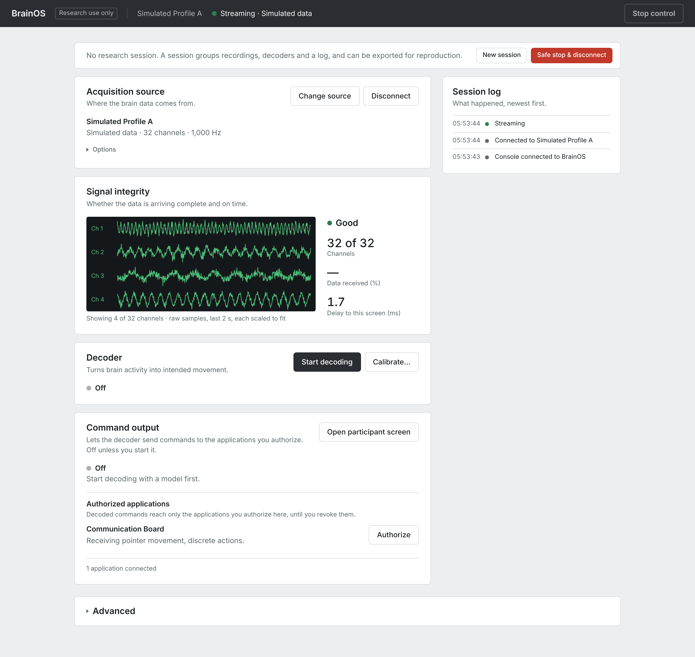
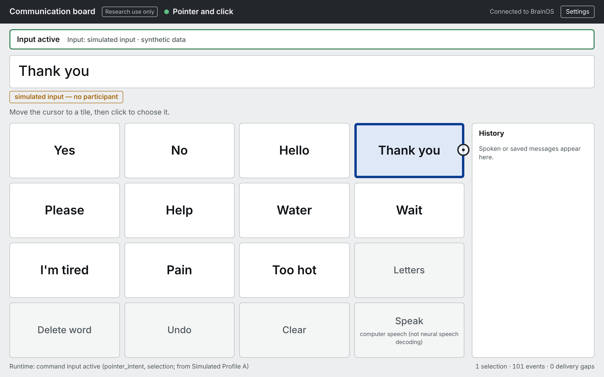

# BrainOS

**A hardware-agnostic, read-only runtime and toolkit for brain-computer interface research.**
BrainOS receives neural data from acquisition systems and recordings, shows where every piece of
data came from, runs decoders, and passes decoded commands only to applications an operator
has authorized.

[-1f2328?style=for-the-badge&logo=apple&logoColor=white)](https://github.com/arnavhiteshpatel-cloud/brainos/releases/latest/download/BrainOS-macos-arm64.dmg)
[](https://github.com/arnavhiteshpatel-cloud/brainos/releases/latest/download/BrainOS-linux-x86_64.tar.gz)
[](https://github.com/arnavhiteshpatel-cloud/brainos/releases/latest)
[](docs/GETTING_STARTED.md)

[](https://github.com/arnavhiteshpatel-cloud/brainos/actions/workflows/ci.yml)
[](https://github.com/arnavhiteshpatel-cloud/brainos/actions/workflows/hwval.yml)

> [!IMPORTANT]
> **Research software, not a medical device.** BrainOS never sends anything to a device. It has
> been tested in software and with protocol-level test sources only: **it has never been used
> with acquisition hardware or with a participant.** No implant manufacturer's device is
> supported. See [what has been validated](#what-has-been-validated) and
> [LIMITATIONS.md](LIMITATIONS.md).

<p>
  
  
</p>

## Contents

- [Download and install](#download-and-install)
- [Try it in 5 minutes](#try-it-in-5-minutes)
- [Test datasets](#test-datasets)
- [What you can do with BrainOS](#what-you-can-do-with-brainos)
- [Using BrainOS with your lab's equipment](#using-brainos-with-your-labs-equipment)
- [What has been validated](#what-has-been-validated)
- [Documentation](#documentation)
- [Developers: install from source](#developers-install-from-source)
- [Citing BrainOS](#citing-brainos)
- [Project status and contributing](#project-status-and-contributing)

## Download and install

| Your computer | Download | Install |
| --- | --- | --- |
| **Mac** with Apple Silicon (M1 or later), macOS 14 or later | [**BrainOS-macos-arm64.dmg**](https://github.com/arnavhiteshpatel-cloud/brainos/releases/latest/download/BrainOS-macos-arm64.dmg) | Open the `.dmg`, drag BrainOS to Applications. The app is not signed by Apple; the first time, Control-click it → **Open** (macOS 14) or **System Settings → Privacy & Security → Open Anyway** (macOS 15+). |
| **Linux** x86_64 (Ubuntu 22.04 or later, or similar) | [**BrainOS-linux-x86_64.tar.gz**](https://github.com/arnavhiteshpatel-cloud/brainos/releases/latest/download/BrainOS-linux-x86_64.tar.gz) | Extract it and run `BrainOS/BrainOS`. |
| Python 3.12 (any platform with Python, for developers) | Wheels on the [Releases page](https://github.com/arnavhiteshpatel-cloud/brainos/releases/latest), or [from source](#developers-install-from-source) | `pip install --find-links <folder with the wheels> "brainos[lab]"` |
| Windows | — | Not supported yet. |

When BrainOS starts, a small window shows **"BrainOS is running at http://127.0.0.1:8000"**
and the **console** opens in your web browser. BrainOS runs only on your computer.
Step-by-step instructions with screenshots: **[Getting started](docs/GETTING_STARTED.md)**.
Every download is listed with its SHA-256 checksum in `SHA256SUMS.txt` on the release page.

## Try it in 5 minutes

No data or hardware needed:

1. Click **Connect a source**, then **Connect** next to **Simulated Profile A** (synthetic data,
   labelled as such everywhere).
2. Click **Open participant screen**: the communication board opens in its own window.
3. Open **Advanced → Simulator controls**, drag the dot in the pad to move the board's cursor,
   and click **Select** to choose a word.
4. Try **Advanced → Simulator controls → Link drop** and watch BrainOS reconnect on its own.

Then replay real human recordings: [Getting started, section 4](docs/GETTING_STARTED.md#4-replay-real-human-recordings-10-minutes).

## Test datasets

BrainOS replays public recordings from people with implanted electrodes. Every file is checked
against a pinned SHA-256 checksum; replays are always labelled **Offline Replay**. The files are
downloaded from the original archives, never redistributed here.

| Dataset | What it contains | Size | License | How to get it |
| --- | --- | --- | --- | --- |
| **FALCON H1** ([DANDI 000954](https://dandiarchive.org/dandiset/000954/draft)) | Intracortical spiking from two 96-channel motor-cortex arrays (176 channels, 20 ms bins) with cued reach-and-grasp kinematics; one participant | 2 files, 8.7 MiB | CC-BY-4.0 + Data Use Agreement | **In the browser:** [file 1](https://api.dandiarchive.org/api/assets/e40a2eca-883d-4c80-81e3-4203a49506b5/download/), [file 2](https://api.dandiarchive.org/api/assets/98f1e471-ad68-4006-b090-9a3e347852e6/download/) → put them in the [datasets folder](docs/GETTING_STARTED.md#41-intracortical-spiking-falcon-h1-about-9-mb-no-account-needed) |
| **T15 cursor + click** ([Dryad](https://datadryad.org/dataset/doi:10.5061/dryad.prr4xgxzq)) | Speech-motor-cortex recordings (256 electrodes) of a participant controlling a cursor and clicking, with the original decoders' outputs | 4 files, 92 MiB (demo) | CC0 | **In the browser** from the Dryad page (free account) → [datasets folder](docs/GETTING_STARTED.md#42-cursor-control-and-click-t15-about-96-mb-free-dryad-account) |
| **AJILE12 ECoG** ([DANDI 000055](https://dandiarchive.org/dandiset/000055/0.220127.0436)) | Raw ECoG (64-electrode grid, 500 Hz) with pose and curated reach events; one participant | 2 slices, ~157 MiB | CC-BY-4.0 | One command: `brainos dataset ajile12` ([how](docs/GETTING_STARTED.md#43-human-ecog-ajile12-about-157-mb)) |
| **Simulated Profile A / B** | Synthetic signals and intents built into BrainOS (not brain data) | — | — | Built in |

Details, verification and known pitfalls of each dataset: [DATASETS.md](docs/DATASETS.md),
[ECOG.md](docs/ECOG.md), [CURSOR_CLICK.md](docs/CURSOR_CLICK.md).

## What you can do with BrainOS

| | Feature | Learn more |
| --- | --- | --- |
| 📡 | **Connect sources**: simulated devices, recorded human datasets, live streams over Lab Streaming Layer (LSL) and the Open Ephys GUI, and plugins (BrainFlow, BCI2000, your own) | [User guide: sources](docs/USER_GUIDE.md#connecting-a-source) |
| ✅ | **Check signal integrity**: channels present, data received, delay, gaps and reconnects, all counted and shown | [User guide: signal integrity](docs/USER_GUIDE.md#signal-integrity) |
| 🏷️ | **Know where every event came from**: simulated, recorded, live, decoded (by which model) — the provenance travels with the data into recordings and exports | [Architecture](ARCHITECTURE.md) |
| ⚙️ | **Process signals**: streaming filters, threshold crossings, band power, ECoG high-gamma, as presets | [User guide: decoding](docs/USER_GUIDE.md#decoding) |
| 🧠 | **Decode**: built-in decoders (ridge, Kalman, click, LDA), calibration from your recordings with held-out evaluation, or your own model (ONNX, scikit-learn, PyTorch) in an isolated process | [User guide: decoding](docs/USER_GUIDE.md#decoding), [Decoder SDK](docs/DECODER_SDK.md) |
| 🛑 | **Control applications safely**: decoded commands reach only applications you authorize; one click stops them | [User guide: command output](docs/USER_GUIDE.md#command-output-and-applications), [Control bridge](docs/CONTROL_BRIDGE.md) |
| 💬 | **Communication board**: a participant screen with five input methods (pointer and click, dwell, navigation, direct selection, scanning) | [Applications](docs/APPLICATIONS.md) |
| 🔴 | **Record and replay**: crash-safe recordings that replay through the same pipeline | [User guide: recording](docs/USER_GUIDE.md#recording-and-replay) |
| 🗂️ | **Research sessions**: a session log, export bundles and `brainos reproduce` to re-run an evaluation elsewhere | [User guide: sessions](docs/USER_GUIDE.md#research-sessions-export-and-reproduction) |
| 🔬 | **Verify your acquisition**: compare what BrainOS received with what LabRecorder or the Open Ephys Record Node recorded, sample by sample | [Hardware validation](docs/HARDWARE_VALIDATION.md) |
| 🧩 | **Extend it**: source plugins, decoder plugins, Python and TypeScript SDKs for applications | [Developers](docs/DEVELOPERS.md) |

## Using BrainOS with your lab's equipment

BrainOS connects to acquisition software you already use; it only receives data.

| Your acquisition system | How BrainOS connects | Guide |
| --- | --- | --- |
| Anything with a **Lab Streaming Layer** outlet (amplifier vendors' LSL apps, OpenBCI GUI, BCI2000/OpenViBE LSL output, task software) | built in | [Lab guide §2](docs/LAB_GUIDE.md#2-connect-an-lsl-source) |
| **Open Ephys GUI** with the ZMQ Interface plugin | built in | [Open Ephys](docs/OPEN_EPHYS.md), [Lab guide §3](docs/LAB_GUIDE.md#3-connect-open-ephys) |
| A board supported by **BrainFlow** | plugin (Python installation) | [Ecosystems](docs/ECOSYSTEMS.md) |
| **BCI2000** | plugin (included in the app) | [Ecosystems](docs/ECOSYSTEMS.md) |
| Something else | write a source plugin | [Adapter SDK](docs/ADAPTER_SDK.md) |

Start with [Lab setup](docs/LAB_SETUP.md) (network layout, ports, configuration), then follow
the [first lab session protocol](docs/FIRST_LAB_SESSION.md). Before trusting BrainOS with your
equipment, verify it: the **[hardware validation protocol](docs/HARDWARE_VALIDATION.md)** and the
`brainos-hwval` toolkit compare BrainOS's recording with your reference software's recording of
the same signal and report PASS, FAIL or INCONCLUSIVE for each check.

## What has been validated

BrainOS uses four validation levels ([details](docs/VALIDATION_LEVELS.md)). **Nothing has reached
level 3 or 4.**

| Level | Meaning | Reached by |
| --- | --- | --- |
| 1. Software-implemented | Code with unit tests on constructed inputs | every component |
| 2. Protocol-tested | Exercised over the real protocol stack (real LSL, real ZMQ), against official reference software where it exists | LSL and Open Ephys adapters (including comparisons with the real LabRecorder and Open Ephys GUI), the BrainFlow and BCI2000 plugins, the streaming pipeline (recorded human data over real LSL) |
| 3. Hardware-verified | Real acquisition hardware, checked against an independent reference | **nothing yet** |
| 4. Human-participant validated | Closed-loop use with a participant under an approved protocol | **nothing yet** |

Decoding results reported in this repository are **offline and open loop** on public recordings
([DECODING.md](docs/DECODING.md), [ECOG_DECODING.md](docs/ECOG_DECODING.md),
[CURSOR_CLICK.md](docs/CURSOR_CLICK.md)). Nobody has controlled anything or communicated through
BrainOS.

## Documentation

| If you are… | Start with |
| --- | --- |
| **New to BrainOS** | [Getting started](docs/GETTING_STARTED.md) → [User guide](docs/USER_GUIDE.md) → [FAQ](docs/FAQ.md) → [Glossary](docs/GLOSSARY.md) |
| **Setting up a lab** | [Lab setup](docs/LAB_SETUP.md) → [Lab guide](docs/LAB_GUIDE.md) → [First lab session](docs/FIRST_LAB_SESSION.md) → [Hardware validation](docs/HARDWARE_VALIDATION.md) |
| **Evaluating the science** | [Validation levels](docs/VALIDATION_LEVELS.md), [Limitations](LIMITATIONS.md), [Datasets](docs/DATASETS.md), [Decoding results](docs/DECODING.md), [Cursor + click](docs/CURSOR_CLICK.md), [Neural-to-communication](docs/NEURAL_COMMUNICATION.md), [ECoG](docs/ECOG.md) |
| **A developer** | [Developers](docs/DEVELOPERS.md), [SDK](docs/SDK.md), [Adapter SDK](docs/ADAPTER_SDK.md), [Decoder SDK](docs/DECODER_SDK.md), [Architecture](ARCHITECTURE.md), [Guided demos](docs/DEMOS.md), [Contributing](CONTRIBUTING.md) |

All documents, grouped by topic: **[docs/README.md](docs/README.md)**. Problems:
[Troubleshooting](docs/TROUBLESHOOTING.md). Security: [SECURITY.md](SECURITY.md).

## Developers: install from source

You need [uv](https://docs.astral.sh/uv/) (it installs Python 3.12) and Node 20 or newer; on a
Mac, `brew install uv node`.

```bash
git clone https://github.com/arnavhiteshpatel-cloud/brainos.git
```
```bash
cd brainos
```
```bash
make setup
```
```bash
make run
```

Open http://127.0.0.1:8000. Useful commands:

| Command | What it does |
| --- | --- |
| `make dataset`, `make model` | Download and verify the FALCON demo files; train the demo decoder |
| `make dataset-ecog`, `make dataset-t15` | The ECoG and cursor + click demo data (T15 needs a [Dryad token](docs/DEMOS.md#cursor--click-data-driving-the-communication-board-t15)) |
| `make test`, `make lint` | Backend, package and console tests; ruff, mypy (strict), TypeScript |
| `make e2e`, `make e2e-communication` | Real-browser tests (run `make e2e-setup` once) |
| `make test-hwval` | The acquisition-verification toolkit with the real LabRecorder and Open Ephys GUI (Linux x86_64) |
| `make bench`, `make bench-live` | Measured performance on this machine |
| `make dev` | Backend with reload + console with hot reload (http://127.0.0.1:5173) |

Guided demos with the terminal (live LSL/Open Ephys test publishers, decoders, ECoG, the
communication-board end-to-end test): [docs/DEMOS.md](docs/DEMOS.md).

<details>
<summary>Repository layout</summary>

```
backend/src/brainos/   runtime, adapters (simulated, replay, NWB, LSL, Open Ephys, plugins),
                       processing, decoding, datasets, server (REST + WebSocket), SDK
backend/tests/         pytest suite
frontend/src/          console, communication board, TypeScript SDK
packages/              adapter SDK, decoder SDK, BrainFlow + BCI2000 plugins,
                       brainos-certify, brainos-hwval
packaging/             desktop app build (PyInstaller) and smoke tests
compat/                generated compatibility registry
contracts/             JSON Schema of the event envelope
e2e/                   real-browser tests (Playwright)
docs/                  documentation
```
</details>

## Citing BrainOS

Use GitHub's **Cite this repository** button (from [CITATION.cff](CITATION.cff)), and cite every
dataset you use: each dataset's citation is shown in the console (**Advanced → Acquisition
details**) and listed in [DATASETS.md](docs/DATASETS.md).

## Project status and contributing

BrainOS is in active development; see the [changelog](CHANGELOG.md) and the
[roadmap](ROADMAP.md). Questions, bug reports and hardware-validation results are welcome as
[issues](https://github.com/arnavhiteshpatel-cloud/brainos/issues/new/choose); read
[CONTRIBUTING.md](CONTRIBUTING.md) before opening a pull request. The design documents are
[PRODUCT.md](PRODUCT.md), [ARCHITECTURE.md](ARCHITECTURE.md) and [MVP_SPEC.md](MVP_SPEC.md).

*BrainOS is an internal project name.*
