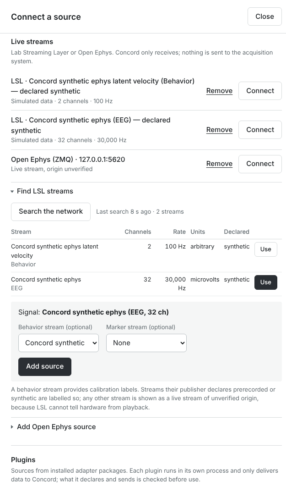
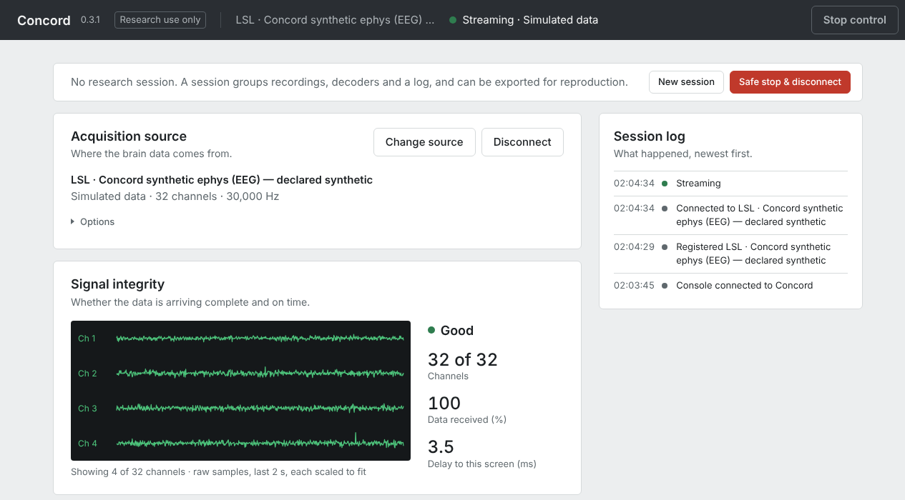
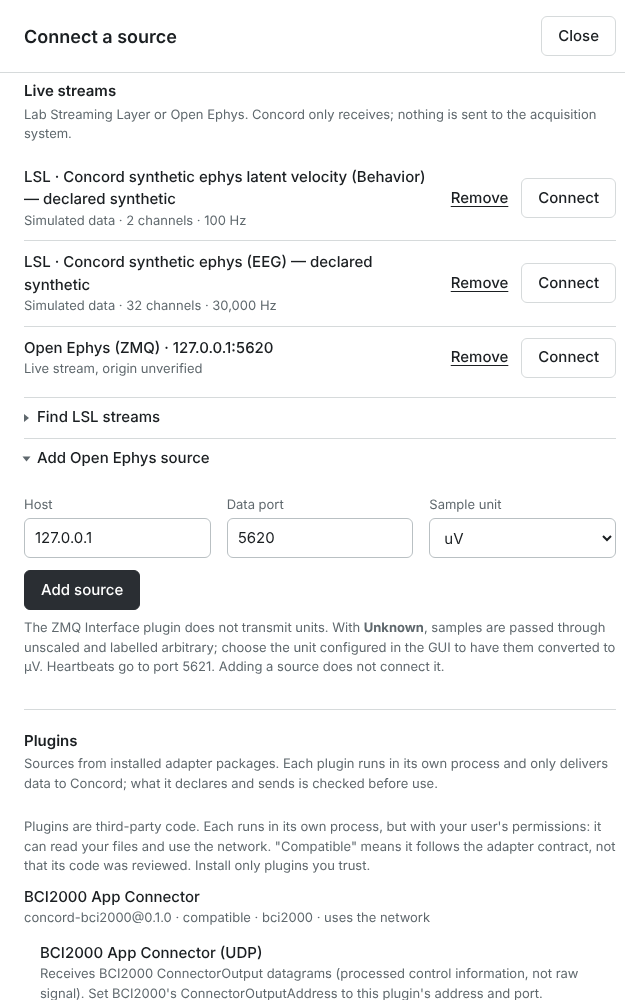
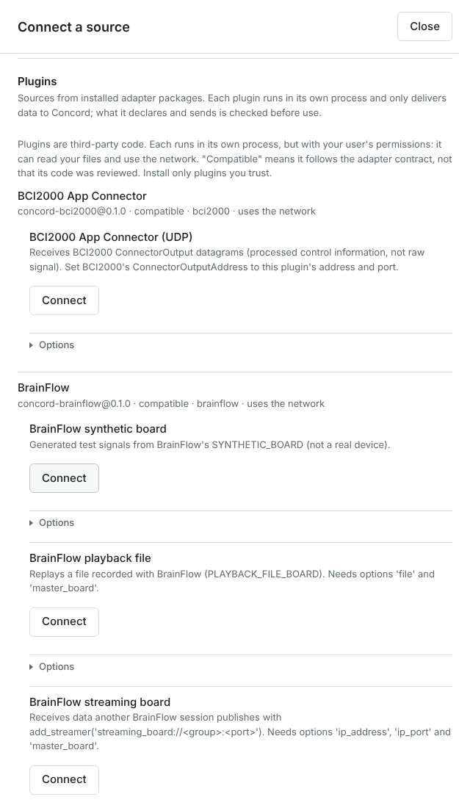

# Connect your own equipment to Concord

This guide shows how to connect the acquisition equipment your lab already uses to Concord, step
by step. It is written for researchers; you do not need to program. It describes **Concord
0.3.1** (the console's title bar shows the version next to **Concord**).

**Before you start, two facts:**

- **Concord only receives.** It never sends anything to an amplifier, a headstage, an
  acquisition program or an implant. The one documented exception is the Open Ephys
  *heartbeat*: a short "still listening" message to the Open Ephys GUI's ZMQ Interface plugin
  (section 4.2).
- **Nothing has been tested with acquisition hardware or with a participant yet.** Every route
  below was tested in software, with test streams that use the real protocols. Your first
  session with real equipment is therefore a **validation session**: it checks whether Concord
  receives exactly what your equipment produces ([section 7](#7-check-that-concord-receives-exactly-what-you-record),
  [validation levels](VALIDATION_LEVELS.md)).

Words in this guide are explained the first time they appear. The [glossary](GLOSSARY.md) and
[How Concord works](CONCEPTS.md) explain the rest.

## Contents

1. [What Concord can connect to, and how to choose](#1-what-concord-can-connect-to-and-how-to-choose)
2. [Before you start](#2-before-you-start)
3. [Rehearse without hardware](#3-rehearse-without-hardware)
4. [Connect your equipment, route by route](#4-connect-your-equipment-route-by-route):
   [LSL](#41-lab-streaming-layer-lsl) ·
   [Open Ephys](#42-open-ephys-gui) ·
   [BrainFlow](#43-brainflow-boards) ·
   [BCI2000](#44-bci2000) ·
   [your own device](#45-your-own-device-a-source-plugin)
5. [After connecting: record, calibrate, decode, control](#5-after-connecting-record-calibrate-decode-control)
6. [Troubleshooting](#6-troubleshooting)
7. [Check that Concord receives exactly what you record](#7-check-that-concord-receives-exactly-what-you-record)

---

## 1. What Concord can connect to, and how to choose

Concord connects to the **software** that runs your equipment, not to the equipment itself.
Find your setup in the left column:

| My lab uses… | Route in Concord | What Concord receives | Needs |
| --- | --- | --- | --- |
| Acquisition software with a **Lab Streaming Layer (LSL) outlet**: an amplifier maker's LSL app, the OpenBCI GUI's LSL output, BCI2000 or OpenViBE LSL output, your own task software | **LSL**, built in ([4.1](#41-lab-streaming-layer-lsl)) | The stream as your software publishes it: raw signal, or binned spike counts; plus a behavior stream and a marker stream you attach | Nothing extra |
| The **Open Ephys GUI** (version 0.6 or later) | **Open Ephys**, built in ([4.2](#42-open-ephys-gui)) | Raw continuous signal, TTL events, and spikes the GUI detected (counted per electrode by Concord) | The GUI's **ZMQ Interface** plugin |
| A board that **BrainFlow** supports | **BrainFlow plugin** ([4.3](#43-brainflow-boards)) | Raw signal of the board's main sensors | The Python installation (not in the desktop app) |
| **BCI2000** | **BCI2000 plugin** ([4.4](#44-bci2000)) | BCI2000's **control signal** (the output of its own signal processing) and selected task states. **Not raw signal.** | Included in the desktop app |
| Recorded files (NWB) | **Recorded human data (offline replay)** | A replay of the file, labelled *Offline Replay* | See [Getting started](GETTING_STARTED.md) |
| Anything else | Publish it over LSL if your software can, or a **source plugin** written by a developer ([4.5](#45-your-own-device-a-source-plugin)) | What the plugin declares | A developer, once |

Some terms:

- **Lab Streaming Layer (LSL)** is a widely used way for lab programs to share live data over
  the local network. A program offers data as an **outlet**. Each outlet is a **stream**, with a
  name, a type, a channel count, a sampling rate and, ideally, a stable identifier
  (**source_id**) and a description of each channel.
- **Raw signal** is the samples as acquired, for example microvolts per channel at 30 kHz.
- **Features** are numbers computed from the signal for each short time bin, such as spike
  counts per 20 ms. Concord can compute them for you (section 5.2), or your software can send
  them already binned.
- A **control signal** (or decoder output) is what a decoder made of the brain activity: for
  example, how fast the cursor should move. BCI2000 sends this, not the brain signal itself.
- A **source plugin** is an add-on that teaches Concord a new kind of source. Each plugin runs
  in its own process, and it can only deliver data to Concord.

### What Concord does not do

- **It sends nothing to your equipment.** It does not set gains, filters, channel selections or
  impedance checks. Configure those in your acquisition software, as you do today. (The only
  exception is the Open Ephys heartbeat, section 4.2.)
- **No implant is supported.** Concord has no route to any implanted device, and none should be
  assumed to work. It connects to acquisition software on a lab network.
- **It does not know where data really comes from.** LSL and Open Ephys cannot tell a real
  amplifier from a file being played back or a simulator. Unless the sending program declares
  that the stream is synthetic or prerecorded, Concord shows it as **Live stream, origin
  unverified**.
- **It never guesses units.** If a stream does not say its channels are in volts (or µV, mV,
  nV), the values are passed through unchanged and labelled **arbitrary**.
- **It connects one source at a time.** One source can bring a signal stream plus a behavior
  stream and a marker stream (LSL), or several streams from one plugin.

---

## 2. Before you start

### 2.1 What you need

| | |
| --- | --- |
| **Concord 0.3.1** | The **desktop app** (Mac with Apple Silicon: `Concord-macos-arm64.dmg`; Linux: `Concord-linux-x86_64.tar.gz`) covers LSL, Open Ephys and BCI2000. For **BrainFlow**, use the **Python installation** (below). Installing the app: [Getting started §1](GETTING_STARTED.md#1-install-and-open-concord). |
| **Your acquisition software** | Installed and able to stream, on the same computer as Concord or on the same lab network |
| **A known test signal** | For the validation session: a signal generator or your amplifier's test-signal mode, never a person ([FIRST_LAB_SESSION.md](FIRST_LAB_SESSION.md)) |
| **For calibrating a decoder** | A **behavior stream**: what the participant is asked to do, over time, for example the cued cursor direction from your task software. Concord uses it as labels to fit a decoder (section 5.1). |
| **For checking the data** | Your software's own recorder: LabRecorder for LSL, the Record Node for Open Ephys (section 7) |

#### The Python installation (needed for BrainFlow; optional otherwise)

None of Concord's packages is on PyPI. They are files (`.whl`, "wheels") attached to each
GitHub release. You need Python 3.12 or later.

1. Open the [latest release](https://github.com/arnavhiteshpatel-cloud/concord/releases/latest)
   and download **every** `.whl` file into one empty folder, for example
   `~/Downloads/concord-wheels`. From 0.3.1 they are: `concordos`, `concord_adapter_sdk`,
   `concord_decoder_sdk`, `concord_hwval`, `concord_certify`, `concord_brainflow` and
   `concord_bci2000`.
2. In a terminal, create a separate Python environment for Concord and install it with the
   plugins you need (here BrainFlow and BCI2000):

   ```bash
   python3.12 -m venv ~/concord-env
   ```

   ```bash
   ~/concord-env/bin/pip install --find-links ~/Downloads/concord-wheels "concordos[lab]" concord-brainflow concord-bci2000
   ```

   `--find-links` tells pip to take Concord's packages from your folder. Other packages,
   including `brainflow` itself, come from PyPI, so this step needs internet access.
3. Check the installation:

   ```bash
   ~/concord-env/bin/concord doctor
   ```

   **What you should see:** `0 failed`. The report lists **BrainFlow (optional)** with its
   version and, under *Source plugins*, each plugin. A plugin shows *not checked* while a
   Concord that started before you installed it is running; restart Concord (or use
   **Search again**, section 4.3) and it shows *compatible*.
4. Start Concord: `~/concord-env/bin/concord start` opens the console at
   http://127.0.0.1:8000. Stop it with `~/concord-env/bin/concord stop`.

Quit the desktop app before starting the Python installation: two copies of Concord cannot share
port 8000 or the same data folder. (If you activate the environment with
`source ~/concord-env/bin/activate`, you can type `concord …` instead of the full path.)

### 2.2 Network and ports

The recommended layout: your acquisition computer stays as it is; Concord runs on a second
computer on the same lab network; the participant screen is a second monitor of the Concord
computer. Concord and your acquisition software can also run on one computer, which is the
easiest way to start.

| Route | Direction | Allow on the firewall | Notes |
| --- | --- | --- | --- |
| LSL | acquisition → Concord | UDP 16571 (discovery, multicast) and TCP/UDP 16572–16603 on the acquisition computer | Both computers on the same subnet, with multicast allowed. If discovery cannot cross your network, list the acquisition computer in liblsl's `KnownPeers` setting (`lsl_api.cfg`). |
| Open Ephys | Concord connects to the GUI computer | TCP data port (default 5556) and data port + 1 (5557) on the GUI computer | Concord subscribes to the data; it sends only the heartbeat. |
| BCI2000 | BCI2000 → Concord | inbound UDP 20321 (default) on the Concord computer | BCI2000's `ConnectorOutputAddress` points to the Concord computer. |
| BrainFlow | depends on the board | USB/serial, Bluetooth or Wi-Fi, as BrainFlow's documentation says for your board | The board is connected to the Concord computer. |
| Concord console | this computer only | none | Concord listens only on 127.0.0.1. To see the console from another computer, use an SSH tunnel ([SECURITY.md](SECURITY.md)). |

Keep all computers on the same time server (NTP). Full details:
[Lab setup §2](LAB_SETUP.md#2-network-topology).

### 2.3 Your first session is a validation session

Before Concord is used in any experiment, check it against your equipment without a participant.
[FIRST_LAB_SESSION.md](FIRST_LAB_SESSION.md) is the checklist for that day: what to decide in
advance, what to compare, how to rehearse every stop procedure, and what evidence to keep.
[HARDWARE_VALIDATION.md](HARDWARE_VALIDATION.md) is the detailed comparison procedure with the
`concord-hwval` toolkit (section 7). Until those checks pass for your setup, treat everything
Concord shows as unverified.

---

## 3. Rehearse without hardware

`concord publish` starts a **test stream** that speaks the real protocol, as your acquisition
software would. Use it to learn the console before connecting real equipment. Each test stream
declares itself **synthetic** (generated) or **prerecorded** (a recording played back), and the
console labels it so. The Open Ephys protocol cannot carry that declaration, so the Open Ephys
test stream is shown as *Live stream, origin unverified* ([OPEN_EPHYS.md, Limitations](OPEN_EPHYS.md#limitations)).

| Test stream | What it is |
| --- | --- |
| `lsl-ephys` | Synthetic broadband signal, 32 channels at 30 kHz in µV, over LSL, plus a 2-channel **behavior stream** ("latent velocity") that the signal is tuned to. Good for practising calibration. |
| `falcon <file.nwb>` | **Real recorded human data** (a FALCON H1 block, DANDI 000954) played over LSL as three streams: spike counts of 176 channels per 20 ms, the recorded movement (7 dimensions), trial markers. Declared prerecorded. |
| `openephys` | Synthetic broadband signal, 16 channels at 30 kHz, in the Open Ephys ZMQ Interface format. |

### 3.1 Start a test stream

Concord must be running, with the console open. Open a **terminal** (Mac: the Terminal app;
Windows: PowerShell; Linux: any terminal) and run the command for your installation. Keep the terminal open: the
stream runs until you stop it.

| You installed | Command |
| --- | --- |
| Mac app | `/Applications/Concord.app/Contents/MacOS/Concord publish lsl-ephys` |
| Windows app | `.\concord-cli.exe publish lsl-ephys` (in the `Concord` folder: `cd $HOME\Downloads\Concord-windows-x86_64\Concord` first) |
| Linux bundle | `./Concord/Concord publish lsl-ephys` (from the folder that contains the `Concord` folder) |
| Python installation | `concord publish lsl-ephys` |

For the other test streams, replace `lsl-ephys` with:

- `falcon "<data folder>/datasets/<file>.nwb" --loop`. `<data folder>` is the folder shown in
  **Advanced → Stored data → Data directory**; the FALCON files are the ones you put in its
  `datasets` folder ([Getting started §4](GETTING_STARTED.md#4-replay-a-real-human-recording-falcon-h1)).
  If you downloaded them with the `dataset` command, they are in `datasets/dandi-000954/`. Keep
  the quotes if the path contains spaces (the Mac's `Application Support` does). `--loop`
  starts the file again at its end.
- `openephys --port 5560` for the Open Ephys test stream. Choose a port other than 5556 if the
  Open Ephys GUI runs on this computer.

**What you should see in the terminal:** one line saying what is being sent, for example
`LSL synthetic ephys: source_id=concord-synthetic-ephys 32 ch @ 30000 Hz`,
`FALCON over LSL: prefix=falcon-h1-19250108t111022 (…), declared prerecorded` or
`Open Ephys ZMQ test publisher on tcp://127.0.0.1:5560 (heartbeat 5561), 16 ch @ 30000 Hz, synthetic`.
Lines from liblsl marked `INFO` or `WARN` (for example about IPv6) are normal.

Useful options: `--channels 64`, `--rate 1000`, `--unit none` (channels without a unit, to see
how Concord shows *arbitrary* units), `--seconds 300` (stop by itself), `--speed 4` (FALCON
four times faster). `… publish lsl-ephys --help` lists them all.

### 3.2 Connect it in the console

Follow the same steps as for real equipment: [4.1](#41-lab-streaming-layer-lsl) for
`lsl-ephys` and `falcon`, [4.2](#42-open-ephys-gui) for `openephys` (Host `127.0.0.1`, your
port). With the test streams the title bar reads:

| Test stream | Title bar after **Connect** |
| --- | --- |
| `lsl-ephys` | **Streaming · Simulated data** |
| `falcon` | **Streaming · Recorded data, streamed replay (declared)** |
| `openephys` | **Streaming · Live stream, origin unverified** (the protocol cannot declare it) |

Then try section 5: record, calibrate a decoder from the `lsl-ephys` stream and its latent
velocity, decode with it, and let it drive the communication board. That is a complete
rehearsal of a lab session.

### 3.3 Stop a test stream

Disconnect it in the console first (**Disconnect**). Then press **Ctrl-C** in its terminal. The
terminal prints a summary (`pushed … samples per channel`, `published … bins` or
`sent … blocks, … messages`) and the stream disappears from the network.

If you stop the stream while Concord is still connected, Concord behaves as it would with a
real outlet that went away. The title bar shows **Source link lost, reconnecting**; after about
17 seconds of failed attempts it shows **Source stopped with an error**. Click **Reset** in the
*Acquisition source* row.

---

## 4. Connect your equipment, route by route

All routes start in the console: **Acquisition source → Connect a source**. If a source is
already connected, the button reads **Change source** and the buttons in the list read
**Switch**.

### 4.1 Lab Streaming Layer (LSL)

#### What your LSL outlet should provide

Most of this is set in your acquisition software's LSL settings. You can check all of it in the
console without writing code (step 2 below).

1. **Numbers at a regular sampling rate**, for the stream that carries the brain signal.
   - A stream of **text** can only be a **marker stream** (events such as "trial 3 start").
   - A numeric stream with an **irregular** rate (nominal rate 0) cannot be the signal.
2. **A description of each channel**, with label and unit. Concord converts to µV only if
   **every** channel declares a voltage unit (`microvolts`, `µV`, `uV`, `mV`, `V`, `nV`, or
   these words spelled out). Otherwise the data is shown and recorded as **arbitrary** units.
3. **A stable source_id**: the stream's identifier, kept the same each time the software starts.
   Concord needs it to reconnect after your software restarts, and you need it to tell apart
   two streams with the same name.
4. **Pre-binned spike counts** (instead of raw voltage) are recognised when the stream type is
   `SpikeCounts` or `BinnedSpikes`, or when the stream's description declares
   `<concord><feature>spike_count</feature></concord>`. One sample is one bin.
5. Optional: a program that plays back a file or generates test data should declare it in the
   stream description (`<concord><prerecorded>true</prerecorded></concord>` or
   `<synthetic>true</synthetic>`), so the console labels it correctly. Without a declaration
   every stream is shown as *Live stream, origin unverified*.

#### Steps

1. **Start streaming** in your acquisition software (and your task software, if it publishes
   cues or markers).
2. In the console: **Connect a source** → *Live streams* → **Find LSL streams** → **Search the
   network**. Concord listens for about 1.5 seconds.

   **What you should see:**
   - a line *Last search 2 s ago · 3 streams*, and a table with a row per stream: *Stream*
     (name and type), *Channels*, *Rate* (or *irregular*), *Units* (or *channels not
     described*), *Declared* (*synthetic*, *prerecorded*, *declared neither* or *no
     declaration*);
   - **Use** next to every stream that can be the signal. Other rows give the reason instead,
     for example *… carries strings; use it as a marker stream*;
   - at the same time, every stream that can be a signal appears at the top of *Live streams*
     as an entry such as *LSL · MyAmp EEG (EEG)*, with **Remove** and **Connect**. Such an entry
     is the stream alone, without behavior or marker streams.

   Hover over a row to see the computer it comes from and its `source_id`. If nothing is found,
   see [Troubleshooting](#61-lsl).
3. If you need only the signal, skip to step 6. To attach a behavior or marker stream, click
   **Use** next to the stream that carries the brain signal.

   **What you should see:** *Signal: MyAmp EEG (EEG, 32 ch)* and two menus.
4. Choose **Behavior stream (optional)**, for example your task's cue stream, and **Marker
   stream (optional)**, a text stream of events. Concord puts both on the signal stream's clock
   (liblsl time correction), so labels and brain data line up.
   - The menus show only names. If two streams have the same name, give them different names in
     your software, or stop the one you do not want, then search again.
   - A marker stream must carry text. Choosing a numeric stream there gives
     `protocol_error: marker stream must carry strings (LSL 'Markers' convention)`.
5. Click **Add source**.

   **What you should see:** the form closes and the session log says *Registered LSL · …*.
   **No new line appears in the list:** the existing entry of that signal stream now carries the
   attachments. You can confirm them after connecting (step 7).

   

6. Click **Connect** on the signal stream's entry (**Switch** if another source is connected).

   **What you should see:**
   - the title bar shows the stream's name and **Streaming · Live stream, origin unverified**
     for real equipment (*Simulated data* or *Recorded data, streamed replay (declared)* for
     streams that declare it);
   - under **Signal integrity**: four live traces; the verdict **Good**; **Channels** *32 of 32*;
     **Data received (%)** *100*; **Delay to this screen (ms)**, a few milliseconds on one
     computer.

   

7. Open **Advanced → Acquisition details** (at the bottom of the console) and compare with your
   acquisition software's own display.

   | Line | Meaning |
   | --- | --- |
   | *Source*, *Library* | The stream Concord opened and the liblsl version |
   | *Interpreted as* | `raw` (signal samples) or `spike_counts` (pre-binned counts) |
   | *Unit* | `uV`, or `arbitrary` if not every channel declared a voltage unit |
   | *Runtime (since start)* | Reconnect attempts and successes, link errors |
   | *chunks*, *samples* | What has arrived so far |
   | *gaps*, *estimated missing samples* | Breaks in the timestamps and how many samples they hide. LSL has no sample numbers, so missing samples are estimated from timestamps. |
   | *lost*, *stalls* | Data lost by liblsl; times nothing arrived for a while |
   | *discarded while paused* | Samples dropped while you paused the source (**Options → Pause**) |
   | *Role* table | One row per stream: *signal*, *behavior*, *markers*, with samples received, gaps, the time correction applied and the last timestamp. **Your attachments appear here.** |

The **Signal integrity** verdicts: **Good**; **Gaps detected** (a loss counter rose in the last
10 s); **No signal** (no signal or feature data in the last 2 s); **Paused**; **Interrupted —
reconnecting**.

**If your software restarts:** the title bar shows **Source link lost, reconnecting**. Concord
tries three times, for about 17 seconds in all. If the stream comes back with the same
`source_id` in that time, it continues by itself. Otherwise it shows **Source stopped with an
error**: click **Reset**, start your software, then connect the entry again (search again if it
has a new `source_id`).

Entries stay in the list after their stream stops; **Remove** clears them. Concord forgets all
registered live sources when it restarts, so search again after a restart.

### 4.2 Open Ephys GUI

Concord reads the stream that the Open Ephys GUI's **ZMQ Interface** plugin publishes:

- the continuous data, as raw signal;
- TTL events, as markers (*recording annotations*);
- spikes that the GUI detected, as spike counts per electrode in 20 ms bins (Concord does the
  counting, not the detection).

#### In the Open Ephys GUI

1. Install the **ZMQ Interface** plugin from the GUI's Plugin Installer, if it is not there.
2. Add **ZMQ Interface** to the signal chain **after** your source, and after any filter or spike
   detector whose output you want Concord to receive.
3. In the plugin's editor: choose the **stream**, set the **Data Port** (default 5556; the
   plugin also uses port + 1 for heartbeats), and **select the channels** to send. Send one kind
   of channel per ZMQ Interface (for example headstage channels only, not ADC/AUX channels with
   them), because Concord applies one unit to all of them.
4. Start acquisition. If the GUI runs on another computer, allow TCP 5556 and 5557 on it.

#### In the console

1. **Connect a source** → *Live streams* → **Add Open Ephys source**.
2. Fill in:

   | Field | What to enter |
   | --- | --- |
   | **Host** | The computer running the Open Ephys GUI: `127.0.0.1` if it is this computer, otherwise its address (for example `192.168.1.20`) |
   | **Data port** | The plugin's Data Port (default `5556`) |
   | **Sample unit** | The plugin does not send units. Choose the unit your GUI shows for these channels: **uV** for headstage/electrode channels in most setups, or **mV** / **V**. Concord converts to µV. If unsure, choose **Unknown (pass through unscaled)**: values are passed through and labelled *arbitrary*. |

3. Click **Add source**. Adding does not connect.

   **What you should see:** a new entry *Open Ephys (ZMQ) · 127.0.0.1:5556*, labelled *Live
   stream, origin unverified*, with **Remove** and **Connect**.

   

4. Click **Connect**. Concord listens for about half a second to learn the stream's layout
   (stream name, rate, channels), then starts.

   **What you should see:** the title bar reads **Streaming · Live stream, origin unverified**,
   always: the protocol cannot tell an acquisition board from the GUI's File Reader. *Signal
   integrity* shows the traces, **Good**, the channel count and *Data received* 100 %. The ZMQ
   Interface lists Concord among its clients.
5. Check **Advanced → Acquisition details**: *Endpoint*; *Stream* (the GUI's stream name);
   *Rate*; *Unit* (for example *configured uV → emitted uV*); *Heartbeat* *ok*; *Last message #*;
   *Clock offset*. The counters include *messages*, *data messages*, *ttl events*, *spikes*,
   *missed messages*, *missing samples* and *incomplete blocks*. Any loss counter above 0 means
   data was lost and Concord counted it; a block with a missing channel is discarded whole, never
   filled in.

**The heartbeat** is the one thing Concord sends: a small message with Concord's name and a
random id, to the plugin's port + 1, so that the plugin keeps Concord in its client list. It
goes to the ZMQ Interface plugin, never to the acquisition board.

If you change the stream, sampling rate or channel selection in the GUI, or restart
acquisition, Concord reconnects and learns the layout again (the session log says so). More:
[OPEN_EPHYS.md](OPEN_EPHYS.md).

### 4.3 BrainFlow boards

[BrainFlow](https://brainflow.org) is a library that reads many research and consumer biosensing
boards (EEG, EMG, ECG). Concord's BrainFlow plugin uses BrainFlow's official interface and only
reads; it never sends settings or commands to a board. No physical board has been connected to
Concord yet: units, channel types and sample counters come from BrainFlow's own descriptions of
each board.

1. **Install** the Python installation with the BrainFlow plugin
   ([2.1](#the-python-installation-needed-for-brainflow-optional-otherwise)). The desktop app does
   not include BrainFlow.
2. **Start Concord** (`concord start`). If it was already running, open **Connect a source →
   Plugins** and click **Search again**.

   **What you should see** under **Plugins**: *BrainFlow*, *concord-brainflow@0.1.0 ·
   compatible · brainflow · uses the network*, with four entries: **BrainFlow synthetic board**,
   **BrainFlow playback file**, **BrainFlow streaming board**, **Configure a BrainFlow board**.
   BrainFlow cannot detect boards, so these are always listed; none of them means a board was
   found.

   

3. **Try the synthetic board first:** click **Connect** next to **BrainFlow synthetic board**.

   **What you should see:** **Streaming · Simulated data**; *Simulated data · 16 channels ·
   250 Hz*; *Plugin · concord-brainflow@0.1.0 · isolated · modality not declared*. (*isolated*
   means the plugin runs in its own process. *Modality not declared* is explained below.)
4. **Your board:** close any other program that uses the board (only one program can open a
   board at a time). Open **Options** under **Configure a BrainFlow board**, fill in the fields
   your board needs, and click **Connect**. BrainFlow's
   [Supported Boards](https://brainflow.readthedocs.io/en/stable/SupportedBoards.html) page lists
   which fields each board needs.

   The form labels are long; hover over a field to see its short name. The fields:

   | Label in the console (starts with) | Short name | What to enter |
   | --- | --- | --- |
   | *BrainFlow board id (BoardIds name). Only used with the 'board' device entry.* | `board` | Your board, for example `CYTON_BOARD` |
   | *PLAYBACK_FILE_BOARD / STREAMING_BOARD only: …* | `master_board` | Leave empty for a real board |
   | *BrainFlowInputParams.serial_port, e.g. /dev/ttyUSB0* | `serial_port` | USB/serial boards: Linux `/dev/ttyUSB0` and similar; Mac `/dev/cu.usbserial-…` |
   | *BrainFlowInputParams.mac_address (Bluetooth boards)* | `mac_address` | Bluetooth boards, if BrainFlow asks for it |
   | *BrainFlowInputParams.ip_address (WiFi boards; …)*, *…ip_port (0-65535)*, *…ip_protocol* | `ip_address`, `ip_port`, `ip_protocol` | Wi-Fi boards |
   | *BrainFlowInputParams.serial_number*, *…other_info (board-specific)*, *…timeout …* | `serial_number`, `other_info`, `timeout` | Only if BrainFlow's page lists them for your board |
   | *BrainFlowInputParams.file (PLAYBACK_FILE_BOARD: recorded file)* | `file` | Only for the playback entry |
   | *Report the link as lost when no sample arrives for this many seconds …* | `stall_timeout_s` | Default 5 |
   | *Range of the board's package counter, used to detect lost samples …* | `package_num_modulus` | Default 256; 0 turns loss detection off if your board's counter is different |

   **What you should see:** **Streaming · Live stream, origin unverified** in the title bar,
   the channel count and rate BrainFlow reports for the board, and **Good**. If the board cannot
   be opened, the error appears at the top of the panel, and any source that was connected stays
   connected (see [6.3](#63-brainflow)).
5. **A BrainFlow recording file:** **BrainFlow playback file**, with *file* (the file) and
   *master_board* (the board that recorded it, for example `CYTON_BOARD`).
   **Sharing a board with another program:** in the program that owns the board, BrainFlow's
   `add_streamer("streaming_board://225.1.1.1:6677")`; in Concord **BrainFlow streaming board**,
   with *ip_address* `225.1.1.1`, *ip_port* `6677` and *master_board* the board.

What BrainFlow delivers, and what it does not:

- The board's main sensor rows (EEG/EMG/ECG/EOG), in µV where BrainFlow says they are µV.
  Accelerometers and other auxiliary sensors are not delivered, and BrainFlow markers cannot
  arrive.
- **Modality not declared** appears when BrainFlow's description of the board lists the same
  rows as EEG, EMG and ECG at once (32 of BrainFlow's board descriptions do, the synthetic board
  among them). Concord does not guess.
- For plugin sources, *Data received (%)* shows "—", and **Acquisition details** shows *No
  telemetry for the current session*. In 0.3.1 the console shows no loss counters for plugin
  sources, and the **Gaps detected** verdict does not use them. Lost samples are still flagged
  in the data and in recordings (the frame after a gap is marked *dropped samples*).

Details and what was tested: [ECOSYSTEMS.md §1](ECOSYSTEMS.md#1-brainflow-packagesconcord-brainflow).

### 4.4 BCI2000

**What BCI2000 delivers to Concord:** the **control signal** at the end of BCI2000's processing
chain, the numbers that move BCI2000's own cursor or speller, plus selected BCI2000 **states**
(by default `TargetCode`, `ResultCode`, `Feedback`, `StimulusCode`, `StimulusType`, those that
BCI2000 sends) as behavior samples and as markers when they change. It does **not** deliver the
raw brain signal. Concord treats the control signal as the output of an external decoder: it
reaches applications only if you start command output (section 5.3).

It uses BCI2000's *App Connector* (UDP, one way: BCI2000 → Concord). The plugin is included in
the desktop app; for the Python installation it is the `concord-bci2000` wheel.

#### In BCI2000

1. In the Operator: **Config → Connector** (or in a batch script), set
   `ConnectorOutputAddress` to `localhost:20321` if BCI2000 runs on the Concord computer, or to
   `<Concord computer's address>:20321`.
2. Leave `ConnectorInputAddress` empty: Concord never sends to BCI2000.
3. **Set Config**. If BCI2000 is on another computer, allow inbound UDP 20321 on the Concord
   computer.

#### In the console

1. **Connect a source** → **Plugins** → *BCI2000 App Connector* → **Options**, under **BCI2000
   App Connector (UDP)**:

   | Label in the console (starts with) | What to enter |
   | --- | --- |
   | *Local address to receive on …* | `127.0.0.1` if BCI2000 runs on this computer; otherwise this computer's network address (the host part of `ConnectorOutputAddress`) |
   | *Local UDP port …* | `20321`, or the port in `ConnectorOutputAddress` |
   | *Comma-separated BCI2000 states to deliver as behavior samples …* | `auto`, or your state names, or empty for none |
   | *Comma-separated BCI2000 states whose changes become markers …* | `auto`, your state names, or empty |
   | *BCI2000 SamplingRate parameter in Hz …* and *BCI2000 SampleBlockSize parameter …* | Both from BCI2000's parameters, or both 0 (unknown) |
   | *Timestamps: …* | `auto` (BCI2000's own clock, when sent) |
   | *How long open() waits for BCI2000 data …* | See the note below |
   | *Set when BCI2000's source module generates data (e.g. SignalGenerator) …* | Tick if BCI2000 runs SignalGenerator: Concord then labels the data synthetic |
   | *Set when BCI2000 replays a recording (e.g. FilePlayback) …* | Tick if BCI2000 plays back a file |

2. **Order matters.** BCI2000 sends only while a **run** is active, and Concord's **Connect**
   gives up if no data arrives within about 4 seconds (in 0.3.1 that limit applies whatever the
   *How long open() waits* field says). Click **Connect**, then start the run in BCI2000 right
   away.

   **What you should see:** the title bar shows *BCI2000 App Connector (UDP)* and
   **Streaming · Live stream, origin unverified** (*Simulated data* if you ticked the
   SignalGenerator box); *Plugin · concord-bci2000@0.1.0 · isolated · modality not declared*.
   **Signal integrity stays at *Waiting for data* / *No signal*: this is expected**, because
   BCI2000 sends a control signal, not a brain signal.
3. **See the control signal:** **Decoder → Start decoding** → **Processing: Source decoder
   outputs (passthrough)** (in 0.3.1 the menu starts on *Band power*, which does not apply here;
   change it) → **Start decoding**.

   **What you should see:** *Running · Source decoder outputs (passthrough)* and *External
   decoder: concord-bci2000:bci2000-control-signal → Signal(0,0), Signal(0,1), …
   (control_signal, N received)*. `Signal(ch,el)` is BCI2000's control signal, channel `ch`,
   element `el`, counted from 0. A warning *no declared output scale* reminds you that the values
   are passed on as BCI2000 computed them.

> **Not yet tried with BCI2000 itself through the console.** Concord's BCI2000 plugin was tested
> against a genuine BCI2000 3.6 build, and the console steps above were run against a recording
> of that BCI2000's output ([ECOSYSTEMS.md §2](ECOSYSTEMS.md#2-bci2000-packagesconcord-bci2000)).
> BCI2000 3.6 was measured to **stop sending for the rest of a run** once nothing has received
> its data for about a second. If Concord reconnects, or the connection fails, **stop and start
> the BCI2000 run**, then click **Connect** again. If you need BCI2000's raw signal, publish it
> over LSL from BCI2000, if your BCI2000 setup offers that, and use section 4.1.

### 4.5 Your own device: a source plugin

1. **First check for LSL.** If your device's software, or its maker's SDK, can publish an LSL
   stream, use section 4.1: no programming is needed.
2. **Otherwise, a developer writes a source plugin once** with Concord's adapter SDK (Python). The
   SDK creates a working template, a checker runs it exactly as Concord will, and the plugin is
   then installed into Concord's Python environment:
   [DEVELOPERS.md §1–3](DEVELOPERS.md#1-integrate-a-device-adapter-developer) and
   [ADAPTER_SDK.md §8](ADAPTER_SDK.md#8-step-by-step-create--install--see-in-concord--test).
   `concord-certify` then produces a report on the plugin ([CERTIFICATION.md](CERTIFICATION.md)).
3. **Use it:** plugins work with the **Python installation** (the desktop app contains only the
   BCI2000 plugin). Install the plugin into the same environment as Concord, then **Connect a
   source → Plugins → Search again**. The plugin is listed with its version and *compatible*, or
   with the reason it was rejected. Fill in its **Options** and click **Connect**. The source row
   shows *Plugin · `<package>@<version>` · isolated · `<modality>`*.

A plugin can only deliver data. It cannot send anything to a device and cannot produce commands
for applications. It is third-party code, though: it runs with your user's permissions, so
install only plugins you trust.

---

## 5. After connecting: record, calibrate, decode, control

These steps are the same for every route. The [user guide](USER_GUIDE.md) describes every
control.

### 5.1 Record and calibrate

**A research session first** (optional, recommended): **New session** in the strip above the
rows. It groups your recordings, decoder models and a log, and can be exported.

**Recording** writes what Concord receives to a file in the data folder's `recordings` folder.
The file name is made from the source and the time, for example
`lsl-concord-synthetic-ephys-20261109-013054` or `openephys-127-0-0-1-5556-20261109-014918`.
(Version 0.3.0 refused to record live sources with *invalid recording name*; 0.3.1 records
them.)

- **Advanced → Recording → Start recording**, then **Stop recording**. With a raw high-rate
  source, tick **Features and labels only (for calibration)**: raw frames fill the default size
  limit (200 MiB) in seconds. For example, 32 channels at 30 kHz stopped after about 10 seconds.
  For longer raw recordings (validation), raise `max_size_mb` and `max_duration_s` in the
  `[recording]` section of the configuration file (`concord config init` creates it).
- Recorded files (FALCON, T15, your session recordings) cannot be recorded again: they already
  are recordings.

**Calibrating a decoder** means fitting a decoder to a recording in which your behavior stream
says what the participant was doing (for example the cued direction). The decoder learns to
predict that from the brain data.

1. If your source sends raw signal, start feature extraction first: **Decoder → Start
   decoding**, keep **Decoder model: None (features only)**, click **Start decoding** (presets:
   5.2). If your source already sends features (spike counts over LSL), the preset is **Source
   features (passthrough)**.
2. **Decoder → Calibrate…** → *1. Record a calibration session* → **Start recording**. Run your
   task, then **Stop recording**. This records features and behavior labels only, for up to an
   hour.
3. Under *2. Train*: tick the recording; choose **What the decoder should output**
   (**Continuous movement**, **Discrete classes** or **Click**) and the **Decoder family**; keep
   **Train fraction** (0.8) and **Gap (bins)** (12) unless you have a reason; click **Check
   labels**.

   **What you should see:** *Labels found: vx, vy · 980 labelled bins* (your dimensions and
   count).
4. Click **Train decoder**.

   **What you should see:** *Saved model … It is now selectable under Start decoding.*, then the
   offline held-out score (R² for movement), two control scores (*mean-predictor*, *time-shift*)
   and the bins used. The score is computed on the last part of the recording, which training
   did not see. It says how well the decoder reconstructs the recorded labels, **not** how well a
   person could control anything with it.

When rehearsing with the `falcon` test stream, record a **single pass** of the file (start it
without `--loop`, or stop recording before the file ends). With `--loop`, the end of the
recording repeats its beginning, so the held-out part is not independent of the training part.

### 5.2 Start decoding with a preset

**Decoder → Start decoding** opens a panel. **Processing** chooses how features are computed:

| Processing (as in the console) | For | Notes |
| --- | --- | --- |
| **Spike-band threshold crossings** | Broadband intracortical signal, 10 kHz or more | Preselected at ≥ 10 kHz. **Bin (ms)** (default 20), **Threshold (× RMS)** (default −4.5). The first second sets the threshold. |
| **High-gamma band power** | ECoG / sEEG, 400 Hz or more | Preselected at ≥ 400 Hz |
| **Band power** | Any rate; you choose the band | Needs **Band low (Hz)** and **Band high (Hz)** |
| **Source features (passthrough)** | Sources that already send features (LSL spike counts, Open Ephys spikes) | No processing |
| **Source decoder outputs (passthrough)** | Sources that send a decoder's output (BCI2000, the T15 recordings) | Listed only for such sources |

**Decoder model** is **None (features only)** or one of your models, marked *(compatible)* or
*(incompatible)*. For an incompatible model, the panel says why: a different channel count, bin
size or feature, a different source (you can tick **Allow a model trained on a different
source** only if you know the channels match), or *stream is from the model's training session
…; decoding it would score the model on its own training data*. Concord never runs a model on the
session it was trained on.

To change the model, click **Stop decoding**, then **Start decoding** again.

### 5.3 Send commands to the communication board

Decoder output is never a command by itself. It reaches an application only through **command
output**, which you start, and only to applications you **authorize**.

1. **Command output → Start control.** This button appears while a decoder with a model runs,
   or while **Source decoder outputs (passthrough)** runs.
   - **Settings** (before or after starting): **Horizontal (x) from** and **Vertical (y)
     from** (which decoder outputs move the cursor), **Gain**, **Dead-zone**, **Max speed**,
     **Invert y** (ticked for you when the decoder declares that +y is up), and **Click from**.
     **Click from** lists the outputs of every running decoder and preselects a click output when
     one exists. With control on, **Apply settings** applies changes.

   **What you should see:** *On · x ← vx, y ← vy, gain 1*.
2. **Open participant screen** opens the communication board in its own window, for a second
   monitor facing the participant.
3. Next to *Communication Board*, click **Authorize**.

   **What you should see:** *Receiving pointer movement.* The board shows *Input active* and where
   the input comes from, for example *decoded by `<model>` (Concord)*. A decoder that only moves
   the cursor (no click output) makes the board use **Pointer with dwell selection**: a tile is
   chosen by resting on it.
4. **Stopping**:
   - **Stop control**, at the top right, turns command output off at once. It is grey and
     disabled (*Command output is off*) while command output is off, and red while it is on.
     Afterwards the row reads *Last stopped: stopped by operator (console).*
   - **Revoke** withdraws the board's authorization. Authorizations last until you revoke them
     or Concord restarts.
   - **Stop decoding** stops the pipeline; **Disconnect** stops receiving.
   - **Safe stop & disconnect** does all of these in order.

   Command output also turns itself off after any source change, pause, link loss or decoder
   change, and when the decoder gets no input for 1 s.

More on command output: [CONTROL_BRIDGE.md](CONTROL_BRIDGE.md), [APPLICATIONS.md](APPLICATIONS.md).

---

## 6. Troubleshooting

Start with `concord doctor` (desktop app: `/Applications/Concord.app/Contents/MacOS/Concord
doctor`, Linux bundle `./Concord/Concord doctor`, or **Advanced → Support report**). It checks
liblsl, pyzmq, BrainFlow, the BCI2000 port, the plugins and recent log problems, and contains no
neural or personal data. The session log (right column) shows every refusal with its reason.

### 6.0 Any route

| Symptom | Cause | Fix |
| --- | --- | --- |
| The title bar says **Source stopped with an error**; the source row shows the reason and **Reset** | The source failed and could not reconnect | Fix the cause, click **Reset**, then connect again |
| `recording_error: invalid recording name 'lsl:…'` (or `openephys:`, `plugin:`) | A bug in 0.3.0 | Update to 0.3.1 |
| A raw recording stops after a few seconds | The default size limit (200 MiB) | Tick **Features and labels only**, or raise `[recording] max_size_mb` / `max_duration_s` in the config file |
| After a recording stopped at its limit, the title bar still says *· Recording* and **Stop recording** answers `recording_error: not recording` | The console did not notice the automatic stop (0.3.1) | Reload the console page. The recording is complete; **Advanced → Recording** lists it. |
| **Start recording** says a recorded file cannot be recorded again | FALCON, T15 and session recordings are already recordings | Record a live or simulated source |
| `incompatible_decoder`, or a model marked *(incompatible)* | Different channels, bin size or feature; the model's own training session; or a different source | Read the reason under **Decoder model**; calibrate on this source (5.1) |

### 6.1 LSL

| Symptom | Cause | Fix |
| --- | --- | --- |
| *No LSL streams found on the network.* | Outlet not started; computers on different subnets; multicast or ports blocked by a firewall | Start streaming first. Test with both programs on one computer. Open UDP 16571 and TCP/UDP 16572–16603; or set `KnownPeers` in `lsl_api.cfg` ([LAB_SETUP §2](LAB_SETUP.md#2-network-topology)) |
| A stream has no **Use** button | It carries text (*use it as a marker stream*) or has an irregular rate | Use it as the **Marker stream**; publish the signal at a regular rate |
| *Units* says *channels not described*, or the unit is *arbitrary* | The outlet does not declare a voltage unit for every channel | Turn on channel metadata in your software; otherwise analyse the values as unscaled |
| Two streams with the same name | Two programs, or two copies of one, publish the same name | Hover over the rows to see host and `source_id`; stop the extra one or rename it |
| `protocol_error: marker stream must carry strings (LSL 'Markers' convention)` | A numeric stream was chosen as marker stream | Choose the text stream, or *None* |
| **Connect** fails with `device_error: open timed out` | The stream is no longer on the network (its entry stays in the list) | Start the outlet and search again; **Remove** old entries |
| Title bar: *Live stream, origin unverified* | Normal for a real device: LSL cannot say whether data comes from hardware | Nothing to fix. Test programs can declare themselves (4.1). |
| **Gaps detected**, or gaps counted all the time | The outlet sends slower than its declared rate, the sending computer is overloaded, or the network loses data | Compare with a LabRecorder recording of the same stream (section 7) |
| After your software restarted, Concord did not reconnect | It took longer than about 17 s, or the outlet has no or a new `source_id` | **Reset**, search again, connect. Give the outlet a fixed `source_id`. |

### 6.2 Open Ephys

| Symptom | Cause | Fix |
| --- | --- | --- |
| `no reply from an Open Ephys ZMQ Interface at <host> (data port …, heartbeat port …) within 4 s` | Wrong host or port; ZMQ Interface not in the signal chain; firewall | Check the plugin's Data Port; allow TCP data port and data port + 1 on the GUI computer |
| `the Open Ephys ZMQ Interface answered heartbeats on …, but no data arrived on … within 4 s` | Acquisition is stopped, or no channels are selected in the ZMQ Interface | Start acquisition; select channels |
| `received events/spikes but no continuous data within 4 s: select at least one channel in the ZMQ Interface` | No continuous channels selected | Select channels in the plugin |
| `… messages received but none parsed as the Open Ephys ZMQ Interface protocol …; is this the right port?` | Another program sends on that port | Check the Data Port |
| Unit *arbitrary* | **Sample unit** was left on **Unknown** | **Remove** the entry and add it again with the unit your GUI shows |
| Values 1,000 or 1,000,000 times too large or small | The wrong **Sample unit** | As above; check against the GUI's display |
| Concord reconnects when you change something in the GUI | Changing the stream, rate or channels, or restarting acquisition, changes the layout | Expected: Concord learns the new layout. Avoid changes during a recording. |
| A test stream on port 5556 conflicts with the GUI | Both use 5556/5557 | Use `concord publish openephys --port 5560` |

### 6.3 BrainFlow

| Symptom | Cause | Fix |
| --- | --- | --- |
| No *BrainFlow* under **Plugins** | Desktop app (no BrainFlow); or the plugin is installed in another Python environment; or Concord started before you installed it | Use the Python installation (2.1); install into Concord's environment; **Search again** or restart |
| `pip install concord-brainflow` says *No matching distribution found* | Concord's packages are not on PyPI | Install from the release wheels with `--find-links` (2.1) |
| `BrainFlow prepare_session failed for CYTON_BOARD: UNABLE_TO_OPEN_PORT_ERROR …` | Wrong serial port; board off or not plugged in; another program has the board open; on Linux, no permission for the serial port | Check the port name; close other programs (the board's own GUI); on Linux add your user to the group that owns the port (often `dialout`) |
| Messages such as *PLAYBACK_FILE_BOARD needs option 'file'* or *STREAMING_BOARD needs options 'ip_address' …* | Required fields missing | Fill in the fields the message names |
| *modality not declared* | BrainFlow cannot tell EEG from EMG/ECG rows for this board | Expected; Concord does not guess |
| The link is reported lost after 5 s | No sample arrived for 5 s: board stopped, or a playback file ended | Check the board; raise *Report the link as lost …* if your board pauses |
| Accelerometer or other auxiliary channels are missing | Only the main sensor rows are delivered | Expected in 0.3.1 |

### 6.4 BCI2000

| Symptom | Cause | Fix |
| --- | --- | --- |
| `plugin did not answer 'open' within 4 s; host stopped` | Nothing arrived within about 4 s: no run active, wrong `ConnectorOutputAddress`, or the port is blocked | Check the address and port; click **Connect**, then start the run right away |
| `cannot receive on 127.0.0.1:20321: … Is another program (or another Concord session) already bound to it?` | Another program uses that UDP port | Choose another port in both BCI2000 and the **Options** |
| Connected, but **Signal integrity** shows *Waiting for data* / *No signal* | BCI2000 sends a control signal, not a brain signal | Expected. Use **Source decoder outputs (passthrough)** to see it (4.4). |
| `BCI2000 does not send state(s) …; it sends: …` | A state name in the behavior or marker field does not exist in your BCI2000 configuration | Use names from the list in the message, or `auto` |
| *give both 'sampling_rate_hz' and 'sample_block_size' …, or neither* | Only one of the two fields was filled | Fill both or leave both at 0 |
| Data stopped after Concord reconnected | BCI2000 3.6 stops sending for the rest of a run once its receiver was unreachable | Stop and start the BCI2000 run, then **Connect** again |

---

## 7. Check that Concord receives exactly what you record

The validation toolkit **`concord-hwval`** compares a Concord recording with a recording of the
same signal made at the same time by your acquisition software's own recorder:

- LSL: **LabRecorder** (an XDF file);
- Open Ephys: the GUI's **Record Node** in **Binary** format.

It checks sample counts, losses, values, units, channel order and timestamps, and reports
**PASS**, **FAIL** or **INCONCLUSIVE** for each check. It needs no Concord to compare files; the
`capture` step records through Concord's own LSL and Open Ephys code.

In short (the full procedure, with thresholds and what each check means, is
[HARDWARE_VALIDATION.md](HARDWARE_VALIDATION.md)):

1. **Install** from the release wheels into Concord's Python installation:
   `pip install --find-links <wheels folder> concord-hwval` (for Open Ephys also
   `pip install open-ephys-python-tools`, used as a cross-check).
2. **Describe your equipment:** `concord-hwval equipment-template > equipment.json`, then fill
   in every field.
3. **Rehearse** with a declared-synthetic stream: `concord-hwval test-signal --name hwval-dry-run
   --duration 400`, recorded by LabRecorder and by `capture` as below.
4. **One run:** start your source and test signal → start the reference recording → start
   Concord's recording:

   ```bash
   concord-hwval capture lsl --stream "<stream name>" --duration 260 --out runs/ --name run01
   ```

   (Open Ephys: `concord-hwval capture openephys --host <GUI computer> --port 5556 --unit uV
   --duration 260 --out runs/ --name run02`.) Stop the reference recording a few seconds after
   `capture` ends. `capture` can run while the console is connected to the same stream.
5. **Compare:**

   ```bash
   concord-hwval lsl --reference runs/run01.xdf --concord runs/run01.concord.jsonl --equipment equipment.json --out reports/
   ```

   (Open Ephys: `concord-hwval openephys --reference "<Record Node folder>" --concord
   runs/run02.concord.jsonl --equipment equipment.json --out reports/`.) The report is
   `reports/<name>.hwval.md` (readable) and `.hwval.json`.

What a result means:

- With a test signal from software, a PASS is a software comparison, not a hardware result.
- With real hardware and a generator signal, a PASS run is a *hardware run candidate*. A
  configuration counts as hardware-verified (level 3) only after the full set of runs in
  [HARDWARE_VALIDATION.md §9](HARDWARE_VALIDATION.md#9-objective-criteria-for-confirming-physical-hardware-compatibility),
  reviewed by a second person.
- Nothing here says anything about decoding, control, or use with a participant.

BrainFlow and BCI2000 have no `concord-hwval` reader yet. For those, and for your own plugin,
compare the recordings with your own tools, and use `concord-certify` for the plugin itself
([CERTIFICATION.md](CERTIFICATION.md)).

---

## What was checked for this guide

The console steps and messages in this guide were checked with Concord 0.3.1 (Python
installation from the release wheels, Linux, Chromium) against test sources only, never
acquisition hardware:

- `concord publish lsl-ephys` and `concord publish falcon`: found, registered with behavior and
  marker streams, connected; recorded through **Advanced → Recording** and **Calibrate…**; a
  decoder trained from a FALCON-over-LSL recording of one block, then run on the other block and
  routed to the communication board;
- `concord publish openephys`: connected and recorded;
- the BrainFlow plugin, installed with the `--find-links` command of 2.1: the synthetic board
  connected and recorded; the error for a board on a missing serial port;
- the BCI2000 plugin: connected to a recording of genuine BCI2000 output sent over UDP, not to
  BCI2000 itself;
- `concord-hwval capture` against the synthetic LSL stream.

Not run for this guide: the steps inside the Open Ephys GUI and BCI2000 (taken from
[OPEN_EPHYS.md](OPEN_EPHYS.md) and [ECOSYSTEMS.md](ECOSYSTEMS.md)), any real board or amplifier,
the `concord-hwval` comparison with LabRecorder or the Record Node (tested in the toolkit's own
test suite), and the desktop app's program (`…/Concord publish …`).
