# Getting started with Concord

This guide takes you from downloading Concord to driving a communication board with a real
person's recorded brain activity. Follow it in order; every step says what to click, what you
should see, and what it means. Nothing is assumed: if you have never used Concord, start at
the top.

> **Before you start.** Concord is research software:
>
> - It *receives* data from acquisition systems and recordings and never sends anything to a
>   device.
> - It has been tested in software and with test sources only, **never with acquisition
>   hardware or a participant**.
> - It is **not a medical device**.
>
> See [what has been validated](VALIDATION_LEVELS.md).

**New to the ideas?** Read [How Concord works](CONCEPTS.md) first (10 minutes). It explains
sources, data kinds, capabilities, decoders and command output in plain language. Look up any
unfamiliar word in the [glossary](GLOSSARY.md).

| Part | What you do | Time | Terminal needed? |
| --- | --- | --- | --- |
| [1. Install and open Concord](#1-install-and-open-concord) | Download, install, start | 5 min | No (Mac, Windows); Linux: yes, two commands to start |
| [2. A tour of the console](#2-a-tour-of-the-console) | Learn what is on the screen | 5 min | No |
| [3. A simulated device and the communication board](#3-a-simulated-device-and-the-communication-board) | Move a cursor and choose words yourself | 10 min | No |
| [4. Replay a real human recording](#4-replay-a-real-human-recording-falcon-h1) | Replay intracortical recordings | 10 min | No |
| [5. Let a recorded decoder drive the board](#5-let-a-recorded-decoder-drive-the-board-t15-cursor--click) | Cursor and clicks from a recording | 15 min | No (needs a free Dryad account) |
| [6. Human ECoG](#6-human-ecog-ajile12-optional) (optional) | Replay a cortical-surface recording | 5 min | Yes, one command |
| [7. A research session: record and export](#7-a-research-session-record-and-export) | Keep a reproducible record | 10 min | No (one optional command) |
| [8. Stored data, support report and quitting](#8-stored-data-support-report-and-quitting) | Tidy up and quit | 5 min | No |
| [9. Where to go next](#9-where-to-go-next) | Your own equipment, every button | | |

**What you need:**
- a Mac with Apple Silicon (M1 or later) and macOS 14 or later, a Windows 10 or 11 PC (64-bit,
  x86_64), or a Linux PC (x86_64, e.g. Ubuntu 22.04 or later);
- a current web browser (Chrome, Firefox, Safari or Edge);
- about 650 MB of free disk space: Concord itself takes about 250 MB (plus its 100 MB download,
  which you can delete afterwards), the demo recordings about 300 MB.

---

## 1. Install and open Concord

### On a Mac

1. Download **[Concord-macos-arm64.dmg](https://github.com/arnavhiteshpatel-cloud/concord/releases/latest/download/Concord-macos-arm64.dmg)**
   (all files are on the [Releases page](https://github.com/arnavhiteshpatel-cloud/concord/releases/latest)).
2. Double-click the downloaded `.dmg`. A window opens: drag **Concord** onto **Applications**.
   Then eject the disk image: in Finder's sidebar, click the eject button next to it.
   Always start Concord from **Applications**, not from the disk-image window.
3. Open Concord from **Applications**. The first time, macOS refuses to open it, because the app
   is not signed with an Apple developer certificate. Allow it once:
   - **macOS 15 Sequoia or later:**
     1. Click **Done** in the message.
     2. Open **System Settings → Privacy & Security** and scroll down to *Security*.
     3. Click **Open Anyway** next to "Concord was blocked…" and confirm with your password.
     4. Open Concord again, and click **Open Anyway** (or **Open**) in the dialog that follows.
   - **macOS 14 Sonoma:** in **Applications**, hold **Control** and click Concord (or
     right-click it) → **Open** → **Open**.

   You only do this once. Later, open Concord like any other app.

Intel Macs and macOS 13 or older: use the Python installation in [INSTALL_MAC.md](INSTALL_MAC.md).

### On Windows

1. Download **[Concord-windows-x86_64.zip](https://github.com/arnavhiteshpatel-cloud/concord/releases/latest/download/Concord-windows-x86_64.zip)**.
2. Open your **Downloads** folder, right-click `Concord-windows-x86_64.zip` → **Extract All…**
   → **Extract**. A folder named `Concord-windows-x86_64` opens, with a folder named `Concord`
   in it. Always start Concord from this extracted folder: double-clicking inside the zip itself
   (Windows shows a zip like a folder) does not work.
3. Open the **Concord** folder and double-click **Concord** (`Concord.exe`), not
   **concord-cli** next to it, which has the same icon and is for commands. (Windows usually
   hides the `.exe` ending.)
4. The first time, Windows shows **Windows protected your PC** (Microsoft Defender
   SmartScreen), because the app is not signed with a code-signing certificate:
   1. Click **More info**.
   2. Check that *App* says **Concord.exe**, then click **Run anyway**.

   If instead Windows says it blocked the app with no **Run anyway** button, *Smart App Control*
   is on, and it blocks all unsigned apps: use the Python installation in
   [INSTALL_WINDOWS.md](INSTALL_WINDOWS.md).

   You do this once for each extracted copy. Later, double-click **Concord** like any other
   program (to start it from the Start menu: right-click it → **Pin to Start**; if you don't see
   that, choose **Show more options** first).

Concord's window and console use only `127.0.0.1` (this computer), which does not make the
Windows firewall ask anything. You need the firewall only for your own equipment (section 9):
if Windows later asks whether Concord may communicate on networks, allow **Private networks**
only, and only if your acquisition system runs on another computer of your lab network;
otherwise click **Cancel**.

### On Linux

1. Download **[Concord-linux-x86_64.tar.gz](https://github.com/arnavhiteshpatel-cloud/concord/releases/latest/download/Concord-linux-x86_64.tar.gz)**
   into your **Downloads** folder.
2. Extract it there (right-click → *Extract Here* in most file managers). This creates a folder
   named `Concord` inside **Downloads**.
3. Start it from a terminal. Open one (Ubuntu: press **Ctrl+Alt+T**) and run these two
   commands. The first goes to the folder where you extracted Concord; the second starts it:

   ```bash
   cd ~/Downloads
   ./Concord/Concord
   ```

   Among a few log lines, the terminal prints `Concord 0.3.1 is running at
   http://127.0.0.1:8000`. Keep that terminal
   open while you use Concord; it is busy now, so use a new terminal window for any other
   command. Next time, start Concord the same way.

### What you should see (all systems)

A small window titled **Concord** opens, with your browser behind it:

```
┌──────────────────────────────────────────────┐
│ Concord is running                           │
│ http://127.0.0.1:8000                        │
│ Research use only · not a medical device ·   │
│ read-only. Quitting stops command output,    │
│ closes any recording and disconnects the     │
│ source.                                      │
│ [ Open console ]  [ Stop and quit ]          │
└──────────────────────────────────────────────┘
```

- Your web browser opens the **console** at `http://127.0.0.1:8000`. If it does not, click
  **Open console**. If still no browser opens (on Linux this happens when no default browser is
  set), open your browser yourself and type `http://127.0.0.1:8000`.
- **Keep this small window open**: Concord runs for as long as it is open. **Stop and quit**
  ends Concord safely (section 8). On Windows it has the Concord icon in the taskbar.
- `127.0.0.1` means "this computer". Concord runs entirely on your machine and sends nothing to
  the internet.

> **No small window on Linux, and the terminal says `running headless`?** Concord is running
> anyway; only its small window could not be shown (for example over a remote connection).
> Open `http://127.0.0.1:8000` in your browser yourself. To quit, press **Ctrl-C** in that
> terminal.

> **Another copy already running?** You see this when a window says *Another copy of Concord is
> running* (with that copy's version and process ID), when the terminal says `Concord is already
> running at http://127.0.0.1:8000`, when no small window appears on a Mac or Windows, or when the
> console's version (top left, next to **Concord**) is not **0.3.1**. You are then looking at the
> other copy, an older version or one started differently, with its own data folder.
>
> **Fix:** quit the other copy: its small window → **Stop and quit**, or Ctrl-C in its terminal,
> or its stop command: Mac `/Applications/Concord.app/Contents/MacOS/Concord stop`; Windows
> (PowerShell, in the Concord folder) `.\concord-cli.exe stop`; Linux `cd ~/Downloads` then
> `./Concord/Concord stop`. Then start Concord again. Still stuck? See which program holds the console's address: on a Mac
> `lsof -nP -iTCP:8000 -sTCP:LISTEN` in Terminal, on Linux `ss -ltnp 'sport = :8000'`, on
> Windows `netstat -ano | findstr :8000` in PowerShell (the number at the end of the
> *LISTENING* line is the program's process ID: find it in **Task Manager → Details**, PID
> column; a `Concord.exe` or `concord-cli.exe` there is another copy of Concord, and so is a
> `python.exe` if you also installed Concord with Python).

### Commands in this guide

You need no commands for most of this guide. The few optional ones are typed in a terminal,
always the same way:

| You have | Where to type it | Example: download the ECoG demo |
| --- | --- | --- |
| Mac app | the **Terminal** app | `/Applications/Concord.app/Contents/MacOS/Concord dataset ajile12` |
| Windows app | **PowerShell** (Start menu → type *PowerShell*); first go to the Concord folder: `cd $HOME\Downloads\Concord-windows-x86_64\Concord` | `.\concord-cli.exe dataset ajile12` |
| Linux bundle | a **new** terminal window (Ctrl+Alt+T; the one running Concord is busy and must stay open); first `cd ~/Downloads` | `./Concord/Concord dataset ajile12` |
| Python install ([INSTALL_MAC.md](INSTALL_MAC.md), [INSTALL_WINDOWS.md](INSTALL_WINDOWS.md)) | a terminal with its virtual environment active | `concord dataset ajile12` |

On Windows, commands go to `concord-cli.exe`, the command-line program next to `Concord.exe` in
the same folder (`Concord.exe` is the app you double-click; its output does not show properly
in a terminal).
Each command in this guide is written out for the Mac, Windows and Linux apps.

---

## 2. A tour of the console

The console is the operator's screen: everything in this guide happens there. It is one page,
top to bottom:

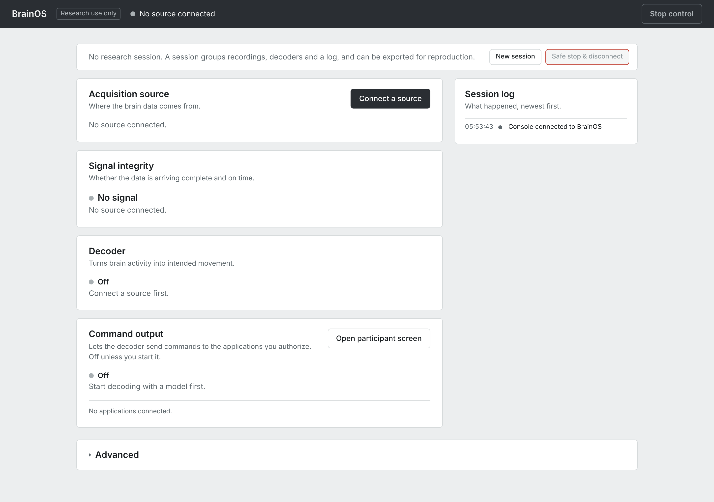

| # | Part | What it is for |
| --- | --- | --- |
| 1 | **Title bar** | **Concord** and its version; the connected source and its state (for example *Streaming · Simulated data*, *Paused*, *Recording*). On the right, **Stop control** stops decoded commands at once; it is grey until command output is running. |
| 2 | **Session strip** | **New session** starts a *research session* that groups your recordings, decoders and a log for export (section 7). **Safe stop & disconnect** stops everything in a safe order. |
| 3 | **Acquisition source** | Where the data comes from. **Connect a source** opens the list of sources. Once something is connected, the buttons become **Change source** and **Disconnect**. |
| 4 | **Signal integrity** | Whether data is arriving complete and on time: a verdict (*Good*, *Gaps detected*, *No signal*…), live traces, the number of channels, data received and the delay. |
| 5 | **Decoder** | Turns brain activity into intended movement or choices. **Start decoding** and **Calibrate…** appear once a source is connected. |
| 6 | **Command output** | The gate between a decoder and applications: off until you click **Start control**, and only for applications you **Authorize**. **Open participant screen** opens the communication board in its own window. |
| 7 | **Session log** | What happened, newest first. |
| 8 | **Advanced** | At the very bottom of the page, closed until you click it. It holds the details: event stream, pipeline, acquisition details, diagnostics, recording, simulator, stored data, support report and more. |

**One thing that surprises everyone:** before you have opened anything, **Command output**
already lists a **Communication Board** with an **Authorize** button, and says
"1 application connected · Communication Board waiting for: a source". That board is the
preview built into **Advanced → Communication board**. **Do not click Authorize yet**:
section 5 explains when you need it.

Every control is explained in the [user guide](USER_GUIDE.md).

---

## 3. A simulated device and the communication board

Simulated devices generate synthetic data inside Concord, for learning and testing. They are
never brain data, and Concord labels them *simulated* everywhere. Here you play the role of a
participant and choose words on the communication board yourself.

### 3.1 Connect a simulated device

1. In **Acquisition source**, click **Connect a source**. A panel lists every kind of source:

   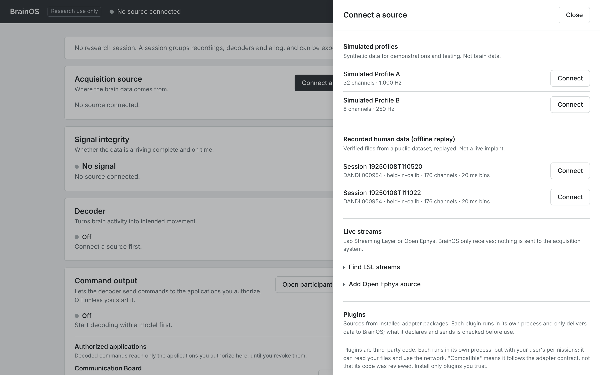

   *Recorded human data* says "No recorded datasets yet" until you add recordings in
   section 4. That is expected. The *Live streams* and *Plugins* parts are for your own
   equipment; you don't need them in this guide (see section 9). The BCI2000 plugin listed there
   comes with Concord.
2. Under **Simulated profiles**, click **Connect** next to **Simulated Profile A** (32 channels at
   1,000 Hz, with a simulated pointer and click).

**What you should see:**
- The title bar says **Streaming · Simulated data**.
- **Signal integrity** shows moving traces, the verdict **Good** and **Channels 32 of 32**.
- The session log says the source connected.

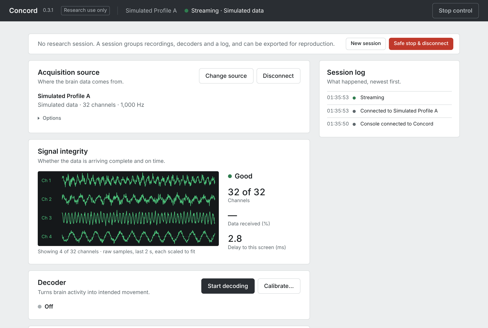

What the figures mean:
- **Channels**: how many channels arrived in the latest block, out of how many the source
  declares.
- **Data received (%)**: measured only for live LSL and Open Ephys streams; for simulated and
  recorded sources it shows **—**.
- **Delay to this screen (ms)**: how long data takes from Concord to this page; a few
  milliseconds is normal.

### 3.2 Open the participant screen (the communication board)

In **Command output**, click **Open participant screen**. A second window opens with the
**communication board**, the screen a participant would use to compose messages. Put it next
to the console and make it at least about 1280 × 800 pixels, or maximise it, so every tile
and the **History** column fit. If nothing opens, your browser
blocked the pop-up: allow pop-ups for `127.0.0.1:8000`.

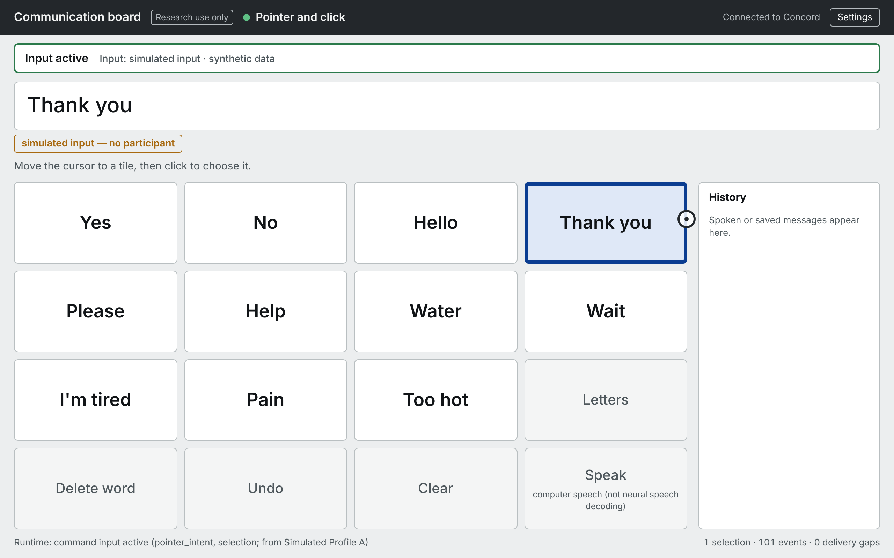

*(The picture shows the board after one word was chosen in 3.3; yours starts with an empty
message bar.)*

What is on the board:
- **Header:** *Communication board*, *Research use only*, the input method in use (here
  *Pointer and click*), the connection (*Connected to Concord*) and **Settings**.
- **Input line:** where the input comes from, here *Input: simulated input · synthetic data*.
- **Message bar:** the message being composed. Once a word is chosen, a label under it says
  where the words came from: *simulated input — no participant*.
- **Tiles:** phrases (*Yes*, *No*, *Hello*, *Thank you*, *Help*…), **Letters** (a keyboard page
  with word prediction), **Delete word**, **Undo**, **Clear** and **Speak** (reads the message
  aloud with ordinary computer speech, not neural speech decoding).
- **History:** spoken messages (shown when the window is wide enough).

**You cannot click the tiles with the mouse.** The board reacts only to input from Concord,
because that is how a participant would use it. In this section the input comes from you,
through the simulator. (The board's hint *click to choose it* means the participant's click:
here, **Select** in the simulator.)

In the console, **Command output** now says **2 applications connected**: the board window and
the preview built into **Advanced → Communication board**. **Authorized applications** still
shows one **Communication Board** row; don't click its **Authorize** yet (section 5).

### 3.3 Move the cursor and choose a word

1. In the console, scroll to the bottom, click **Advanced** to open it, then click **Simulator
   controls**. This section is listed only while a simulated profile is connected.

   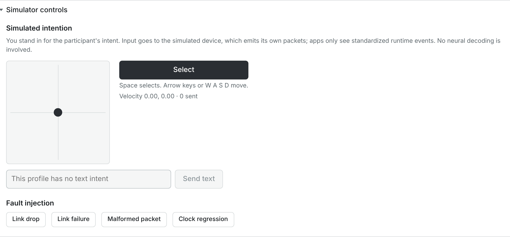

2. The square pad works like a **joystick**: drag the dot away from the centre and the board's
   cursor *keeps moving* in that direction, faster the further you drag; let go and the dot
   springs back and the cursor almost stops. (Profile A adds a little random noise to every
   movement, so the cursor keeps drifting slowly.) Use small, short movements.

   With the keyboard: click once on an empty part of the console page, then press and hold an
   arrow key (or W, A, S, D) **briefly**: a tap of about a tenth of a second moves the cursor
   about one tile, and half a second crosses the whole board. The keys work only while the console
   window is in front.
3. The tile the cursor (a ring) points at is outlined in blue. Click **Select** (or press Space)
   to choose the outlined tile.

**What you should see:** the tile's word appears in the board's message bar, labelled
*simulated input — no participant*, so nobody can mistake it for a person's message. "N sent"
under the pad counts your selections.

Simulated input reaches the board directly because no brain data is involved. Decoded brain
data never does: it needs **Start control** and **Authorize** (section 5).

### 3.4 Try a fault (optional)

Under **Fault injection**, each button makes the simulated device misbehave, so you can see how
Concord reacts. Each fault is also counted in **Advanced → Diagnostics → Counters** (*link
errors*, *decode errors*, *timestamp regressions*).

| Button | What it simulates | What you should see |
| --- | --- | --- |
| **Link drop** | A brief loss of connection | The session log shows *Link lost, reconnecting*, then *Streaming (reconnected after 1 attempt(s))*. It takes a fraction of a second, so the title bar barely changes. The counts are in **Advanced → Diagnostics** (*Reconnects ok / tried*). |
| **Link failure** | A connection that cannot be restored | The title bar says *Source stopped with an error*; the source row shows the error and a **Reset** button. Click **Reset**, then **Connect a source → Connect** next to **Simulated Profile A**, and reopen **Advanced → Simulator controls** to try the next fault. |
| **Malformed packet** | A corrupted data packet | The session log shows *Decode error: CRC mismatch*; the bad packet is dropped and counted. |
| **Clock regression** | A timestamp that goes backwards | The session log shows *Timestamp regression*; the event is flagged in its quality. |

### 3.5 Finish

1. On the board, the message stays until you clear it, so the next words don't mix with these:
   press **Clear** by moving the cursor onto it and selecting, or close the board window.
2. In the console, click **Disconnect** in **Acquisition source**. The board says
   *Paused — device disconnected (operator disconnect)*.

---

## 4. Replay a real human recording (FALCON H1)

Concord can replay public recordings from people with implanted electrodes:
- They are always labelled **Offline Replay**: they are files, not a live implant.
- Concord checks every file against a pinned SHA-256 checksum, a fingerprint published with the
  dataset, and refuses a file that does not match.

**FALCON H1** (about 9 MB, no account needed): two recording blocks from one participant with
two 96-channel arrays in motor cortex. They contain spike counts in 176 channels every 20 ms
(the dataset provides 176 of the 192 electrodes; it does not list which were left out), plus
the cued reach-and-grasp movements the participant attempted.
([Dataset page on DANDI](https://dandiarchive.org/dandiset/000954/draft), license CC-BY-4.0.)

> **Downloading means agreeing to the dataset's Data Use Agreement** (on the DANDI page): no
> attempt to re-identify or contact the participant, and no redistribution of the files.

### 4.1 Download the two files

Click each link; your browser downloads one file directly from the DANDI archive:
- [sub-HumanPitt-held-in-calib_ses-19250108T110520.nwb](https://api.dandiarchive.org/api/assets/e40a2eca-883d-4c80-81e3-4203a49506b5/download/) (5.8 MB)
- [sub-HumanPitt-held-in-calib_ses-19250108T111022.nwb](https://api.dandiarchive.org/api/assets/98f1e471-ad68-4006-b090-9a3e347852e6/download/) (3.3 MB)

If your browser saves a second copy with a name like `… (1).nwb`, delete the extra copy.

### 4.2 Put them in Concord's datasets folder

Concord keeps everything in one **data folder**. Recordings you download go in a folder named
`datasets` inside it. On a new installation that folder does not exist yet.

> **Shortcut with a terminal:** one command downloads, verifies and places both files, and
> creates the folder (see [Commands in this guide](#commands-in-this-guide)). Then skip to 4.3.
> - Mac: `/Applications/Concord.app/Contents/MacOS/Concord dataset`
> - Linux (new terminal window): `cd ~/Downloads`, then `./Concord/Concord dataset`
> - Windows (PowerShell): `cd $HOME\Downloads\Concord-windows-x86_64\Concord`, then `.\concord-cli.exe dataset`

Without a terminal:

1. **See where the folder is.** Click **Connect a source**. Under *Recorded human data*,
   Concord shows the folder to use, for example
   `/Users/you/Library/Application Support/Concord/data/datasets` (Mac),
   `C:\Users\you\AppData\Local\Concord\data\datasets` (Windows) or
   `/home/you/.local/share/concord/data/datasets` (Linux). Close the panel.
2. **Open the data folder**, the same path without `datasets` at the end:
   - **Mac:** in Finder choose **Go → Go to Folder…**, type
     `~/Library/Application Support/Concord/data`, press Return.
   - **Windows:** in File Explorer click the address bar, type `%LOCALAPPDATA%\Concord\data`
     and press Enter. (`AppData` is a hidden folder, but typing the path opens it.)
   - **Linux:** in your file manager press **Ctrl+L**, type `~/.local/share/concord/data`, press
     Enter. (`.local` is a hidden folder, but typing the path opens it.)

   It contains `logs` and `concord.pid`; leave those alone.
3. **Create a folder named `datasets`** there (right-click → **New Folder**), open it, and
   **move both `.nwb` files into it**.

If the panel shows a different folder than these, another copy of Concord is running: see
*Another copy already running?* in section 1. (The data folder is also the first line,
**Data directory**, of **Advanced → Stored data**.)

### 4.3 Connect a recording

1. Reload the console page (⌘R or Ctrl+R), then click **Connect a source**. (Reloading clears
   the on-screen Session log; what happened is still in Concord's log files and, during a
   research session, in the session's log.) Right after Concord starts, the list may say
   *Checking the recorded datasets…* for a few seconds while Concord verifies each file.
2. Under **Recorded human data (offline replay)** you now see **Session 19250108T110520** and
   **Session 19250108T111022**, each with "DANDI 000954 · held-in-calib · 176 channels · 20 ms
   bins". They are two blocks from the same day; either works. The numbers are the recording's
   date and time, which the dataset shifted to 1925 to protect the participant's identity, and
   *held-in-calib* is the name the FALCON benchmark gives this part of its data.
3. Click **Connect** next to one of them.

**What you should see:**
- The title bar says **Streaming · Recorded human data, offline replay**.
- The source row shows the source type *Recorded Human Intracranial Data — Offline Replay* and,
  on the next line, which session is playing.
- **Signal integrity** shows the spike counts of the most active channels.

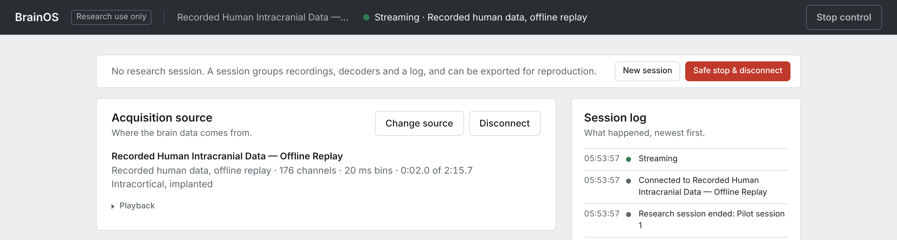

*(In this image the live traces are blanked: the dataset's terms do not allow its data to be
redistributed, so the documentation shows none of it. On your screen you see the traces.)*

### 4.4 Control the replay

Open **Playback** in the source row:
- **Pause** / **Resume**;
- speed **0.5×, 1×, 2×, 4×, 8×**.

The position (for example *0:43.0 of 2:15.7*) is shown in the line above. The bar shows
progress but cannot be dragged. At the end, the replay starts again from the beginning.

### 4.5 See exactly what you are replaying

Open **Advanced → Acquisition details**:

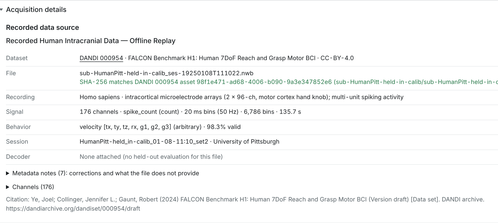

- **Dataset** (with a link), **File**, and a green **SHA-256 matches DANDI 000954 asset …**: the
  file is exactly the published one.
- **Recording**, **Signal**, **Behavior** and **Session**: what was recorded and how.
- **Decoder**: *None attached (no held-out evaluation for this file)*: no decoder has been
  tested on this file ("held-out" means tested on data it was not trained on). Concord does not
  ship a decoder for it; developers who build Concord from its source code can train one
  ([DECODING.md](DECODING.md)).
- **Channels (176)**, **Metadata notes** and **Citation** (how to cite the dataset if you use
  it) are folded: click one to open it. The metadata notes list corrections Concord applied and
  what the file does not provide.
- Below these, **Recorded neural activity** plots the replayed spike counts of all 176 channels
  and the participant's cued movement. Choose the movement dimension in **Velocity dimension**:
  *tx, ty, tz* are translation, *rx* rotation, *g1–g3* grasp.

When you are done, click **Disconnect**.

---

## 5. Let a recorded decoder drive the board (T15 cursor + click)

This is the full chain a real system would use: brain activity → decoder → command output →
communication board. The **T15** recordings come from a participant with electrodes in speech
motor cortex (256 electrodes) who controlled a computer cursor and clicked with them. The files
also contain the outputs of the original research system's decoder, so you can replay exactly
what that decoder did. (Singer-Clark et al. 2025,
[dataset on Dryad](https://datadryad.org/dataset/doi:10.5061/dryad.prr4xgxzq), license CC0.)

### 5.1 Download the four files

On the Dryad page, sign in (a free account) and download these four files one at a time from
the file list (click a file's name to download it). The list is long: use your browser's Find
(Ctrl+F or ⌘F) for `day00468_block0`. It highlights blocks 00 to 09; download only blocks **00,
01, 02 and 03** (table below). Don't click **Download full dataset**; it is much larger.

| File | Size | What it is |
| --- | --- | --- |
| `t15_day00468_block00_radial8_calibration_task.mat` | 28.4 MB | calibration block 0: cursor to 8 targets around a circle |
| `t15_day00468_block01_radial8_calibration_task.mat` | 11.0 MB | calibration block 1 |
| `t15_day00468_block02_radial8_calibration_task.mat` | 28.5 MB | calibration block 2 |
| `t15_day00468_block03_grid_evaluation_task.mat` | 28.5 MB | **the grid block**: choosing targets on a 14 × 14 grid, fully under neural control. This is the one you will replay. |

Move them into the same `datasets` folder as in section 4.2. Delete any `… (1).mat` duplicate
your browser makes. Concord skips duplicates, because the same block cannot be listed twice.

### 5.2 Connect the grid block

1. Reload the console, click **Connect a source** (or **Change source** if something is
   connected).
2. Under **Recorded human data (offline replay)** the four blocks are listed by day, block and
   task:
   - **Cursor + click · Day 468 · block 0 · radial-8 calibration** (and blocks 1 and 2);
   - **Cursor + click · Day 468 · block 3 · grid evaluation**.

   Each has "Dryad T15 · 256 channels · 10 ms bins".

   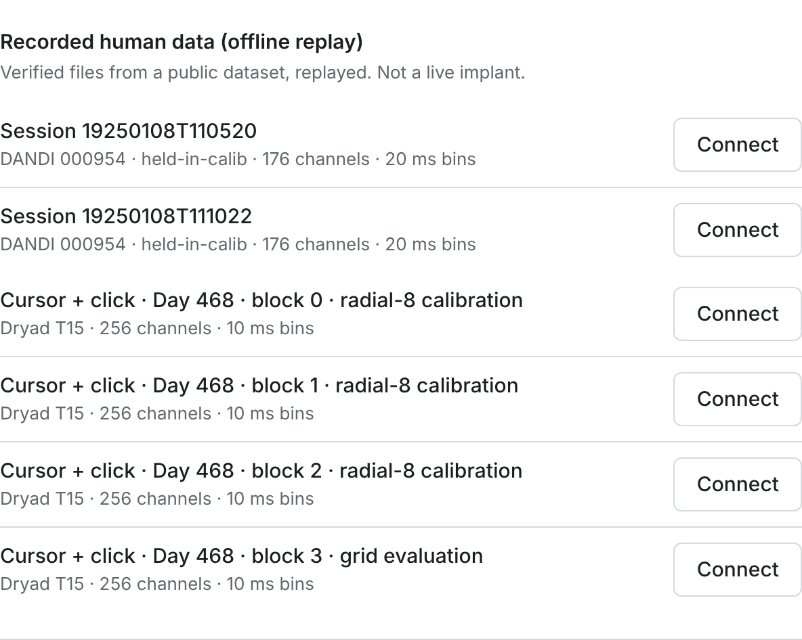
3. Click **Connect** (or **Switch**) next to **block 3 · grid evaluation**.


**What you should see:**
- The title bar says **Streaming · Recorded human data, offline replay**.
- The Decoder row says *This recording carries the replayed output of an offline decoder
  (t15-historical-click); it is not used for control.* "Offline" here means recorded: it is the
  original research system's decoder, replayed from the file. That is the starting state: in 5.4 you choose to pass this recorded
  output on, and only **Start control** in 5.5 lets it move the board. (The row names only
  *t15-historical-click*; the velocity decoder appears in 5.4.)
- **Signal integrity** shows the threshold crossings of the most active channels (a threshold
  crossing is counted each time an electrode's voltage dips below a set level, roughly one
  nearby neuron firing).

The file's checksum is verified when you connect; a file that does not match is refused. The
citation is in [DATASETS.md](DATASETS.md).

T15 replays at real speed: block 3 lasts 3 minutes and then starts again. You can **Pause**
under **Options**. (Unlike FALCON, the T15 row shows no position, progress bar or speed
choice.)

### 5.3 Set the board to the task's grid

The participant chose among targets on a 14 × 14 grid, so the board should show the same grid.

1. Click **Open participant screen** (if the board is not open already).
2. On the board, click **Settings** (top right). The **Board settings** panel opens:

   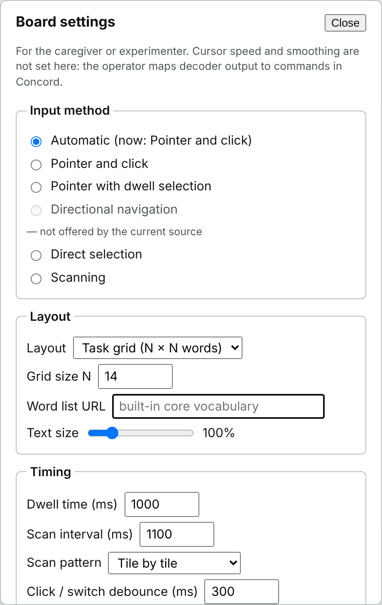

3. Under **Layout**, choose **Task grid (N × N words)**. **Grid size N** shows **14** (set it to
   14 if not). Then maximise the board window: the 196 tiles are small. If some long words
   are still cut off, drag **Text size** (in the same panel) all the way left, to 75%. Leave **Word list URL**
   empty.
4. Leave **Input method** on **Automatic**. For now it reads *Automatic (nothing available now)*
   and the other methods say *not offered by the current source*. That is expected: no command
   output reaches the board yet. After 5.5 it reads *Automatic (now: Pointer and click)*, as in
   the picture. Click **Close**.

**What you should see:** the board shows 196 word tiles. It says *Paused — no command output
for this application*, because no decoded data may reach it yet. Settings are saved in this
browser, so the board keeps them next time.

### 5.4 Turn on the recorded decoder

1. In the **Decoder** row, click **Start decoding**. A panel titled **Start decoding** opens on
   the right.
2. In its **Processing** list, choose **Source decoder outputs (passthrough)**, not the similar
   *Source features (passthrough)*. This option exists only for sources that carry a decoder's
   output. It forwards that output unchanged, labelled *historical*. No model of yours is
   involved.
3. Click the dark **Start decoding** button in that panel (not the one in the Decoder row).

**What you should see:** the Decoder row says *Running* and lists two decoders:
- **t15-historical-velocity**, with outputs **vx, vy**: the cursor velocity;
- **t15-historical-click**, with output **click**: the click decision.

A note says the velocity has "no declared output scale"; the next step sets the scale.

### 5.5 Set up command output

1. In **Command output**, open **Settings**:

   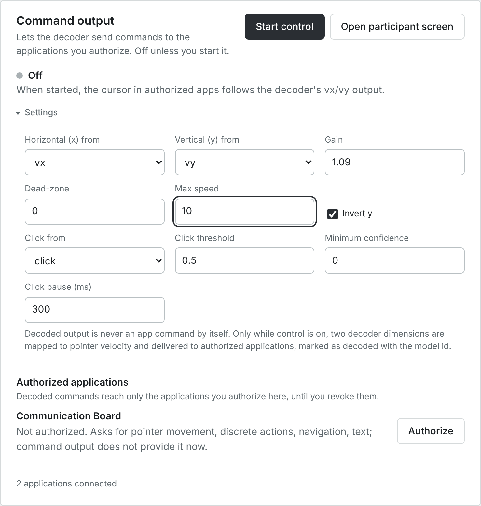

2. **Change three fields** (they start at 1, 0.3 and 2; the picture shows them already
   changed):
   - **Gain**: `1.09`. The recorded velocity is in screen heights per second, and the task's
     targets filled a square 0.92 screen heights wide. Multiplying by 1 / 0.92 = 1.09 makes the
     board's square match that grid.
   - **Dead-zone**: `0` (don't ignore small movements).
   - **Max speed**: `10` (don't cap the recorded movements).

   **Leave the others as they are**: **Horizontal (x) from** `vx`, **Vertical (y) from** `vy`,
   **Invert y** ticked (ticked for you, because the decoder counts "up" as positive y while the
   screen counts "down"), **Click from** `click` (selected for you), **Click threshold** `0.5`,
   **Minimum confidence** `0`, **Click pause (ms)** `300`.
3. Click **Start control**.
4. Under **Authorized applications**, click **Authorize** next to **Communication Board**.

If you change a value later, click **Apply settings** under the fields.

**What you should see:**
- **Command output** says *On · x ← vx, y ← vy (inverted), gain 1.09; click ← click*.
- The title bar's **Stop control** button turns red.
- On the board:
  - the input line reads *historical decoder replay (original research system) · recorded data
    replay*;
  - the cursor moves, and each click selects the word under the cursor;
  - the message is labelled *demonstration — not the participant's message*.

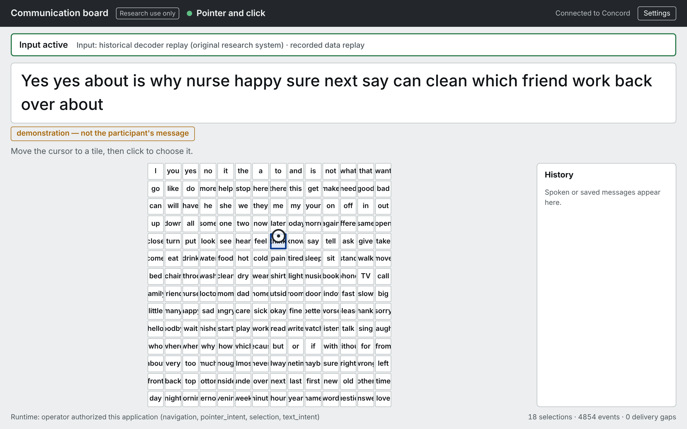

**What to expect:** the cursor moves the way the original decoder moved it during the
recording. The replay is [open loop](GLOSSARY.md#closed-loop-open-loop): the recording cannot react to the
board, so the cursor can drift where the original screen differed. Still, the board's
selections land on the cued word roughly half of the time: 39 of 70 clicks in the published
comparison. The board does not show which word was cued, so you cannot check this on screen;
the comparison is described in [NEURAL_COMMUNICATION.md](NEURAL_COMMUNICATION.md).

### 5.6 Stop and tidy up

1. Click **Stop control** (top right). Decoded commands stop at once; the board says it is
   paused.
2. Under **Authorized applications**, click **Revoke**. Authorization lasts until you revoke it,
   even if you change source or session.
3. Click **Stop decoding** in the **Decoder** row, then **Disconnect** in **Acquisition
   source**. The board says *Paused — device disconnected (operator disconnect)*.
4. On the board, open **Settings → Layout → Phrases and letters** and set **Text size** back to
   100% to get the normal board back (the settings are saved in this browser). Then close the board window: that removes the
   message. (You cannot select **Clear** now: nothing moves the cursor after **Disconnect**,
   and the board ignores mouse clicks.)

Want Concord's *own* decoders on this recording? A [Kalman](GLOSSARY.md#kalman-filter) cursor
decoder and a click decoder fitted on blocks 0–2 are evaluated in
[CURSOR_CLICK.md](CURSOR_CLICK.md). Fitting them needs Concord installed from its source code,
which is meant for developers ([DEVELOPERS.md](DEVELOPERS.md)).

---

## 6. Human ECoG (AJILE12, optional)

AJILE12 contains ECoG recorded from the cortical surface (a 64-electrode grid at 500 Hz) during
everyday arm movements (DANDI 000055, license CC-BY-4.0). The files are very large, so Concord
cuts and verifies two short slices itself. That needs one command in a terminal. Concord may be
running while you run it.

- **Mac** (open the **Terminal** app):

  ```bash
  /Applications/Concord.app/Contents/MacOS/Concord dataset ajile12
  ```

- **Windows** (PowerShell, see [Commands in this guide](#commands-in-this-guide)):

  ```powershell
  cd $HOME\Downloads\Concord-windows-x86_64\Concord
  .\concord-cli.exe dataset ajile12
  ```

- **Linux** (in a new terminal window, see [Commands in this guide](#commands-in-this-guide)):

  ```bash
  cd ~/Downloads
  ./Concord/Concord dataset ajile12
  ```

(Python installation: `concord dataset ajile12`; see [Commands in this guide](#commands-in-this-guide).)

**What you should see:**
- The command takes about a minute and downloads about 157 MB.
- It prints *verified* twice and ends with *2 extract(s) ready in …/datasets/dandi-000055*.

Then:
1. Reload the console and click **Connect a source**.
2. **Recorded human data** now also lists **Session 5** and **Session 6** ("DANDI 000055 ·
   64 channels · 500 Hz"). Connect one: the source row says *Recorded Human ECoG — Offline
   Replay* and the title bar *Streaming · Recorded human data, offline replay*.
3. When you are done, click **Disconnect**.

Background and decoding results: [ECOG.md](ECOG.md).

---

## 7. A research session: record and export

A **research session** keeps a reproducible record of what you do: recordings, decoders,
settings and a log, in one folder you can export as a zip file.

1. In the session strip, click **New session**. Enter a **Session name** (required; **Start
   session** stays grey until you do), optionally the **Operator** and **Notes**. **Never enter
   participant identifiers.** Click **Start session**.

   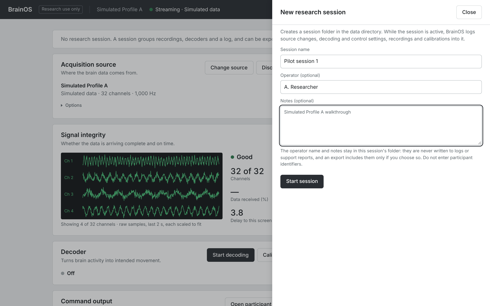

   The strip now shows the session's name, the operator, the start time and how many recordings
   and models it holds.
2. Connect **Simulated Profile A** (**Connect a source**, or **Change source → Switch** if
   something is connected). Source changes are written to the session's log.
3. Open **Advanced → Recording**, leave **Features and labels only** unticked, and click
   **Start recording**. The title bar adds **· Recording**. The size in the list of recordings
   updates when the recording stops.

   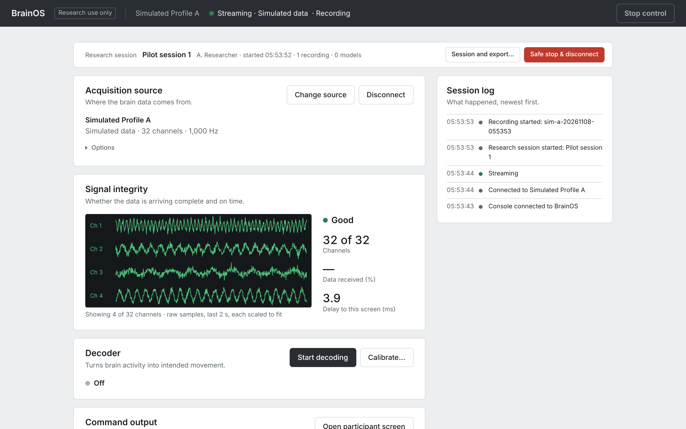

4. After a minute, click **Safe stop & disconnect**. It stops command output, closes the
   recording, stops decoding and disconnects the source, in that order. The session stays open.

   > **About recording limits.** A recording with raw samples stops by itself after 5 minutes or
   > 200 MB; Simulated Profile A writes about 12 MB a minute, so a one-minute recording is fine.
   > (The panel's warning that raw frames "reach the size cap in seconds" applies to
   > high-channel-count live sources.) With **Features and labels only (for calibration)**
   > ticked, the raw samples are left out and a recording can run for an hour. Both limits can
   > be changed in the [configuration file](USER_GUIDE.md#15-configuration-file). Recorded
   > datasets (sections 4–6) cannot be recorded: they already are recordings.
5. Click **Session and export…** in the session strip:
   1. For this exercise, tick **Include the session's recordings** (the data needed to re-run an
      evaluation). Leave **Include the operator name and notes** unticked unless the people you
      share the zip with should see them.
   2. Click **Create export bundle**.
   3. **Download the zip from the link that appears now** (the same file is also listed just
      below it), before you end the session. Your browser saves it in your Downloads folder.
      The panel's hints name `concord reproduce` and `concord doctor`: with the app, type them
      as in [Commands in this guide](#commands-in-this-guide).

   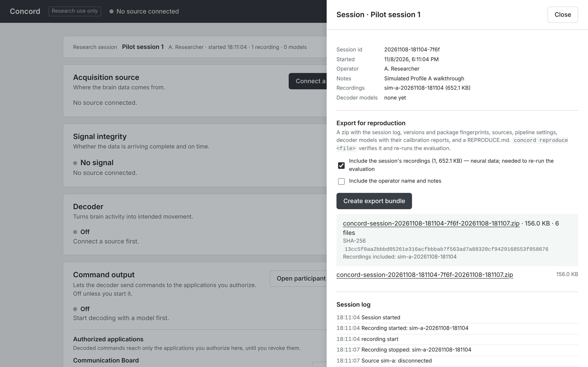

   The zip contains:
   - `session.json` and `session-log.jsonl`: what happened;
   - `environment.json`: software versions;
   - `devices/`: the sources;
   - `recordings/` (if included);
   - decoder models and their calibration reports (if you calibrated);
   - `manifest.json` (checksums) and `REPRODUCE.md`.
6. At the bottom of the same panel, click **End session…** and then **End session now**.

   **What you should see:** the session strip returns to *No research session…*. The session's
   folder stays in **Advanced → Stored data**.

**Reproducing an export (optional, needs a terminal).** Give the `reproduce` command the zip's
full path. Its name is long: type the start, `~/Downloads/concord-session-`, then press **Tab**
to complete it (or drag the zip from your file manager into the terminal).

- **Mac:** `/Applications/Concord.app/Contents/MacOS/Concord reproduce ~/Downloads/concord-session-….zip`
- **Windows** (PowerShell): `cd $HOME\Downloads\Concord-windows-x86_64\Concord`, then `.\concord-cli.exe reproduce $HOME\Downloads\concord-session-….zip`
- **Linux** (new terminal window): `cd ~/Downloads`, then `./Concord/Concord reproduce ~/Downloads/concord-session-….zip`

(Python installation: `concord reproduce …`.)

It checks every file against `manifest.json` and re-runs the session's decoder evaluation. For
this session, which has no decoder, it prints `[OK  ] integrity: 6 files verified against
manifest.json` and `result: nothing_to_reproduce`. That is the expected result. (The export
panel counts 7 files: the 6 checked here plus `manifest.json` itself.)

---

## 8. Stored data, support report and quitting

**Advanced → Stored data** shows the data folder, your recordings, decoder models and research
sessions with their sizes, and deletes what you no longer need (it asks for confirmation).
Downloaded datasets are not listed there: delete them from the `datasets` folder yourself.

**Advanced → Support report → Create support report** checks the installation: versions,
optional parts, ports, folder permissions, disk space and recent problems. It contains **no
neural or personal data**. If you tried the faults in section 3.4, the report lists them under *Recent log problems* as
warnings and errors; that is expected. Download it as JSON or Markdown and attach it when you
[report a problem](https://github.com/arnavhiteshpatel-cloud/concord/issues/new/choose).

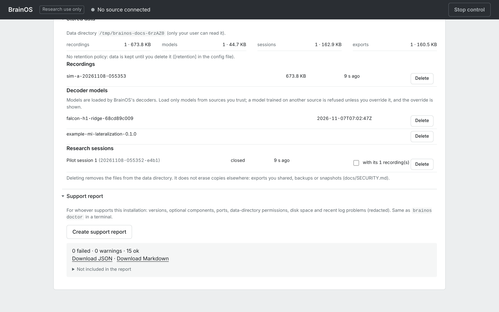

**Quitting:**
- **Mac:** click **Stop and quit** in the small Concord window, or press ⌘Q.
- **Windows:** click **Stop and quit** in the small Concord window, or close it (the **X** in its
  title bar). From PowerShell, `.\concord-cli.exe stop` in the Concord folder does the same.
- **Linux:** click **Stop and quit** in the small Concord window, or close it; or press Ctrl-C
  in the terminal where you started Concord (or run `./Concord/Concord stop` from `~/Downloads`
  in another terminal).

Quitting performs a safe stop first, so recordings are closed properly. Afterwards the console
says *Connection to Concord lost, reconnecting* (and a board window, if one is still open,
says *Reconnecting* in its header instead of *Connected to Concord*): Concord has stopped, so
close the console tab and any board window. If Concord ever stops unexpectedly,
the next start keeps the complete part of an interrupted recording and marks it *incomplete*.

---

## 9. Where to go next

| You want to… | Read |
| --- | --- |
| Understand the ideas: sources, data kinds, capabilities, decoders, command output | [How Concord works](CONCEPTS.md) |
| Know what every button, field and message does | [User guide](USER_GUIDE.md) |
| Connect your own equipment: LSL, Open Ephys, BrainFlow, BCI2000, your own device | [Connect your equipment](CONNECT_YOUR_EQUIPMENT.md) |
| Calibrate a decoder from your own recordings | [User guide: Calibrate](USER_GUIDE.md#65-the-calibrate-panel) |
| See every demo dataset, its license and how to cite it | [DATASETS.md](DATASETS.md) |
| Fix a problem | [TROUBLESHOOTING.md](TROUBLESHOOTING.md), [FAQ.md](FAQ.md) |
| Know what has been validated, and what has not | [VALIDATION_LEVELS.md](VALIDATION_LEVELS.md), [LIMITATIONS.md](../LIMITATIONS.md) |
| Look up a term | [Glossary](GLOSSARY.md) |
