# Concord user guide

A complete reference to everything you can see and touch in Concord 0.3.1: every button, field,
section, state and message of the **operator console** and the **communication board**, what
each one does, when it appears and what to do with it.

- New to Concord? Do the step-by-step tutorial first: [Getting started](GETTING_STARTED.md).
- Want the ideas behind the screen (sources, data kinds, capabilities, command output)? Read
  [How Concord works](CONCEPTS.md).
- A word you don't know? See the [glossary](GLOSSARY.md).

> Concord is research software and only *receives* data. It has never been used with
> acquisition hardware or with a participant, and it is not a medical device. What has been
> tested, and how: [validation levels](VALIDATION_LEVELS.md).

## How to use this guide

The guide follows the screen from top to bottom:

- Section 1 shows the whole console with its eight numbered areas.
- Sections 2 to 8 describe areas 1 to 7, in that order: area *N* is in section *N* + 1.
- Section 9 lists every way to stop.
- Section 10 describes area 8, **Advanced**.
- Sections 11 to 16 cover the communication board, common situations, the desktop app, the
  `concord` command, the configuration file and the data folders.

Looking for one control, for example **Dead-zone**? The [control index](#control-index) at the
end lists every label in this guide from A to Z, with where it is on the screen and the section
that explains it.

Conventions:

- **Bold** is a label exactly as the screen shows it: a button, a field, a heading.
- *Italic* is text the screen displays: a status, a message, a caption.
- Most control tables have four columns: **Control** (the label), **What it does**, **When you
  see it** (when the control is on the screen), and **Notes / units / defaults**. Longer
  explanations are below the table.
- A linked technical term, such as [held-out](GLOSSARY.md#held-out), leads to a plain-language
  explanation in the [glossary](GLOSSARY.md).
- "The data folder" is the folder where Concord keeps your data. Its exact path is at the top of
  **Advanced → Stored data** (shown as *Data directory …*) and in
  [section 16](#16-data-folders-ports-and-network).

## Contents

1. [The console at a glance](#1-the-console-at-a-glance)
2. [The title bar and its states](#2-the-title-bar-and-its-states)
3. [Research sessions and export (the session strip)](#3-research-sessions-and-export-the-session-strip)
4. [Acquisition source](#4-acquisition-source)
5. [Signal integrity](#5-signal-integrity)
6. [Decoder](#6-decoder)
7. [Command output](#7-command-output)
8. [The session log](#8-the-session-log)
9. [Stopping safely](#9-stopping-safely)
10. [Advanced](#10-advanced)
11. [The communication board](#11-the-communication-board)
12. [Common situations](#12-common-situations)
13. [The desktop app](#13-the-desktop-app)
14. [The `concord` command](#14-the-concord-command)
15. [Configuration file](#15-configuration-file)
16. [Data folders, ports and network](#16-data-folders-ports-and-network)

[Control index](#control-index): every label, A to Z.

---

## 1. The console at a glance

The console is the operator's screen. It opens in your web browser at http://127.0.0.1:8000
when Concord starts (the browser tab is called *Concord Runtime Console*).

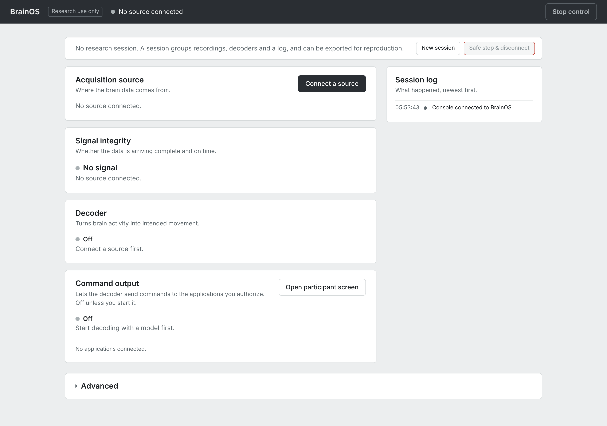

| # | Area | What it is for | Section |
| --- | --- | --- | --- |
| 1 | **Title bar** | Concord's version, the connected source, its state, *· Recording*, and **Stop control** | [2](#2-the-title-bar-and-its-states) |
| 2 | **Session strip** | The [research session](GLOSSARY.md#research-session) (**New session**, **Session and export…**) and **Safe stop & disconnect** | [3](#3-research-sessions-and-export-the-session-strip) |
| 3 | **Acquisition source** | Where the data comes from: connect, change, pause or disconnect a [source](GLOSSARY.md#acquisition-source) | [4](#4-acquisition-source) |
| 4 | **Signal integrity** | Whether data arrives complete and on time | [5](#5-signal-integrity) |
| 5 | **Decoder** | Processing and [decoding](GLOSSARY.md#decoder): **Start decoding**, **Calibrate…** | [6](#6-decoder) |
| 6 | **Command output** | Whether decoded output may reach applications ([command output](GLOSSARY.md#command-output)), its settings, and the applications you [authorize](GLOSSARY.md#authorize-revoke) | [7](#7-command-output) |
| 7 | **Session log** | What happened, newest first | [8](#8-the-session-log) |
| 8 | **Advanced** | Twelve sections of details and tools (thirteen while Simulated Profile A or B is connected) | [10](#10-advanced) |

Things that work the same everywhere in the console:

- **Most buttons appear only when they can be used.** For example, **Start decoding** and
  **Calibrate…** appear once a source is connected. Some buttons are always shown and are greyed
  out while they cannot be used: **Stop control**, **Safe stop & disconnect**, and buttons inside
  panels such as **Start session**, **Start recording**, **Check labels** or **Add source**. The
  reason is usually a grey line next to the button or under the row's heading (for example
  *Connect a source first.* or *Start decoding with a model first.*); some buttons also show it
  when you hover over them.
- **Panels that slide in from the right** (called [sheets](GLOSSARY.md#sheet): **Connect a
  source**, **Start decoding**, **Calibrate a decoder**, **New research session**,
  **Session · …**) close with their **Close** button, with the Escape key, or by clicking the grey
  area beside them.
- **A small triangle (▸) before a label** (for example **Options**, **Settings**, **Advanced**)
  means the part is folded. Click the label to open it, click again to fold it.
- **Hover** over a source, a figure or a status to see a longer explanation.
- **A refused action** shows its reason in a grey box, under the control or at the top of the
  panel. The reason starts with a code such as *capability_unsupported:*, *protocol_error:* or
  *device_error:*. It is also written to the session log as *Refused: …*.
- **Errors are not shown in red.** Errors and refusals appear as dark text in a light-grey box.
  Look for that box, not for red text. Red marks only the stop buttons (**Stop control** while
  command output is on; **Safe stop & disconnect**, filled red while something runs and greyed
  with a red outline otherwise), the final **Delete**
  and **End session now** confirmations, and the dots (title bar, session log) of a source that
  stopped with an error.
- **There is one Concord, shared by every window.** All console tabs and every board window show
  and change the same source, decoder and command output. Opening the console in two tabs does
  not give you two independent setups.

---

## 2. The title bar and its states

### 2.1 Controls in the title bar

| Control | What it does | When you see it | Notes / units / defaults |
| --- | --- | --- | --- |
| **Concord** | The name | Always | |
| Version (for example *0.3.1*) | The version of the Concord that serves this console | Once the console is connected | Hover: *The version of the Concord that serves this console*. Use it to spot an old copy that is still running. |
| **Research use only** | A reminder | Always | Hover: *Not a medical device. Read-only: Concord never writes to or stimulates a device.* |
| Source name | The connected source's name | While a source is connected | Long names end in "…"; hover for the full name. Several files share one name (below the table). |
| Coloured dot and state | What Concord is doing now | Always | Every state is listed in [2.2](#22-every-state-the-title-bar-can-show). Hover over it for a description of the [data kind](GLOSSARY.md#data-kind). |
| *· Recording* | A recording is being written | While recording | See [10.5](#105-recording). |
| **Stop control** | Turns command output off at once: no decoded command reaches any application after this | Always | Greyed out (hover: *Command output is off*) while command output is off; red while it is on. It changes nothing else: decoding, the source and recordings keep running. While decoding keeps running, the **Command output** row then says *Last stopped: stopped by operator (console).* |

Shared source names: both [FALCON H1](GLOSSARY.md#falcon-h1) files are called *Recorded Human
Intracranial Data — Offline Replay*, and all four [T15](GLOSSARY.md#t15) blocks *Recorded Human Intracortical Data (cursor + click) — Offline
Replay*. The **Acquisition source** row says which file is playing.

### 2.2 Every state the title bar can show

The state is the text after the coloured dot. The first three are about the console's own
connection to Concord; the others are about the source.

| State | Dot | What it means | What to do |
| --- | --- | --- | --- |
| *Connecting to Concord* | grey | The page is connecting to Concord | Wait a second. |
| *Connection to Concord lost, reconnecting* | amber | The console lost its connection: Concord was stopped, crashed or is restarting | If you quit Concord, close this tab. Otherwise wait; the console reconnects by itself and logs *Reconnected to Concord*. |
| *Not connected to Concord* | amber | The connection was closed or refused | Check that Concord is running (`concord status`), then reload the page. |
| *No source connected* | light grey | Concord runs, no source is connected | Click **Connect a source**. |
| *Connecting to the source* | grey | Concord is opening the source | Wait. If it fails, the reason appears in the **Connect a source** panel. |
| *Streaming · Simulated data* | green | A source is delivering [synthetic](GLOSSARY.md#simulated-data-synthetic) data (a simulated profile, or a test stream declared synthetic) | Normal. |
| *Streaming · Recorded human data, offline replay* | green | A public human recording is being replayed from a file ([offline replay](GLOSSARY.md#offline-replay)) | Normal. It is never live. |
| *Streaming · Recorded data, offline replay* | green | A recording without "human" in its name is replayed from a file (for example your recording of a non-simulated source) | Normal. |
| *Streaming · Recorded data, streamed replay (declared)* | green | A live stream whose publisher [declares](GLOSSARY.md#declared) that it replays prerecorded data (for example `concord publish falcon`) | Normal. Concord cannot check the declaration. |
| *Streaming · Live stream, origin unverified* | green | A live stream ([LSL](GLOSSARY.md#lsl-lab-streaming-layer), Open Ephys, some plugins) with no declaration | Normal. Concord cannot tell hardware from a file player or a simulator. |
| *Streaming · Device data* | green | A non-simulated source that is neither a stream nor a replay (some plugins) | Normal. |
| *Paused · …* | amber | You paused the source (**Pause**); command output was turned off | Click **Resume** (in **Options** or **Playback**). |
| *Source link lost, reconnecting* | amber | The connection to the source dropped. Concord tries to reconnect three times (see below the table) | Wait: this can take up to about 17 s. Command output was turned off and stays off. The session log shows *Link lost, reconnecting: …* and then either *Streaming (reconnected after N attempt(s))* or an error. |
| *Disconnecting* | grey | The source is being closed | Wait. |
| *Source stopped with an error* | red | The source failed and could not be restored | See [2.3](#23-source-stopped-with-an-error-and-reset). |
| *Source ended* | light grey | The source reached its end (a source that can finish, for example some plugins). File replays do not end: they start again from the beginning. | Click **Reset**, then connect again if needed. |

**How reconnecting works.** Concord tries three times, after waiting 0.2 s, 0.5 s and 1 s. Each
attempt waits up to 5 s for the source to answer (an Open Ephys source gives up after 4 s). So
*Source link lost, reconnecting* can last up to about 17 s before it ends in *Streaming* again
or in *Source stopped with an error*. A short drop, such as the simulator's **Link drop**, is
over in under a second.

### 2.3 Source stopped with an error, and Reset

When a source fails for good (for example after **Link failure** in the simulator, or when an
LSL publisher or the Open Ephys GUI stops and does not come back):

- the title bar shows a red dot and *Source stopped with an error*;
- the **Acquisition source** row shows the error in a grey box under the source. After a lost
  link it reads *link lost; 3 reconnect attempts failed:* followed by the last attempt's error:
  its message, for example *sim-a: simulated link failure (device not responding)*, or the
  error's type when it has no message, for example *TimeoutError*;
- the **Disconnect** button is renamed **Reset**;
- the session log has entries with a red dot: *Source error: …* and *Source stopped: …*;
- decoding and command output have stopped, and any recording was closed.

A source that cannot be opened at all (for example an LSL stream whose publisher is not running)
ends the same way, with *connect failed: …* in the grey box.

**What to do:** read the error, fix the cause (restart the publisher, check the cable or the
network), then click **Reset**. Reset clears the failed source: the title bar returns to *No
source connected* and the button reads **Connect a source** again. Connect the source again from
there. You can also click **Change source** to pick another source directly.

---

## 3. Research sessions and export (the session strip)

A [research session](GLOSSARY.md#research-session) is a named folder that groups what you do:
source changes, decoding and control settings, recordings, calibrations and a log. It can be
exported as one zip file. Concord works without one; a session is for keeping a record.

### 3.1 The strip

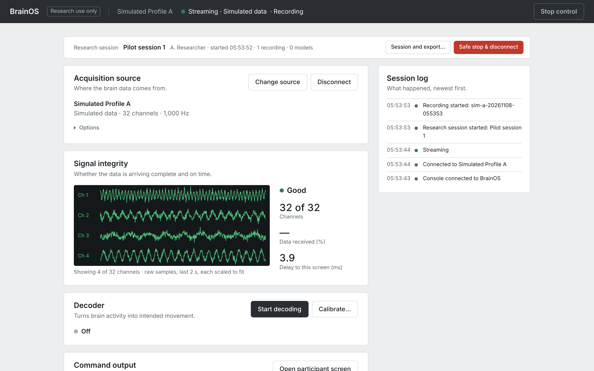

| Control | What it does | When you see it | Notes / units / defaults |
| --- | --- | --- | --- |
| *No research session. A session groups recordings, decoders and a log, and can be exported for reproduction.* | Says that no session is open | No session | |
| **New session** | Opens *New research session* ([3.2](#32-new-research-session)) | No session | |
| *Research session* · name · operator · *started HH:MM:SS* · *N recordings* · *N models* | The active session | A session is active | Counts include recordings and models made during the session. |
| **Session and export…** | Opens the session panel ([3.3](#33-session-and-export)) | A session is active | **End session…** is inside this panel. |
| **Safe stop & disconnect** | Turns command output off, closes the recording, stops decoding and disconnects the source, in that order | Always; filled red when something runs | Greyed out with a red outline (hover: *Nothing is running*) when nothing runs. No confirmation is asked. The research session stays open. Logged as *Safe stop: stopped decoding, source* (what it actually stopped); the session log may list the other resulting entries in a different order, and that *Safe stop: …* line is the summary. |

### 3.2 New research session

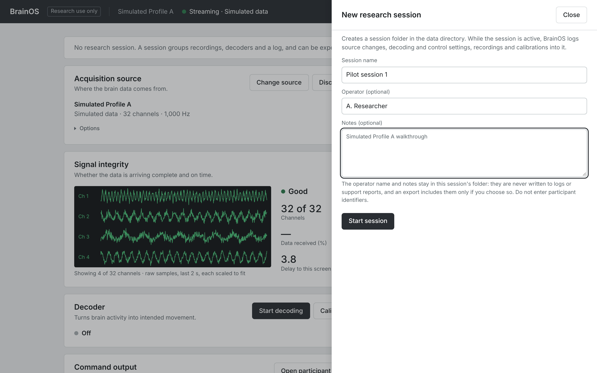

| Control | What it does | When you see it | Notes / units / defaults |
| --- | --- | --- | --- |
| **Session name** | The session's name | Always | Required (up to 80 characters); **Start session** stays grey until it is filled. Do not enter participant identifiers. |
| **Operator (optional)** | Who runs the session | Always | Up to 80 characters. |
| **Notes (optional)** | Free text | Always | Up to 4000 characters. See the note below the table. |
| **Start session** | Creates the session folder and starts logging | Always; greyed out until **Session name** is filled | Logged as *Research session started: \<name>*. |
| **Close** | Closes without starting | Always | |

Operator and notes stay in the session folder. They never go into logs or support reports, and
go into an export only if you tick **Include the operator name and notes**.

You can start a session before or after connecting a source; changes during the session are
logged either way.

### 3.3 Session and export

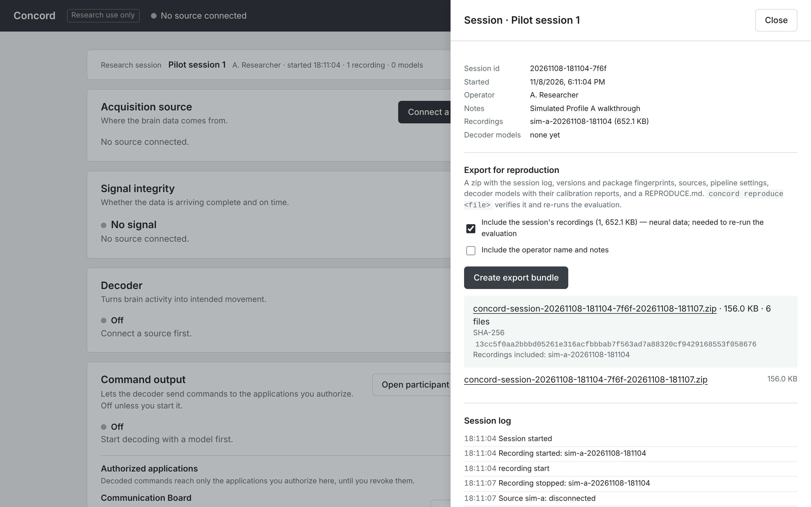

| Control | What it does | When you see it | Notes / units / defaults |
| --- | --- | --- | --- |
| **Session id** | The folder name, for example *20261109-013717-2037* | Always | Not the same as the *Session 19250108T…* names of FALCON files. |
| **Started**, **Operator**, **Notes** | As entered | Always | Operator and Notes only if given. |
| **Recordings** | Recordings made during the session, with sizes | Always | *(deleted)* or *incomplete* when that applies. |
| **Decoder models** | Models trained during the session | Always | *none yet* otherwise. |
| **Include the session's recordings (N, size) — neural data; needed to re-run the evaluation** | Puts the recordings into the zip | Always | Off by default (recordings can be large and identifying). Without it, recordings are *listed by hash only*. The label says "neural data" even for simulated recordings. |
| **Include the operator name and notes** | Puts operator and notes into the zip | Always | Off by default. |
| **Create export bundle** | Writes the zip | Always | Logged as *Session exported: \<file>*. |
| Result box | The zip's name (a download link), size, number of files, its [SHA-256](GLOSSARY.md#sha-256), *Recordings included: …* | After an export | |
| Export list | Every export of this session, with download links | After an export | The newest export therefore appears twice: in the result box and in the list. |
| **Session log** | The last 12 entries of the session's own log, oldest first, and *N entries in the session folder* | Always | Short technical notes such as *Source sim-a: streaming*, *pipeline start*, *router*, *Recording started: …* or *POST /api/v1/calibration/check* (a request the console made); *(refused 409)* marks refused actions. |
| **End session…** | Asks for confirmation | Always | *Ending turns command output off, closes any recording, stops decoding and disconnects the source.* |
| **End session now** (red) / **Cancel** | Ends the session (after a safe stop) / keeps it | After **End session…** | Logged as *Research session ended: \<name>*. |

**Download the zip before you end the session.** Afterwards this panel is gone; the exports
stay in the data folder under `sessions/<session id>/exports/`, and **Advanced → Stored data**
counts them but has no download link.

### 3.4 What is in the export, and what reproducible means

The zip (the [export bundle](GLOSSARY.md#export-bundle)) contains:

| File | Content |
| --- | --- |
| `manifest.json` | Format, session, versions and package fingerprints, plugins, the list of files with their SHA-256 and size, results, what is and is not included |
| `session.json` | The session (operator and notes only if you included them) |
| `session-log.jsonl` | Source status changes and operator actions with their settings |
| `environment.json` | Platform, packages, plugins |
| `devices/*.json` | Descriptions of the sources used |
| `pipeline/*.json` | Each decoding start: processing, model and command-output settings, and status |
| `models/<id>.json`, `models/<id>.manifest.json` | Decoder models used or trained in the session, with their SHA-256 |
| `calibration/<id>.json` (and `.md`) | Each calibration's settings and report |
| `recordings/…` | Only if you ticked **Include the session's recordings** |
| `REPRODUCE.md` | How to install the same Concord version, and the exact commands to check and re-run the session (see below) |

Public dataset files are never included (the [DANDI](GLOSSARY.md#dandi) terms forbid redistribution); they are referenced
by SHA-256. The application log and support reports are not included either.

**Reproducible** means: someone with the zip and the same Concord version can check that no file
was changed, and:

- **re-fit every decoder trained in the session** from the included recordings, comparing the
  weights and [held-out](GLOSSARY.md#held-out) scores with the originals;
- **recompute the decoded output recorded during the session** from the recorded features, and
  compare it with what was recorded.

Both need the recordings in the zip. A session without a trained decoder, or exported without
its recordings, has nothing to re-run: only the files are checked.

**Installing the same version** (as `REPRODUCE.md` explains): Concord's packages are not on
PyPI. Download the release wheels of that version from the project's release page into one
folder, then run `pip install --find-links <folder> "concordos[lab]==0.3.1"`. Or use the
desktop app of the same version: its program accepts `reproduce` ([3.5](#35-concord-reproduce)).

### 3.5 `concord reproduce`

```bash
concord reproduce concord-session-<id>-<time>.zip
```

With the desktop app: `/Applications/Concord.app/Contents/MacOS/Concord reproduce <file>` (Mac)
or `./Concord/Concord reproduce <file>` (Linux, from the folder where you extracted Concord).

It prints one line per check, then a result. Each check starts with a tag of four characters:
`[OK  ]` (passed), `[skip]` (could not be run) or `[FAIL]` (failed).

| Line | Meaning |
| --- | --- |
| `[OK  ] integrity: N files verified against manifest.json` | Every file matches the SHA-256 and size listed in the manifest. N does not include `manifest.json` itself, so it is one less than the number of files in the export's result box. |
| `[OK  ] calibration <model>: re-fitted from N recording(s): … r2 0.915294 -> 0.915294, …` | A decoder trained in the session was fitted again. Each score is shown as original -> re-fitted; they agree to 1e-6. |
| `[OK  ] decoded_output <model>: N decoded outputs recomputed from recorded features, max relative difference 0 (…)` | The decoded output recorded in the session was computed again and matches. The first few bins (warm-up) are not compared. |
| `[skip] calibration <model>: recordings not in the bundle: <file>` | That decoder cannot be re-fitted: its recordings were not exported. |
| `[FAIL] integrity: <file>: SHA-256/size differ from the manifest` | A check failed; here, a file was changed after the export. |

| Result (last line) | Meaning | Exit status |
| --- | --- | --- |
| `result: reproduced` | Everything checked was reproduced | 0 |
| `result: failed` | A check failed | 1 |
| `result: nothing_to_reproduce` | The files are intact, but nothing could be re-run (no trained decoder, or no recordings in the zip) | 2 |

`--json FILE` also writes the report as JSON.

---

## 4. Acquisition source

Where the data comes from. One [source](GLOSSARY.md#acquisition-source) is connected at a time.

### 4.1 The row

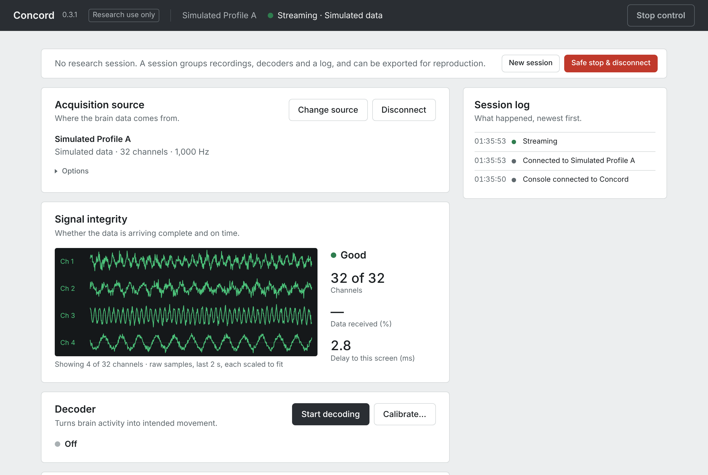

| Control | What it does | When you see it | Notes / units / defaults |
| --- | --- | --- | --- |
| **Connect a source** | Opens the **Connect a source** panel ([4.3](#43-the-connect-a-source-panel)) | No source connected | |
| **Change source** | Opens the same panel, titled **Change source**, where the buttons read **Switch** | A source is connected, or in error | Switching stops decoding and command output, and closes any recording. Applications stay connected and are told what the new source provides. |
| **Disconnect** | Stops the source | A source is connected | Decoding and command output stop; a recording is closed. |
| **Reset** | Clears a failed or ended source | After *Source stopped with an error* or *Source ended* (replaces **Disconnect**) | See [2.3](#23-source-stopped-with-an-error-and-reset). |
| Source name (first line) | The source's name | Connected | Same as in the title bar. |
| Which file is playing (second line) | Names the file or session being replayed | FALCON, AJILE12 and T15 files | For example *Session 19250108T111022 · DANDI 000954 · held-in-calib*, or *Cursor + click · Day 468 · block 3 · grid evaluation*. |
| Kind and shape line | What kind of data it is, how many channels, its rate | Connected | For example *Simulated data · 32 channels · 1,000 Hz*, or *Recorded human data, offline replay · 176 channels · 20 ms bins*. Raw sources show a sample rate in Hz; sources that deliver binned features show the [bin](GLOSSARY.md#bin) length. |
| Position (end of the kind line) | Where the replay is: *0:15.0 of 2:15.7*, followed by the speed when it is not 1× (*· 4×*) | FALCON and AJILE12 files, session recordings | Minutes:seconds. The length shows *—* when Concord cannot tell it: session recordings always show *of —*, so their progress bar stays empty. T15 blocks show no position. |
| Modality tag (last line) | The kind of recording, as the source declares it: *Intracortical, implanted*, *ECoG, implanted*, *EEG, noninvasive*, … | Sources that declare a [modality](GLOSSARY.md#modality), and every plugin | Concord shows what the source says; it cannot check it. A plugin that declares nothing shows *modality not declared*. |
| Plugin line | *Plugin · package@version · isolated* before the modality | Plugin sources | *isolated*: the plugin runs in its own process, separate from Concord ([isolated](GLOSSARY.md#isolated)). |
| Error text (grey box) | Why the source stopped, for example *link lost; 3 reconnect attempts failed: …* or *connect failed: open timed out* | After an error | See [2.3](#23-source-stopped-with-an-error-and-reset). |
| **Options** | Folded; contains **Pause** / **Resume** | Simulated profiles, T15 blocks, LSL, Open Ephys, plugins | Nothing else is in it. |
| **Playback** | Folded; contains a progress bar, **Pause** / **Resume** and the speeds | FALCON and AJILE12 files, session recordings | |
| **Pause** | Pauses the source; command output turns off | Inside **Options** or **Playback**, while streaming | The verdict becomes *Paused*; the log says *Paused (paused by operator)*. Data arriving from a live source while paused is discarded and counted. |
| **Resume** | Continues | While paused | Command output stays off: start it again if you need it. |
| **0.5× 1× 2× 4× 8×** | Replay speed | **Playback** only | Default 1×. The highlighted button is the current speed. T15 blocks have no speed control. |
| Progress bar | How far the replay is | **Playback** only | Display only: you cannot drag it to move in the file. Replays loop: at the end they start again from the beginning, without a log entry. |

When a source declares a modality, the tag is the last line of text above **Options** or
**Playback**: the fourth line for FALCON and T15 files (which also have a file line), the third
for other sources. On a plugin it ends the plugin line (for example *Plugin ·
concord-brainflow@0.1.0 · isolated · modality not declared*). "Intracranial" in the FALCON source name is the
general term (inside the skull); *Intracortical* is the specific modality (electrodes inside the
cortex). See [intracortical, intracranial](GLOSSARY.md#intracortical-intracranial).

### 4.2 What the row shows for each kind of source

| Source | Title bar state | Second line (file) | Folded controls | Notes |
| --- | --- | --- | --- | --- |
| Simulated Profile A or B | *Streaming · Simulated data* | — | **Options** (Pause) | **Advanced → Simulator controls** appears. |
| FALCON H1 file | *Streaming · Recorded human data, offline replay* | *Session … · DANDI 000954 · held-in-calib* | **Playback** | Position, speeds. |
| AJILE12 ECoG extract | *Streaming · Recorded human data, offline replay* | *Session … · DANDI 000055* | **Playback** | Position, speeds. |
| T15 cursor + click block | *Streaming · Recorded human data, offline replay* | *Cursor + click · Day 468 · block N · …* | **Options** (Pause only) | No position, no speed. The **Decoder** row says the recording carries a historical decoder's output ([6.1](#61-the-row)). |
| Session recording | depends on what was recorded | — | **Playback** | Every event is marked replayed. |
| LSL stream | *Live stream, origin unverified*, or what the publisher declares | — | **Options** (Pause) | **Data received (%)** is measured. |
| Open Ephys | *Live stream, origin unverified* | — | **Options** (Pause) | **Data received (%)** is measured. |
| Plugin | what the plugin declares | — | **Options** (Pause) | Plugin line and modality tag. No **Simulator controls**, even for a plugin's synthetic board. |

### 4.3 The Connect a source panel

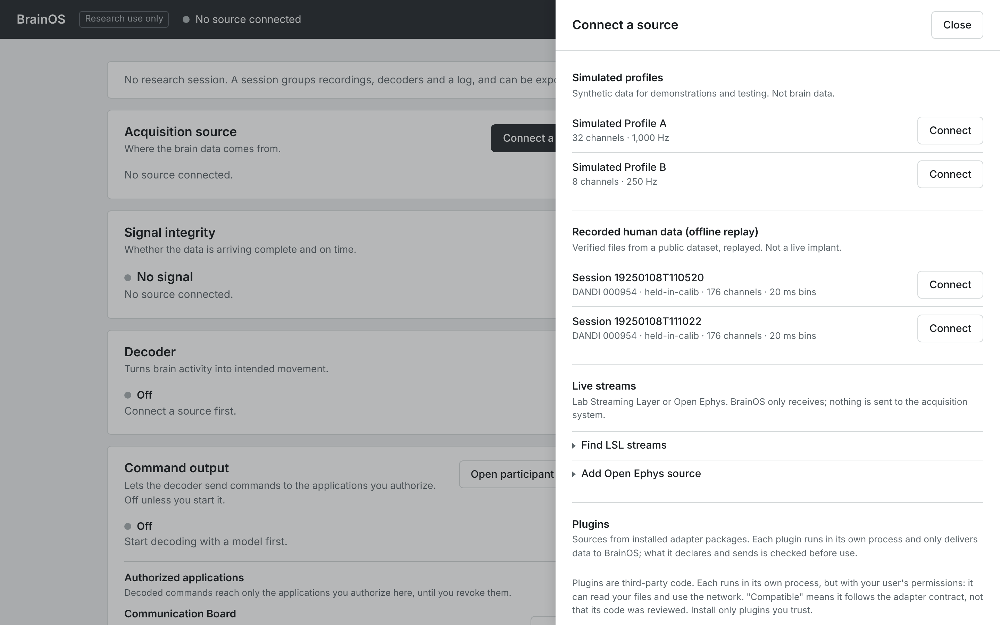

The panel lists every source Concord can use now, in groups. Its title is **Connect a source**
when nothing is connected and **Change source** otherwise.

| Control | What it does | When you see it | Notes / units / defaults |
| --- | --- | --- | --- |
| **Close** | Closes the panel | Always | So do Escape and clicking beside the panel. |
| **Connect** | Connects that source and closes the panel | Nothing connected | If the connection fails, the panel stays open and shows why. |
| **Switch** | Replaces the connected source with this one | A source is connected | Same button, renamed. |
| *Connected* | Marks the current source, also when it has stopped with an error | Next to the current source | After an error, click **Reset** in the row, or **Switch** to another source. |
| Hover on a row | Shows the source's description | Always | What it contains depends on the source: see the list below the table. |
| Grey box at the top | Why the last connect or remove failed or was refused, for example *device_error: open timed out* | After a failure or refusal | |

What the hover shows:

- Simulated profiles: a one-line description.
- FALCON files: the file name and dataset, for example *sub-HumanPitt-held-in-calib_ses-19250108T110520.nwb (DANDI 000954)*. The checksum result is in **Advanced → Acquisition details**.
- T15 blocks: the file name, dataset, block, task, *includes computer assistance* or *fully neural*, the duration, and that the SHA-256 is verified when the file is opened.
- Session recordings: *Replay of a recording from \<source> (\<source id>). Events are marked replayed.*
- LSL sources: the stream name, the host and the `source_id`.
- Open Ephys sources: that Concord cannot tell whether the GUI reads hardware, a file or a
  simulator.
- Plugin devices: no hover; their description is printed on the row.

### 4.4 Simulated profiles

*Synthetic data for demonstrations and testing. Not brain data.* You stand in for the
participant with **Advanced → Simulator controls** ([10.8](#108-simulator-controls)).

| Source | Shown as | What it provides | Board method it gets |
| --- | --- | --- | --- |
| **Simulated Profile A** | *32 channels · 1,000 Hz* | A raw signal, continuous pointer movement (50 times per second; with the pad at rest only small simulated noise), a select action, simulated device health once per second | **Pointer and click** |
| **Simulated Profile B** | *8 channels · 250 Hz* | A raw signal, a select action and text, no pointer; device health every 5 s | **Scanning** (Direct selection can be chosen) |

Neither profile is a model of a real device. Their events are labelled
[`simulated_intent`](GLOSSARY.md#simulated-intent) and
[*synthetic*](GLOSSARY.md#simulated-data-synthetic). Simulated input reaches the board
**without** command output or authorization (it is labelled *simulated input* on the board); only
decoded output needs them ([7.1](#71-when-commands-reach-an-application)).

### 4.5 Recorded human data (offline replay)

*Verified files from a public dataset, replayed. Not a live implant.* Files appear here as soon
as they are in the data folder's `datasets` folder (or any folder inside it) and you reload the
page. How to download them: [Getting started](GETTING_STARTED.md) and [Datasets](DATASETS.md).
The datasets: [FALCON H1](GLOSSARY.md#falcon-h1) and [AJILE12](GLOSSARY.md#ajile12) (both
[NWB](GLOSSARY.md#nwb) files from the [DANDI](GLOSSARY.md#dandi) archive), and
[T15](GLOSSARY.md#t15) (`.mat` files from [Dryad](GLOSSARY.md#dryad)).

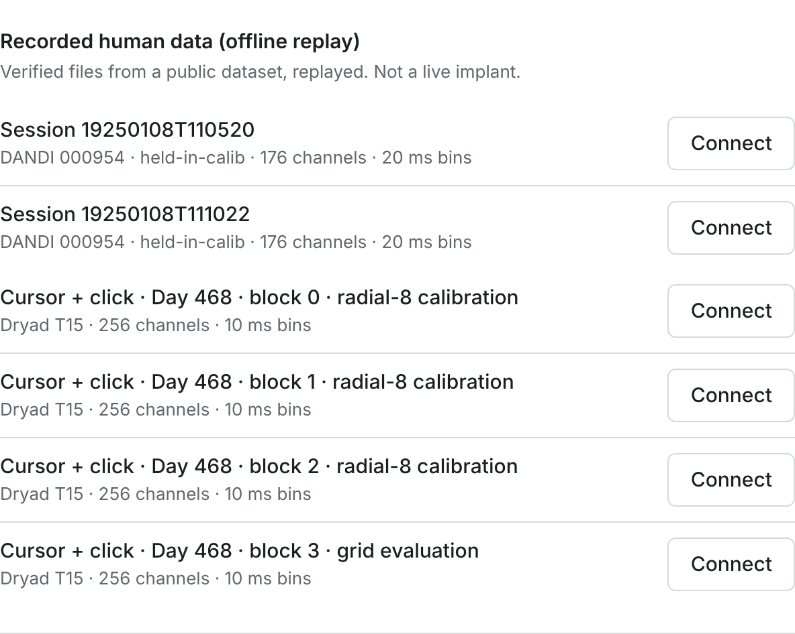

| Control | What it does | When you see it | Notes / units / defaults |
| --- | --- | --- | --- |
| *Session 19250108T110520*, *Session 19250108T111022* (*DANDI 000954 · held-in-calib · 176 channels · 20 ms bins*) | The two FALCON H1 demonstration blocks | FALCON files in `datasets/` | Either block works. See the note below the table. |
| *Session 5*, *Session 6* (*DANDI 000055 · 64 channels · 500 Hz*) | The two AJILE12 [ECoG](GLOSSARY.md#ecog) extracts | After `concord dataset ajile12` | Raw voltage, 64 electrodes. |
| **Show all N files** | Lists the remaining dataset files | More than four FALCON or AJILE12 files (for example after `concord dataset --all-calib`) | Only the first four are shown at first. The connected file is always shown. |
| *Cursor + click · Day 468 · block 0 · radial-8 calibration* | T15 block 0: [radial-8](GLOSSARY.md#radial-8) calibration task, includes computer assistance, 180 s | T15 files in `datasets/` | Sub-line *Dryad T15 · 256 channels · 10 ms bins*. |
| *Cursor + click · Day 468 · block 1 · radial-8 calibration* | T15 block 1: fully neural calibration, 70 s | T15 files in `datasets/` | |
| *Cursor + click · Day 468 · block 2 · radial-8 calibration* | T15 block 2: fully neural calibration, 180 s | T15 files in `datasets/` | |
| *Cursor + click · Day 468 · block 3 · grid evaluation* | T15 block 3: choosing targets on a grid, fully neural, 180 s | T15 files in `datasets/` | The block to use with the board ([7.7](#77-example-the-t15-recorded-decoder-on-the-board)). |
| *No recorded datasets yet. Put downloaded dataset files in `<folder>` (create the folder if needed; Getting started, section 4), then reload this page.* | Tells you where the files go | No dataset file found | The message names the real folder on your computer. |

A FALCON file's name is the recording's session time stamp; the dataset shifted the dates to 1925
for de-identification. *held-in-calib* is FALCON's name for its calibration split.

Every FALCON and AJILE12 file is checked against a pinned [SHA-256](GLOSSARY.md#sha-256)
checksum (a fingerprint of the published file); the result is shown in **Advanced → Acquisition
details** ([10.3](#103-acquisition-details)). T15 files are checked when you connect them;
Acquisition details has no dataset or citation panel for T15 (the citation is in
[Datasets](DATASETS.md)).

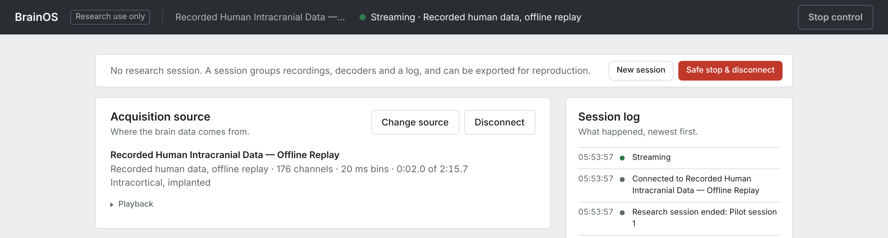

### 4.6 Session recordings (replay) and Other sources

**Session recordings (replay)**: *Recordings made with this console, replayed through the same
pipeline.* Each row is named *Replay · \<recording name>*, with what was recorded (for example
*Simulated data*). This group appears once you have made a recording ([10.5](#105-recording)).
Every replayed event is marked [replayed](GLOSSARY.md#replayed) (↺ in the event stream).

**A recording that contains pipeline features cannot be replayed cleanly in 0.3.1.** That is
every recording made while decoding runs, including every recording made from the
**Calibrate…** panel. On replay:

- the session log fills with *Undeclared capability: adapter emitted features.binned* (or
  *features.vector*) *but did not declare neural_features*, and, if a model was running while
  you recorded, the same for *intent.kinematics* and *intent.pointer*;
- **Advanced → Diagnostics → Contract violations** keeps rising (a
  [contract violation](GLOSSARY.md#contract-violation) means the source sent something it had not
  declared);
- if it was recorded with **Features and labels only**, the console also shows *No signal*.

Use such recordings to train a decoder ([6.5](#65-the-calibrate-panel)). To make a recording for
replay, record with decoding off.

**Other sources**: any other offline source Concord finds. It is empty in a standard
installation and then not shown.

### 4.7 Live streams: LSL

*Lab Streaming Layer or Open Ephys. Concord only receives; nothing is sent to the acquisition
system.* (One exception: an Open Ephys source sends a short
[heartbeat](GLOSSARY.md#heartbeat), a "still listening" message, to the GUI's plugin; see
[4.8](#48-live-streams-open-ephys). Nothing is ever sent to an LSL stream.)
([LSL](GLOSSARY.md#lsl-lab-streaming-layer) is a common way to stream data between programs on a
lab network.) Setting up your own equipment:
[Connect your equipment](CONNECT_YOUR_EQUIPMENT.md) and [Lab guide](LAB_GUIDE.md). To rehearse
without hardware, start a [test stream](GLOSSARY.md#test-stream) with
`concord publish lsl-ephys` or `concord publish falcon <file>`
([14.2](#142-test-streams-concord-publish)).

**The list of live sources.** Registered LSL and Open Ephys sources are listed at the top of the
**Live streams** group, each with **Remove** and **Connect** (or **Switch**). A row reads, for
example, *LSL · Concord synthetic ephys (EEG) — declared synthetic* with *Simulated data · 32
channels · 30,000 Hz*. Two streams can have the same name: hover over a row to see its
[`source_id`](GLOSSARY.md#source_id) and host. This list is kept only while Concord runs; after
a restart, search again.

#### Connect an LSL stream, step by step

1. Open **Find LSL streams** and click **Search the network**. It shows *Searching…* for about
   1.5 s.
2. The results table lists every stream found. **At the same time, every stream that can be a
   signal is added to the list of live sources above, ready to connect.** For a signal stream
   without attachments, just click **Connect** (or **Switch**) on its row. You are done.
   Behavior streams are added as rows too (named *… (Behavior)*); connect the signal stream's
   row, not theirs.
3. To attach a [behavior stream](GLOSSARY.md#behavior-stream) (calibration labels) or a
   [marker stream](GLOSSARY.md#marker-stream): click **Use** on the signal stream, pick the
   **Behavior stream (optional)** and **Marker stream (optional)**, and click **Add source**.
   This does **not** add a new row: it updates the signal stream's existing row with the
   attachments. The session log says *Registered LSL · …*. Then click **Connect** on that row.
4. To check the attachments: **Advanced → Capability contract** shows *behavior: Yes* in that
   source's column. Once connected, **Advanced → Acquisition details** lists one line per stream
   (*signal*, *behavior*, *markers*).

#### The Find LSL streams panel

| Control | What it does | When you see it | Notes / units / defaults |
| --- | --- | --- | --- |
| **Find LSL streams** | Opens the search | Panel open | |
| **Search the network** | Looks for LSL streams on your network for about 1.5 s | Inside **Find LSL streams** | Next to it: *Not searched yet*, or *Last search 4 s ago · 7 streams*. The search uses [multicast](GLOSSARY.md#multicast) on your local network. |
| *No LSL streams found on the network.* | Nothing was found | After a search | Check that the publisher runs and that both computers are on the same network ([LAB_SETUP.md](LAB_SETUP.md)). |
| Results: **Stream** | The stream's name and, below it, its type (EEG, Behavior, SpikeCounts, Markers, …) | After a search | Hover a row: its key, host, `source_id` and number format. |
| Results: **Channels** | Number of channels | After a search | |
| Results: **Rate** | Samples per second; *irregular* for streams without a fixed rate (markers) | After a search | |
| Results: **Units** | The channel units the stream declares | After a search | *channels not described* when it declares none; *none* for channels without a unit. |
| Results: **Declared** | What the publisher [declares](GLOSSARY.md#declared): *prerecorded*, *synthetic*, *prerecorded + synthetic*, *declared neither*, or *no declaration* | After a search | A declaration cannot be verified. |
| **Use** | Makes this stream the signal and shows the form below | Streams that can be a signal | Click again to unselect. |
| Reason instead of **Use** | Why a stream cannot be the signal, for example *stream '…' carries strings; use it as a marker stream*, or an irregular rate | Unusable streams | Such a stream can still be attached as a marker stream. |
| *Signal: name (type, N ch)* | The chosen signal stream | After **Use** | |
| **Behavior stream (optional)** | Attaches a stream whose values become behavior labels (for example cued velocity), mapped onto the signal's clock | After **Use** | Default **None**. Lists every other stream found; streams with the same name appear in the order of the results table. |
| **Marker stream (optional)** | Attaches a stream of event markers (for example trial start) | After **Use** | Default **None**. |
| **Add source** | Registers the signal with its attachments | After **Use** | Updates the existing row; does not connect. |
| **Remove** | Removes a registered source from the list | Each row that is not connected | |

### 4.8 Live streams: Open Ephys

**Add Open Ephys source** registers the Open Ephys GUI's *ZMQ Interface* plugin as a source
([Open Ephys GUI, ZMQ Interface](GLOSSARY.md#open-ephys-gui-zmq-interface);
[ZMQ](GLOSSARY.md#zmq) is the messaging library it uses). Setup in the GUI:
[OPEN_EPHYS.md](OPEN_EPHYS.md).

| Control | What it does | When you see it | Notes / units / defaults |
| --- | --- | --- | --- |
| **Host** | The computer running the Open Ephys GUI | **Add Open Ephys source** open | Default 127.0.0.1 (this computer). |
| **Data port** | The plugin's data port | **Add Open Ephys source** open | Default 5556 (1–65534). Concord sends [heartbeats](GLOSSARY.md#heartbeat) to the next port, 5557 by default. |
| **Sample unit** | The unit the GUI sends | **Add Open Ephys source** open | Default **Unknown (pass through unscaled)**. See the note below the table. |
| **Add source** | Registers *Open Ephys (ZMQ) · host:port* in the live-sources list | **Add Open Ephys source** open | Adding does not connect. Then click **Connect** on its row. |

- **Heartbeat**: a short "still listening" message. It is the only message Concord ever sends to
  any acquisition system.
- **Sample unit**: with **Unknown (pass through unscaled)**, samples are passed on unchanged and
  labelled [*arbitrary*](GLOSSARY.md#arbitrary-unit). With **uV**, **mV** or **V**, Concord
  converts to microvolts. The plugin does not transmit units, so choose what the GUI is set to.

The Open Ephys protocol cannot carry a "synthetic" or "prerecorded" declaration, so an Open
Ephys source is always shown as *Live stream, origin unverified*, even the test stream from
`concord publish openephys`.

### 4.9 Plugins

*Sources from installed adapter packages. Each plugin runs in its own process and only delivers
data to Concord; what it declares and sends is checked before use.* (A
[plugin](GLOSSARY.md#plugin) is an [adapter](GLOSSARY.md#adapter) that someone else wrote.)

The desktop app includes the BCI2000 plugin. BrainFlow, BCI2000 and the certification tools are
also published as wheel files on the release page (none of Concord's packages is on PyPI): see
[ECOSYSTEMS.md](ECOSYSTEMS.md) and [Connect your equipment](CONNECT_YOUR_EQUIPMENT.md). Writing
your own: [ADAPTER_SDK.md](ADAPTER_SDK.md).

| Control | What it does | When you see it | Notes / units / defaults |
| --- | --- | --- | --- |
| Trust note | *Plugins are third-party code. Each runs in its own process, but with your user's permissions … "Compatible" means it follows the adapter contract, not that its code was reviewed. Install only plugins you trust.* | Always | |
| Plugin name and status line | For example *BCI2000 App Connector* with *concord-bci2000@0.1.0 · compatible · bci2000 · uses the network* | Each installed plugin | *compatible*: Concord accepts it. *rejected: …* or *failed to load: …* gives the reason; such a plugin cannot be used. *uses the network*: it opens a network port. |
| Device rows | Each device the plugin found, with its description, **Connect** / **Switch** | Compatible plugins | *No devices found.* or *Device search failed: …* otherwise. |
| **Options** | The plugin's own settings for that device | Plugins that have settings | Fields are defined by the plugin; see the note below the table. |
| *No plugins installed. Install an adapter package into Concord's Python environment, then search again.* | Nothing installed | No plugin | |
| **Search again** | Looks again for installed plugins | Always | Next to it: *Last search 4 min ago · adapter SDK 1.0* (the plugin-interface version this Concord supports). Concord also searches by itself at start. |

Plugin **Options**: each field is labelled with the plugin's own description of it, and the
device's description says which fields it needs. For example, *BrainFlow playback file* says
*Needs options 'file' and 'master_board'*: these are the fields *BrainFlowInputParams.file …*
and *PLAYBACK_FILE_BOARD / STREAMING_BOARD only: BoardIds name of the board that produced the
data …*. A plugin may also mark fields *(required)*; the BrainFlow and BCI2000 plugins do not.
Only values you change are sent; the plugin checks them when you connect. Both plugins' options
are explained in [ECOSYSTEMS.md](ECOSYSTEMS.md).

---

## 5. Signal integrity

*Whether the data is arriving complete and on time.* Laid out like a patient monitor: live traces
on the left, the verdict and three measured numbers on the right.

| Control | What it does | When you see it | Notes / units / defaults |
| --- | --- | --- | --- |
| Traces (raw sources) | The first four [channels'](GLOSSARY.md#channel) [raw](GLOSSARY.md#raw-signal) samples, each scaled to fit its lane | Simulated profiles, raw LSL streams, Open Ephys, AJILE12 | Caption: *Showing 4 of 32 channels · raw samples, last 2 s, each scaled to fit*. Shapes only: there is no voltage scale. |
| Traces (feature sources) | Four channels' counts per [bin](GLOSSARY.md#bin), on a common scale | FALCON, T15, LSL spike-count streams | Caption: *Showing 4 of 176 channels with the most activity · spike count per 20 ms bin, last 5 s*. The four most active channels are chosen once, after the first second. |
| *Waiting for data* | No data to draw yet | Just after connecting, or a source with nothing drawable | |
| Verdict (*Good*, *Gaps detected*, …) | A one-word summary | Always | Hover for the exact rules (table below). |
| **Channels** | Channels in the latest data block, of the channels the source declares: *32 of 32* | Connected | A smaller first number means channels are missing from the stream. |
| **Data received (%)** | Share of the data that arrived | Connected | Measured only for LSL and Open Ephys; *—* for every other source. See the note below the table. |
| **Delay to this screen (ms)** | Median time from Concord receiving an event to this browser tab receiving it, over the last 1,000 events | Connected | Measured in this browser, not from the brain or the device. A value that keeps growing means this tab is falling behind. |

- **Data received (%)**: for LSL, samples received compared with samples estimated missing from
  time-stamp gaps; for Open Ephys, messages received compared with messages missed. Other sources
  do not report losses, so nothing is estimated and the figure shows *—*.
- **Delay to this screen** is never shown below 0: on one computer, clock rounding could
  otherwise produce tiny negative values.

| Verdict | When | What to do |
| --- | --- | --- |
| *Good* | None of the conditions below | Nothing. |
| *Gaps detected* | A loss counter rose in the last 10 s (the list is below the table) | Look at **Advanced → Acquisition details** (source losses) and **Advanced → Diagnostics → Subscriber drops**. |
| *No signal* | No raw-signal or feature data arrived in the last 2 s (also shown when nothing is connected) | Check the source. A replayed features-only recording also shows this ([4.6](#46-session-recordings-replay-and-other-sources)). |
| *Paused* | You paused the source | **Resume**. |
| *Interrupted — reconnecting* | Concord is reconnecting to the source | Wait; see [2.2](#22-every-state-the-title-bar-can-show). |

*Gaps detected* counts these losses: stream gaps, estimated missing samples, missed messages,
incomplete blocks, inputs the pipeline dropped, and events an application or console tab could
not take in time ([subscriber drops](GLOSSARY.md#subscriber-drops)). If **Data received (%)**
shows *—* or 100, the cause is usually a slow application: check **Advanced → Connected
applications** for a non-zero *dropped*, and close console or board tabs you don't need.

Concord counts every loss and reconnect; it never fills gaps silently. Detailed per-stream
counters are in [10.3](#103-acquisition-details).

---

## 6. Decoder

*Turns brain activity into intended movement.* This row starts the processing
[pipeline](GLOSSARY.md#pipeline) (filters and [feature](GLOSSARY.md#features) extraction) and,
optionally, a [decoder](GLOSSARY.md#decoder) model. What decoders are and how they are evaluated:
[How Concord works](CONCEPTS.md#5-decoders-from-brain-activity-to-intended-movement).

### 6.1 The row

| Control | What it does | When you see it | Notes / units / defaults |
| --- | --- | --- | --- |
| **Start decoding** | Opens the **Start decoding** panel ([6.2](#62-the-start-decoding-panel)) | A source is connected, decoding is off | |
| **Stop decoding** | Stops processing and the decoder | Decoding runs | Command output turns off with it. |
| **Calibrate…** | Opens the **Calibrate a decoder** panel ([6.5](#65-the-calibrate-panel)) | A source is connected | |
| *Off* / *Connect a source first.* | Nothing runs | Decoding off | |
| *Unavailable: …* | Decoding cannot run in this installation, with the reason | Rare | |
| *Running · \<processing>* | Decoding runs with that [processing preset](GLOSSARY.md#processing-preset) | Decoding | Green dot. |
| *No model: features only.* | Only features are computed; nothing can become a command | Decoding without a model | Useful for watching or recording features. |
| *Model \<id> · offline held-out R² 0.xxx* | The running model and its [offline held-out score](GLOSSARY.md#offline-held-out-score) ([R²](GLOSSARY.md#r-squared)), as reported by the model file | Decoding with a movement model | [Classifiers](GLOSSARY.md#classifier) and click models show other scores (below the table). |
| Origin line | For example *Concord-trained · ridge regression · in Concord · compatible with this source* | With a model | The possible values are below the table. |
| *Trained on …* | The recording(s) the model was fitted on | With a model | |
| *Historical decoder replay (original research system): t15-historical-velocity → vx, vy (velocity, 271 received)* | A decoder output the source carries, passed through unchanged; the count is how many outputs arrived since decoding started | **Source decoder outputs (passthrough)** | One line per decoder output; T15 has two (velocity and click). See [historical](GLOSSARY.md#historical-model-origin). |
| *T15-historical-velocity: no declared output scale; the router uses its values as they are.* (amber) | The source does not say in what units its output is | Passthrough of such an output | **Gain** and **Dead-zone** are then in the decoder's own units ([7.3](#73-settings-for-movement-decoders)). |
| *Estimating thresholds (0.6 s left).* | The spike-band preset measures each channel's noise level during the first second | Spike-band preset, first second | |
| *Drift monitor warming up (N bins)* | The [drift monitor](GLOSSARY.md#drift-monitor) compares incoming features with the model's training data; it needs some data first | With a Concord model | Then *No drift from the training data detected*, or (amber) *Recalibration recommended: …* with the reason. *Drift monitor: …* means it cannot check (for example no training statistics). |
| *Cross-source override: decoded output is marked as reduced quality.* (amber) | You allowed a model trained on another source ([cross-source model](GLOSSARY.md#cross-source-model)) | After **Allow a model trained on a different source** | |
| Compatibility warnings (amber) | Differences between the model and the source that do not prevent running | With a model | |
| *Decoder stopped: …* (grey box) | The decoder failed; command output turned off | After a decoder failure | Check the reason; start decoding again. |
| *This recording carries the replayed output of an offline decoder (\<model>); it is not used for control.* | The file contains a decoder's recorded output (T15: the original research system's decoders) | Such a file, decoding off | It reaches command output only if you choose **Source decoder outputs ([passthrough](GLOSSARY.md#passthrough))** and start control ([7.7](#77-example-the-t15-recorded-decoder-on-the-board)). Only one of the recording's decoders is named: T15 carries two (velocity and click), and passthrough passes both. |

- **Other scores.** A classifier shows *classes … · offline held-out balanced accuracy …
  (chance …)* ([balanced accuracy](GLOSSARY.md#balanced-accuracy),
  [chance](GLOSSARY.md#chance)). A click model shows *events …*. An offline score says how well
  the model reconstructs recorded labels, not how well a person could control anything.
- **Origin line.** The origin is *Concord-trained*, *Imported model file*, *Decoder plugin*,
  *External decoder* or *Historical decoder replay (original research system)*. Where it runs:
  *in Concord* or *isolated process*. The line adds *channels mapped by label (operator
  enabled)* when you chose **Map channels by label**.

### 6.2 The Start decoding panel

| Control | What it does | When you see it | Notes / units / defaults |
| --- | --- | --- | --- |
| **Processing** | Chooses how features are made from the source ([6.3](#63-processing-presets)) | Always | Preselected for the source. A one-paragraph description of the chosen preset appears below it. |
| **Bin (ms)** | Length of one feature [bin](GLOSSARY.md#bin) | Spike-band, High-gamma, Band power | Leave empty for the default: 20 ms (spike-band) or 50 ms (high-gamma, band power). Must be a number above 0 and up to 1000; another value is refused with *Bin (ms) must be above 0 and at most 1000*. |
| **Threshold (× RMS)** | Spike detection threshold, in multiples of each channel's noise level ([RMS](GLOSSARY.md#rms)) | Spike-band only | Default −4.5 (negative: crossings below the noise). Allowed −20 to just below 0. |
| **Band low (Hz)**, **Band high (Hz)** | The frequency band whose power is computed | Band power only | No default: fill both, or the panel says *band_power needs a low and a high band edge*. |
| **Decoder model** | **None (features only)** or a model ([6.4](#64-decoder-models)) | Every preset except Source decoder outputs | Each model is marked *(compatible)* or *(incompatible)* with what this processing will produce. Models Concord refuses are greyed out. |
| Model details | Origin, data it was trained on, its score, what it expects, compatibility, warnings | A model is chosen | See [6.4](#64-decoder-models). |
| **Map channels by label (the model's channels are taken from the source by name)** | Feeds the model the source channels whose labels match the model's channel labels, in the model's order | Offered only when the labels allow it | Use only if the labels name the same electrodes. The mapping is logged and shown while decoding. |
| **Allow a model trained on a different source** | Runs a model calibrated on another source or session | A model is chosen | For deliberate cross-source tests only. Its output is not expected to be meaningful; decoded events are marked reduced quality. |
| **Mark this file trusted** / **Withdraw trust** | Allows (or no longer allows) a [pickle or joblib](GLOSSARY.md#pickle-joblib) model file to load | Such a file is chosen | See the note below the table. |
| **Start decoding** | Starts | The source is streaming or paused | Otherwise: *Connect a source (streaming or paused) first.* A refusal is shown in a grey box (example below the table). |
| **Search for decoder plugins** | Looks again for installed decoder plugins | Always | *Installed decoder plugins and model files are listed with the models.* |
| **Close** | Closes the panel without starting | Always | |

- **Trust.** Pickle and joblib files run code from the file when loaded, so Concord refuses them
  until you decide. The decision is tied to the file's [SHA-256](GLOSSARY.md#sha-256): changing
  the file voids it.
- **Refusal example**: *capability_unsupported: Recorded Human Intracranial Data — Offline Replay
  provides no continuous raw signal (recording frames)*, when a raw preset is chosen for a FALCON
  file.

### 6.3 Processing presets

| Preset (**Processing**) | For | What it does | Preselected when | Parameters |
| --- | --- | --- | --- | --- |
| **Spike-band threshold crossings** | [Intracortical](GLOSSARY.md#intracortical-intracranial) broadband signals, at least 10 kHz | Band-pass 250–5000 Hz, [common average reference](GLOSSARY.md#common-average-reference) (with 8 or more channels), counts of negative threshold crossings per bin (1 ms refractory period); the noise level (RMS) is measured over the first second | The source's raw rate is 10 kHz or more (LSL ephys, Open Ephys) | **Bin (ms)** 20, **Threshold (× RMS)** −4.5 |
| **High-gamma band power** | [ECoG](GLOSSARY.md#ecog), [sEEG](GLOSSARY.md#seeg), [LFP](GLOSSARY.md#lfp), at least 400 Hz | Mains [notch](GLOSSARY.md#notch-filter) at 60 Hz and its harmonics (or the mains frequency the source declares), common average reference without channels the source marks bad, 70–150 Hz band, log10 mean power per bin | Raw rate 400 Hz to 10 kHz (Simulated Profile A, AJILE12) | **Bin (ms)** 50 |
| **Band power** | Any rate | log10 mean power in one band you choose, per bin (common average reference with 8 or more channels) | Raw rate below 400 Hz (Simulated Profile B) | **Bin (ms)** 50, **Band low (Hz)**, **Band high (Hz)** (required) |
| **Source features (passthrough)** | Sources that already deliver binned features | No processing | The source delivers features (FALCON, T15, LSL spike counts) | None |
| **Source decoder outputs (passthrough)** | Sources that carry a decoder's output | No features and no model: the source's own decoder outputs go to **Command output** unchanged, keeping their model name and origin | Never preselected; listed only when the source carries decoder outputs (T15) | None |

A raw preset on a source without a raw signal, or a preset below its minimum rate, is refused
with the reason. **Source decoder outputs** passes on a research system's recorded decoder (T15)
or an external system's live decoder; see [passthrough](GLOSSARY.md#passthrough).

### 6.4 Decoder models

The **Decoder model** list shows every model Concord can run:

- **Concord-trained** models: made with **Calibrate…** ([6.5](#65-the-calibrate-panel)) or, in a
  source installation, `make model`. Saved as JSON files in the data folder's `models` folder.
- **Imported model files** ([ONNX](GLOSSARY.md#onnx), scikit-learn via
  [skops](GLOSSARY.md#skops), [TorchScript](GLOSSARY.md#torchscript),
  [safetensors](GLOSSARY.md#safetensors); [pickle and joblib](GLOSSARY.md#pickle-joblib) only
  after **Mark this file trusted**): copy the file and its `<id>.manifest.json` into the `models`
  folder. They run in an [isolated](GLOSSARY.md#isolated) process.
- **Decoder plugins**: installed packages; **Search for decoder plugins** finds new ones.

The list is read again each time you open the panel. How to bring your own model:
[DECODER_SDK.md](DECODER_SDK.md).

Model details, shown when you pick a model:

| Line | Meaning |
| --- | --- |
| **Decoder** | Origin · [family](GLOSSARY.md#decoder-family) (ridge regression, Kalman filter, LDA classifier, click classifier, ONNX, scikit-learn, TorchScript) · where it runs |
| **Trained on data from** | The modality of the training data; *not participant-specific* when it was not calibrated on this participant |
| **Trained on** | The recording(s) |
| **Source** | The source the training data came from |
| **Offline held-out R²** / **Offline held-out balanced accuracy** / **Outputs** | The score reported by the model file, with its control ([mean predictor](GLOSSARY.md#mean-predictor-control), or chance) and the number of held-out samples |
| **Expects** | Feature, bin length and channel count the model needs, and what it outputs (for example *threshold crossing count · 20 ms bins · 32 channels → vx, vy*) |
| Compatibility line | *Compatible with this processing (… preview).*, or *Not compatible with this processing (… preview).* followed by the reasons in a grey box, or *Compatibility is checked against the pipeline output when it starts.* |
| Errors (grey box), warnings (amber) | Why it cannot run, or what to be careful about |

### 6.5 The Calibrate panel

**Calibrate…** opens *Calibrate a decoder*: record labelled data from the connected source, then
fit a decoder on it ([calibration](GLOSSARY.md#calibration)). Step by step with a lab setup:
[LAB_GUIDE.md](LAB_GUIDE.md).

The labels come from a [behavior stream](GLOSSARY.md#behavior-stream): an LSL behavior stream
you attached ([4.7](#47-live-streams-lsl)), BCI2000 states, or a test stream. Simulated profiles
carry no labels.

**To rehearse without hardware:**

1. Start `concord publish lsl-ephys` (a synthetic signal plus a "latent velocity" behavior
   stream; [14.2](#142-test-streams-concord-publish)).
2. Connect its signal stream with the behavior stream attached ([4.7](#47-live-streams-lsl)).
3. **Start decoding** with **Spike-band threshold crossings** and **None (features only)**.
4. Record and train here (steps 1 and 2 below).

#### Step 1: Record a calibration session

| Control | What it does | When you see it | Notes / units / defaults |
| --- | --- | --- | --- |
| **Start recording** | Records features and behavior labels only, not raw samples | A simulated or live source (LSL, Open Ephys, plugin) is streaming or paused | Up to an hour by default ([15](#15-configuration-file)). See the notes below the table. |
| **Stop recording** | Ends it; it appears in the list below | While recording | *Recording \<name>* is shown next to it. |
| *A recorded file is already a recording and cannot be recorded again. Calibrate from a simulated or live source, or train on an earlier session recording below.* | Explains why **Start recording** is greyed out | FALCON, AJILE12, T15 or session recording connected | |
| *Connect a source that is streaming to record.* | Explains why you cannot record now | Nothing streaming | |

- With a raw source, start decoding without a model first, so that the pipeline computes
  features to record.
- The recording is named after the source and the time, for example
  *lsl-concord-synthetic-ephys-20261109-024115* for the `concord publish lsl-ephys` test stream.

#### Step 2: Train

*The first part of the data trains the decoder; the chronological tail, after a gap, is held out
for scoring.* ([Held-out](GLOSSARY.md#held-out) data is used only to score the decoder, never to
fit it.)

| Control | What it does | When you see it | Notes / units / defaults |
| --- | --- | --- | --- |
| Recording checklist | Tick the recordings to train on | Finished recordings exist (otherwise *No finished recordings yet.*) | Each line: name · source id · *— events* · size · *synthetic* when the data was synthetic. 0.3.1 does not count events here. |
| **What the decoder should output** | **Continuous movement**, **Discrete classes** or **Click** | Always | The line below says what it needs (list below the table). |
| **Decoder family** | Which kind of model | Continuous movement, Click | Choices below the table. Discrete classes always uses the LDA classifier (no choice shown). |
| **Label dimension (optional)** | Which behavior dimension holds the label | Discrete classes, Click | Needed only when there are several. Examples shown: `cue_class`, `click`. |
| **Class names (optional)** | Names for classes 0, 1, 2, … separated by commas | Discrete classes | Example shown: `rest, left, right`. A class named rest, idle, none or baseline later gets no action by default ([7.4](#74-settings-for-classifiers)). |
| **Train fraction** | The share of the data (from the start) used for fitting ([train fraction](GLOSSARY.md#train-fraction)) | Always | Default 0.8; allowed 0.5 to 0.95. |
| **Gap (bins)** | Bins skipped between the training part and the held-out part, so that slow signals do not leak from one into the other | Always | Default 12; a whole number, 0 or more. |
| **Feature source** | Which features in the recording to use | Always | Default **All feature events in the recording**. Other choices below the table. |
| **Use every feature stream in the recording, joined per bin** | Uses all feature streams of the same bins together (for example threshold crossings and spike-band power) | Always | Off by default. |
| **Check labels** | Checks that the ticked recordings contain the labels the chosen output needs | A recording is ticked | Green on success, for example *Labels found: vx, vy · 885 labelled bins*, with notes. Otherwise the problem in a grey box (example below the table). |
| **Train decoder** | Fits and saves the decoder | A recording is ticked and the numbers are valid | Shows *Training…* while it works. The result is logged as *Model \<id> trained · …*. |
| Report | The saved model's id (*It is now selectable under Start decoding.*) and its offline held-out results | After training | Contents in the table below. |
| Disclaimer | *An offline held-out score on a recording does not establish closed-loop performance …* | Always | See [closed loop](GLOSSARY.md#closed-loop-open-loop). |

**What the decoder should output**, and what each choice needs (the line under the choice):

- **Continuous movement**: *a behavior stream with continuous targets (e.g. cued cursor
  velocity)*.
- **Discrete classes**: *a behavior dimension with a small-integer class code per bin (e.g. a
  cue)*.
- **Click**: *a behavior dimension that is 1 while a click is attempted and 0 otherwise*.

**Decoder family** choices:

- Continuous movement: **Default (ridge regression)**, **ridge regression**, **Kalman filter**
  ([ridge regression](GLOSSARY.md#ridge-regression), [Kalman filter](GLOSSARY.md#kalman-filter)).
- Click: **Default (LDA classifier)**, **LDA classifier**, **click classifier**
  ([LDA classifier](GLOSSARY.md#lda-classifier), [click classifier](GLOSSARY.md#click-classifier)).

**Feature source** choices (pick one when a recording holds more than one kind of feature):

- **All feature events in the recording** (default).
- **Features computed by the Concord pipeline**: those made by **Start decoding** from a raw
  source.
- **Features delivered by an LSL stream**: binned counts the stream itself sent.
- **Spike bins from Open Ephys**: spikes the Open Ephys GUI detected, binned by Concord.

**Check labels** problem example: a recording has *no neural features (features.binned /
features.vector)*. Record again while decoding runs.

**The report** shows offline held-out results only. Its lines depend on the output:

| Report line | Shown for | What it says |
| --- | --- | --- |
| **Offline held-out R²** | Continuous movement | [R²](GLOSSARY.md#r-squared), the number of samples, the [mean-predictor control](GLOSSARY.md#mean-predictor-control) and, when computed, the [time-shift control](GLOSSARY.md#time-shift-control) |
| **Per dimension** | Continuous movement | The R² of each output |
| **Velocity error** | Continuous movement, when computed | Mean error, mean target speed, error per dimension (RMSE) |
| **Bins** | Continuous movement | Total, labelled, train, gap, held-out |
| **Held-out balanced accuracy** | Discrete classes | [Balanced accuracy](GLOSSARY.md#balanced-accuracy) with [chance](GLOSSARY.md#chance), plain and majority-class accuracy, the time-shift control, the number of bins |
| **Per class** | Discrete classes | The accuracy of each class |
| **Confusion** | Discrete classes | A table of true against predicted classes |
| **Click events (held-out)** | Click | [Precision, recall](GLOSSARY.md#precision-and-recall) and [F1](GLOSSARY.md#f1); how many clicks were detected within a tolerance; false clicks per minute; per-bin [ROC AUC](GLOSSARY.md#roc-auc) |
| **Source** | Continuous movement, discrete classes | Where the data came from; *synthetic data* or *prerecorded data streamed live* when it applies |
| **Recordings** | Continuous movement | The recordings it was trained on |

---

## 7. Command output

*Lets the decoder send commands to the applications you authorize. Off unless you start it.*
[Command output](GLOSSARY.md#command-output) is the only path from a decoder to an application.
Background: [How Concord works](CONCEPTS.md#6-command-output-the-only-way-decoded-data-reaches-an-app).
Every rule and stop path in detail: [CONTROL_BRIDGE.md](CONTROL_BRIDGE.md).

### 7.1 When commands reach an application

A decoded command reaches an application only while **all three** hold:

1. a decoder runs: a model, or **Source decoder outputs (passthrough)**;
2. you clicked **Start control** (command output is *On*);
3. you clicked **Authorize** for that application ([authorize](GLOSSARY.md#authorize-revoke)).

**Simulated profiles are different.** Their pointer, select and text input is simulated (the
operator standing in for a participant), not decoded, so it reaches the board directly, without
command output and without authorization. That is why, with a simulated profile, the board row
can read *Receiving pointer movement, discrete actions.* next to an **Authorize** button, and why
**Stop control** stays grey: there is no command output to stop. To stop simulated input, pause
or disconnect the source.

### 7.2 The row

| Control | What it does | When you see it | Notes / units / defaults |
| --- | --- | --- | --- |
| **Start control** | Turns command output on with the current settings | A decoder runs and command output is off | Turning it off is the title bar's **Stop control**. A refusal appears in a grey box under the settings (example below the table). |
| **Open participant screen** | Opens the communication board in its own window (1280 × 800), for a second screen facing the participant | Always | Clicking again brings the same window forward. If the browser blocks pop-ups, it opens in a new tab instead. |
| *Off* / *On · …* | Whether command output is on, and what it sends | Always | Notation below the table. |
| *Start decoding with a model first.* | Why it cannot start | Nothing is decoding | |
| *The decoder has no model. Start decoding with a model.* | Why it cannot start | Decoding with **None (features only)** | |
| *Last stopped: …* | Why command output last turned off | A decoder with a model (or **Source decoder outputs**) runs and command output is off, once command output has been on since Concord started | Reasons in [7.6](#76-why-command-output-turned-off-last-stopped). |
| *When started, the cursor in authorized apps follows the decoder's vx/vy output.* | What starting would do | A movement decoder runs, output off | For a classifier: *When started, authorized apps receive select when left is held, …*, or *Choose in Settings which class triggers which action.* |
| **Settings** | Folded mapping settings | A decoder runs | [7.3](#73-settings-for-movement-decoders) for movement decoders, [7.4](#74-settings-for-classifiers) for [classifiers](GLOSSARY.md#classifier). |
| **Authorized applications** | Every application that asks for commands, with **Authorize** / **Revoke** | Applications are connected | [7.5](#75-authorized-applications). |
| Footer line | *N applications connected*, then *\<app> waiting for: …* for each one that cannot run | Always | The console itself is not counted. |

**Refusal example** for **Start control**: *protocol_error: decoder … declares +y up; the
pointer workspace's +y is down: enable invert_y (console: Command output → Settings → Invert
y)*.

**Reading the status line.** *On · x ← vx, y ← vy (inverted), gain 1.09; click ← click* means:
the horizontal pointer velocity comes from the decoder output `vx`, the vertical from `vy`
(inverted), multiplied by a gain of 1.09, and clicks come from the output `click`. For a
classifier it reads like *select ← left; activate ← right* (action ← class).

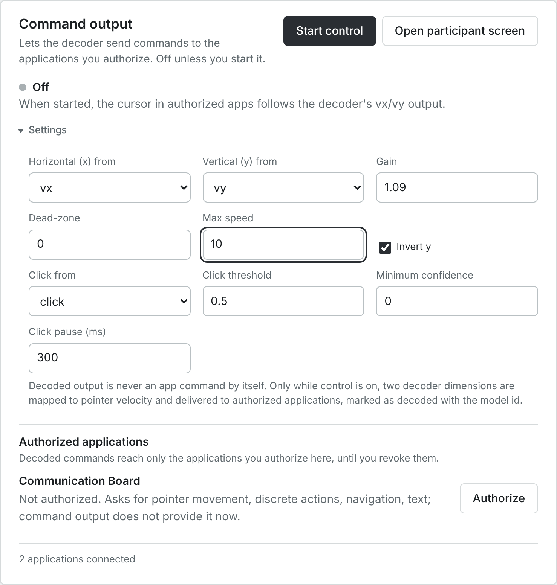

### 7.3 Settings for movement decoders

For decoders with continuous output (velocity). Open **Settings** to see them. The pointer moves
in the application's [workspace](GLOSSARY.md#workspace): the board's tile area, counted as 1 wide
and 1 high, with y pointing down.

| Control | What it does | Default; allowed values |
| --- | --- | --- |
| **Horizontal (x) from**, **Vertical (y) from** | Which decoder outputs drive the pointer. Both must come from the same decoder. | The decoder's first and second outputs |
| **Gain** | Multiplies the decoder output to give pointer velocity. Its units depend on the decoder (below the table). | 1; above 0 and up to 10 |
| **Dead-zone** | Outputs smaller than this are treated as zero, before the gain. Use 0 to pass every movement. | 0.3; 0 to just below 3 |
| **Max speed** | Upper limit of the pointer speed on each axis, in workspaces per second (2 = across the whole board in half a second). | 2; above 0 and up to 10 |
| **Invert y** | Flips the vertical direction. | Ticked automatically when the decoder declares that its +y points up; otherwise unticked |
| **Click from** | A decoder output that is a click probability or a 0/1 click decision (details below the table). | The running decoder's click output if it has one; otherwise **No click** |
| **Click threshold** | The click output must reach this value. Shown once a click output is chosen. | 0.5; above 0 and up to 1 |
| **Minimum confidence** | Clicks whose confidence is below this are not sent; they are counted as *clicks gated* ([10.2](#102-pipeline-details)). Shown once a click output is chosen. | 0; 0 to 1 |
| **Click pause (ms)** | Minimum time between two clicks. Shown once a click output is chosen. | 300; 0 to 10000 |
| **Apply settings** | Applies changed settings. Shown while command output is on; while it is off, the settings apply when you click **Start control**. | |
| Problem line (amber) | *Check the settings: 0 < gain ≤ 10, 0 ≤ dead-zone < 3, 0 < max speed ≤ 10.*, *Check the click: …*, or *The click cannot come from a dimension that moves the pointer.* **Start control** stays grey until it is fixed. | |

**Units of Gain and Dead-zone.** They depend on the decoder:

- **Concord-trained model**: the output is first divided by its training standard deviation.
  Gain 1 turns a typical training movement into 1 workspace per second, and the dead-zone is in
  training standard deviations.
- **Source decoder outputs**: the output is used as it is, unless the source declares a scale.
  Gain 1 means one of the decoder's own units per second, and the dead-zone is in the decoder's
  own units.

**Invert y.** The screen's +y points down. When the decoder declares that its +y points up,
**Invert y** is ticked for you, and starting without it is refused.

**Click from** lists the outputs of **every running decoder** other than the two pointer outputs,
including a second decoder such as a recording's click decoder. Without a click, the board can
still select by dwelling ([11.8](#118-input-methods)).

**The settings reset every time decoding starts.** They are filled in with their defaults when
decoding starts, also when you restart the same decoder, and are kept while you edit. So after
**Stop decoding** → **Start decoding**, enter your values again before **Start control** (for
the T15 example in [7.7](#77-example-the-t15-recorded-decoder-on-the-board): **Gain** 1.09,
**Dead-zone** 0, **Max speed** 10).

### 7.4 Settings for classifiers

For decoders that output classes (for example rest, left, right). *The decoder estimates how
likely each class is. An action is sent when a class stays above its threshold for the hold
time; it can repeat only after the class drops back and the pause has passed.*

| Control | What it does | Default; allowed values |
| --- | --- | --- |
| **When \<class> is held** | The action for that class; one per class (choices below the table). | Classes named rest, idle, none or baseline: **No action**. The others: Select, Activate, Cancel, in order |
| **Threshold** | Probability the class must exceed. Shown once an action is chosen. | 0.8; above 0 and up to 1 |
| **Hold (ms)** | How long the class must stay above the threshold. Shown once an action is chosen. | 300; 0 to 10000 |
| **Pause (ms)** | Minimum time before the same class acts again. Shown once an action is chosen. | 1000; 0 to 60000 |
| **Text** | The text to type. Shown for **Type text**; required (otherwise *Enter the text to type for \<class>.*). | Up to 64 characters |
| **Apply settings** | As for movement decoders. Shown while command output is on. | |
| Problem line | *Check the actions: …* or *Choose an action for at least one class.* | |

The actions for **When \<class> is held**:

- [discrete actions](GLOSSARY.md#discrete-actions): **No action**, **Select**, **Activate**,
  **Cancel**;
- [navigation](GLOSSARY.md#navigation): **Move to next**, **Move to previous**, **Move up**,
  **Move down**, **Move left**, **Move right**;
- text: **Type text**.

### 7.5 Authorized applications

*Decoded commands reach only the applications you authorize here, until you revoke them.* Each
application that asks for commands is listed once by name, even if several windows of it are
open: all windows of one application share one authorization.

| Control | What it does | When you see it | Notes / units / defaults |
| --- | --- | --- | --- |
| Application name | For example *Communication Board* | It asks for command capabilities | |
| Status sentence | What it receives now, or would receive | Always | See the table below. |
| **Authorize** | Lets this application receive every kind of command it asks for (for the board: pointer movement, discrete actions, navigation, text) | The application is connected and not yet authorized for everything it asks | Logged as *Authorized Communication Board for …*. Lasts until you click **Revoke** or Concord quits, across source changes and research sessions. |
| **Revoke** | Withdraws the authorization; commands already queued for it are withdrawn | It is authorized for something | Logged as *Revoked …*. |

| Status sentence | Meaning |
| --- | --- |
| *Not authorized. Asks for pointer movement, discrete actions, navigation, text; command output does not provide it now.* | Command output is off, and it is not authorized. |
| *Not authorized. Would receive pointer movement, discrete actions.* | Command output is on: authorize it and it receives these. |
| *Receiving pointer movement, discrete actions.* | The current source (simulated input) or command output provides these to it. Simulated input needs no authorization ([7.1](#71-when-commands-reach-an-application)). With a simulated profile the sentence stays the same while the profile is paused or has stopped with an error: look at the title bar to see whether input is actually flowing. |
| *Authorized for … .* | Authorized; it will receive commands when command output provides them. |
| *Authorized for … . Nothing to receive now.* | Authorized, but command output is off or provides none of these. |
| *… It cannot run without …, which command output does not provide now.* | A capability it requires is missing. |
| *Not connected. Authorized for … .* | Authorized, but no window of it is open. (For the Communication Board you will not see this while a console tab is open: each console tab contains a board, see [10.9](#109-communication-board-embedded).) |

**Why you may see "2 (or 3) applications connected" before opening anything.** Every console tab
contains an embedded copy of the communication board (**Advanced → Communication board**), which
connects as an application. The footer counts every connection: each console tab's embedded
board, plus each participant window. They all appear under the one name *Communication Board*
and share its authorization. Close console tabs you don't use.

### 7.6 Why Command output turned off (Last stopped)

The line appears while a decoder runs and command output is off. It shows the most recent stop
since Concord started, which can come from an earlier decoder or source.

| *Last stopped: …* reason | Cause |
| --- | --- |
| *stopped by operator (console)* | You clicked **Stop control** |
| *source paused* | You paused the source |
| *source link lost* | The source connection dropped; command output stays off after Concord reconnects |
| *input stalled: no decoder input for N ms (limit L)* | No decoder input arrived for longer than the limit (1000 ms, or three bins if longer): a [router stall](GLOSSARY.md#router-stall) |
| *decoder \<model> failed: …* | The decoder failed |
| *stopped by operator* | You clicked **Stop decoding** while command output was on (or it was stopped through the programming interface without a reason) |
| *device disconnected (…)* | The source was switched or disconnected while command output was on |
| *safe stop by operator* | **Safe stop & disconnect**, **End session now**, quitting the app or `concord stop` |
| *runtime error: …*, *source ended* | The source failed or ended |
| *pipeline restarted*, *decoder failed to start*, *decoder start timed out* | Decoding was restarted, or its decoder could not start |
| *disabled by operator* | A program using Concord's programming interface turned it off |

After decoding stops, the source changes or a safe stop runs, command output stays off: start
decoding and control again when you need them.

### 7.7 Example: the T15 recorded decoder on the board

The [T15](GLOSSARY.md#t15) blocks carry the original research system's decoder outputs
([historical](GLOSSARY.md#historical-model-origin)): a cursor velocity
(`t15-historical-velocity`) and a click decision (`t15-historical-click`). To let them drive the
board:

1. Connect **Cursor + click · Day 468 · block 3 · grid evaluation**.
2. Click **Open participant screen** (in the **Command output** row). In the board window, click
   **Settings**, set **Layout** to **Task grid (N × N words)** (**Grid size N** is 14 by default),
   then **Close** ([11.6](#116-the-task-grid)).
3. **Start decoding** → **Processing**: **Source decoder outputs (passthrough)** → **Start
   decoding**.
4. **Command output → Settings**: **Gain** 1.09 (1 / 0.92: the original decoder's units are
   screen heights per second, with targets in a square 0.92 screen heights wide;
   [CONTROL_BRIDGE.md](CONTROL_BRIDGE.md#native-pointer-scale)), **Dead-zone** 0, **Max speed**
   10. **Invert y** and **Click from** `click` are already set for you. If you stop and start
   decoding again, these three values go back to their defaults: enter them again.
5. **Start control**, then **Authorize** next to *Communication Board*.

The board then shows *Pointer and click* and *Input: historical decoder replay (original
research system) · recorded data replay*, and labels the text *demonstration — not the
participant's message*. The replay is [open loop](GLOSSARY.md#closed-loop-open-loop): the
recording cannot react to the board, so the cursor can drift away from where the participant's
own screen was.

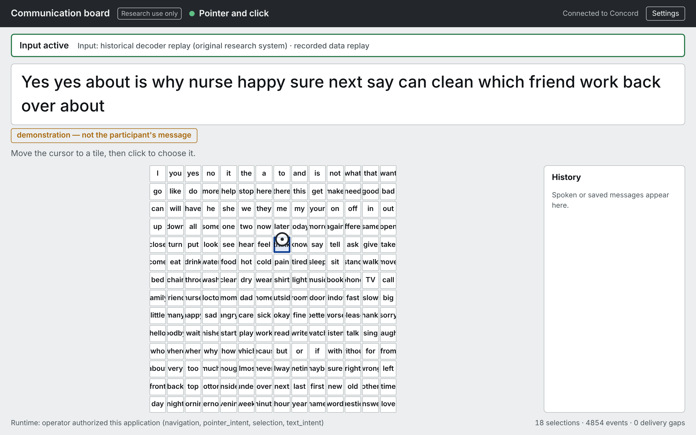

When you are done: **Stop control** (title bar), **Revoke**, **Stop decoding**.

---

## 8. The session log

*What happened, newest first.* The right-hand column of the console.

| Control | What it does | When you see it | Notes / units / defaults |
| --- | --- | --- | --- |
| Entry | Time (HH:MM:SS), a coloured dot and a sentence | Always | Connections, state changes, recordings, decoding, control, authorizations, faults, refusals (*Refused: …*), runtime errors. |
| Dot colours | What kind of entry it is | Always | See the list below the table. |
| **Show all (N)** | Shows every entry | More than 8 entries | |
| **Show latest only** | Back to the latest 8 | After **Show all** | |
| *Nothing yet.* | Says the log is empty | Only before the console has connected to Concord | The log then starts with *Console connected to Concord*. |

The dot colours:

- Green: something started streaming or succeeded.
- Grey: information, including *Decoding stopped*, *Recording stopped*, *Control stopped*
  and refusals (*Refused: …*).
- Light grey: the source was paused, disconnected or ended.
- Amber: a warning, for example a lost link, or a run that was interrupted.
- Red: the source stopped with an error (*Source error: …*, *Source stopped: …*).

This log belongs to the browser tab: it starts afresh when you reload the page and keeps at most
200 entries. The permanent records are the research session's log (in the session folder, and
in an export) and Concord's application log in the data folder's `logs` folder.

**After Concord stopped unexpectedly** (a crash or power loss), the next start recovers what was
open. Entries about it (*Recording … was interrupted when Concord stopped; its complete part was
kept and marked incomplete*, *Research session … was interrupted when Concord stopped*) appear
in the log each time you open or reload the console, for as long as that Concord runs. A console
tab that stayed open and reconnected does not show them: reload it.

---

## 9. Stopping safely

| Control | Where | Effect |
| --- | --- | --- |
| **Stop control** | Title bar | Command output off immediately; nothing else changes |
| **Revoke** | Command output → Authorized applications | That application stops receiving decoded commands |
| **Pause** | Acquisition source → Options or Playback | The source pauses and command output turns off; **Resume** continues (control stays off) |
| **Stop decoding** | Decoder row | Processing and decoder stop; command output turns off |
| **Disconnect** | Acquisition source | The source stops; decoding and command output stop; any recording closes |
| **Safe stop & disconnect** | Session strip | Command output off, recording closed, decoding stopped, source disconnected, in that order |
| **End session now** | Session panel | A safe stop, then the research session is closed |
| Quitting the desktop app, or `concord stop` | Desktop app window, or a terminal | A safe stop, then Concord ends |

Simulated input is not command output: to stop it, pause or disconnect the simulated profile.

---

## 10. Advanced

**Advanced** is the last part of the page, folded until you click it. Each section inside opens
when you click its name. **Simulator controls** is listed only while Simulated Profile A or B is
connected (not after an error).

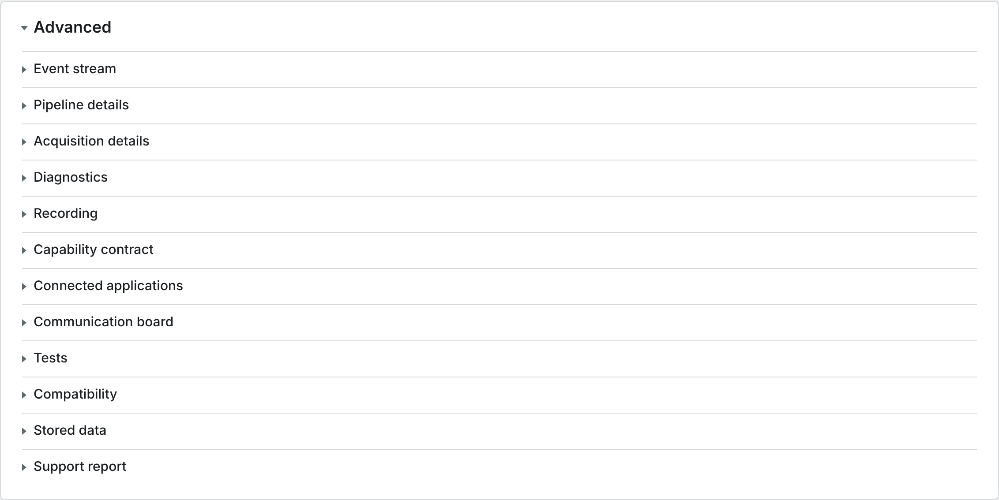

### 10.1 Event stream

Every piece of data Concord handles is an [event](GLOSSARY.md#event). This section lists the
latest 60 events this console receives, newest first (*Latest 60 events. Select a row to inspect
its envelope.*).

| Control | What it does | When you see it | Notes / units / defaults |
| --- | --- | --- | --- |
| **Freeze view** | Stops the list from moving so you can read it | Always | Concord keeps running; only this view is frozen. |
| **Resume view** | Shows live events again | While frozen | |
| Event-type checkboxes | Show or hide each type | Always | The 13 types are in the table below. |
| **Seq** | The event's sequence number within this source connection | Always | It starts again each time a source is connected. |
| **Type** | Event type | Always | |
| **Device** | The source's id | Always | |
| **Provenance** | The data kind ([provenance](GLOSSARY.md#provenance)): `raw_signal`, `processed_feature`, `behavioral_label`, `simulated_intent`, `decoded_intent`, `device_report`, `runtime` | Always | **↺** after it means the event was [replayed](GLOSSARY.md#replayed) from a recording. Hover: the model id (decoded events) or the adapter. |
| **Quality** | A score from 0 to 1 set by the source (1 = nominal) | Always | Shown in amber below 0.7. See the note below the table. |
| **Payload** | A short summary of the content | Always | For example *vx 0.014 vy -0.031*, *32×40 @ 1000 Hz #19080*, *bin 9001 256 ch Σ42 threshold_crossing_count*; decoded events end with *⟵ \<model>*. |
| *No events yet. Connect a source.* | Nothing has arrived | Nothing received | |
| Clicking a row | Opens *Envelope, seq N*: the full event | Always | **Close** hides it. |

What the data kinds mean: [How Concord works](CONCEPTS.md#3-data-kinds-what-each-piece-of-data-is).
[Quality](GLOSSARY.md#quality): a clock regression lowers it to 0.5 at most; a cross-source model
lowers decoded quality.

| Event type | What it carries |
| --- | --- |
| `recording.frame` | Raw samples |
| `recording.annotation` | Markers, labels |
| `intent.pointer` | Pointer movement |
| `intent.selection` | Select / activate / cancel |
| `intent.text` | Text |
| `telemetry.sample` | Device health |
| `device.status` | Connection changes |
| `features.binned` | Counts per bin |
| `features.vector` | Band power and similar values per bin |
| `behavior.sample` | Behavior labels |
| `intent.kinematics` | Decoder output |
| `intent.navigate` | Navigation |
| `control.state` | Command output on/off notices |

Fields of the full event (the [envelope](GLOSSARY.md#envelope)):

| Field | Meaning |
| --- | --- |
| `schema_version` | Version of the event format (1.4) |
| `session_id` | This source connection (`ses_…`); not a research session |
| `device_id` | The source |
| `seq` | Sequence number |
| `timestamp_ns` | When Concord received it, Concord's clock, nanoseconds since 1970 |
| `device_timestamp_ns` | The source's own clock, if it has one |
| `capability`, `event_type` | What kind of data it is |
| `quality.score`, `quality.flags` | Score, and flags: `synthetic`, `replayed`, `low_link_quality`, `timestamp_regression`, `saturated`, `dropped_samples` |
| `provenance.kind` | The data kind |
| `provenance.adapter` | The part of Concord (or plugin) that produced it, with its version |
| `provenance.synthetic` | Generated by software, not recorded from a person |
| `provenance.model_id`, `provenance.model_origin` | For decoded output: the model, and `concord`, `external` or `historical` |
| `provenance.origin` | Who or what produced it (for example `operator` for the simulator pad) |
| `provenance.replayed` | Played back from a recording |
| `payload` | The data itself (raw frames are shortened in this view) |

### 10.2 Pipeline details

What the decoding [pipeline](GLOSSARY.md#pipeline) is doing. All numbers are counted since
decoding last started.

| Line | Meaning |
| --- | --- |
| *Running · \<preset id> on \<source id>* / *Stopped* | Its state, with Concord's internal names: for example *Running · ecog_high_gamma on sim-a* for **High-gamma band power** on Simulated Profile A. During the first second of the spike-band preset: *warm-up … s (estimating thresholds)*. |
| **Stages** | Each processing step with its settings, for example *butterworth bandpass 250-5000 Hz, order 4*, *notch 60 Hz (Q=30)*, *common average reference*, *threshold crossings at -4.5 x RMS …, 20 ms bins* |
| **Input** | The event type it reads: `recording.frame` for raw, `features.binned` for features, `intent.kinematics` for **Source decoder outputs** |
| **Output** | What it produces: type · feature · bin · channels · unit |
| **Decoder** | The model and its outputs, or *none (features only)* |
| **Command router** | *On · \<output> → vx, \<output> → vy* (which decoder outputs become the pointer's horizontal and vertical velocity), or *Off (no commands reach apps)* |

| Counter | Meaning | When to worry |
| --- | --- | --- |
| **inputs** | Events the pipeline processed | Should grow while decoding |
| **input samples** | Raw samples processed (0 for feature sources) | |
| **dropped inputs** | Inputs dropped because the pipeline fell behind (its queue was full) | Any increase: data was lost; the verdict shows *Gaps detected*. Use a longer bin or fewer channels. |
| **features out** | Feature bins produced | Stays 0 with a passthrough preset (features are used as they arrive) |
| **decoded out** | Decoder outputs produced | 0 with a model means the decoder gets no input |
| **commands out** | Pointer commands sent through command output | |
| **errors** | Inputs that failed to process | Any increase: see *Last error* below the tables |
| **queue depth** | Inputs waiting now | Steadily high: the pipeline cannot keep up |
| **selections out**, **texts out**, **navigations out** | Other commands sent | |
| **clicks gated** | Clicks not sent because their confidence was below **Minimum confidence** | |
| **router stalls** | Times command output turned off because decoder input stopped | Any increase |
| **decoded in** | Source decoder outputs received (passthrough) | |
| **rejected inputs** | Passthrough inputs refused (not a decoder output, or undeclared) | Any increase |
| **join dropped** | Bins discarded because not every feature stream arrived for them | Rising steadily |
| **labels in** | Behavior labels received | |
| **decoder failures** | Times a decoder failed or could not start | Any increase |

Counters that should be zero are shown in amber when they are not (**dropped inputs**, **errors**).

| Latency row | Meaning |
| --- | --- |
| **processing per input** | Time to process one input event, in µs |
| **input event → derived event** | Time from an input event to the feature or decoded event made from it, in ms |

Columns p50, p95, p99 and max ([latency, p50, p95, p99](GLOSSARY.md#latency-p50-p95-p99)): the
value that 50 %, 95 %, 99 % and all measurements stayed under; n: how many measurements.
Compatibility warnings and *Last error: …* follow.

### 10.3 Acquisition details

What this section shows depends on the source. Jump to:
[FALCON and AJILE12 files](#falcon-and-ajile12-files-recorded-data-source) ·
[the activity plot](#the-activity-plot) · [T15 blocks](#t15-blocks) ·
[simulated profiles](#simulated-profiles-device-telemetry) ·
[LSL and Open Ephys](#lsl-and-open-ephys-live-source-counters) ·
[plugin sources](#plugin-sources).

#### FALCON and AJILE12 files: Recorded data source

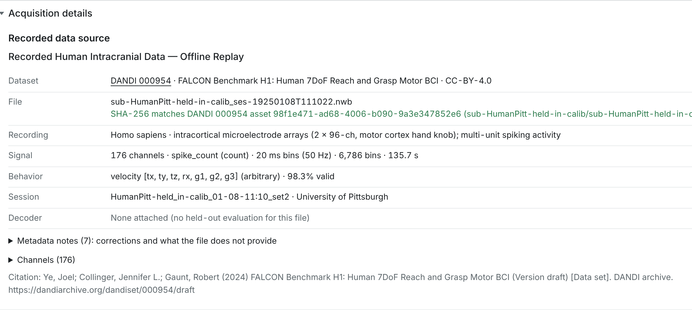

| Line | Meaning |
| --- | --- |
| Label | The source's name |
| **Dataset** | Archive link, title, licence |
| **File** | The file name and, in green, *SHA-256 matches DANDI … asset …*: the file is exactly the published one ([checksum](GLOSSARY.md#checksum)). In amber when it is not verified. |
| **Recording** | Species, recording type, modality |
| **Extract** | AJILE12 only: which samples of which archive file this extract holds |
| **Signal** | FALCON: channels, feature and unit, bin length and rate, number of bins, duration. AJILE12: channels, unit, rate, samples, duration, mains frequency and channels marked bad. |
| **Behavior** | The recorded movement: quantity, dimension names, unit, share of valid samples (note below the table) |
| **Session** | The dataset's session identifier and institution |
| **Decoder** | A decoder evaluated on this file, or *None attached (no held-out evaluation for this file)* (note below the table) |
| **Metadata notes (N): corrections and what the file does not provide** | Click to read Concord's notes on this file (note below the table) |
| **Channels (N)** | FALCON: one entry per unit, *unit:spike count in this file* (for example *0:218*); hover for details |
| **Electrodes (N)** | AJILE12: electrode labels; *(bad)* marks electrodes the dataset marks bad; hover for group, location and coordinates |
| *Citation: …* | How to cite the dataset |

- **Behavior**: FALCON's seven dimensions `tx, ty, tz, rx, g1, g2, g3` are the dataset's own
  names for its cued reach-and-grasp velocity, in [arbitrary units](GLOSSARY.md#arbitrary-unit).
- **Decoder**: a decoder trained on a *different* block, with its offline
  [held-out](GLOSSARY.md#held-out) R² and controls. In the desktop app it is normally *None
  attached*: such decoders come from `make model` in a source installation.
- **Metadata notes** ([metadata notes](GLOSSARY.md#metadata-notes)): corrections Concord applied
  (for example a time-base correction), how it reads a field (for example `eval_mask`), and what
  is missing (no electrode table, dates shifted for de-identification).

#### The activity plot

For sources whose data arrives as counts per bin: FALCON, T15, LSL spike-count streams, and raw
sources while **Spike-band threshold crossings** runs. Titled *Recorded neural activity (offline
replay)* (FALCON), *Source features* (T15, LSL counts) or *Pipeline features* (counts the
pipeline computes from a raw source). Band-power features are not drawn here.

| Control | What it does | Notes |
| --- | --- | --- |
| Raster | Each row a channel, each column a bin; brighter = more counts | The header gives channels, bin length, feature and time span (for example *last 5 s* for FALCON's 20 ms bins, *last 3 s* for T15's 10 ms bins). |
| **Velocity dimension** | Chooses which behavior dimension the lines show ([velocity dimension](GLOSSARY.md#velocity-dimension)) | FALCON: `tx … g3`; T15: `x`, `y`. |
| *Solid: recorded behavior (ground truth, valid samples)* | The recorded behavior of that dimension | |
| *Dashed: decoded (\<model>)* | The output of the decoder named, if one runs or the file carries one | Lines are scaled to fit; there is no unit axis. |

For the T15 blocks this plot is of limited use in 0.3.1: their recorded behavior is cursor and
target position (not velocity), and the dashed line shows whichever of the two historical
decoders reported last for each bin (usually the click decision). To see the historical outputs
themselves, use the [Event stream](#101-event-stream) (`intent.kinematics` rows).

#### T15 blocks

The *Source features* plot and *Device telemetry: No telemetry for the current session.* There is
no dataset, checksum or citation panel for T15: the checksum is verified when you connect, and the
citation is in [Datasets](DATASETS.md).

#### Simulated profiles: Device telemetry

The latest [telemetry](GLOSSARY.md#telemetry) values, with how many seconds ago they arrived:

- Profile A: *battery pct*, *temperature c*, *link quality*, *packets sent*.
- Profile B: *battery pct*, *temperature c*, *rssi dbm*, *link quality*. It reports every 5 s
  (*Waiting for telemetry from this session (0.2 Hz).* at first).

These are **simulated device-health numbers**, made up by the simulator; they do not come from
any implant.

#### LSL and Open Ephys: Live source counters

Polled every second.

| Line | Meaning |
| --- | --- |
| **Source** | The source id |
| **Library** | The LSL library version (LSL) |
| **Endpoint**, **Stream**, **Rate** | Host and port, stream name, sample rate (Open Ephys) |
| **Interpreted as** | `raw` (samples, processed by a raw preset) or `spike_counts` (already binned counts, used with **Source features (passthrough)**). Concord decides from the stream type (for example *SpikeCounts*) or the stream's declaration. |
| **Unit** | The unit Concord uses; for Open Ephys *configured … → emitted …* (what you chose under **Sample unit**, and what Concord sends on) |
| **Heartbeat** | Open Ephys: whether the plugin answers Concord's [heartbeats](GLOSSARY.md#heartbeat) (*ok*) |
| **Last message #** | Open Ephys: the plugin's latest message number |
| **Clock offset** | Open Ephys: this computer's clock minus the sender's time stamp, including transport time; *min* is the best estimate of the clock offset |
| **Runtime (since start)** | Reconnect attempts, successes and link errors since Concord started (all sources) |
| Counter tiles | Loss and traffic counters (list below the table) |
| Stream table (LSL) | One line per stream (**Role** *signal*, *behavior*, *markers*): **Received** samples, **Gaps**, **Est. missing** samples, **Time correction**, **Last timestamp** |
| Notes | How time stamps are interpreted, that losses are estimated from time-stamp gaps (LSL has no sequence numbers), that units are not transmitted (Open Ephys), and that Concord cannot verify whether the stream comes from hardware |

The counter tiles:

- **LSL**: *chunks*, *samples*, *gaps*, *estimated missing samples*, *lost*, *stalls*,
  *discarded while paused*.
- **Open Ephys**: messages, data messages, *missed messages*, *missing samples*, *incomplete
  blocks*, *malformed*, *duplicate messages*, *sample regressions*, *sample clock resets*,
  spikes, heartbeats, *config changes* and more.
- A tile turns amber when a loss-type counter (gap, missing, missed, malformed, lost, stall,
  timeout, error, incomplete, discarded, regression, duplicate, overflow, nonfinite, skipped) is
  above zero.

**Time correction** is the offset LSL measured between the publisher's clock and this computer's,
used to align streams ([time correction](GLOSSARY.md#time-correction)).

#### Plugin sources

*Device telemetry* (usually *No telemetry for the current session.*) and, when the plugin
delivers features, the activity plot. Plugins have no live-counter panel in 0.3.1.

### 10.4 Diagnostics

*Every number below is measured live in this process (runtime) or this browser (client).*

| Tile | Meaning | When to worry |
| --- | --- | --- |
| **Events published** | Events Concord has published since it started | |
| **Runtime pipeline p50**, **p99** | Time from the adapter reading a packet to the checked event being queued for every application (median, 99th percentile; see [p50, p99](GLOSSARY.md#latency-p50-p95-p99)) | Growing steadily |
| **Delivery p95** | Time from queued to written to the network connection | Growing steadily |
| **Client p50**, **Client p95** | Time from Concord receiving an event to this tab receiving it, in ms | Growing steadily |
| **Contract violations** | Sum of decode errors, validation errors and undeclared-capability events ([contract violation](GLOSSARY.md#contract-violation)) | Any increase, except after a deliberate **Malformed packet**, or while replaying a recording made during decoding ([4.6](#46-session-recordings-replay-and-other-sources)) |
| **Subscriber drops** | Events dropped because an application or console tab could not take them in time (each keeps up to 2,048 waiting events; [subscriber drops](GLOSSARY.md#subscriber-drops)) | Any increase: see [10.7](#107-connected-applications) for which one |
| **Reconnects ok / tried** | Successful / attempted source reconnections | Amber after any link error |
| **Uptime** | Seconds since Concord started | |

| Counter (in **Counters**) | Meaning |
| --- | --- |
| events published | As above |
| decode errors | Packets from the source that could not be read (for example a [CRC](GLOSSARY.md#crc) mismatch) |
| validation errors | Events that failed Concord's format check (should never happen) |
| undeclared capability | Events of a kind the source did not declare; refused ([undeclared capability](GLOSSARY.md#undeclared-capability)) |
| timestamp regressions | Times the source's clock went backwards; those events are flagged |
| discarded while paused | Packets dropped because the source was paused |
| link errors | Times the source connection was lost |
| reconnect attempts, reconnect successes | Reconnection tries and successes |
| subscriber drops | As above |
| console delivery gaps | Events this tab never received (gaps in sequence numbers) |
| console out-of-order | Events this tab received out of order |

All counters run since Concord started (not since the source connected).

Other panels: **Event types (5 s rolling rate)** (each event type's current rate in Hz and its
total), **Latency percentiles in µs (last 4,096 events)** (pipeline and delivery: n, p50, p95,
p99, max), **Device switches** (time, from → to, how long the switch took; *No switches yet.*),
**Recent errors** (the last 15: time, kind, source, message; *No errors recorded.*), and
**Process** (Python version, platform, machine, process id).

### 10.5 Recording

Writes the events of the connected source to the data folder's `recordings` folder, including
features and decoder output while decoding runs. A recording made while decoding runs is for
training a decoder; in 0.3.1 it does not replay cleanly ([4.6](#46-session-recordings-replay-and-other-sources)).
To make a recording for replay, record with decoding off.

| Control | What it does | When you see it | Notes / units / defaults |
| --- | --- | --- | --- |
| **Start recording** | Starts a recording named `<source>-<date>-<time>` | A simulated or live source is streaming or paused | Greyed out for FALCON, AJILE12, T15 and session recordings (they already are recordings; the description under the button says *Local file replays cannot be recorded.*). Logged as *Recording started: \<name>*; the title bar adds *· Recording*. |
| **Stop recording** | Ends it | While recording | Logged as *Recording stopped: \<name>*. |
| **Features and labels only (for calibration)** | Records everything except raw sample frames | Before starting | Off by default. Raw frames are large: a 32-channel stream at 30 kHz reaches the default 200 MiB size limit within seconds. Use this with high-rate sources, and for calibration. |
| Recordings list | The 8 newest recordings: name, size, age (*recording* while active) | Recordings exist | *· incomplete* marks one recovered after Concord stopped unexpectedly. |

| Limit (default) | With raw frames | Features and labels only |
| --- | --- | --- |
| Duration | 5 minutes | 1 hour |
| Size | 200 MiB | 200 MiB |
| Free disk space | stops below 256 MiB | stops below 256 MiB |

A recording that reaches a limit stops cleanly and is complete and replayable; the session log
says *Recording stopped: \<name>* (the console does not say which limit). Limits can be raised in
the [configuration file](#15-configuration-file), up to 24 hours and 100 GiB. Recordings appear
under **Session recordings (replay)** and in the **Calibrate…** panel. For long raw archival,
use your acquisition software.

### 10.6 Capability contract

What every source can provide, in Concord's vocabulary of [capabilities](GLOSSARY.md#capability).
What capabilities are and why they matter:
[How Concord works](CONCEPTS.md#4-capabilities-what-a-source-can-provide-and-an-app-can-ask-for).

**Capability matrix**: one row per capability, and one column per source in Concord's list, not
only the connected one. The columns come in this order: the simulated profiles, your session
recordings, the dataset files (FALCON before T15), then the registered live sources. This is not
quite the order of the **Connect a source** panel, which lists session recordings after the
dataset files. *Yes* plus its details means the source declares it; *—* means it does not.
Several columns can have the same heading (for example the FALCON files); tell them apart by
their order. A connected plugin source is added as the last column.

| Detail | Meaning |
| --- | --- |
| `channel_count` | Number of channels |
| `sample_rate_hz` | Raw samples per second |
| `frame_samples`, `frame_rate_hz` | Samples per raw data block, and blocks per second |
| `unit` | `uV` (microvolts), `count`, `arbitrary` (no physical unit), … |
| `channel_labels` | Channel names, separated by vertical bars |
| `channel_units` | Unit of each channel, separated by vertical bars |
| `stream_type`, `channel_format` | LSL stream type and number format |
| `annotations_only` | The source delivers only markers under `recording`, no samples |
| `rate_hz` | Events per second |
| `dims` | Dimension names (or how many) |
| `max_speed` | The fastest pointer velocity the source sends |
| `latency_ms` | The latency the source states for its selections |
| `text_modes` | `character` and/or `word` |
| `feature`, `bin_ms` | The feature and its bin length |
| `streams` | The separate feature streams it carries (T15: threshold crossings and spike band power) |
| `quantity`, `quantities` | What the behavior data is (velocity; cursor and target position) |
| `space` | The coordinate frame of the behavior data (T15: `t15_screen`, in screen heights) |
| `decoders` | The decoder outputs the source carries (T15: `t15-historical-velocity`, `t15-historical-click`) |

**Native format** (last row; [native format](GLOSSARY.md#native-format)): how each source's data
arrives before Concord converts it, for example *binary frames (magic, type, flags, length, u64
µs clock, payload, CRC32)* for Simulated Profile A, *newline-delimited JSON* for Profile B,
*NWB 2.x / HDF5* for FALCON ([NWB](GLOSSARY.md#nwb)), *MATLAB .mat* for T15, *LSL float32 x 32
@ 30000 Hz* for an LSL stream.

**Capability vocabulary**: each capability, the event types it covers and a one-line
description. **Provenance separation**: the data kinds ([provenance](GLOSSARY.md#provenance):
`raw_signal`, `processed_feature`,
`behavioral_label`, `simulated_intent`, `decoded_intent`, `device_report` / `runtime`), which
events carry each, and which can ever reach an application. The links */api/v1/schema/event*
(the event format as JSON Schema; [schema](GLOSSARY.md#schema)) and */docs* (the programming
interface) are for developers.

### 10.7 Connected applications

Every program connected to Concord, including each console tab itself (*Operator Console*) and
each communication board (embedded or in its own window). When a program connects, Concord gives
it the capabilities it asked for that the source provides
([negotiation](GLOSSARY.md#negotiation)).

| Line | Meaning |
| --- | --- |
| Name and state | *active* (it has what it needs), *suspended* (the source lacks something it requires), *no device* (no source connected) |
| `console` / `application` · connection id | Kind of program, and its connection |
| *delivered N · dropped N · queue N* | Events sent to it, events dropped because it fell behind (its queue holds up to 2,048), events waiting now. A growing *dropped* is the usual cause of *Gaps detected* with no source loss. |
| **Granted** | Capabilities it receives from this source |
| **Not granted** | Capabilities it asked for and does not receive, *(required)* when it needs them |

### 10.8 Simulator controls

You stand in for the participant's intent ([simulated intent](GLOSSARY.md#simulated-intent)).
No neural decoding is involved. Shown only while Simulated Profile A or B is connected (not after
an error). It is not shown for other synthetic sources, such as the LSL test stream or a plugin's
synthetic board: nothing can be simulated or injected there.

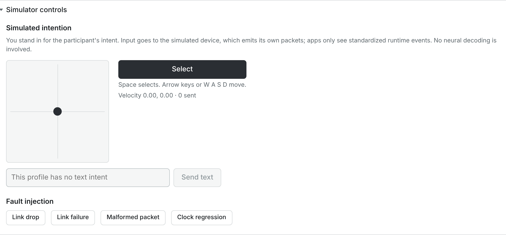

| Control | What it does | When you see it | Notes / units / defaults |
| --- | --- | --- | --- |
| Pad | **A joystick**: pull the dot away from the centre and the board's cursor keeps moving in that direction, faster the further you pull; let go and it springs back. Profile A adds a little random jitter to every movement, like a real decoder, so even at rest the cursor drifts slowly | Profile A | Use small, short pulls: holding the dot off-centre makes the cursor overshoot. *Simulated Profile B has no pointer intent* on Profile B. |
| **Select** | Sends one select action | Both profiles | On the board this chooses (Pointer and click, Scanning) or moves (Direct selection). |
| Keyboard | Arrow keys or W A S D move (like the dot pulled 60 % of the way); Space or Enter selects | While this section is open and the console window has focus | Not while typing in a text field. While this section is open, Space and Enter send **Select** even if a console button has keyboard focus. |
| *Velocity 0.00, 0.00 · N sent* | The current joystick velocity, and how many selections and texts were sent | Always | *sent* does not count movements. |
| Text field and **Send text** | Sends up to 32 characters of text to the board | Profile B | Placeholder *Text intent, for example: hi*; on Profile A *This profile has no text intent* (greyed out). |

**Fault injection** ([fault injection](GLOSSARY.md#fault-injection)) tests how Concord and
applications react. Each fault is logged as *Injected fault: …*.

| Button | What happens | What you see | How to recover |
| --- | --- | --- | --- |
| **Link drop** | The link drops once | Within a second: *Link lost, reconnecting: sim-a: simulated link drop*, then *Streaming (reconnected after 1 attempt(s))*. Too fast to see in the title bar; **Diagnostics** counts it (*Reconnects ok / tried*, *link errors*). | Nothing: Concord reconnects by itself. Command output, if it was on, stays off. |
| **Link failure** | The link drops and every reconnect fails | After about 2 s: *Source stopped with an error* (red dot) in the title bar, the error in a grey box in the source row, **Reset** | Click **Reset**, then **Connect a source** ([2.3](#23-source-stopped-with-an-error-and-reset)). |
| **Malformed packet** | The next packet is corrupt | *Decode error: CRC mismatch*; **Contract violations** +1 | Nothing: the packet is dropped and counted. |
| **Clock regression** | The next packet's device clock jumps back | *Timestamp regression: device clock went backwards by … ms*; the event is flagged | Nothing. |

### 10.9 Communication board (embedded)

*A separate demo app with its own connection. It uses only the SDK and adapts to the
capabilities the runtime grants; it contains no device-specific code.* A full copy of the
communication board inside the console, for watching what the participant sees.

- It is a separate application: it counts as one more *Communication Board* connection, and it
  shares the board's authorization and its saved settings ([11.10](#1110-how-settings-are-stored-and-url-options)).
- It stays connected even while folded.
- **Open in a new window** opens the board in a new browser tab.

### 10.10 Tests

Shows the results of Concord's own automated test suite. In an installed Concord it says: *No
test results on this computer. This section shows the results of Concord's own test suite when
it runs from its source code (make test, make e2e); an installed Concord has none, and it does
not affect how Concord works. The results of each release are on the project's GitHub page.*

In a source installation it lists each test report (*All passed* or *N failed* · passed ·
skipped · duration · when), **Show N test cases** / **Hide**, and **Reload**. It never runs tests
itself.

### 10.11 Compatibility

Every integration Concord has (simulated profiles, recording replay, the datasets, LSL, Open
Ephys, the example plugin, BrainFlow, BCI2000) and the [validation level](GLOSSARY.md#validation-level)
its evidence supports.
Levels are derived from the listed evidence; this page cannot change them. Explanation of the
levels: [VALIDATION_LEVELS.md](VALIDATION_LEVELS.md); the full table:
[COMPATIBILITY.md](COMPATIBILITY.md).

| Column | Meaning |
| --- | --- |
| **Integration** | Name, package and version, protocol, and *This installation: …* (*Built into Concord 0.3.1*, *Installed, version …*, *Not installed here*, *Not checked yet: the plugin search has not run*) |
| **Kind** | *Built-in adapter*, *Source plugin* or *Offline dataset* |
| **Level** | For example *Level 1 · Software-implemented*, *Level 2 · Protocol-tested*; *Real-data replay (recorded data, not live)*, *Synthetic data only*; hover for how the level was derived |
| **Evidence** | Each test, report or document, with what it supports and its date; *Not counted: …* when it does not count |
| **Not tested** | What has not been tested, for example acquisition hardware |

**Reload** reads the registry again. No entry has reached hardware or human-participant
validation.

### 10.12 Stored data

What Concord keeps in the data folder, and deletion.

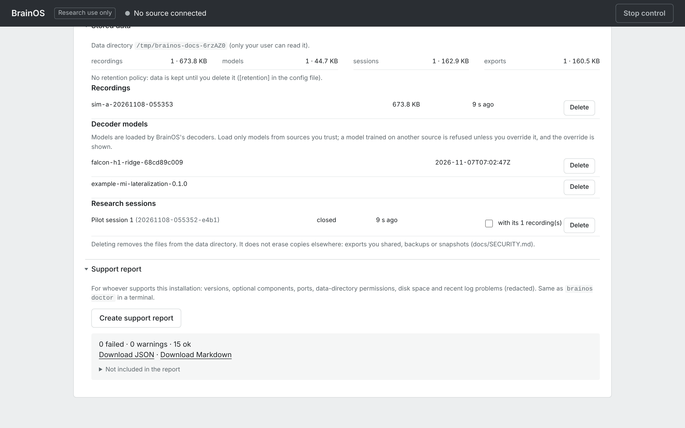

| Control | What it does | When you see it | Notes / units / defaults |
| --- | --- | --- | --- |
| *Data directory \<path> (only your user can read it).* | Where the data folder is | Always | Select the path to copy it. |
| **recordings**, **models**, **sessions**, **exports** | Count and total size of each | Always | Dataset files are not listed or counted here: delete them from the `datasets` folder yourself. |
| Retention line | *No retention policy: data is kept until you delete it ([retention] in the config file).*, or the policy and what it deleted at this start | Always | [15](#15-configuration-file). |
| **Recordings** list | Name, size, age; *· incomplete (N events kept)* for a recovered recording | Always (*No recordings.* when empty) | |
| **Decoder models** list | Model id and creation time | Always (*No models.* when empty) | |
| **Research sessions** list | Name (id), *active* / *closed* / *interrupted*, age | Always (*No research sessions.* when empty) | The active session has no **Delete**. |
| **with its N recording(s)** | Also deletes that session's recordings | A session with recordings | Off by default. |
| **Delete** | Asks *Delete \<name> permanently?* | Each item | An active recording and the active session have no **Delete**; Concord refuses to delete anything else in use. |
| **Delete** (red) / **Cancel** | Deletes / keeps | After **Delete** | Logged as *Deleted … (size)*. |

The lists are read when you open the section; fold and open it again to refresh. *Deleting
removes the files from the data directory. It does not erase copies elsewhere: exports you
shared, backups or snapshots.* More on what is and is not protected: [SECURITY.md](SECURITY.md).

### 10.13 Support report

For whoever helps you with your installation; the same report as `concord doctor`.

| Control | What it does | When you see it | Notes / units / defaults |
| --- | --- | --- | --- |
| **Create support report** | Checks versions, optional components, ports, data-folder permissions, disk space and recent log problems | Always | |
| *N failed · N warnings · N ok* | Summary | After creating | Failed checks and warnings are listed below it with a hint. |
| **Download JSON**, **Download Markdown** | Save the report | After creating | |
| **Not included in the report** | Folded list of what is left out: neural data of any kind, names of recordings, sessions, models and sources, operator names and notes, file contents, environment variables, user name, host name, home folder, e-mail and IP addresses, secrets | After creating | |

---

## 11. The communication board

The participant-facing application included with Concord: tiles with phrases, letters or words,
chosen with one of five [input methods](GLOSSARY.md#input-method). It knows nothing about devices: it adapts to the
capabilities the connected source and command output provide.

### 11.1 Opening the board

| How | Where | Notes |
| --- | --- | --- |
| **Open participant screen** | Command output row | A 1280 × 800 window for a second screen facing the participant; a new tab if pop-ups are blocked. |
| **Advanced → Communication board** | Inside the console | The embedded copy ([10.9](#109-communication-board-embedded)). |
| **Open in a new window** | Advanced → Communication board | A new tab. |
| http://127.0.0.1:8000/board.html | Any browser on this computer | Add URL options ([11.10](#1110-how-settings-are-stored-and-url-options)). |

Make the window wider than 900 pixels to see the **History** panel.

### 11.2 The parts of the board

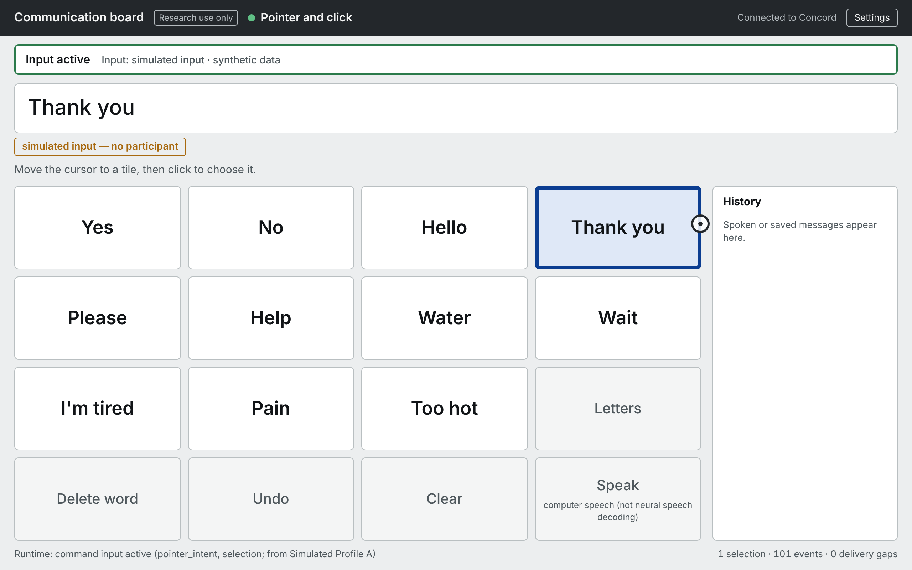

| Part | What it shows | Notes |
| --- | --- | --- |
| *Communication board* | Name | |
| *Research use only* | Reminder | |
| Method (green dot when active) | The input method in use: *Pointer and click*, *Pointer with dwell selection*, *Directional navigation*, *Direct selection*, *Scanning*, or *Waiting* | |
| Connection | *Connected to Concord*, *Connecting*, *Reconnecting*, *Disconnected*, *Not connected*, *Connection refused* | *Reconnecting* after Concord quits; close the window then. |
| **Settings** | Opens **Board settings** ([11.9](#119-board-settings)) | For the caregiver or experimenter. |
| Input bar | *Input active* (green), *Waiting for the operator to authorize this board (pointer intent, selection)*, *Paused — \<reason>* (for example *Paused — command output stopped: stopped by operator (console)* or *Paused — device disconnected (operator disconnect)*), or *No input* | When decoded input waits for **Authorize**, the bar says so. |
| *Input: …* | Where the latest input came from: *simulated input*, *decoded by \<model> (Concord)*, *decoded by \<model> (external decoder)*, *historical decoder replay (original research system)*, followed by *· recorded data replay* and/or *· synthetic data* | Cleared when the source is switched or disconnected, so it never names a previous source. |
| Message | The composed text; *Message appears here…* when empty | Up to 280 characters. A blinking caret shows when the source can type text. |
| Message label | *simulated input — no participant* (all text came from simulated input), or *demonstration — not the participant's message* (some text came from a replayed recording or a historical decoder) | Text composed from a recording is never a participant's message: the person recorded did another task. Text from different sources can mix in one message; press **Clear** before changing source. |
| Instruction line | How to choose with the current method (examples below the table) | *Choose each tile twice to confirm.* is added with confirmation on. |
| Tiles | The current page ([11.4](#114-the-phrases-page) to [11.6](#116-the-task-grid)) | |
| **History** | Messages spoken or saved with **Speak** / **Save**, newest first, each with its label and input | Up to 50; hidden in windows narrower than 900 pixels; cleared by **Clear history** or reloading the page. |
| Footer, left | *Runtime: \<reason>*: what Concord last told the board about its input (examples below the table) | *Runtime: no control state yet* before the first notice. |
| Footer, right | *N selections · N events · N delivery gaps*: tiles chosen since the page loaded, events received, and events the board missed | [Delivery gaps](GLOSSARY.md#delivery-gap) should stay 0. |

Instruction line examples: *Move the cursor to a tile, then click to choose it.*, *Tiles are
highlighted in turn. Select when the one you want is highlighted.*, *Move the cursor to a tile and
rest there for 1.0 s to choose it (dwell selection).*, *Select moves to the next tile, activate
chooses it, cancel undoes.*, or *Waiting for a source that can move a cursor, move a highlight,
or make a selection.*

Footer examples: *Runtime: command input active (pointer_intent, selection; from Simulated
Profile A)*, *Runtime: operator authorized this application (…)*, *Runtime: command output
stopped: stopped by operator (console)*.

The message and history live only in that window: reloading the page clears them.

### 11.3 Mouse clicks on tiles do nothing

The board reacts only to input from Concord (the simulator, or decoded commands through command
output). Clicking a tile with the mouse or pressing keys on the board does nothing, by design:
every choice on the board must come from the source, so that what is recorded and shown is what
the source produced. The only mouse-operated parts are **Settings** and the settings panel. To
try the board by hand, connect a simulated profile and use **Advanced → Simulator controls**.

### 11.4 The phrases page

The default page (**Layout**: **Phrases and letters**). Phrases come first, then five control
tiles. How many phrases appear depends on **Tile size (phrase page)**:

| Tile size | Grid | Phrases shown |
| --- | --- | --- |
| **Large (3 × 3)** | 9 tiles | Yes, No, Hello, Thank you |
| **Standard (4 × 4)** (default) | 16 tiles | Yes, No, Hello, Thank you, Please, Help, Water, Wait, I'm tired, Pain, Too hot |
| **Small (5 × 5)** | 25 tiles | the 11 above, plus Too cold, Bathroom, Change position, I don't know, Call the nurse, Turn on the TV, Goodbye, I love you, Later |

The phrases cannot be changed in the board's settings.

| Tile | What it does |
| --- | --- |
| A phrase | Adds the phrase to the message, as words separated by a space |
| **Letters** | Opens the letters page |
| **Delete word** | Removes the last word |
| **Undo** | Restores the message as it was before the last change (up to 50 steps) |
| **Clear** | Empties the message (can be undone) |
| **Speak** (*computer speech (not neural speech decoding)*) | Reads the message aloud with the browser's built-in speech and adds it to **History**; the message stays |
| **Save** (*save to history (speech off or unavailable)*) | Shown instead of **Speak** when speech is off or the browser has none: adds the message to **History** |

**Speak** and **Save** do nothing with an empty message. The voice is the browser's default; the
board offers no voice choice.

### 11.5 The letters page and word prediction

A 6 × 6 page:

| Row | Tiles |
| --- | --- |
| 1 | three word-prediction tiles, **Space**, **Delete**, **Phrases** |
| 2 | A B C D E F |
| 3 | G H I J K L |
| 4 | M N O P Q R |
| 5 | S T U V W X |
| 6 | Y Z **.** **Undo** **Clear** **Speak** (or **Save**) |

| Tile | What it does |
| --- | --- |
| A letter | Types it. The first letter of the message, and the first after a full stop, question mark or exclamation mark, is a capital; others are lower case. |
| **.** | Types a full stop |
| **Space** | Adds a space (not at the start, not after another space) |
| **Delete** | Removes the last character |
| **Phrases** | Back to the phrases page |
| Prediction tiles | Up to three words that complete the word being typed; choosing one replaces the partial word with the whole word and adds a space. The word is inserted as it appears on the tile, in lower case, even at the start of a sentence. |
| **Undo**, **Clear**, **Speak** / **Save** | As on the phrases page |

**How predictions are chosen:** the board takes the letters typed since the last space and lists,
in order, the first three words of its word list that start with them (ignoring capitals) and are
longer. The word list is the built-in core vocabulary of 200 common English words, roughly in
order of how often they are used in conversation, or the list loaded from **Word list URL**.
Prediction tiles are empty (dashed) when nothing is being typed or nothing matches.

### 11.6 The task grid

**Layout**: **Task grid (N × N words)** shows one square grid of N × N word tiles, for tasks such
as choosing cued words (like the T15 grid task). **Grid size N**: 2 to 20, default 14.

- Words fill the grid row by row from the word list: the built-in 200-word core vocabulary, or
  your list.
- **There are no Delete, Undo, Clear, Speak or page tiles.** Choosing a tile adds its word to the
  message; nothing else.
- With the built-in list, a grid larger than 14 × 14 (196 tiles) has empty tiles at the end
  (200 empty at N = 20). Choosing an empty tile does nothing but counts as a selection.
- The grid is square, so at large N the tiles are small and long words are cut off.
- **Word list URL**: a web address the browser can download, of a text file with one word or
  phrase per line (blank lines and lines starting with `#` are ignored; at most 400 entries, each cut to 40
  characters). A file on your disk (`file://…`) does not work, and a list on another web server
  works only if that server allows other sites to read it ([CORS](GLOSSARY.md#cors)). If the list cannot be loaded,
  the panel says *cannot load the word list (…); using the built-in vocabulary*. A custom list is
  also used for word prediction. Format details: [APPLICATIONS.md](APPLICATIONS.md).

**To make the 14 × 14 task grid:** on the board, click **Settings** → **Layout**: **Task grid (N
× N words)** → **Grid size N**: 14 → **Close**. Or open the board with
`board.html?layout=grid&n=14`.

### 11.7 What you see while choosing

| Sign | Meaning |
| --- | --- |
| Blue outline and fill on a tile | The tile the cursor is on, or the highlighted tile (scanning, navigation, direct selection); during row scanning, the whole row |
| Round cursor ring | The pointer position (pointer methods). It starts in the centre and stops at the edges. |
| Red dashed cursor ring | Input stopped while a pointer method was in use; the cursor is frozen |
| Bar filling along the bottom of a tile | Dwell progress: when it is full, the tile is chosen |
| Thick amber dashed outline and *select again to confirm* | Confirmation is on and this tile waits for its second selection |
| Short green flash | The tile was just chosen; with **Audio tick on every selection**, a short tick sounds |

### 11.8 Input methods

The board picks the first method the source supports, in this order, unless you choose one in
**Board settings**. What the capabilities are: [How Concord works](CONCEPTS.md#4-capabilities-what-a-source-can-provide-and-an-app-can-ask-for).

| Method | Needs | How it works | Typical source |
| --- | --- | --- | --- |
| **Pointer and click** | pointer movement and discrete actions (`pointer_intent` + `selection`) | Move the cursor to a tile, click (select) to choose it | Simulated Profile A; a movement decoder with **Click from**; T15 passthrough with its click |
| **Pointer with dwell selection** | pointer movement (`pointer_intent`) | Rest the cursor on a tile for the **Dwell time** to choose it ([dwell selection](GLOSSARY.md#dwell-selection)); details below the table. A board interaction, never a neural click. | A movement decoder without a click |
| **Directional navigation** | navigation (`navigation`) | Up / down / left / right (or next / previous) move the highlight; select chooses. Without discrete actions, resting on the highlighted tile for the **Dwell time** chooses it. | A classifier with **Move …** actions |
| **Direct selection** | discrete actions with several kinds (`selection`) | Select moves to the next tile, activate chooses it, cancel undoes. **Automatic** uses it only after the source has sent an activate or cancel. | A classifier with Select, Activate and Cancel |
| **Scanning** | discrete actions (`selection`) | The board highlights tiles in turn (every **Scan interval**); any select or activate chooses the highlighted one. Details below the table. | Simulated Profile B; any source with only a select |

- **Pointer with dwell selection**: dwell starts only after the cursor has moved since input
  became active, and after a choice you must leave the tile before it can be chosen again. With
  Simulated Profile A, its built-in jitter counts as movement: the board can choose a tile by
  itself within a few seconds. Use **Pointer and click** when you are not demonstrating dwell.
- **Scanning**: with **Row, then column**, rows are highlighted first; select a row, then the
  tiles in it are highlighted (after two passes without a choice it returns to rows). After a
  choice, scanning starts again at the first tile.

In every method, a cancel action undoes the last change (or cancels a pending confirmation, or
returns row scanning to rows). The cursor speed is not a board setting: it is set by the
operator in **Command output → Settings** ([7.3](#73-settings-for-movement-decoders)).

### 11.9 Board settings

*For the caregiver or experimenter. Cursor speed and smoothing are not set here: the operator
maps decoder output to commands in Concord.* Every change applies at once and is saved.

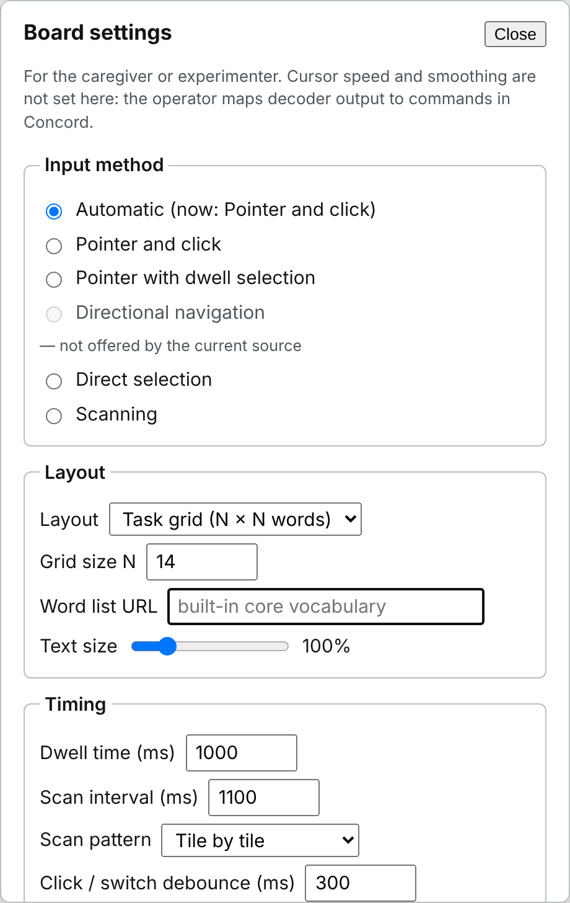

| Control | What it does | When you see it | Notes / units / defaults |
| --- | --- | --- | --- |
| **Close** | Closes the panel | Always | **Settings** in the header also toggles it. |
| **Input method**: **Automatic (now: …)** | Picks the method for you ([11.8](#118-input-methods)) | Always | Default. *(nothing available now)* when the source offers none. |
| **Pointer and click**, **Pointer with dwell selection**, **Directional navigation**, **Direct selection**, **Scanning** | Forces that method | Always | Greyed out with *— not offered by the current source* when unavailable; the board then uses Automatic until it becomes available. |
| **Layout** | **Phrases and letters** or **Task grid (N × N words)** | Always | Default Phrases and letters. |
| **Grid size N** | Grid size | Task grid | 2 to 20; default 14. |
| **Word list URL** | The task grid's word list ([11.6](#116-the-task-grid)) | Task grid | Empty = *built-in core vocabulary*. |
| **Tile size (phrase page)** | **Large (3 × 3)**, **Standard (4 × 4)**, **Small (5 × 5)** | Phrases and letters | Default Standard. Changes which phrases appear ([11.4](#114-the-phrases-page)). |
| **Text size** | Scales the text | Always | 75 % to 200 %; default 100 %. |
| **Dwell time (ms)** | Time resting on a tile that chooses it | Always | 300 to 5000; default 1000. |
| **Scan interval (ms)** | Time each tile or row stays highlighted | Always | 400 to 5000; default 1100. |
| **Scan pattern** | **Tile by tile** or **Row, then column** | Always | Default Tile by tile. |
| **Click / switch debounce (ms)** | A selection within this time of the previous accepted one is ignored, so one click selects once | Always | 0 to 3000; default 300. Measured on the source's clock. |
| **Confirmation** | **None: choose at once** or **Select the same tile twice** | Always | Default None. |
| **Confirm within (ms)** | Time allowed for the second selection | **Select the same tile twice** | 1000 to 10000; default 3000. Selecting another tile moves the pending mark there. |
| **Audio tick on every selection** | A short tick when a tile is chosen | Always | Off by default. |
| **Read the message aloud on Speak — computer speech (not neural speech decoding)** | **Speak** reads the message aloud | Always | On by default. Greyed out with *(not available in this browser)* without speech support; the tile then reads **Save**. |
| **Speech rate** | Speaking speed | Speech on and available | 0.5× to 2×; default 1.0×. |
| **Clear history** | Empties **History** | Always | |

Numbers typed outside the allowed range are set to the nearest allowed value.

### 11.10 How settings are stored, and URL options

**Board settings are saved in the browser**, separately for each browser (and browser profile)
on each computer. Every board in that browser shares them: the embedded board in the console and
the participant window. A board that is already open picks up a change made in another board
when it is reloaded. Another browser or computer has its own settings.

**URL options** set board settings for one page load, for example
`http://127.0.0.1:8000/board.html?layout=grid&n=14&method=cursor_click`. They override the saved
settings, and are not saved, unless you then change something in the settings panel (which saves
all current values, including those from the URL). Invalid values are ignored without a message
(the saved or default value is used); numbers outside the range are set to the nearest allowed
value (for example `n=30` gives 20).

| Option | Setting | Values |
| --- | --- | --- |
| `method` | Input method | `auto`, `cursor_click`, `cursor_dwell`, `navigate`, `direct`, `scan` |
| `layout` | Layout | `communication`, `grid` |
| `n` | Grid size N | 2–20 |
| `words` | Word list URL | a URL |
| `tile_size` | Tile size | `large`, `standard`, `small` |
| `text_scale` | Text size | 0.75–2 |
| `dwell_ms`, `scan_interval_ms`, `click_refractory_ms`, `confirm_ms` | Timings | as in [11.9](#119-board-settings) |
| `scan_pattern` | Scan pattern | `linear`, `row_column` |
| `confirm` | Confirmation | `none`, `repeat` |
| `audio_tick`, `speech` | Audio tick, speech | `1`/`0` or `true`/`false` |
| `speech_rate` | Speech rate | 0.5–2 |

The full reference for evaluation harnesses: [APPLICATIONS.md](APPLICATIONS.md).

---

## 12. Common situations

| You see | Why | What to do |
| --- | --- | --- |
| A *Communication Board* is listed under **Authorized applications**, and *1 application connected* shows before you opened any board (one more per extra console tab or participant screen) | Each console tab contains the embedded board, which counts as one application | Normal ([7.5](#75-authorized-applications)). Close console tabs you don't use. |
| *Receiving pointer movement, discrete actions.* next to **Authorize** | A simulated profile drives the board without authorization | Normal ([7.1](#71-when-commands-reach-an-application)). |
| **Stop control** is grey | Command output is off | Nothing to stop. |
| **Data received (%)** shows *—* | Only LSL and Open Ephys report losses | Normal for other sources. |
| *Gaps detected* although the source is fine | An application or console tab fell behind and dropped events | **Advanced → Connected applications**: find the one with *dropped* rising; close it. |
| The board's cursor moves but never clicks | No click output is mapped | Choose **Click from** ([7.3](#73-settings-for-movement-decoders)), or use dwell selection. |
| Clicking tiles on the board does nothing | By design | [11.3](#113-mouse-clicks-on-tiles-do-nothing). |
| **Start recording** is grey | A file replay is connected | Record a simulated or live source ([10.5](#105-recording)). |
| A replayed recording logs many *Undeclared capability* entries (and may show *No signal*) | It was recorded while decoding ran, or with features and labels only | Use it for training, not replay ([4.6](#46-session-recordings-replay-and-other-sources)). To make a recording for replay, record with decoding off. |
| The board keeps old words from another source | The message keeps everything until cleared | Press **Clear** before changing source. |
| An export disappeared after **End session now** | The session panel closes with the session | It is in `sessions/<id>/exports/` in the data folder. |
| The console says *Connection to Concord lost, reconnecting* | Concord stopped | Start Concord again, or close the tab if you quit it. |

More: [TROUBLESHOOTING.md](TROUBLESHOOTING.md) and [FAQ.md](FAQ.md).

---

## 13. The desktop app

Starting Concord (the Mac app, or `Concord/Concord` in the Linux bundle) starts Concord, opens
the console in your default browser and shows a small window titled **Concord**: *Concord is
running*, its address, *Research use only · not a medical device · read-only. Quitting stops
command output, closes any recording and disconnects the source.*

| Control | What it does |
| --- | --- |
| **Open console** | Opens the console in your browser |
| **Stop and quit** | A safe stop, then Concord ends. ⌘Q, Quit in the Dock and closing the window do the same. The window shows *Stopping…* meanwhile. |

- Opening Concord again while it runs only opens the console.
- If no window can be shown (some Linux systems without a desktop toolkit), Concord runs without
  the window: stop it with Ctrl-C in its terminal or with `./Concord/Concord stop`.
- If the server stops unexpectedly, the window says *The server stopped unexpectedly; see the log
  in the data folder.*
- After a crash or power loss, the next start keeps the complete part of an interrupted
  recording, marks it *incomplete*, and marks an open research session *interrupted*; the session
  log says so when you open or reload the console ([8](#8-the-session-log)).
- Options when started from a terminal: `--no-browser`, `--headless` (no window), `--port`,
  `--data-dir`, `--config`.

Installation: [Getting started](GETTING_STARTED.md) and [INSTALL_MAC.md](INSTALL_MAC.md).

---

## 14. The `concord` command

### 14.1 Commands

Installed with the Python package. The desktop app's own program answers the same commands:

- Mac: `/Applications/Concord.app/Contents/MacOS/Concord <command>`
- Linux: `./Concord/Concord <command>`, from the folder where you extracted Concord

| Command | What it does | Main options |
| --- | --- | --- |
| `concord start` | Starts Concord in the background, waits until it answers, opens the console | `--port`, `--data-dir`, `--config`, `--no-browser`, `--foreground` (run here; Ctrl-C stops), `--host` with `--allow-remote`, `--log-level`, `--timeout` |
| `concord stop` | Safe stop, then ends Concord; prints what it stopped | `--port`, `--timeout` |
| `concord status` | Whether Concord runs, where, its version, the source and its state, recording, command output, research session, data folder | `--json` |
| `concord doctor` | Checks the installation and writes a support report (no neural or personal data) to the data folder's `support` folder | `--json FILE`, `--markdown FILE`, `--print json` or `markdown`, `--no-plugins` |
| `concord version` | Versions of Concord and Python | `--json` (also lists packages) |
| `concord config` | `path` (where the file is), `show` (settings in effect; the default), `init` (create the file), `template` (print a commented file) | `--config` |
| `concord dataset` | Downloads and verifies demo recordings into `<data folder>/datasets/dandi-<number>/`: `falcon-h1` (default: the two demo blocks) or `ajile12` (two ECoG extracts) | `--all-calib` (all 13 FALCON calibration blocks, about 66 MiB), `--list`, `--data-dir`. T15 files are downloaded in the browser from Dryad. |
| `concord reproduce BUNDLE.zip` | Verifies a session export and re-runs its evaluation ([3.5](#35-concord-reproduce)) | `--json FILE` |
| `concord serve` | Runs Concord in the foreground (what `start` runs) | `--port`, `--data-dir`, `--config`, `--host` with `--allow-remote`, `--log-level` |
| `concord publish …` | Test streams for rehearsing without hardware ([14.2](#142-test-streams-concord-publish)) | `concord publish --help` |

### 14.2 Test streams (`concord publish`)

Each [test stream](GLOSSARY.md#test-stream) speaks a real protocol, so Concord (or any other LSL or Open Ephys program)
receives it exactly as it would receive equipment. The LSL streams declare what they are
(synthetic or prerecorded); the Open Ephys protocol cannot carry that. They are for
rehearsing the console workflow; they are not hardware tests. Stop one with Ctrl-C, or give
`--seconds N`.

| Stream | What it publishes | Main options (defaults) | How it appears in Concord |
| --- | --- | --- | --- |
| `concord publish lsl-ephys` | A synthetic broadband signal over LSL (stream *Concord synthetic ephys*, type EEG) plus a 2-dimensional *latent velocity* behavior stream that the signal encodes | `--channels` 32, `--rate` 30000, `--chunk-ms` 10, `--source-id` concord-synthetic-ephys, `--unit` microvolts (`none` to omit), `--seed` 0, `--no-latent` (no behavior stream) | *LSL · Concord synthetic ephys (EEG) — declared synthetic*; title bar *Simulated data*. Good for rehearsing calibration. |
| `concord publish falcon <file.nwb>` | A FALCON H1 file over LSL in real time: spike counts (*SpikeCounts*), kinematics (*Behavior*) and trial markers (*Markers*) | `--speed` 1, `--loop`, `--source-prefix` | *Recorded data, streamed replay (declared)* |
| `concord publish openephys` | The Open Ephys ZMQ Interface format with a synthetic signal | `--host` 127.0.0.1, `--port` 5556 (heartbeat on the next port), `--channels` 16, `--rate` 30000, `--block-size` 1024, `--seed` 0 | Add it with **Add Open Ephys source** (same port). Shown as *Live stream, origin unverified*: the protocol cannot carry the declaration. |

FALCON files downloaded with `concord dataset` are in `<data folder>/datasets/dandi-000954/`;
files you put there yourself may be directly in `datasets/`. Give the full path. More rehearsal
recipes: [LAB_SETUP.md](LAB_SETUP.md) and [Connect your equipment](CONNECT_YOUR_EQUIPMENT.md).

---

## 15. Configuration file

Every setting has a safe default, so the file is optional.

- `concord config init` creates it: a commented file readable only by you.
- `concord config path` shows where it is.
- `concord config show` shows the settings in effect. The `[recording]` limits are not listed
  there; `concord config template` shows their defaults.

Concord refuses a file that other users can change.

| Section and key | Default | Meaning | Environment variable |
| --- | --- | --- | --- |
| `[server] host` | `127.0.0.1` | Interface to listen on; keep 127.0.0.1 (Concord has no authentication or encryption) | `CONCORD_HOST` |
| `[server] port` | `8000` | Port of the console and its programming interface | `CONCORD_PORT` |
| `[server] allow_remote` | `false` | Required for any other host (not recommended; use an SSH tunnel) | `CONCORD_ALLOW_REMOTE` |
| `[server] open_browser` | `true` | Open the console when Concord starts | `CONCORD_OPEN_BROWSER` |
| `[server] log_level` | `INFO` | DEBUG, INFO, WARNING or ERROR | `CONCORD_LOG_LEVEL` |
| `[storage] data_dir` | see [16](#16-data-folders-ports-and-network) | Datasets, recordings, models, sessions, exports, logs | `CONCORD_DATA_DIR` |
| `[storage] reports_dir` | `reports` next to the data folder | Test and calibration reports | `CONCORD_REPORTS_DIR` |
| `[retention] recordings_days`, `sessions_days`, `exports_days`, `models_days` | `0` (keep; `concord config show` prints `null`) | Delete items older than this many days when Concord starts; items in use are never deleted | none |
| `[recording] max_duration_s` | `300` | A recording with raw frames stops after this many seconds (at most 86400) | `CONCORD_RECORDING_MAX_S` |
| `[recording] max_duration_no_raw_s` | `3600` | A features-and-labels-only recording stops after this many seconds (at most 86400) | `CONCORD_RECORDING_MAX_NO_RAW_S` |
| `[recording] max_size_mb` | `200` | A recording stops at this size in MiB (at most 102400) | `CONCORD_RECORDING_MAX_MB` |
| `[recording] min_free_mb` | `256` | A recording does not start, or stops cleanly, below this much free disk space | `CONCORD_RECORDING_MIN_FREE_MB` |
| `[simulation] enabled` | `true` | Offer the simulated profiles and simulator controls | `CONCORD_ENABLE_SIM` |
| `[plugins] discover` | `true` | Look for installed source plugins at start | `CONCORD_PLUGINS` |

An environment variable overrides the file's setting. `CONCORD_CONFIG` chooses which
configuration file to read. For plugins and development there are also `CONCORD_PLUGIN_PYTHON`,
`CONCORD_PLUGIN_PATH`, `CONCORD_STATIC_DIR` and `CONCORD_COMPAT_REGISTRY`.
Command-line options (`--port`, `--data-dir`, …) override both for one run.

---

## 16. Data folders, ports and network

| Installation | Data folder | Configuration file |
| --- | --- | --- |
| Mac app, or Python on a Mac | `~/Library/Application Support/Concord/data` | `~/Library/Application Support/Concord/config.toml` |
| Linux bundle, or Python on Linux | `~/.local/share/concord/data` | `~/.config/concord/config.toml` |
| Source checkout | `data/` in the repository | as above for the platform |

`~/Library` and `~/.local` are hidden folders. On a Mac, use Finder's **Go → Go to Folder…**; on
Linux, press Ctrl+L in the file manager and paste the path. The exact path is shown in
**Advanced → Stored data**.

| Folder in the data folder | Content |
| --- | --- |
| `datasets/` | Downloaded public recordings (FALCON, AJILE12, T15); any folder inside it is searched |
| `recordings/` | Your recordings (`<name>.concord.jsonl`) |
| `models/` | Decoder models, and the trust decisions for model files |
| `sessions/` | One folder per research session, with its log and `exports/` |
| `logs/` | Concord's application log |
| `support/` | Support reports from `concord doctor` |

A new installation also has `concord.pid` (marks a running Concord); leave it alone. The data
folder is readable only by your user account (folders 0700, files 0600). Nothing is encrypted by
Concord. What is and is not protected: [SECURITY.md](SECURITY.md).

**Network.** Concord listens only on this computer, at http://127.0.0.1:8000. Concord has no
passwords, so it protects itself from web pages open in your browser:

- It refuses requests that a web browser sends from another web site.
- It refuses browser requests that address it by any name other than this computer's own
  (`127.0.0.1`, `localhost` or `::1`). This blocks [DNS rebinding](GLOSSARY.md#dns-rebinding),
  where a web site makes its own name point at your computer. With `allow_remote` on
  ([15](#15-configuration-file)), this name check is off.
- Programs on this computer that are not web browsers, such as scripts, the SDKs or `curl`, can
  use Concord's programming interface. Any program on this computer could do so anyway: see
  [SECURITY.md](SECURITY.md).

It contacts other computers only when you
ask: LSL discovery and streams ([multicast](GLOSSARY.md#multicast) and TCP on your local network), an Open Ephys GUI (its
data port, and heartbeats to the next port), BCI2000 (UDP 20321 by default), and dataset
downloads. Ports and topology for a lab: [LAB_SETUP.md](LAB_SETUP.md#2-network-topology).

---

## Control index

Every label in this guide, A to Z, with where it is on the screen and the section that
explains it. Labels that appear in several places list each section.

| Label | Where | Section |
| --- | --- | --- |
| **.** | Board letters page (full-stop tile) | [11.5](#115-the-letters-page-and-word-prediction) |
| **0.5× 1× 2× 4× 8×** | Acquisition source → Playback | [4.1](#41-the-row) |
| **↺** | Advanced → Event stream (Provenance column) | [10.1](#101-event-stream) |
| **Acquisition details** | Advanced | [10.3](#103-acquisition-details) |
| **Acquisition source** | Area 3 | [4](#4-acquisition-source) |
| **Activate** | Command output → Settings → When \<class> is held | [7.4](#74-settings-for-classifiers) |
| **Add Open Ephys source** | Connect a source panel → Live streams | [4.8](#48-live-streams-open-ephys) |
| **Add source** | Find LSL streams; Add Open Ephys source | [4.7](#47-live-streams-lsl), [4.8](#48-live-streams-open-ephys) |
| **Advanced** | Bottom of the console (area 8) | [10](#10-advanced) |
| **All feature events in the recording** | Calibrate a decoder → Feature source | [6.5](#65-the-calibrate-panel) |
| **Allow a model trained on a different source** | Start decoding panel | [6.2](#62-the-start-decoding-panel) |
| **Apply settings** | Command output → Settings | [7.3](#73-settings-for-movement-decoders), [7.4](#74-settings-for-classifiers) |
| **Audio tick on every selection** | Board settings | [11.9](#119-board-settings) |
| **Authorize** | Command output → Authorized applications | [7.5](#75-authorized-applications) |
| **Authorized applications** | Command output row | [7.2](#72-the-row), [7.5](#75-authorized-applications) |
| **Automatic (now: …)** | Board settings → Input method | [11.8](#118-input-methods), [11.9](#119-board-settings) |
| **Band high (Hz)** | Start decoding panel | [6.2](#62-the-start-decoding-panel) |
| **Band low (Hz)** | Start decoding panel | [6.2](#62-the-start-decoding-panel) |
| **Band power** | Start decoding panel → Processing | [6.3](#63-processing-presets) |
| **Behavior** | Advanced → Acquisition details (FALCON, AJILE12) | [10.3](#103-acquisition-details) |
| **Behavior stream (optional)** | Find LSL streams, after Use | [4.7](#47-live-streams-lsl) |
| **Bin (ms)** | Start decoding panel | [6.2](#62-the-start-decoding-panel) |
| **Bins** | Calibration report | [6.5](#65-the-calibrate-panel) |
| **Board settings** | Board → Settings | [11.9](#119-board-settings) |
| **Calibrate a decoder** | Panel opened by Calibrate… | [6.5](#65-the-calibrate-panel) |
| **Calibrate…** | Decoder row | [6.1](#61-the-row), [6.5](#65-the-calibrate-panel) |
| **Cancel** | Session panel, after End session…; When \<class> is held; Advanced → Stored data | [3.3](#33-session-and-export), [7.4](#74-settings-for-classifiers), [10.12](#1012-stored-data) |
| **Capability contract** | Advanced | [10.6](#106-capability-contract) |
| **Capability matrix** | Advanced → Capability contract | [10.6](#106-capability-contract) |
| **Capability vocabulary** | Advanced → Capability contract | [10.6](#106-capability-contract) |
| **Change source** | Acquisition source row; panel title | [4.1](#41-the-row), [4.3](#43-the-connect-a-source-panel) |
| **Channels** | Find LSL streams results; Signal integrity | [4.7](#47-live-streams-lsl), [5](#5-signal-integrity) |
| **Channels (N)** | Advanced → Acquisition details (FALCON) | [10.3](#103-acquisition-details) |
| **Check labels** | Calibrate a decoder | [6.5](#65-the-calibrate-panel) |
| **Class names (optional)** | Calibrate a decoder | [6.5](#65-the-calibrate-panel) |
| **Clear** | Board phrases and letters pages (tile) | [11.4](#114-the-phrases-page), [11.5](#115-the-letters-page-and-word-prediction) |
| **Clear history** | Board settings | [11.9](#119-board-settings) |
| **Click** | Calibrate a decoder → What the decoder should output | [6.5](#65-the-calibrate-panel) |
| **Click / switch debounce (ms)** | Board settings | [11.9](#119-board-settings) |
| **click classifier** | Calibrate a decoder → Decoder family | [6.5](#65-the-calibrate-panel) |
| **Click events (held-out)** | Calibration report | [6.5](#65-the-calibrate-panel) |
| **Click from** | Command output → Settings | [7.3](#73-settings-for-movement-decoders) |
| **Click pause (ms)** | Command output → Settings | [7.3](#73-settings-for-movement-decoders) |
| **Click threshold** | Command output → Settings | [7.3](#73-settings-for-movement-decoders) |
| **clicks gated** | Advanced → Pipeline details | [10.2](#102-pipeline-details) |
| **Client p50**, **Client p95** | Advanced → Diagnostics | [10.4](#104-diagnostics) |
| **Clock offset** | Advanced → Acquisition details (Open Ephys) | [10.3](#103-acquisition-details) |
| **Clock regression** | Advanced → Simulator controls | [10.8](#108-simulator-controls) |
| **Close** | Every panel that slides in; Board settings; Event stream envelope | [1](#1-the-console-at-a-glance), [4.3](#43-the-connect-a-source-panel), [11.9](#119-board-settings), [10.1](#101-event-stream) |
| **Command output** | Area 6 | [7](#7-command-output) |
| **Command router** | Advanced → Pipeline details | [10.2](#102-pipeline-details) |
| **commands out** | Advanced → Pipeline details | [10.2](#102-pipeline-details) |
| **Communication board** | Advanced (embedded board) | [10.9](#109-communication-board-embedded), [11](#11-the-communication-board) |
| **Compatibility** | Advanced | [10.11](#1011-compatibility) |
| **Concord** | Title bar; desktop app window | [2.1](#21-controls-in-the-title-bar), [13](#13-the-desktop-app) |
| **Confirm within (ms)** | Board settings | [11.9](#119-board-settings) |
| **Confirmation** | Board settings | [11.9](#119-board-settings) |
| **Confusion** | Calibration report | [6.5](#65-the-calibrate-panel) |
| **Connect** | Connect a source panel | [4.3](#43-the-connect-a-source-panel) |
| **Connect a source** | Acquisition source row; panel title | [4.1](#41-the-row), [4.3](#43-the-connect-a-source-panel) |
| **Connected applications** | Advanced | [10.7](#107-connected-applications) |
| **Continuous movement** | Calibrate a decoder → What the decoder should output | [6.5](#65-the-calibrate-panel) |
| **Contract violations** | Advanced → Diagnostics | [10.4](#104-diagnostics) |
| **Counters** | Advanced → Diagnostics | [10.4](#104-diagnostics) |
| **Create export bundle** | Session panel | [3.3](#33-session-and-export) |
| **Create support report** | Advanced → Support report | [10.13](#1013-support-report) |
| **Data port** | Add Open Ephys source | [4.8](#48-live-streams-open-ephys) |
| **Data received (%)** | Signal integrity | [5](#5-signal-integrity) |
| **Dataset** | Advanced → Acquisition details (FALCON, AJILE12) | [10.3](#103-acquisition-details) |
| **Dead-zone** | Command output → Settings | [7.3](#73-settings-for-movement-decoders) |
| **Declared** | Find LSL streams results | [4.7](#47-live-streams-lsl) |
| **decoded in** | Advanced → Pipeline details | [10.2](#102-pipeline-details) |
| **decoded out** | Advanced → Pipeline details | [10.2](#102-pipeline-details) |
| **Decoder** | Area 5; model details; Pipeline details; Acquisition details (FALCON) | [6](#6-decoder), [6.4](#64-decoder-models), [10.2](#102-pipeline-details), [10.3](#103-acquisition-details) |
| **decoder failures** | Advanced → Pipeline details | [10.2](#102-pipeline-details) |
| **Decoder family** | Calibrate a decoder | [6.5](#65-the-calibrate-panel) |
| **Decoder model** | Start decoding panel | [6.2](#62-the-start-decoding-panel), [6.4](#64-decoder-models) |
| **Decoder models** | Session panel; Advanced → Stored data | [3.3](#33-session-and-export), [10.12](#1012-stored-data) |
| **Default (LDA classifier)** | Calibrate a decoder → Decoder family | [6.5](#65-the-calibrate-panel) |
| **Default (ridge regression)** | Calibrate a decoder → Decoder family | [6.5](#65-the-calibrate-panel) |
| **Delay to this screen (ms)** | Signal integrity | [5](#5-signal-integrity) |
| **Delete** | Advanced → Stored data; board letters page (tile) | [10.12](#1012-stored-data), [11.5](#115-the-letters-page-and-word-prediction) |
| **Delete word** | Board phrases page (tile) | [11.4](#114-the-phrases-page) |
| **Delivery p95** | Advanced → Diagnostics | [10.4](#104-diagnostics) |
| **Device** | Advanced → Event stream | [10.1](#101-event-stream) |
| **Device switches** | Advanced → Diagnostics | [10.4](#104-diagnostics) |
| **Device telemetry** | Advanced → Acquisition details (simulated profiles, session recordings, plugins) | [10.3](#103-acquisition-details) |
| **Diagnostics** | Advanced | [10.4](#104-diagnostics) |
| **Direct selection** | Board settings → Input method | [11.8](#118-input-methods) |
| **Directional navigation** | Board settings → Input method | [11.8](#118-input-methods) |
| **Disconnect** | Acquisition source row | [4.1](#41-the-row), [9](#9-stopping-safely) |
| **Discrete classes** | Calibrate a decoder → What the decoder should output | [6.5](#65-the-calibrate-panel) |
| **Download JSON** | Advanced → Support report | [10.13](#1013-support-report) |
| **Download Markdown** | Advanced → Support report | [10.13](#1013-support-report) |
| **dropped inputs** | Advanced → Pipeline details | [10.2](#102-pipeline-details) |
| **Dwell time (ms)** | Board settings | [11.9](#119-board-settings) |
| **Electrodes (N)** | Advanced → Acquisition details (AJILE12) | [10.3](#103-acquisition-details) |
| **End session now** | Session panel, after End session… | [3.3](#33-session-and-export), [9](#9-stopping-safely) |
| **End session…** | Session panel | [3.3](#33-session-and-export) |
| **Endpoint** | Advanced → Acquisition details (Open Ephys) | [10.3](#103-acquisition-details) |
| **errors** | Advanced → Pipeline details | [10.2](#102-pipeline-details) |
| **Est. missing** | Advanced → Acquisition details (LSL stream table) | [10.3](#103-acquisition-details) |
| **Event stream** | Advanced | [10.1](#101-event-stream) |
| **Event types (5 s rolling rate)** | Advanced → Diagnostics | [10.4](#104-diagnostics) |
| **Events published** | Advanced → Diagnostics | [10.4](#104-diagnostics) |
| **Evidence** | Advanced → Compatibility | [10.11](#1011-compatibility) |
| **Expects** | Start decoding panel → model details | [6.4](#64-decoder-models) |
| **Extract** | Advanced → Acquisition details (AJILE12) | [10.3](#103-acquisition-details) |
| **Fault injection** | Advanced → Simulator controls | [10.8](#108-simulator-controls) |
| **Feature source** | Calibrate a decoder | [6.5](#65-the-calibrate-panel) |
| **Features and labels only (for calibration)** | Advanced → Recording | [10.5](#105-recording) |
| **Features computed by the Concord pipeline** | Calibrate a decoder → Feature source | [6.5](#65-the-calibrate-panel) |
| **Features delivered by an LSL stream** | Calibrate a decoder → Feature source | [6.5](#65-the-calibrate-panel) |
| **features out** | Advanced → Pipeline details | [10.2](#102-pipeline-details) |
| **Feedback and speech** | Board settings (group) | [11.9](#119-board-settings) |
| **File** | Advanced → Acquisition details (FALCON, AJILE12) | [10.3](#103-acquisition-details) |
| **Find LSL streams** | Connect a source panel → Live streams | [4.7](#47-live-streams-lsl) |
| **Freeze view** | Advanced → Event stream | [10.1](#101-event-stream) |
| **Gain** | Command output → Settings | [7.3](#73-settings-for-movement-decoders) |
| **Gap (bins)** | Calibrate a decoder | [6.5](#65-the-calibrate-panel) |
| **Gaps** | Advanced → Acquisition details (LSL stream table) | [10.3](#103-acquisition-details) |
| **Granted** | Advanced → Connected applications | [10.7](#107-connected-applications) |
| **Grid size N** | Board settings | [11.6](#116-the-task-grid), [11.9](#119-board-settings) |
| **Heartbeat** | Advanced → Acquisition details (Open Ephys) | [10.3](#103-acquisition-details) |
| **Held-out balanced accuracy** | Calibration report | [6.5](#65-the-calibrate-panel) |
| **Hide** | Advanced → Tests (source installation) | [10.10](#1010-tests) |
| **High-gamma band power** | Start decoding panel → Processing | [6.3](#63-processing-presets) |
| **History** | Board (windows wider than 900 pixels) | [11.2](#112-the-parts-of-the-board) |
| **Hold (ms)** | Command output → Settings (classifiers) | [7.4](#74-settings-for-classifiers) |
| **Horizontal (x) from** | Command output → Settings | [7.3](#73-settings-for-movement-decoders) |
| **Host** | Add Open Ephys source | [4.8](#48-live-streams-open-ephys) |
| **Include the operator name and notes** | Session panel | [3.3](#33-session-and-export) |
| **Include the session's recordings (N, size) — neural data; needed to re-run the evaluation** | Session panel | [3.3](#33-session-and-export) |
| **Input** | Advanced → Pipeline details | [10.2](#102-pipeline-details) |
| **input event → derived event** | Advanced → Pipeline details | [10.2](#102-pipeline-details) |
| **Input method** | Board settings | [11.9](#119-board-settings) |
| **input samples** | Advanced → Pipeline details | [10.2](#102-pipeline-details) |
| **inputs** | Advanced → Pipeline details | [10.2](#102-pipeline-details) |
| **Integration** | Advanced → Compatibility | [10.11](#1011-compatibility) |
| **Interpreted as** | Advanced → Acquisition details (LSL, Open Ephys) | [10.3](#103-acquisition-details) |
| **Invert y** | Command output → Settings | [7.3](#73-settings-for-movement-decoders) |
| **join dropped** | Advanced → Pipeline details | [10.2](#102-pipeline-details) |
| **Kalman filter** | Calibrate a decoder → Decoder family | [6.5](#65-the-calibrate-panel) |
| **Kind** | Advanced → Compatibility | [10.11](#1011-compatibility) |
| **Label dimension (optional)** | Calibrate a decoder | [6.5](#65-the-calibrate-panel) |
| **labels in** | Advanced → Pipeline details | [10.2](#102-pipeline-details) |
| **Large (3 × 3)**, **Standard (4 × 4)**, **Small (5 × 5)** | Board settings → Tile size | [11.4](#114-the-phrases-page) |
| **Last message #** | Advanced → Acquisition details (Open Ephys) | [10.3](#103-acquisition-details) |
| **Last timestamp** | Advanced → Acquisition details (LSL stream table) | [10.3](#103-acquisition-details) |
| **Latency percentiles in µs (last 4,096 events)** | Advanced → Diagnostics | [10.4](#104-diagnostics) |
| **Layout** | Board settings | [11.9](#119-board-settings) |
| **LDA classifier** | Calibrate a decoder → Decoder family | [6.5](#65-the-calibrate-panel) |
| **Letters** | Board phrases page (tile) | [11.4](#114-the-phrases-page) |
| **Level** | Advanced → Compatibility | [10.11](#1011-compatibility) |
| **Library** | Advanced → Acquisition details (LSL) | [10.3](#103-acquisition-details) |
| **Link drop** | Advanced → Simulator controls | [10.8](#108-simulator-controls) |
| **Link failure** | Advanced → Simulator controls | [10.8](#108-simulator-controls) |
| **Live streams** | Connect a source panel (group) | [4.7](#47-live-streams-lsl) |
| **Malformed packet** | Advanced → Simulator controls | [10.8](#108-simulator-controls) |
| **Map channels by label (the model's channels are taken from the source by name)** | Start decoding panel | [6.2](#62-the-start-decoding-panel) |
| **Mark this file trusted** | Start decoding panel | [6.2](#62-the-start-decoding-panel) |
| **Marker stream (optional)** | Find LSL streams, after Use | [4.7](#47-live-streams-lsl) |
| **Max speed** | Command output → Settings | [7.3](#73-settings-for-movement-decoders) |
| **Measured** | Advanced → Pipeline details (latency table) | [10.2](#102-pipeline-details) |
| **Metadata notes (N): corrections and what the file does not provide** | Advanced → Acquisition details | [10.3](#103-acquisition-details) |
| **Minimum confidence** | Command output → Settings | [7.3](#73-settings-for-movement-decoders) |
| **Move to next**, **Move to previous**, **Move up**, **Move down**, **Move left**, **Move right** | Command output → Settings → When \<class> is held | [7.4](#74-settings-for-classifiers) |
| **Native format** | Advanced → Capability contract | [10.6](#106-capability-contract) |
| **New session** | Session strip | [3.1](#31-the-strip) |
| **No action** | Command output → Settings → When \<class> is held | [7.4](#74-settings-for-classifiers) |
| **No click** | Command output → Settings → Click from | [7.3](#73-settings-for-movement-decoders) |
| **None** | Behavior / Marker stream lists | [4.7](#47-live-streams-lsl) |
| **None (features only)** | Start decoding panel → Decoder model | [6.2](#62-the-start-decoding-panel) |
| **None: choose at once** | Board settings → Confirmation | [11.9](#119-board-settings) |
| **Not granted** | Advanced → Connected applications | [10.7](#107-connected-applications) |
| **Not included in the report** | Advanced → Support report | [10.13](#1013-support-report) |
| **Not tested** | Advanced → Compatibility | [10.11](#1011-compatibility) |
| **Notes** | Session panel; Acquisition details (live sources) | [3.3](#33-session-and-export), [10.3](#103-acquisition-details) |
| **Notes (optional)** | New research session panel | [3.2](#32-new-research-session) |
| **Offline held-out balanced accuracy** | Start decoding panel → model details | [6.4](#64-decoder-models) |
| **Offline held-out R²** | Model details; calibration report | [6.4](#64-decoder-models), [6.5](#65-the-calibrate-panel) |
| **Open console** | Desktop app window | [13](#13-the-desktop-app) |
| **Open in a new window** | Advanced → Communication board | [10.9](#109-communication-board-embedded), [11.1](#111-opening-the-board) |
| **Open participant screen** | Command output row | [7.2](#72-the-row), [11.1](#111-opening-the-board) |
| **Operator** | Session panel | [3.3](#33-session-and-export) |
| **Operator (optional)** | New research session panel | [3.2](#32-new-research-session) |
| **Options** | Acquisition source row (Pause); plugin device rows | [4.1](#41-the-row), [4.9](#49-plugins) |
| **Other sources** | Connect a source panel (group) | [4.6](#46-session-recordings-replay-and-other-sources) |
| **Output** | Advanced → Pipeline details | [10.2](#102-pipeline-details) |
| **Outputs** | Start decoding panel → model details | [6.4](#64-decoder-models) |
| **Pause** | Acquisition source → Options or Playback | [4.1](#41-the-row), [9](#9-stopping-safely) |
| **Pause (ms)** | Command output → Settings (classifiers) | [7.4](#74-settings-for-classifiers) |
| **Payload** | Advanced → Event stream | [10.1](#101-event-stream) |
| **Per class** | Calibration report | [6.5](#65-the-calibrate-panel) |
| **Per dimension** | Calibration report | [6.5](#65-the-calibrate-panel) |
| **Phrases** | Board letters page (tile) | [11.5](#115-the-letters-page-and-word-prediction) |
| **Phrases and letters** | Board settings → Layout | [11.4](#114-the-phrases-page) |
| **Pipeline details** | Advanced | [10.2](#102-pipeline-details) |
| **Pipeline features** | Advanced → Acquisition details (plot) | [10.3](#103-acquisition-details) |
| **Playback** | Acquisition source row (file replays) | [4.1](#41-the-row) |
| **Plugins** | Connect a source panel (group) | [4.9](#49-plugins) |
| **Pointer and click** | Board settings → Input method | [11.8](#118-input-methods) |
| **Pointer with dwell selection** | Board settings → Input method | [11.8](#118-input-methods) |
| **Process** | Advanced → Diagnostics | [10.4](#104-diagnostics) |
| **Processing** | Start decoding panel | [6.2](#62-the-start-decoding-panel), [6.3](#63-processing-presets) |
| **processing per input** | Advanced → Pipeline details | [10.2](#102-pipeline-details) |
| **Provenance** | Advanced → Event stream | [10.1](#101-event-stream) |
| **Provenance separation** | Advanced → Capability contract | [10.6](#106-capability-contract) |
| **Quality** | Advanced → Event stream | [10.1](#101-event-stream) |
| **queue depth** | Advanced → Pipeline details | [10.2](#102-pipeline-details) |
| **Rate** | Find LSL streams results; Acquisition details (Open Ephys) | [4.7](#47-live-streams-lsl), [10.3](#103-acquisition-details) |
| **Read the message aloud on Speak — computer speech (not neural speech decoding)** | Board settings | [11.9](#119-board-settings) |
| **Received** | Advanced → Acquisition details (LSL stream table) | [10.3](#103-acquisition-details) |
| **Recent errors** | Advanced → Diagnostics | [10.4](#104-diagnostics) |
| **Reconnects ok / tried** | Advanced → Diagnostics | [10.4](#104-diagnostics) |
| **Recorded data source** | Advanced → Acquisition details (heading of the dataset panel) | [10.3](#103-acquisition-details) |
| **Recorded human data (offline replay)** | Connect a source panel (group) | [4.5](#45-recorded-human-data-offline-replay) |
| **Recorded neural activity (offline replay)** | Advanced → Acquisition details (plot) | [10.3](#103-acquisition-details) |
| **Recording** | Acquisition details (FALCON, AJILE12); Advanced | [10.3](#103-acquisition-details), [10.5](#105-recording) |
| **Recordings** | Session panel; Advanced → Stored data | [3.3](#33-session-and-export), [10.12](#1012-stored-data) |
| **recordings**, **models**, **sessions**, **exports** | Advanced → Stored data | [10.12](#1012-stored-data) |
| **rejected inputs** | Advanced → Pipeline details | [10.2](#102-pipeline-details) |
| **Reload** | Advanced → Tests; Advanced → Compatibility | [10.10](#1010-tests), [10.11](#1011-compatibility) |
| **Remove** | Live streams rows | [4.7](#47-live-streams-lsl) |
| **Research sessions** | Advanced → Stored data | [10.12](#1012-stored-data) |
| **Research use only** | Title bar; board header | [2.1](#21-controls-in-the-title-bar), [11.2](#112-the-parts-of-the-board) |
| **Reset** | Acquisition source row, after an error | [2.3](#23-source-stopped-with-an-error-and-reset), [4.1](#41-the-row) |
| **Resume** | Acquisition source → Options or Playback | [4.1](#41-the-row) |
| **Resume view** | Advanced → Event stream | [10.1](#101-event-stream) |
| **Revoke** | Command output → Authorized applications | [7.5](#75-authorized-applications), [9](#9-stopping-safely) |
| **ridge regression** | Calibrate a decoder → Decoder family | [6.5](#65-the-calibrate-panel) |
| **Role** | Advanced → Acquisition details (LSL stream table) | [10.3](#103-acquisition-details) |
| **router stalls** | Advanced → Pipeline details | [10.2](#102-pipeline-details) |
| **Row, then column** | Board settings → Scan pattern | [11.8](#118-input-methods), [11.9](#119-board-settings) |
| **Runtime (since start)** | Advanced → Acquisition details (LSL, Open Ephys) | [10.3](#103-acquisition-details) |
| **Runtime pipeline p50**, **p99** | Advanced → Diagnostics | [10.4](#104-diagnostics) |
| **Safe stop & disconnect** | Session strip | [3.1](#31-the-strip), [9](#9-stopping-safely) |
| **Sample unit** | Add Open Ephys source | [4.8](#48-live-streams-open-ephys) |
| **Save** | Board phrases and letters pages (tile) | [11.4](#114-the-phrases-page) |
| **Scan interval (ms)** | Board settings | [11.9](#119-board-settings) |
| **Scan pattern** | Board settings | [11.9](#119-board-settings) |
| **Scanning** | Board settings → Input method | [11.8](#118-input-methods) |
| **Search again** | Connect a source panel → Plugins | [4.9](#49-plugins) |
| **Search for decoder plugins** | Start decoding panel | [6.2](#62-the-start-decoding-panel) |
| **Search the network** | Find LSL streams | [4.7](#47-live-streams-lsl) |
| **Select** | When \<class> is held; Simulator controls | [7.4](#74-settings-for-classifiers), [10.8](#108-simulator-controls) |
| **Select the same tile twice** | Board settings → Confirmation | [11.9](#119-board-settings) |
| **selections out**, **texts out**, **navigations out** | Advanced → Pipeline details | [10.2](#102-pipeline-details) |
| **Send text** | Advanced → Simulator controls | [10.8](#108-simulator-controls) |
| **Seq** | Advanced → Event stream | [10.1](#101-event-stream) |
| **Session** | Advanced → Acquisition details (FALCON, AJILE12) | [10.3](#103-acquisition-details) |
| **Session and export…** | Session strip | [3.1](#31-the-strip) |
| **Session id** | Session panel | [3.3](#33-session-and-export) |
| **Session log** | Session panel; right-hand column of the console | [3.3](#33-session-and-export), [8](#8-the-session-log) |
| **Session name** | New research session panel | [3.2](#32-new-research-session) |
| **Session recordings (replay)** | Connect a source panel (group) | [4.6](#46-session-recordings-replay-and-other-sources) |
| **Session strip** | Under the title bar (area 2) | [3](#3-research-sessions-and-export-the-session-strip) |
| **Settings** | Command output row; board header | [7.2](#72-the-row), [11.2](#112-the-parts-of-the-board) |
| **Show all (N)** | Session log | [8](#8-the-session-log) |
| **Show all N files** | Connect a source panel | [4.5](#45-recorded-human-data-offline-replay) |
| **Show latest only** | Session log | [8](#8-the-session-log) |
| **Show N test cases** | Advanced → Tests (source installation) | [10.10](#1010-tests) |
| **Signal** | Advanced → Acquisition details (FALCON, AJILE12) | [10.3](#103-acquisition-details) |
| **Signal integrity** | Area 4 | [5](#5-signal-integrity) |
| **Simulated intention** | Advanced → Simulator controls | [10.8](#108-simulator-controls) |
| **Simulated Profile A** | Connect a source panel | [4.4](#44-simulated-profiles) |
| **Simulated Profile B** | Connect a source panel | [4.4](#44-simulated-profiles) |
| **Simulated profiles** | Connect a source panel (group) | [4.4](#44-simulated-profiles) |
| **Simulator controls** | Advanced (Simulated Profile A or B only) | [10.8](#108-simulator-controls) |
| **Source** | Model details; calibration report; Acquisition details | [6.4](#64-decoder-models), [6.5](#65-the-calibrate-panel), [10.3](#103-acquisition-details) |
| **Source decoder outputs (passthrough)** | Start decoding panel → Processing | [6.3](#63-processing-presets) |
| **Source features** | Advanced → Acquisition details (plot) | [10.3](#103-acquisition-details) |
| **Source features (passthrough)** | Start decoding panel → Processing | [6.3](#63-processing-presets) |
| **Space** | Board letters page (tile) | [11.5](#115-the-letters-page-and-word-prediction) |
| **Speak** | Board phrases and letters pages (tile) | [11.4](#114-the-phrases-page) |
| **Speech rate** | Board settings | [11.9](#119-board-settings) |
| **Spike bins from Open Ephys** | Calibrate a decoder → Feature source | [6.5](#65-the-calibrate-panel) |
| **Spike-band threshold crossings** | Start decoding panel → Processing | [6.3](#63-processing-presets) |
| **Stages** | Advanced → Pipeline details | [10.2](#102-pipeline-details) |
| **Start control** | Command output row | [7.2](#72-the-row) |
| **Start decoding** | Decoder row; Start decoding panel | [6.1](#61-the-row), [6.2](#62-the-start-decoding-panel) |
| **Start recording** | Calibrate a decoder; Advanced → Recording | [6.5](#65-the-calibrate-panel), [10.5](#105-recording) |
| **Start session** | New research session panel | [3.2](#32-new-research-session) |
| **Started** | Session panel | [3.3](#33-session-and-export) |
| **Stop and quit** | Desktop app window | [13](#13-the-desktop-app) |
| **Stop control** | Title bar | [2.1](#21-controls-in-the-title-bar), [9](#9-stopping-safely) |
| **Stop decoding** | Decoder row | [6.1](#61-the-row), [9](#9-stopping-safely) |
| **Stop recording** | Calibrate a decoder; Advanced → Recording | [6.5](#65-the-calibrate-panel), [10.5](#105-recording) |
| **Stored data** | Advanced | [10.12](#1012-stored-data) |
| **Stream** | Find LSL streams results; Acquisition details (Open Ephys) | [4.7](#47-live-streams-lsl), [10.3](#103-acquisition-details) |
| **Subscriber drops** | Advanced → Diagnostics | [10.4](#104-diagnostics) |
| **Support report** | Advanced | [10.13](#1013-support-report) |
| **Switch** | Connect a source panel | [4.3](#43-the-connect-a-source-panel) |
| **Task grid (N × N words)** | Board settings → Layout | [11.6](#116-the-task-grid) |
| **Tests** | Advanced | [10.10](#1010-tests) |
| **Text** | Command output → Settings (classifiers) | [7.4](#74-settings-for-classifiers) |
| **Text size** | Board settings | [11.9](#119-board-settings) |
| **Threshold** | Command output → Settings (classifiers) | [7.4](#74-settings-for-classifiers) |
| **Threshold (× RMS)** | Start decoding panel | [6.2](#62-the-start-decoding-panel) |
| **Tile by tile** | Board settings → Scan pattern | [11.9](#119-board-settings) |
| **Tile size (phrase page)** | Board settings | [11.4](#114-the-phrases-page), [11.9](#119-board-settings) |
| **Time correction** | Advanced → Acquisition details (LSL stream table) | [10.3](#103-acquisition-details) |
| **Timing** | Board settings (group) | [11.9](#119-board-settings) |
| **Title bar** | Top of the console (area 1) | [2](#2-the-title-bar-and-its-states) |
| **Train decoder** | Calibrate a decoder | [6.5](#65-the-calibrate-panel) |
| **Train fraction** | Calibrate a decoder | [6.5](#65-the-calibrate-panel) |
| **Trained on** | Start decoding panel → model details | [6.4](#64-decoder-models) |
| **Trained on data from** | Start decoding panel → model details | [6.4](#64-decoder-models) |
| **Type** | Advanced → Event stream | [10.1](#101-event-stream) |
| **Type text** | Command output → Settings → When \<class> is held | [7.4](#74-settings-for-classifiers) |
| **Undo** | Board phrases and letters pages (tile) | [11.4](#114-the-phrases-page), [11.5](#115-the-letters-page-and-word-prediction) |
| **Unit** | Advanced → Acquisition details (LSL, Open Ephys) | [10.3](#103-acquisition-details) |
| **Units** | Find LSL streams results | [4.7](#47-live-streams-lsl) |
| **Unknown (pass through unscaled)** | Add Open Ephys source → Sample unit | [4.8](#48-live-streams-open-ephys) |
| **Uptime** | Advanced → Diagnostics | [10.4](#104-diagnostics) |
| **Use** | Find LSL streams results | [4.7](#47-live-streams-lsl) |
| **Use every feature stream in the recording, joined per bin** | Calibrate a decoder | [6.5](#65-the-calibrate-panel) |
| **uV**, **mV**, **V** | Add Open Ephys source → Sample unit | [4.8](#48-live-streams-open-ephys) |
| **Velocity dimension** | Advanced → Acquisition details (activity plot) | [10.3](#103-acquisition-details) |
| **Velocity error** | Calibration report | [6.5](#65-the-calibrate-panel) |
| **Vertical (y) from** | Command output → Settings | [7.3](#73-settings-for-movement-decoders) |
| **What the decoder should output** | Calibrate a decoder | [6.5](#65-the-calibrate-panel) |
| **When \<class> is held** | Command output → Settings (classifiers) | [7.4](#74-settings-for-classifiers) |
| **with its N recording(s)** | Advanced → Stored data | [10.12](#1012-stored-data) |
| **Withdraw trust** | Start decoding panel | [6.2](#62-the-start-decoding-panel) |
| **Word list URL** | Board settings | [11.6](#116-the-task-grid), [11.9](#119-board-settings) |
