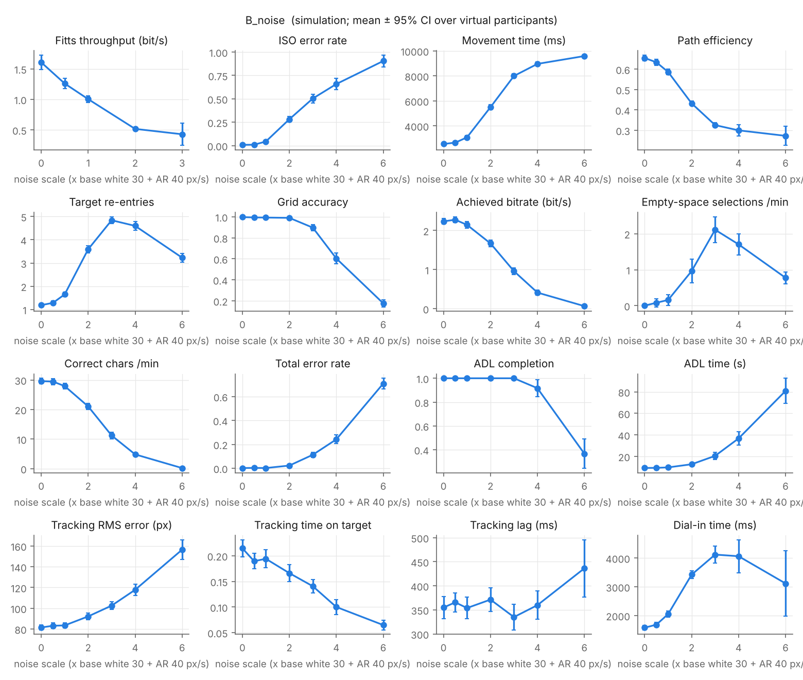
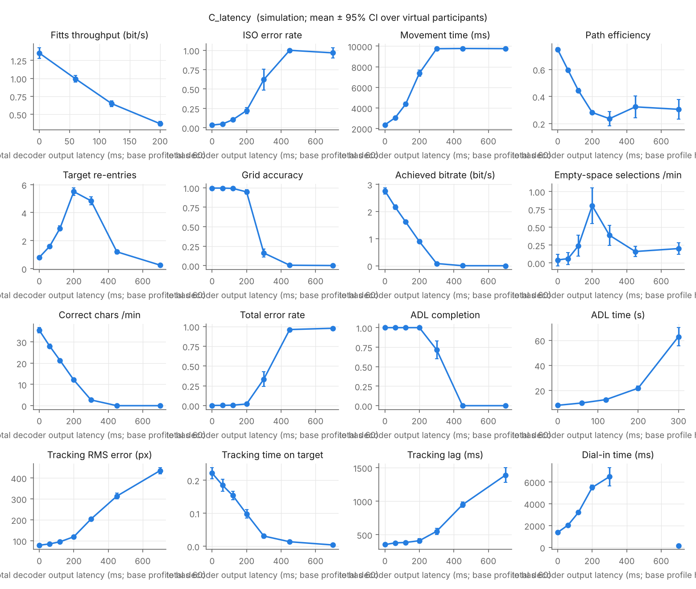
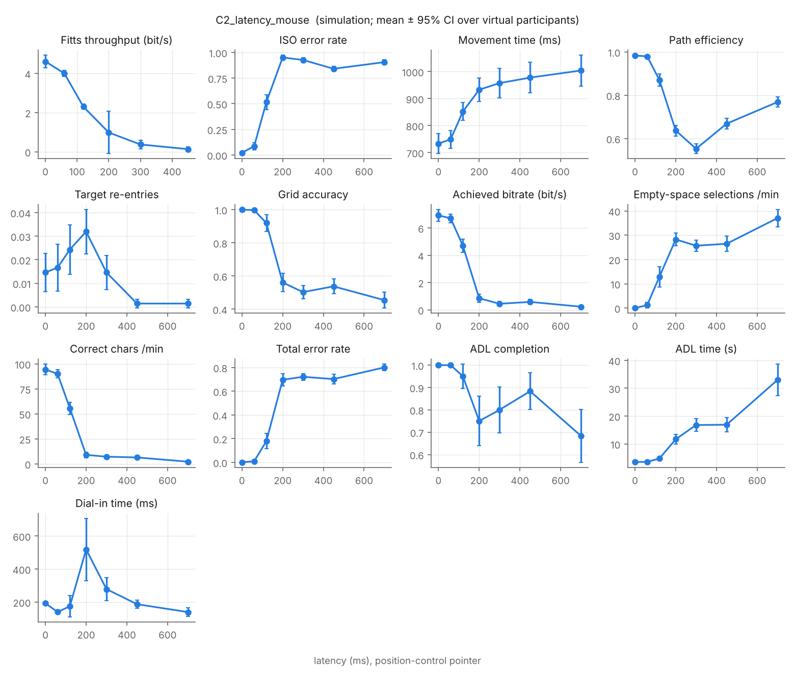
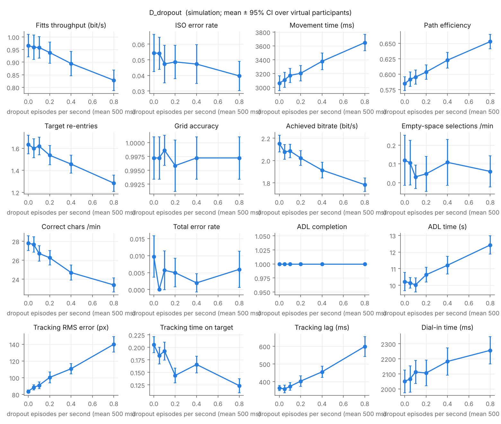
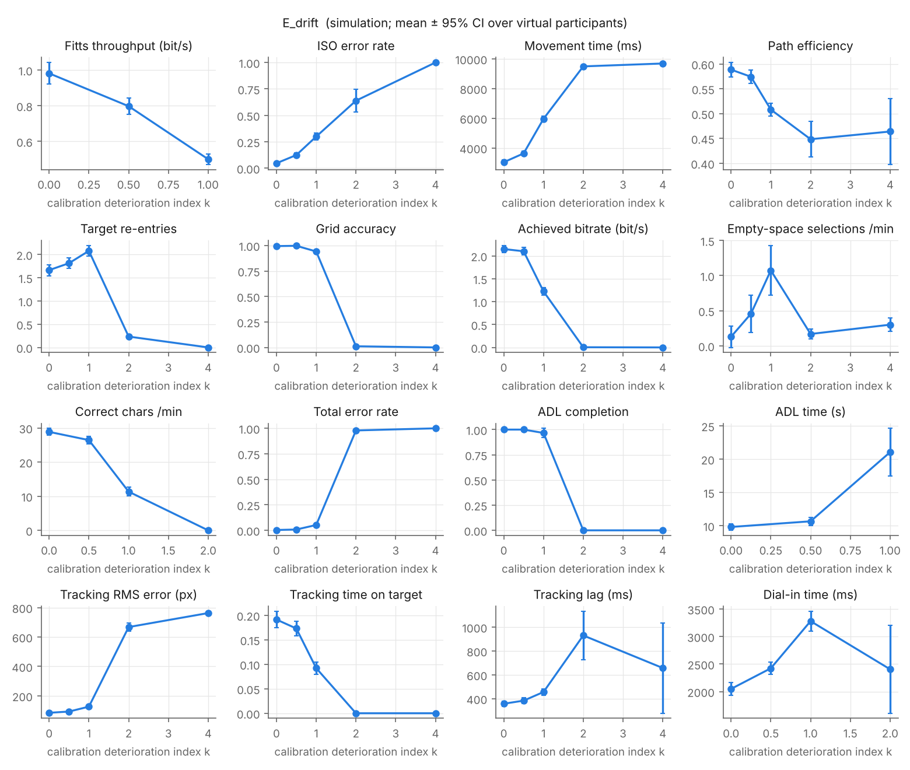
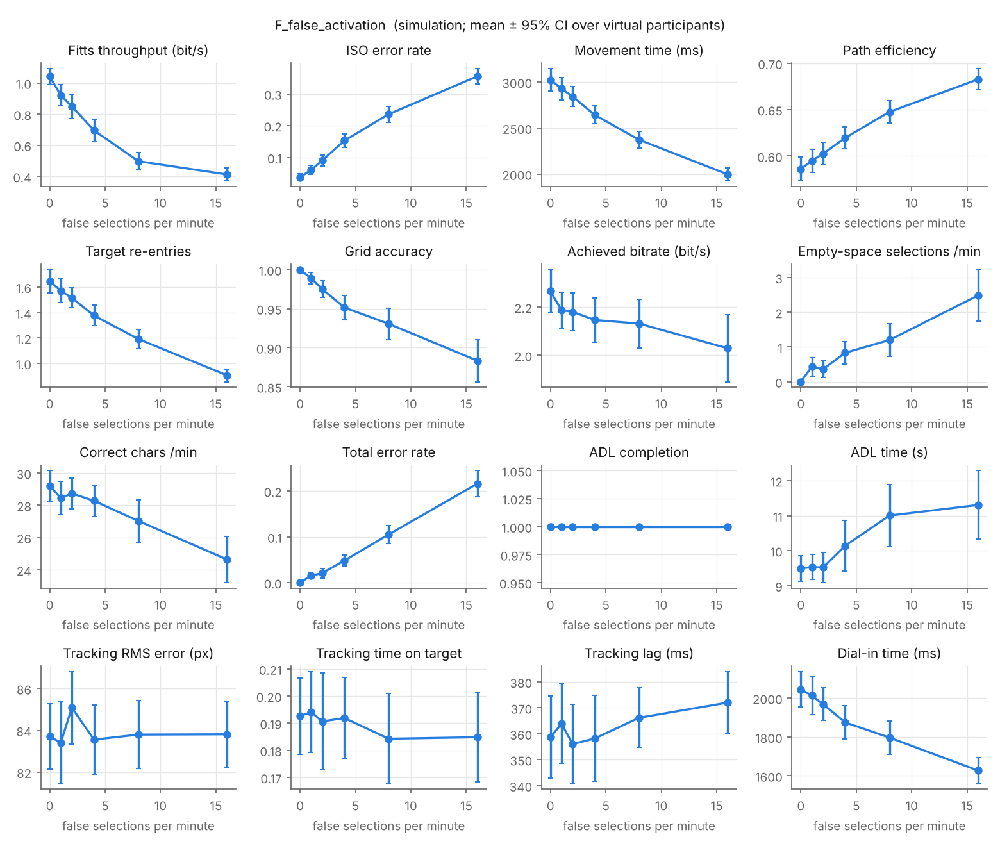
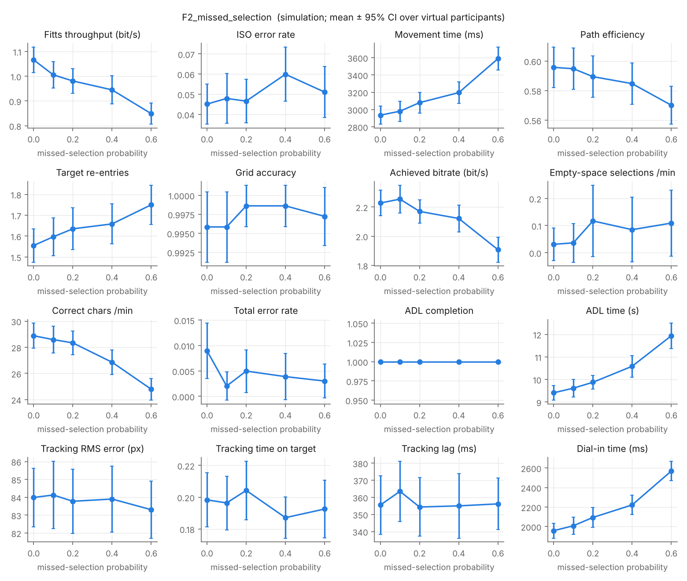
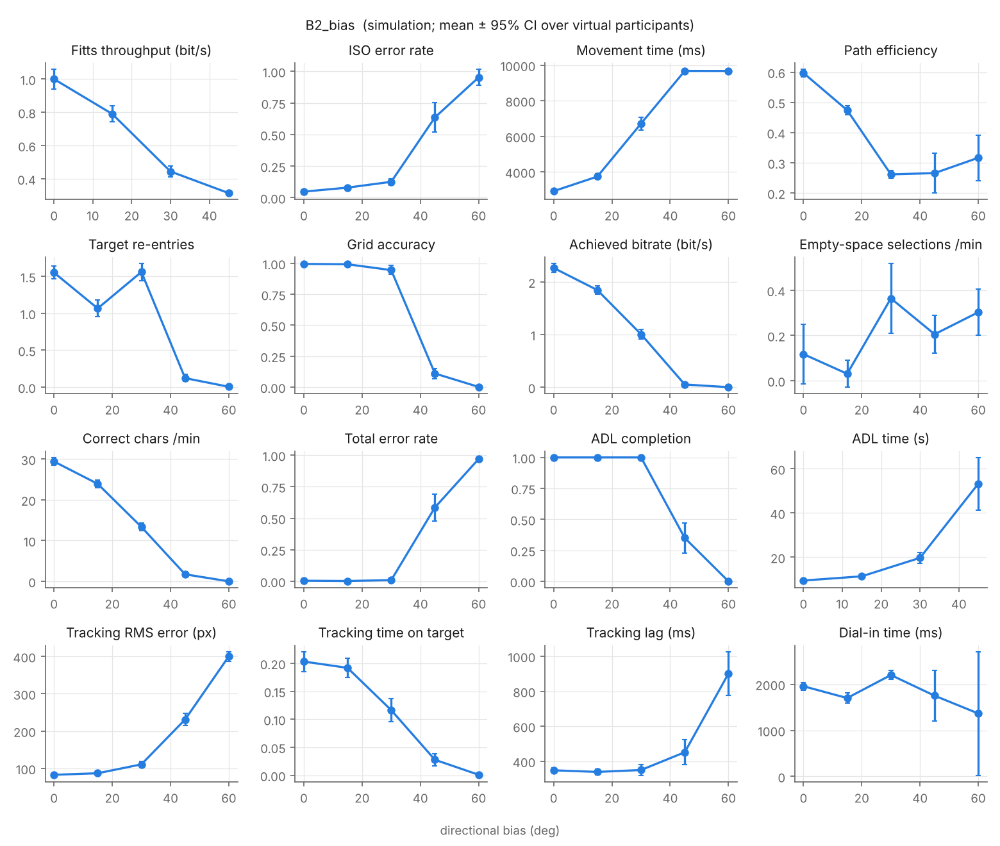
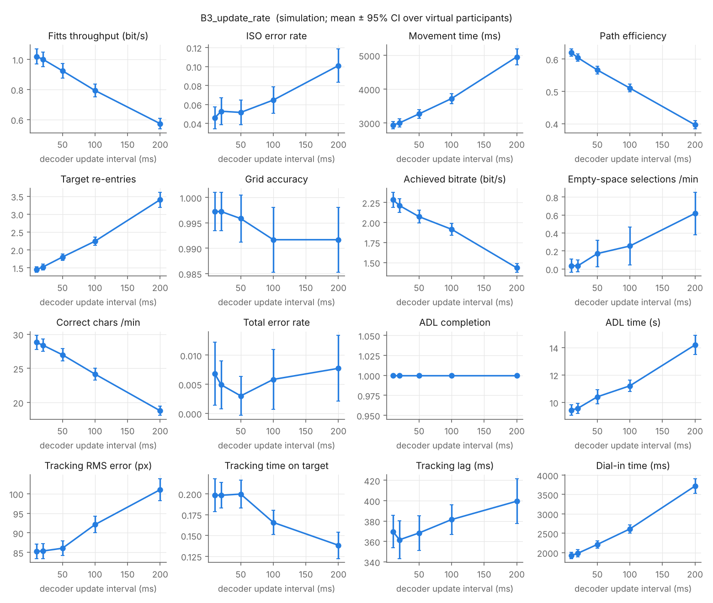
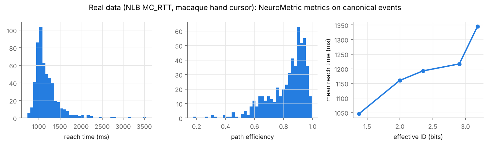

# EXPERIMENT REGISTRY

Generated by `tools/build_registry.py` from `experiments/results/` — numbers are read from result files. All experiments are SIMULATIONS of virtual participants unless marked REAL DATA. Simulations show how the measurement system behaves under modelled input conditions; they do not establish clinical effectiveness, or reliability or validity in human users. Code version: results regenerated after the independent review fixes (docs/review/RESPONSE_TO_SCIENCE_CORE_REVIEW.md). Re-run: `python -m neurometric.experiments.registry`.

| ID | Experiment | Status | Hypothesis |
|---|---|---|---|
| A_input_timing | Input adapter timing and consistency | done | Browser adapters preserve event order and timestamps without drops or duplicates under realistic and 1 kHz synthetic streams. |
| B_noise | Target acquisition under increasing input noise | done | Task scores degrade monotonically and detectably as decoder noise increases. |
| C_latency | Functional performance under increasing latency | done | Latency degrades closed-loop control; tracking lag and MT are most sensitive. |
| C2_latency_mouse | Latency with a position-control pointer | done | Position-control (mouse-like) users are less affected by latency than velocity users. |
| D_dropout | Sensitivity to dropout | done | Scores fall as dropout episodes become frequent. |
| E_drift | Cursor drift and calibration deterioration | done | Calibration decay (drift, gain loss, noise growth over session time) degrades later tasks. |
| F_false_activation | False activation sensitivity | done | Unintended selections lower accuracy and bitrate; empty-space selections reveal them. |
| F2_missed_selection | Missed-selection sensitivity | done | Missed selections lengthen time; accuracy is insensitive. |
| B2_bias | Directional bias | done | Users compensate small biases; large biases degrade path metrics first. |
| B3_update_rate | Reduced update frequency | done | Slow decoder updates degrade control. |
| B4_gain | Gain mismatch (overshoot/undershoot) | pending | Performance is best near unit gain (non-monotone). |
| G_metric_comparison | Comparison of functional task metrics | pending | Metrics differ in sensitivity, monotonicity, floor/ceiling and reliability; no single metric is best for all impairments. |
| H_adaptive | Fixed versus adaptive difficulty | pending | An adaptive size staircase reduces floor/ceiling effects across a wide ability range. |
| I_test_retest | Simulated test-retest reliability | pending | Reliability rises with test length per Spearman-Brown; some metrics reach ICC >= 0.8. |
| K_responsiveness | Measurement responsiveness | pending | Change scores separate participants whose (simulated) decoder improved from stable ones. |
| L_cross_modality | Cross-modality comparability (simulation) | pending | The same tasks run across modalities; some metrics are undefined or unfair across selection methods. |
| M_user_variability | Virtual user variability vs device variability | pending | Some metrics mostly reflect the device, others the user. |
| N_missing_data | Missing data and incomplete sessions | pending | Informative (MNAR) abandonment biases complete-case estimates; MCAR does not. |
| O_telemetry_integrity | Telemetry data integrity | done | Duplicates, conflicts, overlaps, clock skew and forbidden content are handled; aggregates stay exact. |
| P_reproducibility | Reproducibility | pending | Identical seeds give bit-identical results regardless of process count. |
| Q_accessibility | Accessibility and interface performance | done | Web battery, portal and website have zero serious/critical automated violations. |
| R_statistical_verification | Statistical implementation verification | done | Psychometric functions reproduce published values and independent libraries; CIs have nominal coverage. |
| S_event_latency | Real-time event processing latency | done | Server-side validation/scoring and browser event handling are fast enough for real-time recording. |
| X1_external_mc_rtt | Real public data: metric pipeline on macaque hand-cursor reaching | done | The pipeline ingests real behavioural data as canonical events and gives sane metrics. |

## A_input_timing — Input adapter timing and consistency

**Hypothesis.** Browser adapters preserve event order and timestamps without drops or duplicates under realistic and 1 kHz synthetic streams.

**Model / dataset.** Headless Chromium via Playwright; injected pointer streams.

Result files: browser_cdp_send_times.csv, browser_events.csv, browser_summary.json

`browser_summary.json`: {"experiment": "A_input_timing (browser part)", "generated": "2026-11-27T07:35:41.559Z", "caveat": "Headless Chromium on a shared CI-class Linux container. Events are injected via CDP (page.mouse) or dispatchEvent, so USB/Bluetooth polling, OS input processing, compositor and display latency are NOT included. These figures characterise the in-page software path (adapter -> canonical event) only and must not be reported as physical end-to-end latency; see docs/research/browser_timing.md for the bench protocol.", "environment": {"user_agent": "Mozilla/5.0 (Windows NT 10.0; Win64; x64) AppleWebKit/537.36 (KHTML, like Gecko) Chrome/153.0.8010.12 Safari/537.36", "cross_origin_isolated": true, "device_pixel_ratio": 1, "hardware_concurrency": 4, "timer_resolution_ms": 0.004999999888241291}, "canvas_scale": 0.9875, "cdp_mouse_stream": {"injected": 2000, "recorded_pointer_move": 2000, "matched_un

**Limitations.** Headless timing is not physical device latency (no display, no USB polling).

## B_noise — Target acquisition under increasing input noise

**Hypothesis.** Task scores degrade monotonically and detectably as decoder noise increases.

**Model / dataset.** Closed-loop BCI-like feedback users, bci_good base, white + AR(1) noise scaled 0-6x.

Levels: noise scale (x base white 30 + AR 40 px/s); 60 virtual participants x 2 sessions per level; runtime 97.0 s; ~52,920 simulated trials.

Mean scores by level (session 1):

| level | iso_tp_bps | iso_mt_ms | iso_path_efficiency | grid_bitrate_bps | grid_accuracy | type_ccpm | adl_completion_rate | track_rms_px | track_lag_ms |
|---|---|---|---|---|---|---|---|---|---|
| 0.00 | 1.61 | 2551.74 | 0.66 | 2.23 | 1.00 | 29.60 | 1.00 | 81.50 | 354.83 |
| 0.50 | 1.26 | 2657.83 | 0.63 | 2.28 | 0.99 | 29.45 | 1.00 | 83.15 | 365.67 |
| 1.00 | 1.00 | 3081.14 | 0.59 | 2.14 | 0.99 | 27.93 | 1.00 | 83.49 | 353.83 |
| 2.00 | 0.52 | 5494.79 | 0.43 | 1.67 | 0.99 | 21.05 | 1.00 | 92.18 | 371.33 |
| 3.00 | 0.43 | 7992.67 | 0.33 | 0.96 | 0.90 | 11.20 | 1.00 | 102.58 | 335.00 |
| 4.00 | – | 8959.38 | 0.30 | 0.41 | 0.60 | 4.82 | 0.92 | 117.79 | 359.83 |
| 6.00 | – | 9587.06 | 0.27 | 0.07 | 0.18 | 0.19 | 0.37 | 156.44 | 436.33 |

Most sensitive metrics (Spearman rho of oriented score with degradation; more negative = more sensitive):

| metric | rho | monotone_frac | auc_adjacent | min_detect_level |
|---|---|---|---|---|
| iso_movement_variability_px | -0.99 | 1.00 | 1.00 | 0.50 |
| iso_submovements | -0.96 | 1.00 | 0.89 | 0.50 |
| iso_success_rate | -0.95 | 1.00 | 0.82 | 1.00 |
| iso_timeout_rate | -0.95 | 1.00 | 0.79 | 2.00 |
| iso_endpoint_error_px | -0.95 | 1.00 | 0.90 | 1.00 |

**Limitations.** See docs/science/SIMULATOR.md (no physiology; one control law per modality; reliability estimates are upper bounds).

## C_latency — Functional performance under increasing latency

**Hypothesis.** Latency degrades closed-loop control; tracking lag and MT are most sensitive.

**Model / dataset.** Total decoder output latency 0-700 ms on the bci_good base.

Levels: total decoder output latency (ms; base profile has 60); 60 virtual participants x 2 sessions per level; runtime 111.4 s; ~52,920 simulated trials.

Mean scores by level (session 1):

| level | iso_tp_bps | iso_mt_ms | iso_path_efficiency | grid_bitrate_bps | grid_accuracy | type_ccpm | adl_completion_rate | track_rms_px | track_lag_ms |
|---|---|---|---|---|---|---|---|---|---|
| 0.00 | 1.35 | 2352.47 | 0.75 | 2.76 | 1.00 | 35.44 | 1.00 | 78.39 | 351.67 |
| 60.00 | 0.99 | 3046.26 | 0.60 | 2.16 | 1.00 | 28.03 | 1.00 | 84.86 | 377.67 |
| 120.00 | 0.65 | 4358.08 | 0.44 | 1.62 | 0.99 | 21.31 | 1.00 | 94.94 | 383.33 |
| 200.00 | 0.37 | 7367.31 | 0.28 | 0.89 | 0.95 | 12.11 | 1.00 | 118.80 | 409.83 |
| 300.00 | – | 9754.10 | 0.24 | 0.08 | 0.16 | 2.69 | 0.72 | 203.43 | 550.00 |
| 450.00 | – | 9777.51 | 0.32 | 0.00 | 0.01 | 0.00 | 0.00 | 313.00 | 946.17 |
| 700.00 | – | 9759.75 | 0.31 | 0.00 | 0.00 | 0.00 | 0.00 | 434.47 | 1390.00 |

Most sensitive metrics (Spearman rho of oriented score with degradation; more negative = more sensitive):

| metric | rho | monotone_frac | auc_adjacent | min_detect_level |
|---|---|---|---|---|
| iso_movement_variability_px | -0.97 | 1.00 | 0.94 | 60.00 |
| type_wpm | -0.97 | 1.00 | 0.88 | 60.00 |
| type_ccpm | -0.97 | 1.00 | 0.85 | 60.00 |
| iso_overshoot_px | -0.96 | 1.00 | 0.90 | 60.00 |
| grid_bitrate_bps | -0.96 | 1.00 | 0.84 | 60.00 |

**Limitations.** See docs/science/SIMULATOR.md (no physiology; one control law per modality; reliability estimates are upper bounds).

## C2_latency_mouse — Latency with a position-control pointer

**Hypothesis.** Position-control (mouse-like) users are less affected by latency than velocity users.

**Model / dataset.** Submovement users; latency only.

Levels: latency (ms), position-control pointer; 60 virtual participants x 2 sessions per level; runtime 42.2 s; ~52,920 simulated trials.

Mean scores by level (session 1):

| level | iso_tp_bps | iso_mt_ms | iso_path_efficiency | grid_bitrate_bps | grid_accuracy | type_ccpm | adl_completion_rate |
|---|---|---|---|---|---|---|---|
| 0.00 | 4.61 | 733.22 | 0.98 | 6.92 | 1.00 | 94.45 | 1.00 |
| 60.00 | 4.00 | 749.18 | 0.98 | 6.70 | 1.00 | 89.97 | 1.00 |
| 120.00 | 2.30 | 852.23 | 0.87 | 4.69 | 0.92 | 55.71 | 0.95 |
| 200.00 | 0.98 | 932.92 | 0.64 | 0.85 | 0.56 | 8.95 | 0.75 |
| 300.00 | 0.37 | 957.42 | 0.55 | 0.44 | 0.50 | 7.16 | 0.80 |
| 450.00 | 0.13 | 977.74 | 0.67 | 0.58 | 0.54 | 6.41 | 0.88 |
| 700.00 | – | 1004.03 | 0.77 | 0.23 | 0.45 | 2.15 | 0.68 |

Most sensitive metrics (Spearman rho of oriented score with degradation; more negative = more sensitive):

| metric | rho | monotone_frac | auc_adjacent | min_detect_level |
|---|---|---|---|---|
| iso_tp_all_bps | -0.94 | 1.00 | 0.84 | 120.00 |
| iso_endpoint_error_px | -0.94 | 1.00 | 0.82 | 120.00 |
| type_wpm | -0.88 | 1.00 | 0.73 | 120.00 |
| iso_movement_variability_px | -0.86 | 0.83 | 0.69 | 200.00 |
| grid_time_ms | -0.85 | 1.00 | 0.72 | 120.00 |

**Limitations.** See docs/science/SIMULATOR.md (no physiology; one control law per modality; reliability estimates are upper bounds).

## D_dropout — Sensitivity to dropout

**Hypothesis.** Scores fall as dropout episodes become frequent.

**Model / dataset.** Markov dropout 0-0.8 episodes/s, mean 500 ms.

Levels: dropout episodes per second (mean 500 ms); 60 virtual participants x 2 sessions per level; runtime 33.1 s; ~45,360 simulated trials.

Mean scores by level (session 1):

| level | iso_tp_bps | iso_mt_ms | iso_path_efficiency | grid_bitrate_bps | grid_accuracy | type_ccpm | adl_completion_rate | track_rms_px | track_lag_ms |
|---|---|---|---|---|---|---|---|---|---|
| 0.00 | 0.97 | 3059.62 | 0.58 | 2.15 | 1.00 | 27.79 | 1.00 | 83.58 | 363.83 |
| 0.05 | 0.96 | 3109.04 | 0.59 | 2.08 | 1.00 | 27.66 | 1.00 | 88.44 | 358.67 |
| 0.10 | 0.96 | 3173.15 | 0.60 | 2.09 | 1.00 | 26.72 | 1.00 | 90.81 | 372.67 |
| 0.20 | 0.94 | 3203.49 | 0.60 | 2.02 | 1.00 | 26.26 | 1.00 | 100.33 | 402.50 |
| 0.40 | 0.89 | 3377.13 | 0.62 | 1.91 | 1.00 | 24.70 | 1.00 | 110.64 | 455.17 |
| 0.80 | 0.83 | 3646.98 | 0.65 | 1.78 | 1.00 | 23.40 | 1.00 | 139.87 | 598.67 |

Most sensitive metrics (Spearman rho of oriented score with degradation; more negative = more sensitive):

| metric | rho | monotone_frac | auc_adjacent | min_detect_level |
|---|---|---|---|---|
| track_rms_px | -0.67 | 1.00 | 0.65 | 0.20 |
| iso_onset_ms | -0.58 | 1.00 | 0.62 | 0.05 |
| track_lag_ms | -0.45 | 0.80 | 0.59 | 0.40 |
| type_ccpm | -0.44 | 1.00 | 0.58 | 0.10 |
| type_wpm | -0.44 | 1.00 | 0.58 | 0.10 |

**Limitations.** See docs/science/SIMULATOR.md (no physiology; one control law per modality; reliability estimates are upper bounds).

## E_drift — Cursor drift and calibration deterioration

**Hypothesis.** Calibration decay (drift, gain loss, noise growth over session time) degrades later tasks.

**Model / dataset.** Index k scales drift rate, gain decay and noise growth; session starts at minute 10.

Levels: calibration deterioration index k; 60 virtual participants x 2 sessions per level; runtime 67.6 s; ~37,800 simulated trials.

Mean scores by level (session 1):

| level | iso_tp_bps | iso_mt_ms | iso_path_efficiency | grid_bitrate_bps | grid_accuracy | type_ccpm | adl_completion_rate | track_rms_px | track_lag_ms |
|---|---|---|---|---|---|---|---|---|---|
| 0.00 | 0.98 | 3033.84 | 0.59 | 2.15 | 0.99 | 28.85 | 1.00 | 84.93 | 357.33 |
| 0.50 | 0.80 | 3629.58 | 0.57 | 2.10 | 1.00 | 26.44 | 1.00 | 93.41 | 383.33 |
| 1.00 | 0.50 | 5958.34 | 0.51 | 1.22 | 0.94 | 11.33 | 0.97 | 126.68 | 455.83 |
| 2.00 | – | 9495.07 | 0.45 | 0.00 | 0.01 | 0.00 | 0.00 | 667.62 | 930.56 |
| 4.00 | – | 9689.56 | 0.46 | 0.00 | 0.00 | – | 0.00 | 762.74 | 657.22 |

Most sensitive metrics (Spearman rho of oriented score with degradation; more negative = more sensitive):

| metric | rho | monotone_frac | auc_adjacent | min_detect_level |
|---|---|---|---|---|
| iso_movement_variability_px | -0.96 | 1.00 | 0.94 | 0.50 |
| iso_success_rate | -0.95 | 1.00 | 0.90 | 0.50 |
| iso_timeout_rate | -0.93 | 1.00 | 0.83 | 0.50 |
| iso_endpoint_error_px | -0.93 | 1.00 | 0.92 | 1.00 |
| track_rms_px | -0.93 | 1.00 | 0.88 | 0.50 |

**Limitations.** See docs/science/SIMULATOR.md (no physiology; one control law per modality; reliability estimates are upper bounds).

## F_false_activation — False activation sensitivity

**Hypothesis.** Unintended selections lower accuracy and bitrate; empty-space selections reveal them.

**Model / dataset.** Poisson false selections 0-16/min.

Levels: false selections per minute; 60 virtual participants x 2 sessions per level; runtime 33.6 s; ~45,360 simulated trials.

Mean scores by level (session 1):

| level | iso_tp_bps | iso_mt_ms | iso_path_efficiency | grid_bitrate_bps | grid_accuracy | type_ccpm | adl_completion_rate | track_rms_px | track_lag_ms |
|---|---|---|---|---|---|---|---|---|---|
| 0.00 | 1.04 | 3023.78 | 0.59 | 2.27 | 1.00 | 29.21 | 1.00 | 83.71 | 358.67 |
| 1.00 | 0.92 | 2927.31 | 0.59 | 2.19 | 0.99 | 28.45 | 1.00 | 83.41 | 363.83 |
| 2.00 | 0.85 | 2842.67 | 0.60 | 2.18 | 0.97 | 28.74 | 1.00 | 85.08 | 356.00 |
| 4.00 | 0.70 | 2641.77 | 0.62 | 2.15 | 0.95 | 28.28 | 1.00 | 83.56 | 358.17 |
| 8.00 | 0.50 | 2372.17 | 0.65 | 2.13 | 0.93 | 27.03 | 1.00 | 83.80 | 366.17 |
| 16.00 | 0.41 | 1995.88 | 0.68 | 2.03 | 0.88 | 24.64 | 1.00 | 83.81 | 372.00 |

Most sensitive metrics (Spearman rho of oriented score with degradation; more negative = more sensitive):

| metric | rho | monotone_frac | auc_adjacent | min_detect_level |
|---|---|---|---|---|
| iso_endpoint_error_px | -0.81 | 1.00 | 0.70 | 1.00 |
| iso_error_rate | -0.80 | 1.00 | 0.70 | 2.00 |
| iso_success_rate | -0.80 | 1.00 | 0.70 | 2.00 |
| type_total_error_rate | -0.73 | 1.00 | 0.66 | 1.00 |
| iso_tp_all_bps | -0.68 | 1.00 | 0.63 | 2.00 |

**Limitations.** See docs/science/SIMULATOR.md (no physiology; one control law per modality; reliability estimates are upper bounds).

## F2_missed_selection — Missed-selection sensitivity

**Hypothesis.** Missed selections lengthen time; accuracy is insensitive.

**Model / dataset.** Selection miss probability 0-0.6.

Levels: missed-selection probability; 60 virtual participants x 2 sessions per level; runtime 30.2 s; ~37,800 simulated trials.

Mean scores by level (session 1):

| level | iso_tp_bps | iso_mt_ms | iso_path_efficiency | grid_bitrate_bps | grid_accuracy | type_ccpm | adl_completion_rate | track_rms_px | track_lag_ms |
|---|---|---|---|---|---|---|---|---|---|
| 0.00 | 1.07 | 2934.74 | 0.60 | 2.23 | 1.00 | 28.88 | 1.00 | 83.99 | 355.50 |
| 0.10 | 1.01 | 2980.28 | 0.59 | 2.25 | 1.00 | 28.59 | 1.00 | 84.13 | 363.50 |
| 0.20 | 0.98 | 3079.59 | 0.59 | 2.17 | 1.00 | 28.33 | 1.00 | 83.77 | 354.33 |
| 0.40 | 0.94 | 3195.31 | 0.58 | 2.12 | 1.00 | 26.86 | 1.00 | 83.90 | 355.00 |
| 0.60 | 0.85 | 3588.40 | 0.57 | 1.91 | 1.00 | 24.79 | 1.00 | 83.30 | 356.17 |

Most sensitive metrics (Spearman rho of oriented score with degradation; more negative = more sensitive):

| metric | rho | monotone_frac | auc_adjacent | min_detect_level |
|---|---|---|---|---|
| iso_dial_in_ms | -0.48 | 1.00 | 0.61 | 0.20 |
| adl_time_s | -0.42 | 1.00 | 0.60 | 0.40 |
| iso_mt_ms | -0.39 | 1.00 | 0.59 | 0.20 |
| iso_mt_completed_ms | -0.39 | 1.00 | 0.59 | 0.20 |
| type_wpm | -0.36 | 1.00 | 0.58 | 0.40 |

**Limitations.** See docs/science/SIMULATOR.md (no physiology; one control law per modality; reliability estimates are upper bounds).

## B2_bias — Directional bias

**Hypothesis.** Users compensate small biases; large biases degrade path metrics first.

**Model / dataset.** Rotation 0-60 degrees.

Levels: directional bias (deg); 60 virtual participants x 2 sessions per level; runtime 66.5 s; ~37,800 simulated trials.

Mean scores by level (session 1):

| level | iso_tp_bps | iso_mt_ms | iso_path_efficiency | grid_bitrate_bps | grid_accuracy | type_ccpm | adl_completion_rate | track_rms_px | track_lag_ms |
|---|---|---|---|---|---|---|---|---|---|
| 0.00 | 1.00 | 2913.01 | 0.60 | 2.26 | 1.00 | 29.41 | 1.00 | 82.83 | 348.00 |
| 15.00 | 0.79 | 3733.48 | 0.47 | 1.84 | 0.99 | 23.92 | 1.00 | 86.98 | 338.83 |
| 30.00 | 0.44 | 6714.53 | 0.26 | 1.01 | 0.95 | 13.35 | 1.00 | 110.81 | 349.67 |
| 45.00 | 0.31 | 9676.15 | 0.27 | 0.05 | 0.11 | 1.72 | 0.35 | 230.99 | 451.33 |
| 60.00 | – | 9673.62 | 0.32 | 0.00 | 0.00 | 0.00 | 0.00 | 400.23 | 900.83 |

Most sensitive metrics (Spearman rho of oriented score with degradation; more negative = more sensitive):

| metric | rho | monotone_frac | auc_adjacent | min_detect_level |
|---|---|---|---|---|
| iso_movement_variability_px | -0.98 | 1.00 | 1.00 | 15.00 |
| iso_overshoot_px | -0.95 | 1.00 | 0.92 | 15.00 |
| type_ccpm | -0.94 | 1.00 | 0.88 | 15.00 |
| grid_bitrate_bps | -0.94 | 1.00 | 0.87 | 15.00 |
| type_wpm | -0.94 | 1.00 | 0.90 | 15.00 |

**Limitations.** See docs/science/SIMULATOR.md (no physiology; one control law per modality; reliability estimates are upper bounds).

## B3_update_rate — Reduced update frequency

**Hypothesis.** Slow decoder updates degrade control.

**Model / dataset.** Update interval 10-200 ms.

Levels: decoder update interval (ms); 60 virtual participants x 2 sessions per level; runtime 28.1 s; ~37,800 simulated trials.

Mean scores by level (session 1):

| level | iso_tp_bps | iso_mt_ms | iso_path_efficiency | grid_bitrate_bps | grid_accuracy | type_ccpm | adl_completion_rate | track_rms_px | track_lag_ms |
|---|---|---|---|---|---|---|---|---|---|
| 10.00 | 1.02 | 2933.74 | 0.62 | 2.29 | 1.00 | 28.80 | 1.00 | 85.30 | 369.67 |
| 20.00 | 1.00 | 3000.03 | 0.60 | 2.21 | 1.00 | 28.39 | 1.00 | 85.37 | 361.67 |
| 50.00 | 0.92 | 3266.49 | 0.57 | 2.07 | 1.00 | 26.98 | 1.00 | 86.07 | 368.33 |
| 100.00 | 0.79 | 3720.62 | 0.51 | 1.91 | 0.99 | 24.15 | 1.00 | 92.12 | 381.50 |
| 200.00 | 0.57 | 4953.90 | 0.40 | 1.43 | 0.99 | 18.77 | 1.00 | 101.04 | 399.50 |

Most sensitive metrics (Spearman rho of oriented score with degradation; more negative = more sensitive):

| metric | rho | monotone_frac | auc_adjacent | min_detect_level |
|---|---|---|---|---|
| iso_path_efficiency | -0.82 | 1.00 | 0.77 | 20.00 |
| iso_reentries | -0.80 | 1.00 | 0.75 | 50.00 |
| iso_overshoot_px | -0.78 | 1.00 | 0.73 | 20.00 |
| iso_dial_in_ms | -0.77 | 1.00 | 0.73 | 50.00 |
| iso_mt_ms | -0.73 | 1.00 | 0.71 | 50.00 |

**Limitations.** See docs/science/SIMULATOR.md (no physiology; one control law per modality; reliability estimates are upper bounds).

## B4_gain — Gain mismatch (overshoot/undershoot)

**Hypothesis.** Performance is best near unit gain (non-monotone).

**Model / dataset.** Gain 0.4-2.0.

_Not yet run._

**Limitations.** See docs/science/SIMULATOR.md (no physiology; one control law per modality; reliability estimates are upper bounds).

## G_metric_comparison — Comparison of functional task metrics

**Hypothesis.** Metrics differ in sensitivity, monotonicity, floor/ceiling and reliability; no single metric is best for all impairments.

**Model / dataset.** Properties pooled over sweeps B-F.

_Not yet run._

**Limitations.** See docs/science/SIMULATOR.md (no physiology; one control law per modality; reliability estimates are upper bounds).

## H_adaptive — Fixed versus adaptive difficulty

**Hypothesis.** An adaptive size staircase reduces floor/ceiling effects across a wide ability range.

**Model / dataset.** Fixed 100 px and 40 px grids vs 2-down/1-up size staircase; 6 noise levels.

_Not yet run._

**Limitations.** Adaptive scores are on a different scale; comparability requires locking the staircase rule.

## I_test_retest — Simulated test-retest reliability

**Hypothesis.** Reliability rises with test length per Spearman-Brown; some metrics reach ICC >= 0.8.

**Model / dataset.** 80 virtual participants x 2 sessions x 4 lengths x 3 modalities; day-to-day variation.

_Not yet run._

**Limitations.** Upper bounds: real users vary more between days than modelled.

## K_responsiveness — Measurement responsiveness

**Hypothesis.** Change scores separate participants whose (simulated) decoder improved from stable ones.

**Model / dataset.** 100 virtual participants; half receive an improved decoder at session 2.

_Not yet run._

**Limitations.** MDC is statistically detectable change, not an MCID.

## L_cross_modality — Cross-modality comparability (simulation)

**Hypothesis.** The same tasks run across modalities; some metrics are undefined or unfair across selection methods.

**Model / dataset.** 8 simulated modalities incl. mouse, head pointer, gaze, BCI x3, switch scanning x2.

_Not yet run._

**Limitations.** All modalities simulated; dwell time is inside MT; scanning has no throughput.

## M_user_variability — Virtual user variability vs device variability

**Hypothesis.** Some metrics mostly reflect the device, others the user.

**Model / dataset.** 3 ability levels x 3 decoder profiles x 60 virtual participants.

_Not yet run._

**Limitations.** See docs/science/SIMULATOR.md (no physiology; one control law per modality; reliability estimates are upper bounds).

## N_missing_data — Missing data and incomplete sessions

**Hypothesis.** Informative (MNAR) abandonment biases complete-case estimates; MCAR does not.

**Model / dataset.** 120 virtual participants, 24 ISO selections; MCAR, MAR (late trials), MNAR (abandon after slow trial).

_Not yet run._

**Limitations.** See docs/science/SIMULATOR.md (no physiology; one control law per modality; reliability estimates are upper bounds).

## O_telemetry_integrity — Telemetry data integrity

**Hypothesis.** Duplicates, conflicts, overlaps, clock skew and forbidden content are handled; aggregates stay exact.

**Model / dataset.** Fault-injection tests against the ingest service.

32/32 fault-injection tests passed. Fault injection against the telemetry ingest service: duplicates, conflicting re-sends, out-of-order batches, overlapping periods, clock skew/future periods, forbidden content fields (keystrokes, URLs, titles, free text), consent paused/stopped/withdrawn, hash mismatch; stored aggregates compared with expected values.

**Limitations.** Software verification, not field data.

## P_reproducibility — Reproducibility

**Hypothesis.** Identical seeds give bit-identical results regardless of process count.

**Model / dataset.** One condition run in-process and in a pool.

_Not yet run._

**Limitations.** See docs/science/SIMULATOR.md (no physiology; one control law per modality; reliability estimates are upper bounds).

## Q_accessibility — Accessibility and interface performance

**Hypothesis.** Web battery, portal and website have zero serious/critical automated violations.

**Model / dataset.** axe-core via Playwright.

Result files: axe_summary.json, axe_violations.csv, e2e_backend_upload.json, e2e_tasks_summary.json, reflow_text_spacing.csv

`e2e_tasks_summary.json`: {"generated": "2026-11-27T07:42:29.781Z", "note": "Automated Playwright runs in headless Chromium with synthetic input (CDP mouse, keyboard as switch). Not a substitute for testing with real assistive technology.", "results": {"demo": {"live_identity_position_iso_tp_bps": 23.33, "virtual_user_rows": ["mouse_simvirtual userpositionISO ring3.740 %8760.99\u201312", "mouse_simvirtual userpositionGrid 4\u00d76\u20130 %730\u20136.2010", "bci_goodvirtual uservelocityISO ring0.678 %28580.69\u201312", "bci_goodvirtual uservelocityGrid 4\u00d76\u201310 %1677\u20132.1610", "bci_moderatevirtual uservelocityISO ring0.1430 %47240.51\u201310", "bci_moderatevirtual uservelocityGrid 4\u00d76\u201310 %3400\u20130.9310", "bci_poorvirtual uservelocityISO ring0.44100 %53230.39\u20134", "bci_poorvirtual uservelocityGrid 4\u00d76\u201310 %2700\u20130.6710"]}}}

`axe_summary.json`: {"generated": "2026-11-27T07:41:07.577Z", "tool": "axe-core 4.10.3 (vendored npm devDependency) via Playwright, headless Chromium", "tags": ["wcag2a", "wcag2aa", "wcag21a", "wcag21aa", "wcag22aa", "best-practice"], "screens_scanned": 58, "violations_by_impact": {}, "serious_or_critical": 0, "screens": [{"screen": "setup", "theme": "light", "violations": [], "rules_passed": 41, "needs_review": 1}, {"screen": "task list", "theme": "light", "violations": [], "rules_passed": 34, "needs_review": 0}, {"screen": "task intro (A2)", "theme": "light", "violations": [], "rules_passed": 33, "needs_review": 0}, {"screen": "results (empty)", "theme": "light", "violations": [], "rules_passed": 31, "needs_review": 0}, {"screen": "demo: try it yourself", "theme": "light", "violations": [], "rules_passed": 47, "needs_review": 1}, {"screen": "demo: watch a virtual user", "theme": "light", "violations": [],

**Limitations.** Automated checks only; no testing with real assistive technology or users.

## R_statistical_verification — Statistical implementation verification

**Hypothesis.** Psychometric functions reproduce published values and independent libraries; CIs have nominal coverage.

**Model / dataset.** Shrout & Fleiss example, pingouin, scipy, Monte Carlo coverage.

Result files: coverage_results.csv, coverage_results.json

`coverage_results.json`: {"experiment": "R_statistical_verification", "description": "Monte-Carlo verification of neurometric.psychometrics estimators: bias, RMSE, 95% CI coverage and test type-I error under known truth.", "n_reps": 2000, "seed": 20261127, "runtime_s": 85.8, "n_rows": 86, "n_pass": 86, "failures": [], "known_limitations": [{"analysis": "ICC(2,1) 95% CI (McGraw & Wong)", "scenario": "n=20,k=2,var_s=0.6,var_session=0.2,var_e=0.2", "value_checked": 0.907}, {"analysis": "ICC(2,k) 95% CI (McGraw & Wong)", "scenario": "n=20,k=2,var_s=0.6,var_session=0.2,var_e=0.2", "value_checked": 0.907}, {"analysis": "ICC(2,1) 95% CI (McGraw & Wong)", "scenario": "n=50,k=3,var_s=0.9,var_session=0.05,var_e=0.05", "value_checked": 0.868}, {"analysis": "ICC(2,k) 95% CI (McGraw & Wong)", "scenario": "n=50,k=3,var_s=0.9,var_session=0.05,var_e=0.05", "value_checked": 0.868}, {"analysis": "ICC(2,1) 95% CI (McGraw & Wong)",

**Limitations.** See docs/science/SIMULATOR.md (no physiology; one control law per modality; reliability estimates are upper bounds).

## S_event_latency — Real-time event processing latency

**Hypothesis.** Server-side validation/scoring and browser event handling are fast enough for real-time recording.

**Model / dataset.** Synthetic 60-trial session (Python); headless Chromium (browser).

Python pipeline on a 14,643-event, 60-trial session: validation 2,140,357 events/s; segmentation + scoring 87 ms; JSON round trip identical: True; per-event validation p99 1.1 µs.

Browser (`browser_summary.json`): {"experiment": "S_event_latency part 1 (browser)", "generated": "2026-11-27T07:34:42.270Z", "caveat": "Headless Chromium on a shared CI-class Linux container. Events are injected via CDP (page.mouse) or dispatchEvent, so USB/Bluetooth polling, OS input processing, compositor and display latency are NOT included. These figures characterise the in-page software path (adapter -> canonical event) only and must not be reported as physical end-to-end latency; see docs/research/browser_timing.md for the bench protocol.", "environment": {"user_agent": "Mozilla/5.0 (Windows NT 10.0; Win64; x64) AppleWebKit/537.36 (KHTML, like Gecko) Chrome/153.0.8010.12 Safari/537.36", "cross_origin_isolated": true, 

**Limitations.** Machine-specific.

## X1_external_mc_rtt — Real public data: metric pipeline on macaque hand-cursor reaching

**Hypothesis.** The pipeline ingests real behavioural data as canonical events and gives sane metrics.

**Model / dataset.** NLB MC_RTT (DANDI:000129, CC-BY-4.0).

REAL DATA. Reaches: 541; median reach time 1110 ms; median path efficiency 0.866; effective throughput (mean over distance bins) 1.95 bit/s; stream integrity {'n': 66639, 'non_monotonic': 0, 'duplicate_seq': 0, 'seq_gaps': 0, 'gap_events': 0}.

| distance_bin_mm | n | De_mm | We_mm | IDe_bits | MT_ms | TPe_bps |
|---|---|---|---|---|---|---|
| (9.548, 32.354] | 109 | 22.26 | 13.95 | 1.38 | 1046.15 | 1.32 |
| (32.354, 47.163] | 108 | 40.13 | 13.42 | 2.00 | 1159.91 | 1.72 |
| (47.163, 62.549] | 108 | 54.83 | 13.35 | 2.35 | 1192.78 | 1.97 |
| (62.549, 78.897] | 108 | 69.51 | 10.69 | 2.91 | 1216.67 | 2.39 |
| (78.897, 114.543] | 108 | 90.65 | 11.21 | 3.18 | 1344.72 | 2.37 |

**Limitations.** Able-bodied macaque, hand control, one session; target width unknown.
