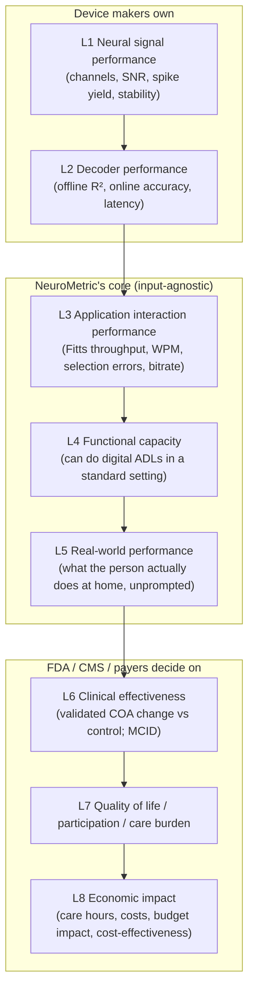

# NeuroMetric founder knowledge base

A primer on the technology, clinical science and measurement problems NeuroMetric works on. Written for a
founder with a biomedical research background who has built BCI middleware (Concord) and now needs a
clinician's, regulator's and payer's view of the same systems.

Prepared 2026-11-27. Evidence labels follow [`../research/CONVENTIONS.md`](../research/CONVENTIONS.md).

How to read the labels in this file:

| Label | Meaning here |
|---|---|
| **[V-DOI]** | The DOI was resolved against the Crossref API on 2026-11-27, and author, year, title and journal match. The *citation* is verified. Specific numbers quoted from the paper are **[PK]** unless marked otherwise, because the full text was not re-read this session. |
| **[V]** | Checked against a primary web source on 2026-11-27 (URL given), or carried over from a [V] item in `docs/research/` (file linked). |
| **[PK]** | Prior knowledge, not re-verified this session. Treat as "probably right; check before quoting externally". |
| **[CC] [RF] [AE] [INF] [HYP] [UNR]** | As defined in `CONVENTIONS.md`. |

Companion research (do not duplicate; link to it):
[`regulatory_landscape.md`](../research/regulatory_landscape.md),
[`clinical_trials.md`](../research/clinical_trials.md),
[`published_bci_functional_measures.md`](../research/published_bci_functional_measures.md),
[`methods_references.md`](../research/methods_references.md),
[`instruments.md`](../research/instruments.md),
[`health_economics_payer.md`](../research/health_economics_payer.md),
[`platform_matrix.md`](../research/platform_matrix.md),
[`bci_hid_and_input_standards.md`](../research/bci_hid_and_input_standards.md),
[`browser_timing.md`](../research/browser_timing.md),
[`neuromodulation_market.md`](../research/neuromodulation_market.md),
[`competitors.md`](../research/competitors.md).

---

## Contents

0. [The one idea to keep: levels of evidence](#0-the-one-idea-to-keep-levels-of-evidence)
1. [Neural interfaces by invasiveness](#1-neural-interfaces-by-invasiveness)
2. [Neural decoding basics](#2-neural-decoding-basics)
3. [Closed-loop control: cursor, click, typing, shared control](#3-closed-loop-control-cursor-click-typing-shared-control)
4. [Things that go wrong: calibration, drift, latency, dropout, uncertainty](#4-things-that-go-wrong-calibration-drift-latency-dropout-uncertainty)
5. [Assistive technology and AAC](#5-assistive-technology-and-aac)
6. [Rehabilitation outcomes](#6-rehabilitation-outcomes)
7. [Neuromodulation and BCI-driven rehabilitation](#7-neuromodulation-and-bci-driven-rehabilitation)
8. [The eight levels in detail](#8-the-eight-levels-in-detail)
9. [Why adjacent-level correlations do not establish causation](#9-why-adjacent-level-correlations-do-not-establish-causation)
10. [What this means for NeuroMetric](#10-what-this-means-for-neurometric)
11. [Reference list](#11-reference-list)

---

## 0. The one idea to keep: levels of evidence

Every claim anyone makes about a BCI or assistive device sits at a **level**. A good electrode is not a good
decoder; a good decoder is not a usable computer; a usable computer is not independence at home; independence
is not a health outcome; a health outcome is not a cost saving. Most published iBCI work stops at the
first three levels. Dohle et al. (2025) found that of 112 iBCI studies, only 17.9% assessed clinical outcomes
([V], see [`published_bci_functional_measures.md`](../research/published_bci_functional_measures.md) §2).

NeuroMetric's job is to measure levels 3 to 5 the same way across *any* input device, and to link them,
with honest uncertainty, to levels 6 to 8.



The same chain in plain text, with the "input-agnostic" cut marked:

```
 device-specific ............................|......... input-agnostic ..................................
                                             |
 [L1 signal] -> [L2 decoder] -> (OS / HID / AT layer) -> [L3 interaction] -> [L4 capacity] -> [L5 real world]
   electrodes     Kalman/RNN     pointer, click,          ISO pointing,       dADL tasks in      hours used,
   SNR, units     click HMM      keys, switch scan        typing, grid        clinic or home     independent
                                                           |                                     sessions
                                                           v
                              [L6 clinical effectiveness] -> [L7 QoL, participation, care burden] -> [L8 economics]
                               COA change vs control,        PIADS, WHOQOL-BREF, Zarit,              care hours x wage,
                               MCID, responders              care-partner time diary                 budget impact
```

Two consequences shape everything else in this document:

1. **The cut point is the operating system.** Below it, signals and decoders are unique to each device.
   Above it, a Neuralink cursor, a Synchron "click", an eye tracker and a sip-and-puff switch all arrive as
   pointer, key or switch events. That is why NeuroMetric can be input-agnostic, and why it should log the
   input *modality and settings* with every event (see [`browser_timing.md`](../research/browser_timing.md)
   §6 and [`bci_hid_and_input_standards.md`](../research/bci_hid_and_input_standards.md) §1.4).
2. **Each arrow is a hypothesis, not a fact.** Section 9 explains why a correlation between two adjacent
   levels does not show that improving one causes the other to improve.

The full table of example metrics, who measures them and the typical evidence is in
[Section 8](#8-the-eight-levels-in-detail).

---

## 1. Neural interfaces by invasiveness

A rule of thumb: the closer the electrode is to individual neurons, the more information per second you can
extract, and the more surgical risk, tissue reaction and long-term stability problems you take on.

| Class | Where the sensor sits | What it records | Typical spatial scale | Examples |
|---|---|---|---|---|
| Intracortical | Penetrates cortex 1–1.5 mm | Spikes (action potentials) and local field potentials (LFP) from small groups of neurons | ~100 µm | Utah array (Blackrock), Neuralink N1 threads, Paradromics Connexus |
| Electrocorticography (ECoG) / µECoG | On the cortical surface, under (subdural) or over (epidural) the dura | Field potentials, especially high-gamma (~70–150 Hz) power that tracks local population firing | mm | CortiCom (JHU), Precision Layer 7, Clinatec WIMAGINE |
| Endovascular | Inside a blood vessel next to cortex | ECoG-like field potentials through the vessel wall | mm–cm | Synchron Stentrode |
| Scalp EEG | On the scalp | Summed activity of large cortical areas, filtered by skull and scalp | cm | Motor-imagery, P300 and SSVEP spellers; Cognixion; EMOTIV, OpenBCI |

### 1.1 Intracortical BCIs

**Utah array.** A 10 × 10 grid of silicon microelectrodes (96 wired in the standard human device), 1.0 or 1.5
mm long, 400 µm apart, connected through a percutaneous pedestal on the skull [PK]. It is the workhorse of
BrainGate, Pittsburgh, Caltech and others since Hochberg et al. 2006 (first human cursor control; [V-DOI]
10.1038/nature04970). Review: Normann & Fernandez 2016 [V-DOI] 10.1088/1741-2560/13/6/061003.

Landmark results [citations V-DOI; numbers PK]:
- Hochberg et al. 2012: reach and grasp with a robotic arm (10.1038/nature11076).
- Collinger et al. 2013: 7-degree-of-freedom arm control in a person with tetraplegia
  (10.1016/S0140-6736(12)61816-9); Wodlinger et al. 2015 extended this to 10 DoF (10.1088/1741-2560/12/1/016011).
- Pandarinath et al. 2017: point-and-click typing by people with ALS and SCI (10.7554/eLife.18554).
- Willett et al. 2021: "mental handwriting" decoded at about 90 characters per minute
  (10.1038/s41586-021-03506-2).
- Safety: Rubin et al. 2023 interim BrainGate safety profile (10.1212/WNL.0000000000201707) [V-DOI].

Known weaknesses: the percutaneous connector (infection risk, tethering), and a slow loss of recordable units
over months to years from tissue response and material failure (Barrese et al. 2013, failure-mode analysis in
non-human primates; [V-DOI] 10.1088/1741-2560/10/6/066014).

**Neuralink N1.** Flexible polymer "threads" inserted by a surgical robot, with the electronics, battery and
radio sealed in a skull-flush implant that charges inductively. The 2019 white paper described thousands of
channels across many threads (Musk 2019, [V-DOI] 10.2196/16194); the human N1 is commonly described as about
1,024 electrodes on 64 threads [PK/CC]. Neuralink reports results mainly through its own blog, including the
"webgrid" bits-per-second benchmark (record 11.32 BPS, median about 10; [CC] in
[`published_bci_functional_measures.md`](../research/published_bci_functional_measures.md) §3.3). Its US
studies register safety as the primary endpoint ([V],
[`clinical_trials.md`](../research/clinical_trials.md) §2.1). It collaborates on the Shirley Ryan AbilityLab
DAI study (NCT07407725; [V]).

**Paradromics Connexus.** A high-channel-count intracortical system of many microwires, aimed first at
communication (speech). Preclinical platform described in Sahasrabuddhe et al. 2021 ("The Argo"; [V-DOI]
10.1088/1741-2552/abd0ce). First human implants under the Connect-One early feasibility study
(NCT07357428; [V] via [`competitors.md`](../research/competitors.md) B3). The company argues for reporting
*achieved* information rate together with *latency* (SONIC benchmark; [CC]).

### 1.2 ECoG

ECoG grids sit on the brain surface. They do not resolve single neurons, but the **high-gamma band** carries
much of the information that spikes do at a coarser scale, and surface arrays tend to be more stable over
time than penetrating ones [PK]. For background on field potentials see Pesaran et al. 2018 ([V-DOI]
10.1038/s41593-018-0171-8).

- **Early human ECoG BCI:** Leuthardt et al. 2004 ([V-DOI] 10.1088/1741-2560/1/2/001).
- **Fully implanted home ECoG BCI:** Vansteensel et al. 2016, a person with late-stage ALS using a
  click-like "brain switch" at home ([V-DOI] 10.1056/NEJMoa1608085). This is still one of the best examples of
  real-world (L5) evidence for a BCI.
- **CortiCom (Johns Hopkins):** ECoG over speech and upper-limb areas in ALS (NCT03567213; [V] in
  `clinical_trials.md`). Luo et al. 2023 reported speech-command decoding that stayed usable for about three
  months without recalibration ([V-DOI] 10.1002/advs.202304853).
- **Speech:** Moses et al. 2021 (UCSF, 50-word vocabulary; [V-DOI] 10.1056/NEJMoa2027540); Metzger et al. 2023
  (text, speech audio and an avatar; [V-DOI] 10.1038/s41586-023-06443-4).
- **Precision Neuroscience (Layer 7):** a thin-film µECoG array with very many surface contacts placed through
  a narrow skull slit (Hettick et al. 2022 preprint; [V-DOI] 10.1101/2022.01.02.474656). Reported 510(k) for
  temporary (up to 30 days) use [AE in `competitors.md` B4]. No Precision BCI study was found on
  ClinicalTrials.gov ([V-negative]).
- **Clinatec WIMAGINE:** a wireless *epidural* ECoG implant used to drive an exoskeleton (Benabid et al. 2019;
  [V-DOI] 10.1016/S1474-4422(19)30321-7) and, with EPFL and ONWARD, a "brain–spine interface" for walking
  (Lorach et al. 2023; [V-DOI] 10.1038/s41586-023-06094-5).

### 1.3 Endovascular: Synchron Stentrode

A self-expanding nitinol stent carrying a small number of electrodes (16 in published descriptions [PK]) is
delivered through the jugular vein into the **superior sagittal sinus**, beside motor cortex, and wired to a
chest unit that transmits wirelessly [PK]. No craniotomy is needed. Signal bandwidth is lower than intracortical
arrays, so the main control output has been a reliable **switch/click**, often paired with eye tracking for
pointing [PK].

- First-in-sheep recordings: Oxley et al. 2016 ([V-DOI] 10.1038/nbt.3428).
- First human reports: Oxley et al. 2021 (online first 2020), digital ADLs with the switch ([V-DOI]
  10.1136/neurintsurg-2020-016862).
- SWITCH safety study, 4 patients: Mitchell et al. 2023, JAMA Neurology ([V-DOI] 10.1001/jamaneurol.2022.4847).
- US COMMAND early feasibility (NCT05035823) and INTENT (NCT07543367) register safety-only outcomes; enrolment
  in second-generation trials was reported paused in November 2026 ([V]/[AE] in
  [`competitors.md`](../research/competitors.md) B2).
- Synchron integrates with **Apple's BCI HID protocol**, so a Stentrode user can appear to iPadOS as a
  Switch Control device ([CC]; protocol details [V] in
  [`bci_hid_and_input_standards.md`](../research/bci_hid_and_input_standards.md) §1).

### 1.4 Scalp EEG

EEG is cheap, safe and portable, but its signals are small (microvolts), spatially blurred, and contaminated
by muscle, eye movement and electrical noise. Three paradigms dominate [PK unless noted]:

| Paradigm | What the user does | Signal | Strengths | Weaknesses |
|---|---|---|---|---|
| **Motor imagery (MI) / sensorimotor rhythms (SMR)** | Imagines moving a hand or foot | Event-related desynchronisation (power drop) in mu (8–12 Hz) and beta (13–30 Hz) over sensorimotor cortex | No external stimulus; can drive continuous 1D/2D control (Wolpaw & McFarland 2004, [V-DOI] 10.1073/pnas.0403504101) | Weeks of training; a sizeable minority cannot reach useful control ("BCI inefficiency"; Vidaurre & Blankertz, [V-DOI] 10.1007/s10548-009-0121-6) |
| **P300 speller** | Attends to a target letter while rows/columns flash | A positive deflection about 300 ms after a rare, attended stimulus (oddball) | Little training; used at home in ALS (Farwell & Donchin 1988, [V-DOI] 10.1016/0013-4694(88)90149-6; Sellers & Donchin 2006, [V-DOI] 10.1016/j.clinph.2005.06.027; Wolpaw et al. 2018 home use, [V-DOI] 10.1212/WNL.0000000000005812) | Slow (several flashes per letter); needs reliable gaze/attention; fatigue |
| **SSVEP** | Looks at one of several targets flickering at different frequencies | Occipital EEG oscillates at the attended frequency and its harmonics | Highest non-invasive information rates (Chen et al. 2015, [V-DOI] 10.1073/pnas.1508080112) | Needs gaze control (so often redundant with an eye tracker); visual fatigue; **flicker can trigger seizures in photosensitive people** |

Classification methods: Lotte et al. 2018 review ([V-DOI] 10.1088/1741-2552/aab2f2). Classic MI review:
Pfurtscheller & Neuper 2001 ([V-DOI] 10.1109/5.939829). Field textbook: Wolpaw & Wolpaw 2012 ([V-DOI]
10.1093/acprof:oso/9780195388855.001.0001).

Why this matters to NeuroMetric: EEG BCIs are a real comparator arm. The SRAlab DAI study includes an EMOTIV
EPOC X headset alongside an implanted BCI, an eye tracker, a mouth joystick and voice ([V],
[`clinical_trials.md`](../research/clinical_trials.md) §1). You need to understand EEG to design fair tasks.
You do **not** need to build EEG hardware (see [`EQUIPMENT.md`](EQUIPMENT.md)).

### 1.5 Attempted-speech decoding

Since 2021, speech has become the highest-bandwidth BCI output. Participants with paralysis *attempt* to speak
(or, in some work, imagine speaking), and the decoder maps motor-cortex or speech-cortex activity to phonemes,
then uses a language model to produce words. Landmarks [citations V-DOI; numbers PK]:

| Study | Interface | Headline result |
|---|---|---|
| Moses et al. 2021, NEJM (10.1056/NEJMoa2027540) | ECoG | Word decoding from a 50-word vocabulary in a man with anarthria |
| Willett et al. 2023, Nature (10.1038/s41586-023-06377-x) | Utah arrays | About 62 words/min; 9.1% WER on a 50-word set, much higher on a large vocabulary |
| Metzger et al. 2023, Nature (10.1038/s41586-023-06443-4) | ECoG | Text, synthesized voice and facial avatar; about 78 words/min |
| Card et al. 2024, NEJM (10.1056/NEJMoa2314132) | Utah arrays | High accuracy on a large vocabulary with fast calibration, in ALS |
| Wairagkar et al. 2025, Nature (10.1038/s41586-025-09127-3) | Utah arrays | "Instantaneous" voice synthesis rather than text |
| Littlejohn et al. 2025, Nat Neurosci (10.1038/s41593-025-01905-6) | ECoG | Streaming brain-to-voice with low delay |
| Kunz et al. 2025, Cell (10.1016/j.cell.2025.06.015) | Utah arrays | Inner (imagined) speech is represented in motor cortex; raises privacy questions about unintended decoding |

Measurement points for NeuroMetric:
- Word error rate (WER) depends heavily on vocabulary size and on the language model. A 5% WER on 50 words and
  a 25% WER on 125,000 words are not comparable.
- Words per minute depends on whether the user copies a prompt or speaks freely, and on whether correction
  time is counted ([`published_bci_functional_measures.md`](../research/published_bci_functional_measures.md)
  §3.6).
- Speech BCIs reach the operating system as text or audio, not as a pointer. NeuroMetric's text-entry and
  communication tasks have to accept text input from any source and score it the same way.

---

## 2. Neural decoding basics

A **decoder** turns recorded neural features into a control signal: a cursor velocity, a click, a character,
a phoneme.

### 2.1 Features
- **Threshold crossings:** count each time the voltage on an electrode drops below a threshold (often about
  −3.5 to −4.5 × RMS noise), in time bins of 10–50 ms [PK]. Cheap, robust, and does not need spike sorting.
- **Sorted units:** spikes assigned to individual neurons. More informative in principle; less stable day to
  day.
- **Spike-band power / LFP / high-gamma power:** band-limited power, used especially in ECoG and EEG.

### 2.2 Population vector (Georgopoulos et al. 1986)
Many motor-cortex neurons are **cosine-tuned**: firing rate ≈ baseline + depth × cos(θ − θ_pref), where θ is
the movement direction and θ_pref is that neuron's preferred direction. Adding each neuron's preferred
direction vector, weighted by its rate change, gives a "population vector" that points roughly in the movement
direction ([V-DOI] 10.1126/science.3749885). It is the conceptual ancestor of linear decoders.
Taylor, Tillery & Schwartz 2002 showed monkeys could learn closed-loop 3D control with an adaptive
population-vector-like decoder ([V-DOI] 10.1126/science.1070291).

### 2.3 Linear and Kalman velocity decoders
Most clinical cursor BCIs decode **velocity**, not position.
- A **Kalman filter** combines (a) a model of how cursor kinematics evolve (smooth motion) with (b) a linear
  model of how firing rates relate to kinematics. Each time step it predicts the next state and corrects the
  prediction with the new neural data, weighting each by its uncertainty (Wu et al. 2006, [V-DOI]
  10.1162/089976606774841585; first human velocity Kalman, Kim et al. 2008, [V-DOI]
  10.1088/1741-2560/5/4/010).
- **ReFIT** (Gilja et al. 2012, [V-DOI] 10.1038/nn.3265) retrains the Kalman filter on closed-loop data after
  two corrections: it rotates decoded velocities to point at the target (assuming the user always *intended*
  to go there), and it sets intended velocity to zero when the cursor is on the target. It also feeds the
  cursor's actual position back into the filter. The paper reported large gains in speed and accuracy [PK].
  Nuyujukian et al. 2015 used ReFIT-style decoders and task optimisation to set keyboard benchmarks
  ([V-DOI] 10.1109/TBME.2014.2354697).

### 2.4 Recurrent and deep decoders
- **RNN decoders** learn non-linear, history-dependent mappings (Sussillo et al. 2012, [V-DOI]
  10.1088/1741-2560/9/2/026027). Willett et al. 2021 (handwriting) and the 2023–2025 speech decoders use RNN or
  transformer-style sequence models followed by a language model [PK].
- **Pretrained / "foundation" models** trained across many sessions or people are the current trend
  (Neuralink reports pre-training on 50,000 hours [CC]; Synchron "Chiral" [CC]). For measurement, the
  important point is that decoder updates change L2 and L3 performance *during a study*; the decoder version
  must be logged.

### 2.5 Click and state decoders
A cursor also needs a way to **select**. Discrete decoders classify the neural state into "move", "click",
"rest" and so on, often with linear discriminant analysis (LDA) or hidden Markov models (HMMs), plus a
probability threshold and a dwell or refractory period (Kim et al. 2011, point-and-click, [V-DOI]
10.1109/TNSRE.2011.2107750; Bacher et al. 2015 in a person with locked-in syndrome, [V-DOI]
10.1177/1545968314554624). The threshold sets a trade-off between **missed clicks** and **false clicks** (the
BCI version of the eye-tracking "Midas touch" problem). False activations per minute is therefore a core
NeuroMetric metric (it was in Concord too; see `DECISIONS.md` D-002).

### 2.6 Offline vs online performance
Offline decoding accuracy (fit on recorded data, test on held-out data) often predicts closed-loop
performance poorly, because in closed loop the user sees the cursor and corrects, and the brain adapts to the
decoder (Shenoy & Carmena 2014, [V-DOI] 10.1016/j.neuron.2014.08.038). This is the single most important
reason L2 metrics such as R² cannot stand in for L3 metrics. It is also why the NeuroMetric simulator is closed
loop with delayed perception (`DECISIONS.md` D-005; feedback-control model of Willett et al. 2019, [V-DOI]
10.1038/s41598-019-44166-7).

---

## 3. Closed-loop control: cursor, click, typing, shared control

### 3.1 Cursor control
In closed loop the user sees the cursor, notices errors after a feedback delay, and corrects. Typical BCI
cursor movements show a fast initial approach followed by slow "dial-in" near the target, with overshoots and
re-entries. Useful metrics (computed in `src/neurometric/metrics/pointing.py`):
- **Fitts throughput** (bits/s) from the ISO 9241-411 multidirectional tapping task, using effective width
  We = 4.133 × SD of endpoint deviation (Soukoreff & MacKenzie 2004, [V-DOI]
  10.1016/j.ijhcs.2004.09.001; recipe in [`methods_references.md`](../research/methods_references.md) §A).
- **Path metrics:** path efficiency, target re-entries, movement direction changes (MacKenzie et al. 2001).
- **Dial-in time:** time from first target entry to selection.
- **Achieved bitrate** for grid tasks (Nuyujukian et al. 2015), and Neuralink-style webgrid BPS (company task).

### 3.2 Brain-controlled typing
Routes to text: point-and-click on an on-screen keyboard, mental handwriting, or speech. Measure with the HCI
text-entry toolkit: WPM, total/corrected/uncorrected error rate, keystrokes per character (Soukoreff &
MacKenzie 2003; `src/neurometric/metrics/text.py`). Report language-model assistance and vocabulary.
Brain-controlled tablet use (email, web, apps) was shown by Nuyujukian et al. 2018 ([V-DOI]
10.1371/journal.pone.0204566).

### 3.3 Shared control
In **shared control**, the system blends the user's decoded command with automation: snapping to likely
targets, slowing near buttons, word prediction, or a robot arm's vision-guided grasp (Downey et al. 2016,
[V-DOI] 10.1186/s12984-016-0134-9). Shared control can improve task success a lot. Two measurement
consequences:
1. A score reflects **user + decoder + assistance**. If assistance level changes between sessions, change in
   the score is not change in the user. Log the assistance settings.
2. Strong assistance can hide poor decoding in easy tasks and fail in real-world tasks where targets are not
   known in advance. Tasks should include conditions with unknown or dense targets.

---

## 4. Things that go wrong: calibration, drift, latency, dropout, uncertainty

These are the failure modes NeuroMetric's degradation simulator models (`src/neurometric/simulator/decoder.py`,
`DegradationConfig`), so that metrics can be checked for sensitivity to each one before human data exist.

### 4.1 Calibration and recalibration
A decoder is calibrated by asking the user to attempt or imagine movements while watching a cursor that moves
automatically, or by closed-loop decoder adaptation (CLDA; Dangi et al. 2013, [V-DOI]
10.1162/NECO_a_00460; Orsborn et al. 2014, [V-DOI] 10.1016/j.neuron.2014.04.048). Calibration takes the user's
time and energy every day or session, which matters for burden and for patient preference (FDA iBCI guidance
mentions "daily calibration" as a factor in risk tolerance; [V] in
[`regulatory_landscape.md`](../research/regulatory_landscape.md) §1).

Ways to reduce it [citations V-DOI]:
- Self-calibration during use by inferring intended targets retrospectively (Jarosiewicz et al. 2015,
  10.1126/scitranslmed.aac7328).
- Rapid calibration methods (Brandman et al. 2018, 10.1088/1741-2552/aa9ee7).
- Aligning low-dimensional neural "manifolds" across days (Degenhart et al. 2020, 10.1038/s41551-020-0542-9).
- Stabilising ECoG decoders (Silversmith et al. 2020 "plug-and-play", 10.1038/s41587-020-0662-5).
- Generative / transfer methods across sessions or people (Wen et al. 2021, 10.1038/s41551-021-00811-z).

What NeuroMetric should log: time spent calibrating, calibration events, and decoder version, so that
**performance per minute of use** and **performance per minute of setup** can both be reported.

### 4.2 Non-stationarity and drift
Neural recordings change within a day and across days: electrodes move slightly, neurons drop out or appear,
noise changes, and the user's attention and fatigue vary (Perge et al. 2013, [V-DOI]
10.1088/1741-2560/10/3/036004). In the decoder output this shows up as a slowly growing bias (the cursor
drifts), loss of gain, and rising noise. Behaviourally it looks like "performance was good at 9 a.m. and poor
by noon". For measurement:
- **Time since calibration** is a covariate in every analysis.
- Test-retest reliability of a task is limited by real day-to-day changes in the system, not only by
  measurement error. That is a feature of the construct, and COSMIN asks you to define which sources of
  variation the repeated measurements are meant to include (Mokkink et al. 2020, see
  [`methods_references.md`](../research/methods_references.md) §E).

### 4.3 Latency budgets
End-to-end latency is the time from the user's intent to a visible effect. For a BCI cursor it is roughly:

| Stage | Typical contribution [PK/INF] |
|---|---|
| Neural feature binning | 10–50 ms bins |
| Decoder smoothing (Kalman, exponential) | Effective lag of tens to a few hundred ms, depending on settings |
| Wireless link and processing | Several to tens of ms |
| OS / HID / AT layer (Switch Control, dwell, scanning) | From a few ms up to seconds for scanning and dwell |
| Browser event pipeline and display | One or more frames (16.7 ms at 60 Hz) plus compositor and panel lag |

Paradromics argues latency must be reported alongside information rate, because look-ahead or smoothing can
inflate offline accuracy at the cost of feel ([CC], `published_bci_functional_measures.md` §3.4). Latency also
interacts with gain: high gain plus delay causes overshoot and oscillation (classic control theory, and the
Willett 2019 feedback model). The browser can only measure part of this chain; see
[`browser_timing.md`](../research/browser_timing.md) for what NeuroMetric can and cannot claim. In the
simulator, experiment `C_latency` sweeps added latency (`src/neurometric/experiments/registry.py`).

### 4.4 Signal dropout
Wireless packet loss, a loose connector, an artefact detector, or a recharge interrupts control for
milliseconds to minutes. Short dropouts freeze the cursor; long ones stop use. The simulator models dropout as
episodes with an onset hazard and a mean duration (`D_dropout` sweep). Real-world (L5) metrics must
distinguish "the person chose not to use the device" from "the device was unavailable" — otherwise
reliability problems look like low motivation.

### 4.5 Input uncertainty
A measurement system downstream of the decoder sees only the output. It cannot know whether a stray click was
a decoder false positive, a spasm, a caregiver touching the mouse, or a deliberate choice. Principles:
- **Observable-only metrics.** Metrics use only data a real deployment can record; simulation ground truth is
  stored separately for validation (`DECISIONS.md` D-006).
- **Never fabricate confidence** (Concord principle carried into NeuroMetric, D-002). If attribution is
  uncertain, say so; flag sessions where a care partner may have operated the device.
- **Provenance labels** on every record: simulated, replayed, or live.

---

## 5. Assistive technology and AAC

Assistive technology (AT) is any device or system that helps a person do something they otherwise could not
do or could only do with difficulty. Augmentative and alternative communication (AAC) is the subset for
communication. BCIs are, from the user's point of view, one more access method. Comparing them with existing
AT is what payers will ask for (`health_economics_payer.md` §4, "comparative effectiveness vs existing AT").

| Access method | How it works | Typical users | Measurement notes |
|---|---|---|---|
| **Eye gaze** | Camera-based tracker estimates where you look; selection by dwell (looking for e.g. 0.5–1 s), blink or switch | ALS, high SCI, cerebral palsy | Accuracy varies by person and screen region (Feit et al. 2017); dwell time is a user setting; "Midas touch" false selections (Jacob 1991). Licensing restricts *storing* gaze data ([V], `platform_matrix.md` §3) |
| **Switch scanning** | The system highlights options in turn (row, then column); the user presses a switch to choose | Very limited movement | Speed limited by scan interval; log scan onset, press and the highlighted item (`methods_references.md` §G) |
| **Head pointer** | Camera or IR tracking of head movement moves the pointer; dwell or switch to click | SCI with head control | Free options: Camera Mouse [PK], Apple Head Pointer (macOS; [V] https://support.apple.com/guide/mac-help/use-head-pointer-mh41557/mac), iOS/iPadOS Head Tracking ([V], `bci_hid_and_input_standards.md` §3) |
| **Sip-and-puff** | Mouth pressure (sip/puff, hard/soft) acts as switches or drives a pointer | High SCI | Usually appears to the computer as a switch or mouse |
| **Mouth joystick / chin joystick** | Small joystick operated by lips or chin; puff or bite to click | High SCI | E.g. Jouse+ (used in the SRAlab DAI study; [V]) |
| **Voice control** | Speech recognition for commands and dictation | SCI with intact speech | Fails with dysarthria or ventilation; environment noise |
| **EMG** | Surface electrodes pick up residual muscle activity and turn it into switches or continuous control | Partial paralysis, early ALS | Meta Neural Band exposes only key/pointer events to developers ([V], `bci_hid_and_input_standards.md` §1.7) |
| **BCI** | Neural decoder emits pointer, click or text | Severe paralysis, locked-in | Apple BCI HID presents as Switch Control ([V]) |

Key AT facts a founder should know:
- **Abandonment is common.** A classic survey found that a substantial fraction of AT devices are abandoned,
  often because the device did not match the person's needs or changed abilities (Phillips & Zhao 1993,
  [V-DOI] 10.1080/10400435.1993.10132205; figure around 29% [PK]). Real-world use (L5) is therefore an
  outcome, not a given.
- **User priorities.** Potential BCI users with ALS prioritise reliability, ease of setup and communication
  over raw speed (Huggins et al. 2011, [V-DOI] 10.3109/17482968.2011.572978). People with SCI prioritise arm
  and hand function and bladder/bowel/sexual function (Anderson 2004, [V-DOI] 10.1089/neu.2004.21.1371).
- **AAC access review:** Higginbotham et al. 2007 ([V-DOI] 10.1080/07434610701571058).
- **Accessibility standards** (WCAG 2.2, Section 508, EN 301 549): your own task battery must be usable by
  switch and gaze users. See [`bci_hid_and_input_standards.md`](../research/bci_hid_and_input_standards.md) §4.

---

## 6. Rehabilitation outcomes

Rehabilitation science organises outcomes with the WHO **International Classification of Functioning,
Disability and Health (ICF)** ([V] https://www.who.int/standards/classifications/international-classification-of-functioning-disability-and-health):

- **Body structures and functions** (e.g. muscle strength, ISNCSCI motor score, cortical signals). Roughly L1.
- **Activity** (what a person *can* do in a standard environment, "capacity", and what they *do* in their own
  environment, "performance"). Roughly L4 (capacity) and L5 (performance).
- **Participation** (involvement in life situations: work, social roles). Roughly L7.
- **Contextual factors** (environment, personal factors such as care partners, home set-up).

The ICF's capacity/performance distinction is exactly NeuroMetric's L4/L5 distinction, and clinicians will
recognise it.

Common instrument families (details and licensing in [`instruments.md`](../research/instruments.md)):

| Construct | Examples | Type |
|---|---|---|
| Upper-limb function | ARAT, Fugl-Meyer UE, GRASSP | Performance / clinician-rated |
| Independence in ADLs | SCIM III, Barthel, FIM (proprietary), **CMS Section GG** (6-level assistance scale) | Clinician-rated |
| Digital ADLs | Digital IADL (development stage), SRAlab DAI index (in development) | Mixed |
| Individual goals | COPM, Goal Attainment Scaling | PRO via interview |
| AT impact and satisfaction | PIADS, QUEST 2.0, ATD-PA | PRO |
| Workload / usability | NASA-TLX, SUS | PRO |
| Quality of life | WHOQOL-BREF, EQ-5D-5L, Neuro-QoL, SCI-QOL, ALSAQ-40 | PRO |
| Care burden | Zarit Burden Interview | Care-partner reported |

Measurement science vocabulary (definitions in [`GLOSSARY.md`](GLOSSARY.md); methods in
[`methods_references.md`](../research/methods_references.md) §D–E):
**reliability** (ICC), **measurement error** (SEM, MDC/SDC), **validity** (content, construct, criterion),
**responsiveness** (ability to detect change), **floor/ceiling effects**, and **MCID/MIC** (smallest change
that matters to patients, estimated mainly with anchor-based methods). The FDA iBCI guidance asks pivotal
sponsors for a validated primary effectiveness endpoint with an MCID ([V], `regulatory_landscape.md` §1).

---

## 7. Neuromodulation and BCI-driven rehabilitation

These devices *change* the nervous system rather than read from it, and their outcomes are mostly at L4–L7.
They are NeuroMetric's second market because their home-use phases lack visibility
([`neuromodulation_market.md`](../research/neuromodulation_market.md)).

| Device | What it is | Regulatory status | Key evidence | NeuroMetric relevance |
|---|---|---|---|---|
| **ONWARD ARC-EX** | Transcutaneous (skin-surface) spinal cord stimulation during task practice to improve hand strength and sensation in chronic cervical SCI | De Novo DEN240014 (2024-12-19); home-use 510(k) K251821 (2025-11-14) — the 510(k) relied on prior clinical data ([V], `neuromodulation_market.md`) | Up-LIFT pivotal, Moritz et al. 2024 ([V-DOI] 10.1038/s41591-024-02940-9) | Home adherence and functional carry-over are not separately demonstrated |
| **Epidural SCS / brain–spine interface** | Implanted targeted stimulation of the lumbar cord, optionally triggered by ECoG-decoded intent | Investigational (ARC-IM, ARC-BCI) | Wagner et al. 2018 ([V-DOI] 10.1038/s41586-018-0649-2); Lorach et al. 2023 ([V-DOI] 10.1038/s41586-023-06094-5) | Gait and ADL outcomes; research customer |
| **PoNS** (Bioness Medical) | Translingual (tongue) electrical stimulation during exercise | De Novo DEN200050 (MS gait); K253061 (chronic stroke gait, 2026-05-13); 4 weeks clinic then 8 weeks independent home use ([V], `neuromodulation_market.md`) | Functional Gait Assessment change, active vs sham ([V] 510(k) summary) | The 8-week home phase is unobserved |
| **Vivistim** (Mobia Medical, formerly MicroTransponder) | Implanted vagus nerve stimulation paired with upper-limb rehab movements after stroke | PMA P210007 (2021-08-27) ([V]) | VNS-REHAB, Dawson et al. 2021 ([V-DOI] 10.1016/S0140-6736(21)00475-X) | Home-paired therapy adherence; payer evidence (often investigational per commercial payers [CC]) |
| **IpsiHand** (Kandu / Neurolutions) | EEG BCI that reads movement-related signals from the *undamaged* hemisphere (on the same side of the body as the affected hand) to drive a powered hand orthosis in chronic stroke | De Novo DEN200046 (2021-04-23) ([V]) | Bundy et al. 2017 ([V-DOI] 10.1161/STROKEAHA.116.016304); remote home RCT NCT05965713 ([V]) | Anthem policy DME.00052 calls BCI rehab investigational, citing missing real-world arm use and daily-living independence evidence ([V]) — the clearest demand signal found |

A note on IpsiHand wording: the device reads motor-related EEG over the hemisphere on the **same side as the
moving hand**, which after a stroke is usually the undamaged (contralesional) hemisphere — hence Bundy et al.'s
title "Contralesional brain–computer interface control" [PK for mechanism; title V-DOI].

---

## 8. The eight levels in detail

| Level | Question it answers | Example metrics | Who usually measures it | Typical evidence today |
|---|---|---|---|---|
| **1. Neural signal performance** | Is the interface recording useful signals, safely and stably? | Channel count, impedance, SNR, spike/unit yield, high-gamma power, signal stability over months, adverse events | Device engineers; FDA for safety | Bench and animal data; per-participant longitudinal yield in papers; safety AEs as primary endpoint in almost all US EFS ([V] `clinical_trials.md` §3.1) |
| **2. Decoder performance** | Do the signals map accurately to intent? | Offline R² or correlation, classification accuracy, click precision/recall, decoder latency, calibration time, days until recalibration | Neural engineering teams | Offline cross-validation; closed-loop tests in lab; accuracy is reported in 74% of iBCI studies (Dohle et al., [V]) |
| **3. Application interaction performance** | How well can the person operate a computer interface with it? | Fitts throughput, movement time, error rate, path efficiency, false activations/min, achieved bitrate, webgrid BPS, WPM/CCPM, total error rate, WER | Academic labs; companies (own benchmarks); **NeuroMetric** | Lab tasks, mostly peak performance in short sessions; heterogeneous and non-comparable across groups ([V] `published_bci_functional_measures.md` §3) |
| **4. Functional capacity** | Can the person complete everyday digital tasks in a standard setting? | Digital-ADL task completion and time (send a message, book an appointment, online shopping), independence level (Section GG-style), Digital IADL items | Rehab clinicians and researchers (SRAlab DAI; Mount Sinai Digital IADL); **NeuroMetric** | Instruments in development; content validity only (Sawyer et al. 2025, [V-DOI]) |
| **5. Real-world performance** | What does the person actually do with it in daily life? | Hours of independent use per day, share of use by modality, sessions started without help, messages sent, abandonment | Sponsors (device logs); Cognixion (primary endpoint); **NeuroMetric** (consented telemetry, sponsor export) | Device-log usage hours in several trials; rarely standardised; no MCID ([V] `published_bci_functional_measures.md` §3.8) |
| **6. Clinical effectiveness** | Does the device produce a meaningful benefit compared with a control? | Change in a validated COA vs control or performance goal; responder rate ≥ MCID; durability at ≥ 1 year | Sponsors and investigators in pivotal trials; FDA decides | Few; Chinese studies with ARAT-responder primary endpoints are the clearest examples ([V] `clinical_trials.md` §3.1) |
| **7. Quality of life / participation / care burden** | Does life get better for the person and those around them? | WHOQOL-BREF, PIADS, QUEST, Neuro-QoL, ALSAQ-40, Zarit Burden, care-partner hours, return to work or study | Investigators; HEOR teams; payers | PIADS/QUEST/NASA-TLX recur; caregiver burden almost never registered in US iBCI trials ([V] `clinical_trials.md` §3.1 item 7) |
| **8. Economic impact** | What does it cost and save, and for whom? | Device + procedure + support costs, care-hour offsets × wage, hospitalisations, budget impact, cost per QALY | HEOR firms; payers; HTA bodies | None published for iBCI found ([PK]/[UNR], `health_economics_payer.md` §4) |

Who decides at each level: engineers (1–2), human-factors and AT specialists (3), rehabilitation clinicians
(4–5), FDA (6, with 1–2 for safety), CMS and payers (6–8). The iBCI-CC consensus (1 Oct 2026) describes a
"shared measurement chain" from device performance to function to health outcome or care burden ([V],
`regulatory_landscape.md` §6) — essentially levels 3 → 4/5 → 6/7.

---

## 9. Why adjacent-level correlations do not establish causation

Suppose a study finds that participants with higher Fitts throughput (L3) also have more hours of independent
daily use (L5), r = 0.6. It is tempting to say "improving the decoder by X bits/s will add Y hours of use".
That inference is unsafe. The main reasons:

### 9.1 Confounding by user ability
A third variable causes both. People with better residual cognition, attention, vision, motivation, less
fatigue or less spasticity will score higher on lab tasks **and** use the device more at home. Changing the
decoder does not change those traits. In ALS, disease stage drives both performance and use. Remedy: measure
the confounders (ALSFRS-R, ECAS, ISNCSCI level, time since injury), use within-person designs, and analyse
**within-person change** (does a person's throughput going up predict *their* use going up?), not just
between-person correlation. Hernán & Robins, *Causal Inference: What If* (free; [V]
https://miguelhernan.org/whatifbook), is the reference.

### 9.2 Practice and learning
Using the device at home is practice. Practice improves lab scores. So high use may *cause* high L3 scores,
not the reverse (see 9.4), and both rise over time for everyone, which produces a correlation across sessions
even if they are causally unrelated. Remedy: model time and cumulative use explicitly; use a stable baseline
period; compare against a control access method with the same practice.

### 9.3 Care-partner involvement
An engaged care partner sets up the device, recalibrates it, positions the screen, and encourages use. That
increases both measured performance (better set-up on test days) and real-world use. Worse, some "use" may be
the care partner operating the device. Remedy: log set-up time and assistance, ask the care partner directly
(the iBCI guidance wants caregiver ability to assist measured; [V]), and flag assisted sessions.

### 9.4 Reverse causation
Real-world demand drives performance: a person who needs the device for work uses it more and becomes more
skilled, rather than skill causing use. Remedy: temporal ordering (does earlier L3 predict later L5, adjusting
for earlier L5?), and experiments that change L3 directly (e.g. randomised decoder settings).

### 9.5 Selection
Who gets into iBCI trials is highly selected: motivated, well-supported, near an implanting centre, healthy
enough for surgery. People who stop using a device often leave studies. Correlations in the survivors can
differ from, or even reverse, those in the full population (collider/selection bias). Remedy: report who was
screened, enrolled and lost; analyse dropout as an outcome; be explicit about generalisation.

### 9.6 Regression to the mean
If participants are tested when they are doing badly (e.g. enrolled after a poor day, or a "rescue"
recalibration happens after a poor session), their next score will tend to be better even with no
intervention, simply because extreme scores include more noise (Barnett et al. 2005, [V-DOI]
10.1093/ije/dyh299). Remedy: average multiple baseline sessions; use control groups or within-person
crossover; never select sessions on the outcome.

### 9.7 Measurement artefacts that look like relationships
- **Shared method variance:** both scores come from the same session or the same rater.
- **Ceiling/floor effects:** a ceiling at L3 can hide real differences that matter at L5.
- **Ecological fallacy / Simpson's paradox:** a between-person correlation can have the opposite sign from the
  within-person relation.
- **Mathematical coupling:** if L5 "use" is computed partly from successful selections, it is guaranteed to
  correlate with L3 accuracy.

### 9.8 What can support a causal claim
1. **Randomised manipulation** of the upstream level (e.g. randomised decoder or assistance settings, crossover
   between access methods as in the SRAlab DAI study design) with downstream outcomes measured blind.
2. **Within-person longitudinal models** with time-varying confounders measured, and temporal ordering.
3. **Dose–response** across several manipulations that move L3 in different ways.
4. **Triangulation** with qualitative evidence (participants explain *why* they used it more).
5. Pre-registered hypotheses (COSMIN-style construct validity: state expected correlations *before* looking).

The NeuroMetric simulator can test whether a metric is *sensitive* to a manipulated degradation (L2-like
inputs → L3 outputs). It cannot tell you whether L3 changes cause L5 or L6 changes in people. That requires
human studies.

---

## 10. What this means for NeuroMetric

1. **Own L3–L5, input-agnostically, and log context.** Every event carries modality, AT settings, decoder
   version (if provided), calibration time, assistance level and provenance. Without context, a downstream
   metric cannot be interpreted.
2. **Report peak and typical performance.** Lab peaks (webgrid-style) and home typical performance answer
   different questions.
3. **Link levels with designs that can bear causal weight**: within-person crossover, randomised settings,
   longitudinal models — not cross-sectional correlations.
4. **Plan the validation programme in COSMIN and PFDD terms** (content validity → reliability → construct
   validity → responsiveness → anchor-based meaningful change), as set out in
   [`published_bci_functional_measures.md`](../research/published_bci_functional_measures.md) §7.
5. **Stay downstream of the decoder** to remain neutral, to avoid neural-data privacy obligations where
   possible, and to keep the product out of the device's design controls
   ([`regulatory_landscape.md`](../research/regulatory_landscape.md) §8, §10).

---

## 11. Reference list

All DOIs below were resolved on Crossref on 2026-11-27 ([V-DOI]); content statements in the text are [PK]
unless marked. Measurement-method references (Fitts, text entry, ITR, ICC, COSMIN, MCID, scanning, gaze) are
listed with takeaways in [`methods_references.md`](../research/methods_references.md) and are not repeated.

Neural interfaces and decoding
- Georgopoulos AP et al. 1986. Neuronal population coding of movement direction. *Science* 233:1416–1419. 10.1126/science.3749885
- Taylor DM, Tillery SIH, Schwartz AB 2002. Direct cortical control of 3D neuroprosthetic devices. *Science* 296:1829–1832. 10.1126/science.1070291
- Leuthardt EC et al. 2004. A brain–computer interface using electrocorticographic signals in humans. *J Neural Eng* 1:63–71. 10.1088/1741-2560/1/2/001
- Wu W et al. 2006. Bayesian population decoding of motor cortical activity using a Kalman filter. *Neural Comput* 18:80–118. 10.1162/089976606774841585
- Hochberg LR et al. 2006. *Nature* 442:164–171. 10.1038/nature04970
- Kim S-P et al. 2008. Neural control of computer cursor velocity ... tetraplegia. *J Neural Eng* 5:455–476. 10.1088/1741-2560/5/4/010
- Kim S-P et al. 2011. Point-and-click cursor control with an intracortical neural interface system. *IEEE TNSRE* 19:193–203. 10.1109/TNSRE.2011.2107750
- Gilja V et al. 2012. *Nat Neurosci* 15:1752–1757. 10.1038/nn.3265
- Sussillo D et al. 2012. A recurrent neural network for closed-loop intracortical BMI decoders. *J Neural Eng* 9:026027. 10.1088/1741-2560/9/2/026027
- Hochberg LR et al. 2012. Reach and grasp ... robotic arm. *Nature* 485:372–375. 10.1038/nature11076
- Collinger JL et al. 2013. *Lancet* 381:557–564. 10.1016/S0140-6736(12)61816-9
- Dangi S et al. 2013. Closed-loop decoder adaptation algorithms. *Neural Comput* 25:1693–1731. 10.1162/NECO_a_00460
- Perge JA et al. 2013. Intra-day signal instabilities affect decoding performance. *J Neural Eng* 10:036004. 10.1088/1741-2560/10/3/036004
- Barrese JC et al. 2013. Failure mode analysis of silicon-based intracortical microelectrode arrays. *J Neural Eng* 10:066014. 10.1088/1741-2560/10/6/066014
- Orsborn AL et al. 2014. Closed-loop decoder adaptation shapes neural plasticity. *Neuron* 82:1380–1393. 10.1016/j.neuron.2014.04.048
- Shenoy KV, Carmena JM 2014. Combining decoder design and neural adaptation. *Neuron* 84:665–680. 10.1016/j.neuron.2014.08.038
- Wodlinger B et al. 2015 (online 2014). Ten-dimensional anthropomorphic arm control. *J Neural Eng* 12:016011. 10.1088/1741-2560/12/1/016011
- Jarosiewicz B et al. 2015. Virtual typing ... self-calibrating intracortical BCI. *Sci Transl Med* 7:313ra179. 10.1126/scitranslmed.aac7328
- Bacher D et al. 2015. Neural point-and-click communication ... incomplete locked-in syndrome. *Neurorehabil Neural Repair* 29:462–471. 10.1177/1545968314554624
- Nuyujukian P et al. 2015. *IEEE TBME* 62:21–29. 10.1109/TBME.2014.2354697
- Normann RA, Fernandez E 2016. Clinical applications of penetrating neural interfaces and Utah Electrode Array technologies. *J Neural Eng* 13:061003. 10.1088/1741-2560/13/6/061003
- Pandarinath C et al. 2017. *eLife* 6:e18554. 10.7554/eLife.18554
- Brandman DM et al. 2018. Rapid calibration of an intracortical BCI. *J Neural Eng* 15:026007. 10.1088/1741-2552/aa9ee7
- Nuyujukian P et al. 2018. Cortical control of a tablet computer by people with paralysis. *PLOS ONE* 13:e0204566. 10.1371/journal.pone.0204566
- Pesaran B et al. 2018. Investigating large-scale brain dynamics using field potential recordings. *Nat Neurosci* 21:903–919. 10.1038/s41593-018-0171-8
- Willett FR et al. 2019. Principled BCI decoder design ... feedback control model. *Sci Rep* 9:8881. 10.1038/s41598-019-44166-7
- Musk E, Neuralink 2019. An integrated brain–machine interface platform with thousands of channels. *J Med Internet Res* 21:e16194. 10.2196/16194
- Degenhart AD et al. 2020. Stabilization of a BCI via alignment of low-dimensional spaces. *Nat Biomed Eng* 4:672–685. 10.1038/s41551-020-0542-9
- Silversmith DB et al. 2021 (online 2020). Plug-and-play control of a BCI through neural map stabilization. *Nat Biotechnol* 39:326–335. 10.1038/s41587-020-0662-5
- Sahasrabuddhe K et al. 2021. The Argo: a high channel count recording system. *J Neural Eng* 18:015002. 10.1088/1741-2552/abd0ce
- Willett FR et al. 2021. *Nature* 593:249–254. 10.1038/s41586-021-03506-2
- Wen S et al. 2023 (online 2021). Rapid adaptation of BCIs to new neuronal ensembles or participants via generative modelling. *Nat Biomed Eng* 7:546–558. 10.1038/s41551-021-00811-z
- Hettick M et al. 2022. The Layer 7 Cortical Interface (bioRxiv preprint). 10.1101/2022.01.02.474656
- Rubin DB et al. 2023. Interim safety profile ... BrainGate. *Neurology* 100:e1177. 10.1212/WNL.0000000000201707

Endovascular
- Oxley TJ et al. 2016. *Nat Biotechnol* 34:320–327. 10.1038/nbt.3428
- Oxley TJ et al. 2021 (online 2020). Motor neuroprosthesis implanted with neurointerventional surgery. *J NeuroInterv Surg* 13:102–108. 10.1136/neurintsurg-2020-016862
- Mitchell P et al. 2023. Assessment of safety of a fully implanted endovascular BCI for severe paralysis. *JAMA Neurol* 80:270. 10.1001/jamaneurol.2022.4847

EEG
- Farwell LA, Donchin E 1988. *Electroencephalogr Clin Neurophysiol* 70:510–523. 10.1016/0013-4694(88)90149-6
- Pfurtscheller G, Neuper C 2001. Motor imagery and direct brain–computer communication. *Proc IEEE* 89:1123–1134. 10.1109/5.939829
- Wolpaw JR, McFarland DJ 2004. *PNAS* 101:17849–17854. 10.1073/pnas.0403504101
- Kübler A et al. 2005. Patients with ALS can use sensorimotor rhythms to operate a BCI. *Neurology* 64:1775–1777. 10.1212/01.WNL.0000158616.43002.6D
- Sellers EW, Donchin E 2006. A P300-based BCI: initial tests by ALS patients. *Clin Neurophysiol* 117:538–548. 10.1016/j.clinph.2005.06.027
- Vidaurre C, Blankertz B 2010 (issued 2009). Towards a cure for BCI illiteracy. *Brain Topogr* 23:194–198. 10.1007/s10548-009-0121-6
- Wolpaw JR, Wolpaw EW (eds) 2012. *Brain–Computer Interfaces: Principles and Practice*. OUP. 10.1093/acprof:oso/9780195388855.001.0001
- Sellers EW et al. 2014. Noninvasive BCI enables communication after brainstem stroke. *Sci Transl Med* 6. 10.1126/scitranslmed.3007801
- Chen X et al. 2015. High-speed spelling with a noninvasive BCI. *PNAS* 112:E6058. 10.1073/pnas.1508080112
- Lotte F et al. 2018. A review of classification algorithms for EEG-based BCIs: a 10-year update. *J Neural Eng* 15:031005. 10.1088/1741-2552/aab2f2
- Wolpaw JR et al. 2018. Independent home use of a BCI by people with ALS. *Neurology* 91:e258. 10.1212/WNL.0000000000005812

ECoG and speech
- Vansteensel MJ et al. 2016. *NEJM* 375:2060–2066. 10.1056/NEJMoa1608085
- Moses DA et al. 2021. *NEJM* 385:217–227. 10.1056/NEJMoa2027540
- Luo S et al. 2023. Stable decoding from a speech BCI ... without recalibration for 3 months. *Adv Sci* 10:2304853. 10.1002/advs.202304853
- Willett FR et al. 2023. *Nature* 620:1031–1036. 10.1038/s41586-023-06377-x
- Metzger SL et al. 2023. *Nature* 620:1037–1046. 10.1038/s41586-023-06443-4
- Card NS et al. 2024. *NEJM* 391:609–618. 10.1056/NEJMoa2314132
- Wairagkar M et al. 2025. An instantaneous voice-synthesis neuroprosthesis. *Nature* 644:145–152. 10.1038/s41586-025-09127-3
- Littlejohn KT et al. 2025. A streaming brain-to-voice neuroprosthesis. *Nat Neurosci* 28:902–912. 10.1038/s41593-025-01905-6
- Kunz EM et al. 2025. Inner speech in motor cortex and implications for speech neuroprostheses. *Cell* 188:4658. 10.1016/j.cell.2025.06.015

Shared control, rehab, neuromodulation
- Downey JE et al. 2016. Blending of BMI and vision-guided autonomous robotics. *J NeuroEng Rehabil* 13:28. 10.1186/s12984-016-0134-9
- Bundy DT et al. 2017. Contralesional BCI control of a powered exoskeleton for motor recovery in chronic stroke. *Stroke* 48:1908–1915. 10.1161/STROKEAHA.116.016304
- Wagner FB et al. 2018. Targeted neurotechnology restores walking in humans with SCI. *Nature* 563:65–71. 10.1038/s41586-018-0649-2
- Benabid AL et al. 2019. *Lancet Neurol* 18:1112–1122. 10.1016/S1474-4422(19)30321-7
- Dawson J et al. 2021. VNS-REHAB. *Lancet* 397:1545–1553. 10.1016/S0140-6736(21)00475-X
- Lorach H et al. 2023. Walking naturally after SCI using a brain–spine interface. *Nature* 618:126–133. 10.1038/s41586-023-06094-5
- Moritz C et al. 2024. Non-invasive spinal cord electrical stimulation for arm and hand function in chronic tetraplegia. *Nat Med* 30:1276–1283. 10.1038/s41591-024-02940-9

AT, users, outcomes frameworks
- Phillips B, Zhao H 1993. Predictors of assistive technology abandonment. *Assist Technol* 5:36–45. 10.1080/10400435.1993.10132205
- Anderson KD 2004. Targeting recovery: priorities of the spinal cord-injured population. *J Neurotrauma* 21:1371–1383. 10.1089/neu.2004.21.1371
- Higginbotham DJ et al. 2007. Access to AAC: present, past, and future. *AAC* 23:243–257. 10.1080/07434610701571058
- Huggins JE et al. 2011. What would BCI users want? *Amyotroph Lateral Scler* 12:318–324. 10.3109/17482968.2011.572978
- Fry A et al. 2022. Evaluating the clinical benefit of BCIs for control of a personal computer. *J Neural Eng* 19:021001. 10.1088/1741-2552/ac60ca
- Dohle E et al. 2025. *Adv Sci* 12:e01912. 10.1002/advs.202501912
- Sawyer A et al. 2025. Digital IADL. *eBioMedicine* 116:105732. 10.1016/j.ebiom.2025.105732
- Sawyer A et al. 2026. BCI clinical trial design considerations and COAs in pivotal studies. *J Neural Eng* 23:053002. 10.1088/1741-2552/ae9eee

Causal inference
- Barnett AG, van der Pols JC, Dobson AJ 2005. Regression to the mean: what it is and how to deal with it. *Int J Epidemiol* 34:215–220. 10.1093/ije/dyh299
- Hernán MA, Robins JM. *Causal Inference: What If*. Free online. [V] https://miguelhernan.org/whatifbook
