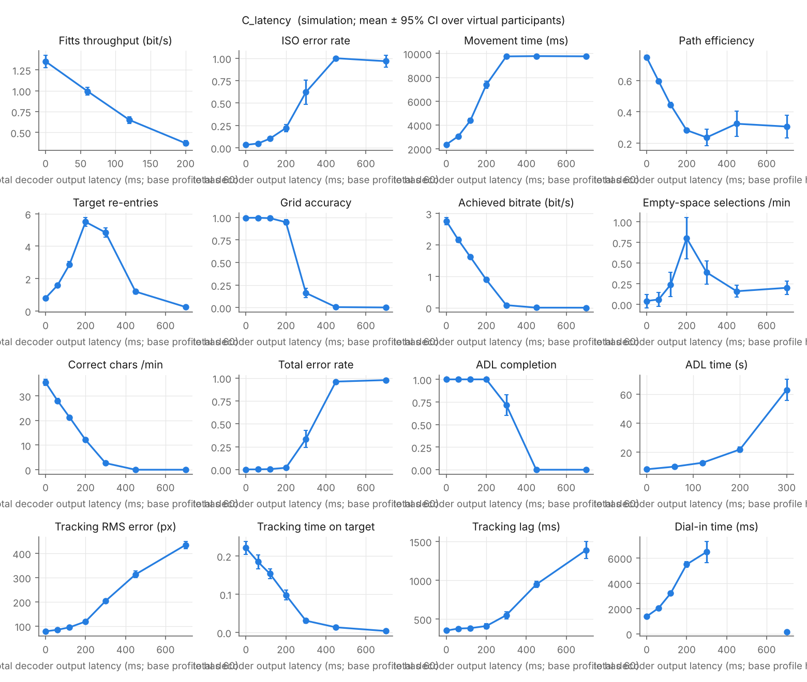
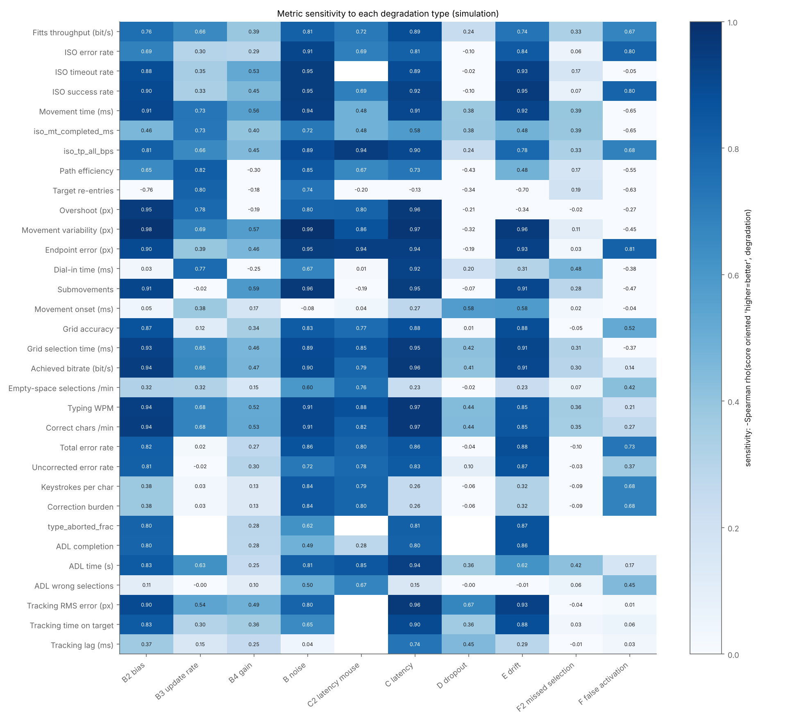

# Executive summary

**NeuroMetric** is research and evidence infrastructure for measuring what people actually
accomplish through brain-computer interfaces (BCIs), assistive technology (AT) and home
neurorehabilitation devices. It works *downstream* of the device: it never decodes neural signals,
controls a device or changes stimulation. It measures functional performance through ordinary,
authorised input paths (pointer, switch, dwell, keyboard), captures consented aggregate real-world
use and care-partner assistance, and packages the evidence with an audit trail.

**What was done in this session (all inside `neurometric/` on branch
`claude/neurometric-platform-vvzijh`; Concord itself was not modified):**

* Seven parallel research investigations (regulatory and trials, competitors, instruments and
  licensing, datasets, funding and collaborators, prospects and neuromodulation, platforms and
  timing) and an audit of Concord. Twenty-eight playbook claims were checked; several were
  corrected (Section 2).
* A working platform: canonical input events and adapters, a 17-task experimental battery
  (browser + simulator), a metrics engine, a closed-loop simulated-decoder harness with virtual
  users, a verified psychometrics engine, study management with consent, hash-chained audit,
  privacy-limited telemetry, questionnaires, exports, a sponsor portal, seven evidence-report types,
  a live degradation demo and a company website. About 290 Python tests, 75 unit and 14 end-to-end
  web tests, and automated accessibility scans pass.
* A computational study of roughly 20 experiments (about 1.2 million simulated trials across
  sweeps), an independent adversarial code review whose five critical findings were fixed before
  the final run, and one analysis of **real** public cursor-control data.
* Complete preparation for the first human studies (six-stage validation plan, statistical
  analysis plans, IRB drafts), commercialization (niche, model, prospects, outreach drafts,
  interview guides), funding (NIH STTR, Cozad, I-Corps drafts) and two manuscript drafts.

**What the computational research shows (simulation — not human evidence):**

1. Functional scores respond monotonically and detectably to simulated decoder degradation (noise,
   latency, drift, bias, update rate, false and missed selections): the playbook's experiment E4
   passes computationally.
2. **Communication rate (correct characters per minute), grid achieved bitrate, movement time and
   digital-activity time** give the best combination of sensitivity, monotonicity and simulated
   test–retest reliability. **Fitts throughput — the HCI standard — is a poor primary score for
   BCI-like users**: it is undefined (validity conditions fail) in up to 60% of degraded conditions
   and its simulated reliability is only 0.30–0.42 for a BCI-like user. Accuracy and error rates
   are near-useless as scores (ceiling, ICC ≈ 0).
3. Different impairments need different tasks: dropout and missed selections are nearly invisible
   to accuracy but visible in times and tracking error; false activations *shorten* movement time
   (premature selections) and are caught by error and endpoint measures.
4. Latency is the most damaging single parameter for velocity control: communication rate falls by
   a third at 120 ms and closed-loop control collapses near 300 ms.
5. An adaptive target-size staircase cut floor/ceiling effects (14%/15% vs 6%/44% and 40%/24% for
   fixed grids) and separated device levels better, at the cost of within-level ranking of people.
6. With absolute-agreement reliability, **two test–retest sessions cannot meet an ICC lower bound
   of 0.75**; the human study needs ≥3 sessions.

**Commercial verdict:** the implanted-BCI sponsor market alone is too concentrated (three active
US motor/communication sponsors in 2026, ~5–8 plausible by 2028). The most specific defensible
entry is **neutral, input-agnostic home-use evidence of digital independence**, sold first to
non-invasive BCI/AAC and home neuro-rehab makers with public evidence gaps, funded early by an NIH
STTR with a UIUC/Carle faculty PI. The closest substitute — the Shirley Ryan AbilityLab Digital
Assessment Interface (NCT07407725, Neuralink collaborator) — should be approached as a partner.
No modelled scenario breaks even by 2031 at hypothesised prices; grants and a lean team are
essential.

**What remains unvalidated:** everything in humans; all hardware; all prices and demand; all
compliance. Nothing was sent, submitted, published or released.

<!-- pagebreak -->

# 1. The problem and the opportunity

Device operation is not clinical benefit. A participant who can move a cursor may still be unable
to communicate independently, may need a care partner to set the system up every morning, or may
abandon the device after a month. Regulators and payers ask for evidence across that gap:

* FDA's implanted-BCI guidance asks for a clinically meaningful effectiveness endpoint, ideally
  validated, with home-use evaluation and attention to caregivers' ability to assist (validation
  is *recommended*; feasibility studies are exempt) [V] (FDA, https://www.fda.gov/media/120362/download).
* The iBCI Collaborative Community's 1 Oct 2026 consensus statement says a single existing measure
  is "unlikely … sufficient" and calls for a "shared measurement chain" from device performance to
  functional outcome to health outcome or care burden [V]
  (https://www.ibci-cc.org/s/iBCI-CC-Assessment-of-the-iBCI-Endpoints-for-Clinical-Utility.pdf).
* Registered sponsor feasibility studies list **safety** as the primary endpoint (Neuralink PRIME,
  Synchron COMMAND, Paradromics Connect-One) [V]; only 20 of 112 iBCI studies (17.9%) reported
  clinical outcomes (Dohle et al. 2025) [RF]. Caregiver burden is almost never a registered
  endpoint; the exception found is Cognixion's non-invasive ALS study (NCT07871071) [V].
* CMS–FDA's **RAPID** pathway (announced 23 Apr 2026; Federal Register 2026-16368, 11 Aug 2026;
  still proposed) and the NSCEB BCI paper (Sep 2026) push evidence toward coverage decisions [V].

**Measurement levels are not interchangeable** (KNOWLEDGE_BASE.md): neural signal → decoder →
application interaction → functional capacity → real-world performance → clinical effectiveness →
quality of life → economic impact. NeuroMetric measures levels 3–5 directly, captures level 6–7
inputs through licensed or original questionnaires, and treats level 8 only as hypothetical
scenarios. Correlation between adjacent levels is never presented as causation.

# 2. What the founder playbook got right — and what changed

| Claim | Finding (label) |
|---|---|
| Neuralink LINK pivotal approved 25 Nov 2026 | Company announcement only; not registered; ALS-only; endpoints not public **[CC]** |
| RAPID dates | Confirmed; still a proposal; scope likely excludes devices already in IDE study [V/INF] |
| iBCI-CC consensus, "shared measurement chain" | Confirmed verbatim; wording hedged [V] |
| FDA guidance "caregiver metrics" | Caregiver **safety and ability to assist**, not burden [V] |
| NCT07407725 lists no PI | **PI is named: Arun Jayaraman**; randomized crossover, 60 participants, 3 cohorts; DAI metrics + NASA-TLX, SUS, modified COPM, PIADS; no home-logging outcome [V] |
| ARC-EX home 510(k) Nov 2025 | Confirmed (K251821); original authorization was De Novo DEN240014 [V] |
| NCT06140706 is ONWARD's home study | Run by **VA Palo Alto** (ONWARD collaborator), not yet recruiting [V] |
| Bioness (PoNS), stroke clearance 2026 | Confirmed (K253061, 13 May 2026); Bioness now owned by Accelmed and owns PoNS [V] |
| IpsiHand's maker | Neurolutions merged into **Kandu, Inc.** (Apr 2025); Kandu runs an RWE study with Zarit [V] |
| NIH STTR PA-27-102, Phase I cap $314,363 | PA-27-102 exists (due 5 Jan / 5 Apr 2027); caps are IC-specific (NINDS $700k / $3.0M) [V] |
| SBIR/STTR available | Lapsed 1 Oct 2025; **reauthorized to 2031** by P.L. 119-83 (13 Apr 2026) [V] |
| RFA-NS-25-021 invites businesses | Not a small-business RFA; expired 29 Sep 2026 [V] |
| Apple BCI HID | iOS/iPadOS/visionOS 26+; usage page 0x60 still "Reserved"; no app access to BCI reports [V] |
| Prices $25–75K pilots, $100–400K/study-year | Remain **[HYP]**; $100–400K looks high for 2–15-participant feasibility studies [AE] |

Full ledger: EVIDENCE_LEDGER.md and docs/research/ledger_regulatory.csv.

# 3. Competitive landscape and niche

**Overlaps.** The SRAlab DAI (with Neuralink) tests the same digital primitives across eye
tracker, mouth joystick, EEG, voice and the Neuralink N1, with psychometric validation and a
normative cohort planned [V] — the highest threat and the most valuable partner. Sponsors'
in-house systems (Neuralink reports usage hours and its Webgrid score) [AE/V]; Mount Sinai's
Digital IADL scale and the iBCI-CC endpoints workgroup [RF/V]; and platform consolidation —
Signant acquired Ametris (ex-ActiGraph) on 14 May 2026 [V]; Thermo Fisher owns Clario and PPD
Evidera [AE]. Academic tools (BCI2000, BrainGate task software) are not Part 11 or payer-oriented.

**Gaps that remain:** no neutral, input-agnostic, home-capable functional battery with consented
real-world-use logging and care-partner assistance capture, operated under Part 11-oriented
controls, across sponsors and across AT and BCI inputs.

**Recommended niche (hypothesis):** home-use evidence of digital independence for communication
and computer-access devices — a periodic home battery that *implements* (or complements) the
field's chosen instruments rather than a rival index, plus aggregate use logging, care-partner
assistance diaries and an evidence package. First buyers: non-invasive BCI/AAC makers and home
neuro-rehab makers with public evidence gaps (Cognixion, Kandu/IpsiHand, ONWARD, Bioness/PoNS,
Mobia/Vivistim — tier 1), then smaller implant sponsors (Paradromics, Precision; Synchron on hold),
plus academic iBCI programs on grants. Falsifiers are listed in competitors.md (e.g., a free home
DAI adopted by ≥2 sponsors by end-2027).

<!-- pagebreak -->

# 4. What was built

```
inputs (mouse, touch, keyboard, switch scanning, dwell, gamepad; gaze / head / BCI via OS pointer;
        simulated; replayed; Concord recordings)
   -> canonical InputEvent (monotonic t_ms, task-space px, provenance, confidence only if real)
   -> task engine (17 tasks, seeded stimuli shared by browser and simulator)
   -> session upload -> server-side scoring (single source of truth; TS subset parity-tested)
   -> study database (consent, visits, devices, questionnaires, telemetry aggregates, deviations,
      queries, signatures, hash-chained audit)
   -> psychometrics + measurement chain -> evidence reports (PDF + JSON) and exports (manifest + SHA-256)
simulated decoder harness + virtual users -> same scoring path -> computational experiments
```

| Component | Key facts |
|---|---|
| Canonical events | 16 kinds incl. dwell, switch, assist, marker; validation, ordering and merge rules; conformance suite; Concord importer (verified on three genuine Concord recordings) |
| Task battery v1 | A1–A5 target acquisition, B1 steering, B2 tracking, C1 scrolling, D1 drag, E1 copy typing, E2 phrase selection, F1–F7 simulated digital ADLs; original tasks, not the DAI; specs in docs/science/TASK_BATTERY.md |
| Metrics | ISO 9241-411 effective throughput with validity flags, MacKenzie path measures, achieved bitrate, Wolpaw ITR (flagged), Soukoreff–MacKenzie text-entry taxonomy, tracking, scrolling, session/process measures |
| Simulator | velocity and position modes; gain, bias, asymmetry, white + AR(1) noise, drift, smoothing, quantization, update rate, latency + jitter, Markov dropout, loss of control + recovery, calibration decay, selection miss/latency/false activations; deterministic seeds |
| Virtual users | feedback-control (BCI-like), minimum-jerk submovement (mouse/head), gaze, switch scanning; populations with latent ability and day-to-day variation |
| Psychometrics | all ICC forms with F-based and generalized CIs, SEM/MDC, Spearman–Brown, Bland–Altman, CCC, known-groups, AUC (DeLong), responsiveness, effect sizes, mixed models, Little's MCAR, TOST |
| Study platform | SQLite (WAL), 6 roles, tenant isolation, demo/real separation enforced by triggers, consent scopes and withdrawal, retention purge, e-signatures with re-authentication, backup/restore with integrity check |
| Telemetry | aggregate-only allowlist (`nm.telemetry/1`); forbidden-field rejection; idempotency; overlap and clock-skew rules; consent gating; local review |
| Reports | functional assessment, device comparison, psychometric validation, home-use feasibility, sponsor summary, evidence package, payer evidence planning |
| Interfaces | participant battery and live degradation demo (web/), sponsor portal (portal/), website (site/) |

**Accessibility.** Keyboard-only and single-switch operation of setup and tasks, dwell, scanning,
large targets, high contrast, reduced motion, adjustable timing; 58 axe scans with zero
violations; reflow and text-spacing checks pass. Manual testing with screen readers, switches,
eye trackers and disabled users has **not** been done (docs/accessibility/ACCESSIBILITY.md).

**Privacy.** Never collected: keystroke content (outside predefined copy-typing phrases),
passwords, messages, screenshots, window titles, URLs or browsing history. Telemetry is opt-in,
visible, pausable, reviewable and aggregate-only; platform probes for Windows/macOS/Android exist
only as untested sketches; iOS deployments need sponsor exports (DATA_GOVERNANCE.md,
docs/research/platform_matrix.md).

**Quality and security.** Requirements, functional spec, traceability, FMEA risk assessment,
validation strategy with IQ/OQ/PQ drafts, five SOPs, STRIDE threat model, dependency audit (no
known vulnerabilities). These are technical foundations: **no Part 11 compliance, HIPAA
compliance, SOC 2 or validation is claimed.**

<!-- pagebreak -->

# 5. Computational research

All results below are simulations of virtual participants (labelled `synthetic=True`) except X1.
They characterise the measurement system under modelled input conditions and **cannot establish
reliability, validity or effectiveness in human users.** Full tables, figures and limitations:
EXPERIMENT_REGISTRY.md.

## 5.1 Calibration of the simulator

Virtual users were tuned to broad published ranges [PK]: mouse-like ≈4.5 bit/s ISO throughput with
≈3% errors and ≈17.5 WPM on an on-screen keyboard; dwell gaze ≈2.4 bit/s and ≈9.5 WPM; head pointer
≈1.7 bit/s; BCI-like `bci_good` ≈1.0 bit/s, grid achieved bitrate ≈2.3 bit/s and ≈29 correct
characters per minute; row-column switch scanning ≈3.3 WPM. Calibration targets ranges, not
devices.

## 5.2 Degradation sweeps (experiments B–F, E4 of the playbook)

Ten one-factor sweeps, 60 virtual participants × 2 sessions per level.



| Total latency (ms) | 0 | 60 | 120 | 200 | 300 | 450 |
|---|---|---|---|---|---|---|
| Correct chars/min | 35.4 | 28.0 | 21.3 | 12.1 | 2.7 | 0.0 |
| Grid achieved bitrate (bit/s) | 2.76 | 2.16 | 1.62 | 0.89 | 0.08 | 0.00 |
| Fitts throughput (bit/s; valid only) | 1.35 | 0.99 | 0.65 | 0.37 | undefined | undefined |
| ADL completion | 1.00 | 1.00 | 1.00 | 1.00 | 0.72 | 0.00 |

Noise (B): throughput 1.61 → 0.43 bit/s from 0 to 3× base noise and undefined beyond; grid bitrate
2.23 → 0.07; correct chars/min 29.6 → 0.2; ADL completion stays at ceiling until 4×.
Drift/calibration decay (E): correct chars/min 28.9 → 11.3 at index 1 and 0 at index 2.
Dropout (D): gradual — grid bitrate 2.15 → 1.78 and tracking RMS 84 → 140 px at 0.8 episodes/s,
while accuracy stays 1.0. False activations (F): accuracy 1.00 → 0.88 at 16/min, but ISO movement
time *falls* (3024 → 1996 ms) because premature selections end trials early — time alone would
misread this impairment as an improvement.



## 5.3 Which metrics are useful (experiment G)

| Verdict | Metrics | Evidence (mean sensitivity; baseline retest ICC) |
|---|---|---|
| **Recommended primary** | correct characters/min (E1); grid achieved bitrate (A4); movement time (A2, censored at timeout); ADL time (F) | 0.69; 0.89 — 0.67; 0.72 (always defined) — 0.56; 0.86 — 0.62; 0.64 |
| Useful secondary | path efficiency, submovements, overshoot, tracking RMS, dial-in time | reliable (0.76–0.89) but non-monotone for some impairments (gain, dropout) |
| Use with caution | Fitts throughput | sensitive but undefined in up to 60% of degraded conditions; retest ICC 0.30–0.42 for BCI-like users even with 32 trials |
| Not recommended as scores | accuracy, error rates, wrong selections, false-activation counts, ADL completion | ceiling/floor; retest ICC ≈ 0–0.2; completion is a functional *outcome* to report, not a sensitive score |
| Fails | target re-entries (non-monotone: severe impairment prevents reaching the target); tracking lag (insensitive except to latency) | — |

## 5.4 Reliability and test length (experiment I)

60 virtual participants with latent ability and day-to-day variation, 2 sessions, 4–32 trials.

| Metric (bci_good) | 4 | 8 | 16 | 32 trials |
|---|---|---|---|---|
| Movement time | 0.79 | 0.86 | 0.82 | 0.94 |
| Path efficiency | 0.74 | 0.85 | 0.88 | 0.93 |
| Grid achieved bitrate | 0.64 | 0.62 | 0.77 | 0.90 |
| Fitts throughput | undefined | undefined | 0.42 | 0.30 |

Mouse-like users reach ICC ≈0.9 for throughput; BCI-like users do not. These are upper bounds:
real between-day variation is likely larger.

## 5.5 Responsiveness (K), adaptive testing (H), modality comparison (L), variance (M), missing data (N)

* **Responsiveness.** When half of 100 virtual participants received an improved decoder, change
  scores separated improved from stable participants with AUC 1.00 (submovements), 0.99 (movement
  time), 0.95 (correct chars/min) and 0.93 (grid bitrate). 73% of improved participants exceeded
  the movement-time MDC95 versus 0% of stable ones. MDC is statistically detectable change, not an
  MCID.
* **Adaptive difficulty.** A 2-down/1-up target-size staircase had 14% floor / 15% ceiling versus
  6%/44% (fixed 100 px) and 40%/24% (fixed 40 px), and the best separation of adjacent device
  levels (minimum AUC 0.71 vs 0.45 and 0.51) — but weaker within-level ranking of people (ρ 0.29
  vs 0.42).
* **Cross-modality.** Grid bitrate (bit/s): mouse 6.86, gaze 3.66, head pointer 2.44, BCI good
  2.22, BCI moderate 1.15, switch scanning 0.88, BCI poor 0.11. Metrics defined for every modality
  ranked modalities consistently (Kendall τ 0.86–0.93 among grid bitrate, grid time and ADL time).
  Fitts throughput is undefined for scanning; dwell time sits inside movement time — compare
  within selection method. **A faster scan (0.6 s) was worse than 1 s** (accuracy 0.79 vs 0.99)
  because simulated reaction times (~450 ms) land late.
* **Person vs device.** Over a deliberately wide range of decoder quality, device explained
  60–97% of variance in most metrics; movement onset was the most person-related (23%). The split
  depends on the design ranges.
* **Missing data.** Random missingness biased movement time by < 50 ms; abandoning a session after
  a slow trial biased it by +185 to +782 ms — record reasons for incompleteness and pre-specify
  sensitivity analyses.

## 5.6 Engineering verification (A, O, P, Q, R, S) and real data (X1)

* **Input timing (A, headless Chromium):** 2000/2000 injected pointer moves recorded with no drops,
  duplicates or ordering errors; a 1 kHz stream of 33,377 events, 0 drops; merged multi-stream
  timeline passes the Python integrity check. Headless timing is not physical latency.
* **Event processing (S):** browser ≈0.055 ms dispatch→event, ≈8.5 ms to next frame; Python
  validates ≈2 million events/s and scores a 60-trial session in ≈90 ms; JSON round-trips are
  byte-identical.
* **Telemetry integrity (O):** 32/32 fault-injection tests pass (duplicates, conflicts, overlaps,
  clock skew, forbidden content, consent states, hash mismatch).
* **Reproducibility (P):** bit-identical results in-process vs worker pool; different seeds differ.
* **Accessibility (Q):** 0 axe violations across web battery, portal and website.
* **Statistics (R):** all six Shrout & Fleiss ICCs reproduced exactly; ICC values match pingouin to
  1e-10; 86/86 coverage checks pass. Finding: the standard McGraw–Wong CI for ICC(A,1) covers only
  78–92% when sessions differ systematically; NeuroMetric adds a generalized CI with ≈95% coverage.
* **Real data (X1):** NLB MC_RTT (DANDI:000129, CC-BY-4.0; one macaque, hand-controlled cursor):
  541 reaches ingested as canonical events; median reach time 1110 ms (includes hold), median path
  efficiency 0.866, effective throughput ≈1.95 bit/s. Demonstrates the pipeline on real behaviour;
  not BCI control and not a clinical population.

## 5.7 Limitations of the computational work

No physiology; one control law per modality; users do not adapt strategy (e.g., simulated mouse
users keep clicking without verification under latency, producing 52–95% errors above 120 ms
where real users would slow down); reliability estimates are upper bounds; calibration is to
broad ranges from memory [PK]; scanning ignores anticipation; gaze ignores blinks and head motion.
An independent adversarial review found five critical defects (ability scaling, invalid throughput
averaging, session clock, scanning population, typing clock); all were fixed and all results
regenerated (docs/review/).

<!-- pagebreak -->

# 6. Clinical validation pathway

The founder cannot be PI (UIUC policy RP-19: student employees may not serve as PI) — a faculty PI
is needed for every stage.

| Stage | Design | n | Key pre-specified criterion |
|---|---|---|---|
| 1 Able-bodied controlled testing | battery with 3 inputs | 42 | valid-trial lower 95% bound ≥ 0.90; Fitts R² ≥ 0.80 |
| 2 Modality comparison | 4 inputs, balanced Latin square | 24 | Holm-adjusted contrasts on achieved bitrate (power 0.91 at d_z = 0.8) |
| 3 Test–retest | familiarisation + 4 sessions | 60 (50 completers) | generalized-CI lower bound of ICC(A,1) ≥ 0.75 for 4 primary scores |
| 4 AT users (ALS, SCI, stroke) | known-groups, convergent validity, reliability | 45 | AUC ≥ 0.70; ≥ 75% of validity hypotheses confirmed; floor ≤ 15% |
| 5 Home-use feasibility | 2 weeks, aggregate logging + diaries | 5 dyads | usable logs ≥ 4/5; ≥ 80% of days complete |
| 6 Neural-interface / rehab users | partner protocol | — | descriptive |

Recommended primary scores for Stages 3–4, informed by the simulation: correct characters per
minute, grid achieved bitrate, movement time (censored) and ADL time — with Fitts throughput
secondary. Convergent anchors: NASA-TLX and SUS (free); PROMIS, QUEST, PIADS, COPM, Zarit after
licensing. No MCID is defined without anchor-based clinical evidence. Documents:
CLINICAL_VALIDATION_PLAN.md, docs/clinical/, docs/irb/ (all "DRAFT — not submitted").

# 7. Commercialization

* **Concentration:** 3 active US motor/communication iBCI sponsors; ~5–8 by 2028; excluding
  Neuralink leaves 3–7 possible buyers worth ≈$0.4–0.9M/yr at 100% penetration [HYP].
* **Bottom-up market (customers, not patients):** ≈42 plausible initial customers in 2027 rising
  to ≈80 in 2031 across segments; revenue pool ≈$2.4–5.0M/yr at hypothesised prices [HYP].
* **Scenarios [HYP]:** A small software company — 2029 revenue $0.38M, capital $1.6M (2027–31);
  B sponsor-funded infrastructure — $0.84M, $3.2M; C broad evidence platform — $1.44M, $11.8M;
  D rehab & AT expansion — $1.00M, $5.1M. **No scenario reaches operating break-even by 2031.**
* **Sequencing:** 90-day gate (≥2 LOIs, ≥20 interviews, academic STTR partner) → 2027 STTR
  Phase I + pilots with non-invasive BCI/AAC and home-neuromod makers → 2028 Part 11 validation,
  SOC 2 readiness, implant-sponsor study-years → 2029+ rehab-provider subscriptions and payer
  evidence work with HEOR partners.
* **Pricing hypotheses to test:** $25–75K pilots look plausible; per-study-year pricing at the
  high end fits pivotal, not feasibility, studies. Comparables: OpenClinica ≈$36–45K/yr per study
  [V]; Compass AT software $179 [V]; EDC year-1 $10–50K small studies [AE].

Materials: COMMERCIALIZATION.md, docs/commercial/ (one-pager, pilot proposal, academic proposal,
pricing, payer evidence matrix, outreach drafts — not sent, pipeline, discovery plan, deck outline,
data-room structure), docs/research/interview_guides.md, prospects.csv.

# 8. Funding

NIH STTR PA-27-102 (5 Jan / 5 Apr 2027; NINDS caps $700k Phase I / $3.0M Phase II) with a faculty
PI who may remain university-employed; NSF requires the PI to be ≥51% company-employed. Cozad 2027
(healthcare prizes need a Carle Illinois medical student; university takes no IP); Illinois I-Corps
(5 Feb 2027); NIDILRR SBIR Phase I ($100k; next realistic cycle ~Dec 2027); Illinois DCEO match
(up to $75k / $250k); DoD ALSRP clinical outcomes award (watch FY27). Drafts: docs/grants/.

# 9. Collaborators (no contact made)

SRAlab DAI team (PI Arun Jayaraman; registry contact only); Yuan Yang (Illinois–Carle JNERL) as
faculty PI; iBCI-CC Clinical Study Endpoints workgroup (co-leads Mariska Vansteensel, Vivek Pinto);
Mount Sinai Digital IADL team (David Putrino, Abbey Sawyer, Adam Fry); Melanie Fried-Oken (OHSU);
DRES and Carle Illinois; Catherine Lang (WashU); Leigh Hochberg (BrainGate). Details and draft
messages: docs/research/collaborators.md, docs/commercial/OUTREACH_DRAFTS.md.

# 10. Risks

| Risk | Mitigation / test |
|---|---|
| SRAlab DAI becomes the free standard | partner (implement, extend home use, AT inputs); never build a rival index; playbook E1 |
| Sponsors keep evidence in-house | target makers with public evidence gaps first; E2 decision rule |
| Measures fail in humans (reliability, ceiling) | simulation-informed primary scores; ≥3 retest sessions; adaptive option |
| iOS-only deployments block logging | sponsor export agreements; app-scoped battery; E6 |
| Licensing of instruments | licensing pack; original questionnaires labelled unvalidated |
| Founder bandwidth / student status | faculty PI, STTR structure, I-Corps, advisors |
| IP ownership (Concord, UIUC) | Landuyt IP Clinic and OTM disclosure before incorporation |
| Over-claiming | evidence labels everywhere; no compliance or clinical claims |

# 11. Remaining actions

**Requires the founder:** read the core field documents; book the Landuyt IP Clinic and file an
OTM disclosure; review and send the SRAlab, Yuan Yang and iBCI-CC messages; run 15–20 discovery
interviews before the 25 Feb 2027 gate; secure a faculty PI and submit the Stage 1 IRB; complete
CITI training; acquire Stage 1–2 devices and build the latency bench; send licensing inquiries;
recruit a Carle Illinois medical student for Cozad; apply to I-Corps; re-verify [UNR] items;
replace the website contact address; decide on any open release.

**Can still be done computationally:** unit tests for the remaining simulator parameters; realistic
demo trajectories in the seeded demo study; adaptive (strategy-changing) virtual users; latency ×
noise interaction grids; Wobbrock–Myers error alignment; richer server-side scoring for tasks B–D;
MFA/SSO and external audit anchoring; calibration of the simulator against licensed BCI kinematic
datasets.

# 12. Key sources

* FDA. Implanted BCI Devices for Patients with Paralysis or Amputation (2021). https://www.fda.gov/media/120362/download
* FDA. Digital Health Technologies for Remote Data Acquisition in Clinical Investigations. https://www.fda.gov/regulatory-information/search-fda-guidance-documents/digital-health-technologies-remote-data-acquisition-clinical-investigations
* FDA. PFDD guidance series (COA). https://www.fda.gov/drugs/development-approval-process-drugs/fda-patient-focused-drug-development-guidance-series-enhancing-incorporation-patients-voice-medical
* 21 CFR Part 11. https://www.ecfr.gov/current/title-21/chapter-I/subchapter-A/part-11
* FDA Medical Device Development Tools. https://www.fda.gov/medical-devices/medical-device-development-tools-mddt
* iBCI-CC. Consensus Statement for the Assessment of iBCI Endpoints for Clinical Utility (1 Oct 2026). https://www.ibci-cc.org/s/iBCI-CC-Assessment-of-the-iBCI-Endpoints-for-Clinical-Utility.pdf
* CMS/FDA RAPID. https://www.federalregister.gov/documents/2026/08/11/2026-16368/medicare-program-regulatory-alignment-for-predictable-and-immediate-device-rapid-coverage-pathway
* NSCEB BCI issue paper (Sep 2026). https://www.biotech.senate.gov/wp-content/uploads/2026/09/NSCEB-BCI-Issue-Paper-Final.pdf
* Health Affairs Forefront, Medicare and BCIs (2026). https://www.healthaffairs.org/content/forefront/unlocking-future-medicare-and-brain-computer-interfaces
* ClinicalTrials.gov NCT07407725. https://clinicaltrials.gov/study/NCT07407725
* Sawyer et al. J Neural Eng 2026, doi:10.1088/1741-2552/ae9eee
* SBIR/STTR reauthorization, P.L. 119-83. https://www.govinfo.gov/content/pkg/PLAW-119publ83/html/PLAW-119publ83.htm
* Signant acquires Ametris. https://signanthealth.com/company/news/signant-health-acquires-ametris
* Soukoreff & MacKenzie 2004, Int J Hum-Comput Stud 61:751–789 (effective throughput) [PK formula; DOI verified in methods_references.md]
* Soukoreff & MacKenzie 2003, CHI (text-entry error taxonomy) [PK]
* MacKenzie, Kauppinen & Silfverberg 2001, CHI (path accuracy measures) [PK]
* Koo & Li 2016, J Chiropr Med 15:155–163, doi:10.1016/j.jcm.2016.02.012
* Shrout & Fleiss 1979, Psychol Bull 86:420–428; McGraw & Wong 1996, Psychol Methods 1:30–46 [PK]
* Willett et al. 2019, Sci Rep (feedback-control model of BCI users) [PK]
* O'Doherty et al., MC_RTT, DANDI:000129, doi:10.48324/dandi.000129/0.241017.1444 (CC-BY-4.0)
* Anwyl-Irvine et al. 2021, Behav Res Methods (browser timing) [RF]
* UIUC Landuyt Center: Cozad rules https://landuyt.illinois.edu/programs/cozad/rules ; IP Clinic https://landuyt.illinois.edu/programs/ipclinic

Further sources with access dates and labels are in docs/research/*.md and *.csv.
